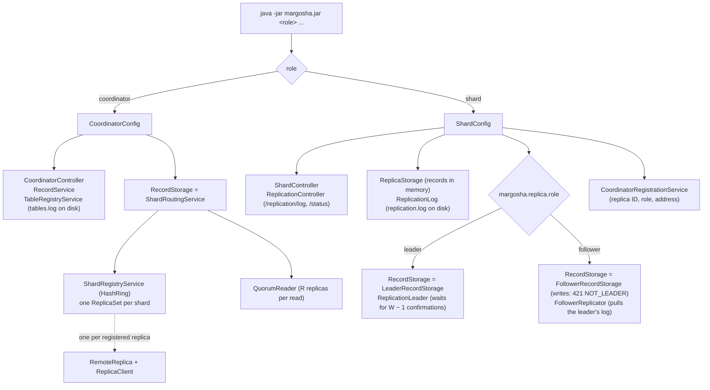
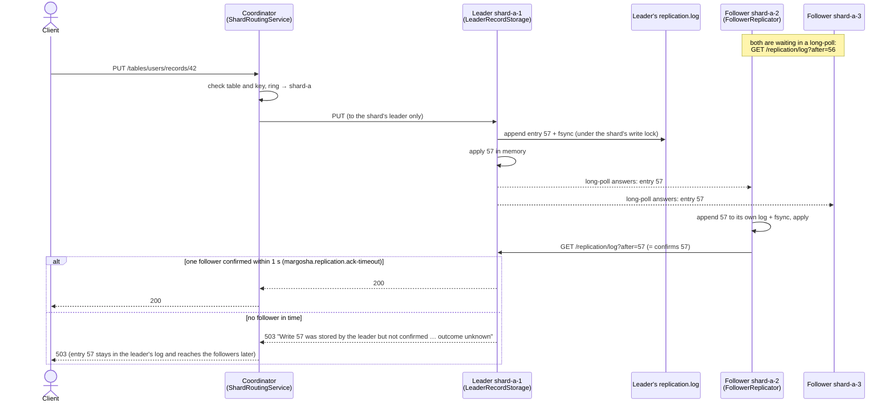
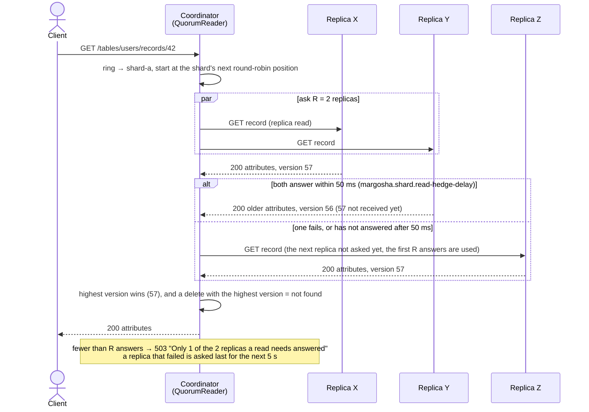
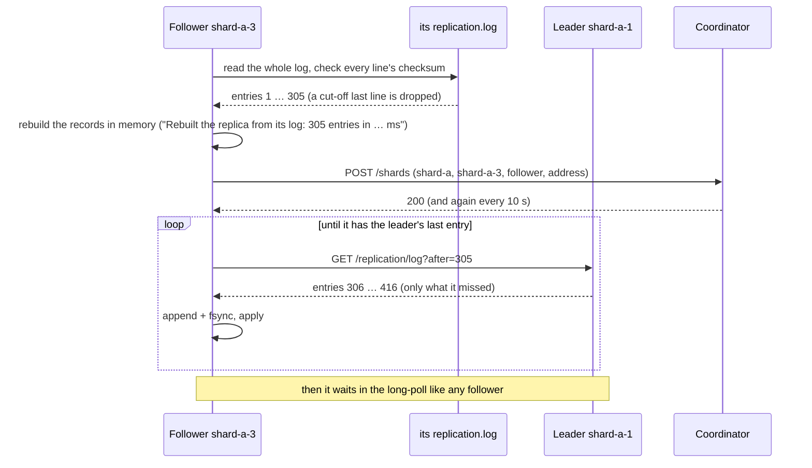
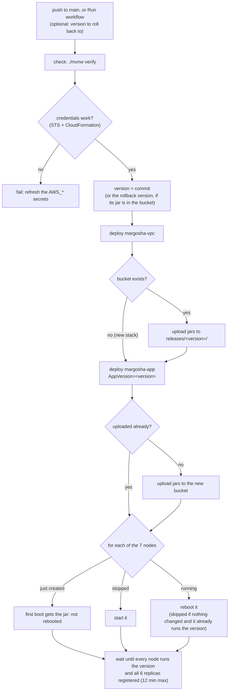

# Milestone 3: Replicated, durable store

**Environment:** AWS Academy Learner Lab, region `us-east-1`, account role `voclabs`, instance profile `LabInstanceProfile`.

Each shard is now a **replica set of 3 nodes**: a leader and two followers. A write goes to the shard's leader, which
appends it to a log on its disk and waits until one follower has stored it too before it answers (W = 2). A read asks
2 of the 3 replicas and returns the newest answer (R = 2). Because W + R > N, a read always reaches at least one replica
that has the latest confirmed write. Every replica keeps its log on its own disk and rebuilds its records from it when
it starts, so the data survives reboots, deploys and the end of a lab session.

```
                        internet (only OperatorCidr: API 8080 + SSH 22)
 ┌──────────────── VPC 10.0.0.0/16 (margosha-vpc) ──────────────────────────────────────────────┐
 │  public subnet (us-east-1a):   coordinator (t3.micro)      YCSB client (t3.small, only        │
 │                                     │ 8080                  while benchmarking)               │
 │              ┌──────────────────────┴─────────────────────────┐                               │
 │  private A (us-east-1a)                          private B (us-east-1b)          no internet  │
 │    shard-a-1  LEADER of shard A                    shard-a-2  follower of A                   │
 │    shard-a-3  follower of A                        shard-b-1  LEADER of shard B               │
 │    shard-b-2  follower of B                        shard-b-3  follower of B                   │
 │      each replica: replication.log on its own gp3 disk (/var/lib/margosha)                    │
 │              └──── S3 gateway endpoint: AL2023 packages + artifacts bucket ───────────────────┼──► S3
 └───────────────────────────────────────────────────────────────────────────────────────────────┘
 replicas accept 8080 only from the coordinator and from each other (replication); SSH only from the coordinator
 GitHub Actions ──► CloudFormation (margosha-vpc, margosha-app, AppVersion=<commit>)
                ──► s3://margosha-artifacts-<account-id>/releases/<commit>/
```

Each shard has replicas in both private subnets, and the two leaders are in different availability zones.

## What's in M3

| Part | Document | Code / template |
|---|---|---|
| Decisions: N / W / R, how replicas sync, log structure, ordering, write acknowledgement | [ADR 0007](adr/0007-n-w-r-values.md), [0008](adr/0008-replica-synchronisation.md), [0009](adr/0009-log-structure.md), [0010](adr/0010-ordering-guarantees.md), [0011](adr/0011-write-acknowledgement.md) | — |
| Replication: replica sets, write path, log and versions, followers and resync, quorum reads, failures | [m3/replication.md](m3/replication.md) | [app/node](app/node) (`shard.replication`, `coordinator.replica.QuorumReader`) |
| API: replica registration with ID and role, versioned replica reads, `/replication/log`, `/replication/status`, `421 NOT_LEADER`, `503` "outcome unknown" | [openapi.yaml](app/api/src/main/resources/openapi.yaml) | [app/api](app/api) |
| Application stack: coordinator + 6 replicas, versioned releases | [checks on AWS](m3/aws_checks/README.md) | [margosha-app.yaml](cfn/margosha-app.yaml) |
| Pipeline: versions, rollback, 7 nodes, credential check | [below](#deploy-pipeline-in-m3), [Deploy pipeline](M2.md#deploy-pipeline) | [pipeline.yml](.github/workflows/pipeline.yml) |
| Checks on AWS: placement, replication, failures, durability | [m3/aws_checks/](m3/aws_checks/README.md) | — |
| Benchmark: warm-up + 3 measured runs, comparison with M2 | [procedure.md](m3/benchmark/procedure.md), [results.md](m3/benchmark/results.md) | [run-benchmark.sh](m3/benchmark/run-benchmark.sh) |
| End-to-end: fresh deploy from the pipeline | [m3/end_to_end/fresh-deploy.md](m3/end_to_end/fresh-deploy.md) | — |

## How to bring it up

As in M2, everything is deployed by the pipeline; no console steps. The steps are the same:

**1. Credentials.** Start the lab, paste the credentials into `~/.aws/credentials` and into the repository secrets
([details](M2.md#refresh-the-secrets-every-new-lab-session)). Repeat this in every new session.

**2. Deploy.** Push to `main`, or **Actions → pipeline → Run workflow** on `main`. The `deploy` job uploads the jars as
the commit's version, creates or updates `margosha-app` with `AppVersion=<commit>`, starts or reboots the 7 nodes, and
waits until all of them run that version and the coordinator has registered all 6 replicas (5–8 minutes). On a new
stack the nodes boot for the first time and are not rebooted.

**3. Open the API to your IP.** A new stack starts with the API closed. This adds two security group rules and replaces
nothing; it works the same on Windows (PowerShell) and macOS (Terminal):

Windows (PowerShell):
```powershell
aws configure set region us-east-1
$MY_IP = (Invoke-RestMethod https://checkip.amazonaws.com).Trim()
```

macOS (Terminal):
```bash
aws configure set region us-east-1
MY_IP=$(curl -s https://checkip.amazonaws.com)
```

```bash
aws cloudformation deploy --stack-name margosha-app --template-file cfn/margosha-app.yaml --parameter-overrides "OperatorCidr=$MY_IP/32" --no-fail-on-empty-changeset
```

**In a new lab session** the stacks are still there, and the lab starts all 7 nodes again. Each replica rebuilds its
records from its log and catches up with its leader; all 6 register by themselves. Only the secrets and, if your IP
changed, step 3 need to be redone. The coordinator gets a new public IP every session.

**Before pushing a template change**, check whether it replaces the nodes: 7 + 7 instances do not fit the lab's limit
of 9, and a replaced node loses its log. See
[Before pushing a template change](M2.md#before-pushing-a-template-change-will-it-replace-the-nodes).

**Run it on your machine** (no AWS), from `app/`: one coordinator and one shard of 3 replicas, each in its own terminal
and with its own data folder:

```bash
./mvnw verify                      # Windows: .\mvnw.cmd verify
```
```bash
java -jar node/target/margosha.jar coordinator --mode=sharded --server.port=8080 --margosha.data-dir=data/coordinator
```
```bash
java -jar node/target/margosha.jar shard --server.port=8081 --margosha.shard.id=shard-a --margosha.replica.id=shard-a-1 --margosha.replica.role=leader --margosha.data-dir=data/shard-a-1 --margosha.coordinator.url=http://localhost:8080 --margosha.shard.host=localhost
```
```bash
java -jar node/target/margosha.jar shard --server.port=8082 --margosha.shard.id=shard-a --margosha.replica.id=shard-a-2 --margosha.replica.role=follower --margosha.replica.leader-url=http://localhost:8081 --margosha.data-dir=data/shard-a-2 --margosha.coordinator.url=http://localhost:8080 --margosha.shard.host=localhost
```
```bash
java -jar node/target/margosha.jar shard --server.port=8083 --margosha.shard.id=shard-a --margosha.replica.id=shard-a-3 --margosha.replica.role=follower --margosha.replica.leader-url=http://localhost:8081 --margosha.data-dir=data/shard-a-3 --margosha.coordinator.url=http://localhost:8080 --margosha.shard.host=localhost
```
The coordinator logs `Registered replica shard-a-1 (leader)` and the two followers within a few seconds; the API is at
`http://localhost:8080`, and each replica's status at `http://localhost:808x/replication/status`. Stop a replica
(Ctrl+C) and start it again with the same command: it rebuilds from its `data/` folder and catches up. Delete the
`data/` folders to start empty (git ignores them). If a port is already taken (`Port 8080 was already in use`, for
example by a local web server), use other ports: change every `808x` in the four commands, including the ones in
`--margosha.coordinator.url` and `--margosha.replica.leader-url`.

## How to verify it

Run from the repo root, in one terminal window.

**1. Find the nodes.** `Ip` / `node_ip` prints a node's private IP (or another field) by its name, and
`Status` / `status` asks a replica for its replication status, through the coordinator, because the replicas are
private. The SSH key is the lab's `labsuser.pem` (**AWS Details → Download PEM**), in `~/.ssh/`.

Windows (PowerShell):
```powershell
aws configure set region us-east-1
$env:PYTHONUTF8 = '1'; [Console]::OutputEncoding = [Text.Encoding]::UTF8   # the logs have non-ASCII characters
$PEM = "$HOME\.ssh\labsuser.pem"
function Ip($name, $field = 'PrivateIpAddress') {
  aws ec2 describe-instances --filters "Name=tag:Name,Values=margosha-$name" "Name=instance-state-name,Values=running" `
    --query "Reservations[0].Instances[0].$field" --output text
}
function Status($ip) { ssh -i $PEM -o StrictHostKeyChecking=accept-new "ec2-user@$COORD_PUB" "curl -s -m 5 http://${ip}:8080/replication/status; echo" }
$COORD     = Ip coordinator InstanceId
$COORD_PUB = Ip coordinator PublicIpAddress
$API       = "http://${COORD_PUB}:8080"
$REPLICAS  = 'shard-a-1','shard-a-2','shard-a-3','shard-b-1','shard-b-2','shard-b-3' | ForEach-Object { Ip $_ }
"coordinator $COORD_PUB  replicas $REPLICAS"
```

macOS (Terminal):
```bash
aws configure set region us-east-1
PEM=~/.ssh/labsuser.pem; chmod 400 "$PEM"
node_ip() {
  aws ec2 describe-instances --filters "Name=tag:Name,Values=margosha-$1" "Name=instance-state-name,Values=running" \
    --query "Reservations[0].Instances[0].${2:-PrivateIpAddress}" --output text
}
status() { ssh -i "$PEM" -o StrictHostKeyChecking=accept-new "ec2-user@$COORD_PUB" "curl -s -m 5 http://$1:8080/replication/status"; echo; }
COORD=$(node_ip coordinator InstanceId)
COORD_PUB=$(node_ip coordinator PublicIpAddress)
API="http://$COORD_PUB:8080"
REPLICAS=$(for n in shard-a-1 shard-a-2 shard-a-3 shard-b-1 shard-b-2 shard-b-3; do node_ip $n; done | tr '\n' ' ')
echo "coordinator $COORD_PUB  replicas $REPLICAS"
```
It must print the coordinator's public IP and 6 private IPs, with no `None`.

**2. All 6 replicas registered with the coordinator.** The last 6 lines must be `Registered replica …` for shard-a-1 …
shard-b-3, after the last boot (the coordinator's log goes to its serial console, so no SSH is needed):

Windows (PowerShell):
```powershell
aws ec2 get-console-output --instance-id $COORD --latest --output text | Select-String "Registered replica" | Select-Object -Last 6
```

macOS (Terminal):
```bash
aws ec2 get-console-output --instance-id "$COORD" --latest --output text | grep -E "Registered replica" | tail -n 6
```

**3. The store works:** register a table, write a record, read it back, check a missing one:

Windows (PowerShell):
```powershell
Invoke-RestMethod -Method Post -Uri "$API/tables" -ContentType 'application/json' -Body '{"name":"users","partitionKey":"user_id"}' | ConvertTo-Json -Compress
Invoke-RestMethod -Method Post -Uri "$API/tables/users/records" -ContentType 'application/json' -Body '{"user_id":"42","name":"Anna","city":"Kyiv"}' | ConvertTo-Json -Compress
curl.exe -s "$API/tables/users/records/42"; ""
curl.exe -s "$API/tables/users/records/42/exists"; ""
curl.exe -s "$API/tables/users/records/nobody"; ""
```

macOS (Terminal):
```bash
curl -s -X POST "$API/tables" -H 'Content-Type: application/json' -d '{"name":"users","partitionKey":"user_id"}'; echo
curl -s -X POST "$API/tables/users/records" -H 'Content-Type: application/json' -d '{"user_id":"42","name":"Anna","city":"Kyiv"}'; echo
curl -s "$API/tables/users/records/42"; echo
curl -s "$API/tables/users/records/42/exists"; echo
curl -s "$API/tables/users/records/nobody"; echo
```
Expected: the table, the record twice (`user_id` 42, Anna, Kyiv), `exists: true`, and
`{"code":"RECORD_NOT_FOUND","message":"Record nobody not found in table users"}`. The data is on disk now, so after a
reboot or in a new session the table is still there: the first call then answers `409 TABLE_ALREADY_EXISTS`
(PowerShell shows it as an error; the other calls still work).

**4. Every follower has its leader's entries.** Ask the 6 replicas for their status:

Windows (PowerShell):
```powershell
foreach ($ip in $REPLICAS) { Status $ip }
```

macOS (Terminal):
```bash
for ip in $REPLICAS; do status "$ip"; done
```
Expected: one line per replica. Each leader (`"role":"leader"`) shows both of its followers in `followerPositions` at
its own `lastVersion`, and each follower's `lastVersion` is the same as its leader's. `lastVersion` is how many writes
the replica has; `entriesReceived` and `readsServed` count since the replica last started.

**The tests** (unit and integration, including the replication log, leader and followers, quorum reads and failures
with in-process replicas) run on every push in the pipeline's `check` job, and locally with `./mvnw verify` in `app/`.

More checks, with commands, expected outputs and screenshots:

| What | Where |
|---|---|
| The first M3 deploy and the lab's 9-instance limit | [m3/aws_checks/instance-limit.md](m3/aws_checks/instance-limit.md) |
| Deploy, registration, placement, a follower reaches its leader, the bench client cannot reach replicas | [m3/aws_checks/](m3/aws_checks/README.md) |
| Followers keep up; a restarted follower gets only what it missed; rebuild time | [replicas-in-sync.md](m3/aws_checks/replicas-in-sync.md), [missed-range.md](m3/aws_checks/missed-range.md), [rebuild-time.md](m3/aws_checks/rebuild-time.md) |
| One follower, both followers, the leader down | [one-follower-down.md](m3/aws_checks/one-follower-down.md), [both-followers-down.md](m3/aws_checks/both-followers-down.md), [leader-down.md](m3/aws_checks/leader-down.md) |
| Data survives an app-only deploy, and stopping and starting all instances | [data-survives-deploy.md](m3/aws_checks/data-survives-deploy.md), [data-survives-stop-start.md](m3/aws_checks/data-survives-stop-start.md) |
| Fresh deploy from the pipeline with only `margosha-vpc` present | [m3/end_to_end/fresh-deploy.md](m3/end_to_end/fresh-deploy.md) |
| Benchmark (YCSB workload A), compared with M2 | [m3/benchmark/results.md](m3/benchmark/results.md) |

**Benchmark** (workload A, 100,000 records, 200,000 operations, 8 threads, N = 3, W = 2, R = 2, version `2743bae`,
median of 3 runs): **1,015 ops/s**; READ avg / p95 / p99 3.7 / 6.7 / 14.6 ms, UPDATE 11.9 / 18.6 / 28.3 ms, no failed
operations. Against M2: writes take about 6 ms longer (every write is stored on the disks of the leader and a
follower), reads take the same, so throughput is about a third lower. To repeat it:
[m3/benchmark/procedure.md](m3/benchmark/procedure.md).

**Tear down:** the same as in M2 ([M2, How to verify it](M2.md#how-to-verify-it)). Deleting `margosha-app` also deletes the
7 nodes and their logs, so all data is lost.

## What changed since the previous milestone

- **Replication:** each shard is a replica set of a leader and two followers (N = 3). The leader orders the writes in
  its log; followers pull the log with long-polling and confirm with their next request. A write is confirmed when
  W = 2 replicas have it; a read asks R = 2 replicas and returns the highest version. Roles are fixed: there is no
  failover yet, so a shard without its leader cannot take writes. (ADRs 0007, 0008, 0010, 0011.)
- **Durability:** records are no longer only in memory. Each replica appends every write to `replication.log` and forces
  it to disk before it counts as stored, and rebuilds its records from the log on start; a follower then asks its leader
  only for the entries after its own last one. The coordinator keeps the table definitions on its disk too
  (`tables.log`). (ADR 0009.)
- **API:** replicas register with their replica ID and role; replica reads return the record's version; new replica
  endpoints `GET /replication/log` and `GET /replication/status`; a follower answers writes with `421 NOT_LEADER`; a
  write the leader stored but no follower confirmed answers `503` "outcome unknown". The client API is unchanged.
- **Infrastructure (`margosha-app`):** 6 replicas instead of 2 shards, placed over both private subnets with the leaders
  in different AZs; replicas may reach each other on 8080 (replication); the quorums are stack parameters passed to
  every node as tags; the data folder `/var/lib/margosha` on each instance's disk. The new boot script replaced all
  nodes on the first M3 deploy ([instance limit](m3/aws_checks/instance-limit.md)).
- **Delivery:** every deploy is a **version** (the commit) kept in the bucket and passed to the stack as `AppVersion`, so
  every commit rolls the nodes out and an earlier version can be deployed again
  ([roll back](M2.md#roll-back-to-an-earlier-version)). The deploy job checks all 7 nodes and all 6 registrations, and its
  credential check catches cancelled lab credentials.
- **Benchmark:** the M3 procedure adds a store reset (the data now survives reboots), a discarded warm-up run and
  3 measured runs, and runs the YCSB client in unlimited CPU credit mode
  ([why](m3/benchmark/results.md#what-was-benchmarked)).
- **Checks:** every check on AWS has its own file with commands and screenshots in [m3/aws_checks/](m3/aws_checks/README.md).
- **Budget:** 7 `t3.micro` nodes instead of 3 (about twice the hourly cost, only during work sessions), still standard
  credits and no NAT Gateway; the YCSB client only while benchmarking. With the client the stack runs 8 instances, close
  to the lab's limit of 9.

## How replication works

More detail, with the log format and the failure cases: [m3/replication.md](m3/replication.md).

### Which classes exist in each role



### A write (W = 2)



### A read (R = 2)



### A replica starts (reboot, deploy, new lab session)



A leader starts the same way: it rebuilds from its own log and registers; its followers find it again by themselves.

### Deploy pipeline in M3



### What clients see when replicas are down

| Down in a shard | Writes | Reads | Checked on AWS |
|---|---|---|---|
| nothing | work | work | — |
| one follower | work (the other follower confirms) | work (the third replica is asked instead, after at most 50 ms) | [one-follower-down.md](m3/aws_checks/one-follower-down.md) |
| both followers | `503` after the 1 s ack timeout, outcome unknown (the leader kept the write) | `503`: only the leader answers | [both-followers-down.md](m3/aws_checks/both-followers-down.md) |
| the leader | `503 Replica … did not answer` (no failover yet) | work, from the two followers | [leader-down.md](m3/aws_checks/leader-down.md) |

The other shard is never affected.