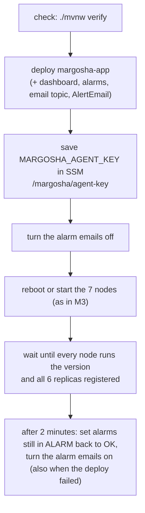

# Milestone 4: Operations (monitoring, tracing, conflict resolution, agent access)

**Environment:** AWS Academy Learner Lab, region `us-east-1`, account role `voclabs`, instance profile `LabInstanceProfile`.

M4 makes the M3 store something you can watch and run. Every node measures its requests, and the coordinator sends
these metrics, its own and the replicas', to CloudWatch once a minute. A dashboard shows them, and 17 alarms send an
email when a node is down, answers are slow or fail, or a follower falls behind. Every request carries a trace ID that can be
followed through the coordinator and the replicas in the logs. Every write gets a record version, and reads keep the
newest copy (Last-Write-Wins). An AI agent such as Claude can use the store through an MCP server, with only four
record operations on allowed tables.

```
 laptop: Claude ──stdio──► margosha-mcp.jar ──HTTP + X-Agent-Key──┐
                                                                   ▼
 ┌──────────────── VPC 10.0.0.0/16 (margosha-vpc) ─────────────────────────────────────────────┐
 │  public subnet:   coordinator ── reads every replica's metrics once a minute ──┐             │
 │                        │ 8080                                                  │             │
 │  private subnets: shard-a-1 … shard-b-3 (as in M3, no internet)                 │             │
 └────────────────────────┼────────────────────────────────────────────────────────┼─────────────┘
                          │ its own + the replicas' metrics (LabRole)               │
                          ▼                                                         │
            CloudWatch: namespace MargoshaDB, dashboard, 17 alarms ──► SNS ──► alert email
            SSM Parameter Store: /margosha/agent-key (read by the coordinator when it starts)
 GitHub Actions ──► CloudFormation (margosha-app: + dashboard, alarms, email topic) + SSM (agent key)
```

No instance was added: the stack still runs 7 nodes (8 with the bench client), and the M4 deploy updated them in place.

## What's in M4

| Part | Document | Code / template |
|---|---|---|
| Decisions: metrics, monitoring stack, SLO values, agent boundaries, record versioning, logs and trace IDs, read latency limit | [ADR 0012](adr/0012-metrics.md), [0013](adr/0013-monitoring-stack.md), [0014](adr/0014-slo-values.md), [0015](adr/0015-mcp-agent-boundaries.md), [0016](adr/0016-record-versioning.md), [0017](adr/0017-logging-and-trace-ids.md), [0018](adr/0018-read-latency-limit.md) | — |
| Metrics, dashboard and alarms | [m4/metrics.md](m4/metrics.md) | [app/node](app/node) (`common.metrics`, `coordinator.metrics.ReplicaMetricsRelay`), [margosha-app.yaml](cfn/margosha-app.yaml) |
| Structured logs, trace IDs and the timeline helper | [m4/tracing/tracing.md](m4/tracing/tracing.md) | `common.filter.TraceIdFilter`, [m4/tracing/commands/](m4/tracing/commands/) |
| Record versions and Last-Write-Wins | [m4/lww.md](m4/lww.md) | `shard.replication`, `coordinator.replica.LastWriteWins` |
| MCP server for AI agents | [m4/mcp/mcp.md](m4/mcp/mcp.md) | [app/mcp-tools](app/mcp-tools), [app/mcp-server](app/mcp-server) |
| API: `X-Trace-Id` on every operation, record versions in replica answers, `X-Agent-Key` | [openapi.yaml](app/api/src/main/resources/openapi.yaml) | [app/api](app/api) |
| Pipeline: alert email, agent key in SSM, alarm emails muted during a deploy | [Deploy pipeline in M4](#deploy-pipeline-in-m4) | [pipeline.yml](.github/workflows/pipeline.yml) |
| Checks on AWS | [m4/checks/](m4/checks/), [traces.md](m4/tracing/traces.md), [mcp_session.md](m4/mcp/mcp_session.md) | — |

## How to bring it up

As in M3, the pipeline deploys everything. M4 adds two settings in GitHub and one email to confirm.

**1. Credentials.** Start the lab, paste the credentials into `~/.aws/credentials` and into the repository secrets
([details](M2.md#refresh-the-secrets-every-new-lab-session)). Repeat this in every new session.

**2. Once: the alert email and the agent key.** The alarms send their emails to the address in the GitHub variable
`MARGOSHA_ALERT_EMAIL`. The MCP server and the coordinator share a key, kept in the secret `MARGOSHA_AGENT_KEY`. The
pipeline copies it to SSM Parameter Store for the coordinator. Neither value is in the repository.

Windows (PowerShell):
```powershell
gh variable set MARGOSHA_ALERT_EMAIL --body "<your email>"
$AGENT_KEY = [Convert]::ToBase64String((1..32 | ForEach-Object { Get-Random -Maximum 256 }))
$AGENT_KEY | gh secret set MARGOSHA_AGENT_KEY
```

macOS (Terminal):
```bash
gh variable set MARGOSHA_ALERT_EMAIL --body "<your email>"
AGENT_KEY=$(openssl rand -base64 32)
echo "$AGENT_KEY" | gh secret set MARGOSHA_AGENT_KEY
```

Keep `$AGENT_KEY` for step 6. If you lose it, read it back from SSM after a deploy (step 6 shows how).

**3. Deploy.** Push to `main`, or **Actions → pipeline → Run workflow** on `main`, as in M3. Besides the nodes, the
deploy creates or updates the dashboard, the 17 alarms and the email topic, and saves the agent key in SSM. While the
nodes restart, the alarm emails are off, so a deploy doesn't send node-down emails.

**4. Once per new stack: confirm the alert email.** AWS sends "AWS Notification - Subscription Confirmation" to the
address from step 2. Click **Confirm subscription**. Until then the alarms work, but no email is sent.

**5. Open the API to your IP**, with the same commands as in M3
([How to bring it up, step 3](M3.md#how-to-bring-it-up)). A new stack starts with the API closed.

**6. Connect Claude to the store** (optional). Build the MCP server's jar from `app/`, then register it in Claude Code
for your user. Use `$API` from [How to verify it, step 1](#how-to-verify-it). The full guide, also for Claude
Desktop, is in [m4/mcp/mcp.md](m4/mcp/mcp.md).

Windows (PowerShell), from the repository root:
```powershell
cd app; .\mvnw.cmd -pl mcp-server -am package -DskipTests; cd ..
$AGENT_KEY = aws ssm get-parameter --name /margosha/agent-key --with-decryption --query "Parameter.Value" --output text
claude mcp add --scope user margosha-db --env "MCP_COORDINATOR_URL=$API" --env "MCP_AGENT_KEY=$AGENT_KEY" --env "MCP_ALLOWED_TABLES=agent_notes" '--' java -jar "$PWD\app\mcp-server\target\margosha-mcp.jar"
```

macOS (Terminal), from the repository root:
```bash
(cd app && ./mvnw -pl mcp-server -am package -DskipTests)
AGENT_KEY=$(aws ssm get-parameter --name /margosha/agent-key --with-decryption --query "Parameter.Value" --output text)
claude mcp add --scope user margosha-db --env "MCP_COORDINATOR_URL=$API" --env "MCP_AGENT_KEY=$AGENT_KEY" --env "MCP_ALLOWED_TABLES=agent_notes" -- java -jar "$PWD/app/mcp-server/target/margosha-mcp.jar"
```

The agent may only use the table `agent_notes`. Register it once with a normal request:

```bash
curl -s -X POST "$API/tables" -H "Content-Type: application/json" -d "{\"name\":\"agent_notes\",\"partitionKey\":\"note_id\"}"
```

On Windows, use `curl.exe` instead of `curl`.

**In a new lab session** the stacks are still there, as in M3. Redo the secrets, step 5 if your IP changed, and step 6
with `claude mcp remove margosha-db --scope user` first, because the coordinator gets a new public IP.

**Before pushing a template change**, check that it replaces no node
([how](M2.md#before-pushing-a-template-change-will-it-replace-the-nodes)). The M4 changes to `cfn/margosha-app.yaml` only
touch the dashboard and the alarms.

**Run it on your machine** with the same commands as in M3 ([How to bring it up](M3.md#how-to-bring-it-up)). Without a
region set, no metrics are sent to CloudWatch, and everything else works as on AWS.

## How to verify it

Run from the repository root, in one terminal window.

**1. Find the nodes**, with the commands of M3 ([How to verify it, step 1](M3.md#how-to-verify-it)). They set `$PEM`,
`$COORD`, `$COORD_PUB`, `$API` and `$REPLICAS`.

**2. All 6 replicas registered, and the coordinator has the agent key:**

Windows (PowerShell):
```powershell
aws ec2 get-console-output --instance-id $COORD --latest --output text | Select-String "(Registered|Updated) replica|Agent requests"
```

macOS (Terminal):
```bash
aws ec2 get-console-output --instance-id "$COORD" --latest --output text | grep -E "(Registered|Updated) replica|Agent requests"
```

After the last boot there are 6 `Registered replica` lines (shard-a-1 … shard-b-3) and
`Agent requests: key set; allowed tables: [agent_notes]`.

**3. The store works, and a request can be followed by its trace ID.** Write and read a record, each with your own
trace ID. Each answer carries it back:

Windows (PowerShell):
```powershell
try { Invoke-RestMethod -Method Post -Uri "$API/tables" -ContentType 'application/json' -Body '{"name":"users","partitionKey":"user_id"}' | Out-Null } catch { $_.ErrorDetails.Message }
$RUN = Get-Date -Format HHmmss
$r = Invoke-WebRequest -UseBasicParsing -Method Post -Uri "$API/tables/users/records" -ContentType 'application/json' -Headers @{ 'X-Trace-Id' = "readme-write-$RUN" } -Body ('{"user_id":"m4-' + $RUN + '","name":"Anna"}')
"$($r.StatusCode) $($r.Headers['X-Trace-Id']) $($r.Content)"
$r = Invoke-WebRequest -UseBasicParsing -Uri "$API/tables/users/records/m4-$RUN" -Headers @{ 'X-Trace-Id' = "readme-read-$RUN" }
"$($r.StatusCode) $($r.Headers['X-Trace-Id']) $($r.Content)"
```

macOS (Terminal):
```bash
curl -s -X POST "$API/tables" -H 'Content-Type: application/json' -d '{"name":"users","partitionKey":"user_id"}'; echo
RUN=$(date +%H%M%S)
curl -s -i -X POST "$API/tables/users/records" -H 'Content-Type: application/json' -H "X-Trace-Id: readme-write-$RUN" -d "{\"user_id\":\"m4-$RUN\",\"name\":\"Anna\"}" | grep -i -e '^HTTP' -e '^x-trace-id' -e '^{'
curl -s -i "$API/tables/users/records/m4-$RUN" -H "X-Trace-Id: readme-read-$RUN" | grep -i -e '^HTTP' -e '^x-trace-id' -e '^{'
```

The write answers `201` and the read `200`, both with the trace ID that was sent and the record. Then print the read
as a timeline across the nodes. If it is missing, run it again after a few seconds:

Windows (PowerShell):
```powershell
.\m4\tracing\commands\trace.ps1 -TraceId "readme-read-$RUN"
```

macOS (Terminal), needs `jq`:
```bash
./m4/tracing/commands/trace.sh "readme-read-$RUN"
```

The timeline has the coordinator's `GET`, its calls to 2 replicas, and each replica's own `GET`, with their durations
([how to read it](m4/tracing/tracing.md#the-timeline-command)).

**4. The monitoring works.** The 17 alarms exist, are `OK` and have their actions on:

```bash
aws cloudwatch describe-alarms --alarm-name-prefix margosha-app- --query "MetricAlarms[].[AlarmName,StateValue,ActionsEnabled]" --output table
```

About 2 minutes after step 3, CloudWatch has the coordinator's metrics and the metrics of all 6 replicas:

Windows (PowerShell):
```powershell
aws cloudwatch list-metrics --namespace MargoshaDB --dimensions Name=role,Value=coordinator --recently-active PT3H --query "Metrics[].MetricName" --output text | ForEach-Object { $_ -split "\s+" } | Sort-Object -Unique
```

macOS (Terminal):
```bash
aws cloudwatch list-metrics --namespace MargoshaDB --dimensions Name=role,Value=coordinator --recently-active PT3H --query "Metrics[].MetricName" --output text | tr '\t' '\n' | sort -u
```

```bash
aws cloudwatch list-metrics --namespace MargoshaDB --metric-name margosha.replica.records.value --recently-active PT3H --query "Metrics[].Dimensions[?Name=='replica'].Value[]" --output text
```

The first command lists `margosha.errors.count`, `margosha.requests.count`, `margosha.requests.percentile.value` and
`margosha.shard.requests.count`. The second lists shard-a-1 … shard-b-3. The dashboard's link is a stack output:

```bash
aws cloudformation describe-stacks --stack-name margosha-app --query "Stacks[0].Outputs[?OutputKey=='DashboardUrl'].OutputValue" --output text
```

**5. An agent can use the store** (after step 6 of How to bring it up). `claude mcp list` shows `margosha-db` as
connected. In a Claude Code session started outside the repository, ask for example: "Create a note n1 with the text
hello in agent_notes, read it back, then delete it." A table other than `agent_notes` is refused with
`TABLE_NOT_ALLOWED`, and there is no tool to change a record.

**The tests** run on every push in the pipeline's `check` job, and locally with `./mvnw verify` in `app/`. M4 adds
tests for the metrics, the trace IDs across nodes, the record versions and LWW, and the MCP tools and their limits.

More checks, with commands, results and screenshots:

| What | Where |
|---|---|
| The first M4 deploy (M3 logs have no record versions) | [first_m4_deploy.md](m4/checks/first_m4_deploy.md) |
| What `LabRole` may do for the monitoring | [permissions.md](m4/checks/permissions.md) |
| 7 nodes, metrics from all of them, the dashboard, the alarms, replicas closed to the outside | [deploy_checks.md](m4/checks/deploy_checks.md) |
| A follower down and back: node-down and lag alarms fire and clear | [follower_down.md](m4/checks/follower_down.md) |
| The coordinator down: its alarm fires without it (and the fix that made it fire in about 3 minutes) | [coordinator_down.md](m4/checks/coordinator_down.md) |
| High latency: the latency alarm fires and clears (and the fix that made the percentiles reach CloudWatch) | [high_latency.md](m4/checks/high_latency.md) |
| A replica that never registers after the coordinator starts: its node-down alarm fires and clears (ADR 0019) | [expected_replicas.md](m4/checks/expected_replicas.md) |
| A trace the console has lost, still found in the log files (ADR 0020) | [log_file.md](m4/checks/log_file.md) |
| The availability alarm fires on 503 answers and clears, 404 answers don't count (ADR 0021) | [availability_alarm.md](m4/checks/availability_alarm.md) |
| A write and reads followed by their trace IDs, and where a read's time goes | [traces.md](m4/tracing/traces.md) |
| Two clients writing the same record: every replica holds the same winner | [concurrent_writes.md](m4/checks/concurrent_writes.md) |
| Claude using the store through MCP, and what it may not do | [mcp_session.md](m4/mcp/mcp_session.md) |
| Fresh deploy from the pipeline with only `margosha-vpc` present | [fresh_deploy.md](m4/checks/fresh_deploy.md) |

**Tear down:** the same as in M3. Deleting `margosha-app` also deletes the dashboard, the alarms and the email topic.
The agent key stays in SSM until you delete it:

```bash
aws ssm delete-parameter --name /margosha/agent-key
```

CloudWatch keeps the metrics for a while and then drops them by itself.

## What changed since the previous milestone

- **Metrics:** every node measures its requests (count and p50 / p95 / p99 per operation) and errors per code. The
  coordinator also measures replication lag, cluster health and requests per shard, and sends its own metrics and the
  replicas' to CloudWatch once a minute. The replicas have no internet, so they don't send anything themselves.
  (ADRs 0012, 0013.)
- **Dashboard and alarms:** a CloudWatch dashboard and 17 alarms, defined in `cfn/margosha-app.yaml`: a node-down
  alarm for each of the 7 nodes, a p99 alarm per operation, a lag alarm per follower, and an availability alarm on the
  share of 5xx answers. They email the address from `MARGOSHA_ALERT_EMAIL`. (ADRs 0013, 0014.)
- **SLOs:** 99.5% of requests without a 5xx, coordinator p99 at or below 100 ms for reads and for writes, follower lag
  at most 5 s, and a node counts as down after 1 minute (2 minutes for the coordinator). The read limit was first
  50 ms. The checks on AWS showed that normal reads at low load come close to it, so it was raised.
  (ADRs 0014, 0018.)
- **Logs and tracing:** every node logs one JSON object per line with `role`, `shard` and `replica`. Every request
  carries a trace ID in `X-Trace-Id`, which the coordinator passes on to the replicas it calls, so one request can be
  printed as a timeline. The same lines also go to a log file in each node's data folder, so traces are kept under
  load too. (ADR 0017.)
- **Record versions and Last-Write-Wins:** the leader gives every write a version (a vector clock and a hybrid logical
  clock), and the quorum read keeps the copy that wins. The M3 logs had no versions, so the replicas started empty on
  the first M4 deploy. (ADR 0016.)
- **Agent access:** an MCP server lets an AI agent check, read, create and delete one record at a time, only in
  allowed tables. It runs on the laptop over stdio, and sends an agent key that the coordinator checks. There is no
  update, list or table tool. (ADR 0015.)
- **API:** `X-Trace-Id` on every operation, the record version in replica answers, and `X-Agent-Key` with `401` and
  `403` answers for agent requests. The client API is otherwise unchanged.
- **Pipeline:** it passes the alert email to the stack, saves the agent key in SSM, turns the alarm emails off while
  the nodes restart, and turns them on again at the end.
- **Found and fixed during the checks on AWS:** the coordinator-down alarm took 7.5 minutes and now fires in about 3
  ([coordinator_down.md](m4/checks/coordinator_down.md)). An old HdrHistogram version in the jar sent the percentiles
  as 0 ([high_latency.md](m4/checks/high_latency.md)). The trace helper skipped the console's log lines
  ([traces.md](m4/tracing/traces.md)).
- **Fixed after the AI review** ([ai_critique.md](m4/ai_critique.md)): a replica that never registers after the
  coordinator starts is now reported as down ([ADR 0019](adr/0019-expected-replicas.md)), the log lines are kept in a
  file ([ADR 0020](adr/0020-log-file.md)), and an availability alarm was added
  ([ADR 0021](adr/0021-availability-alarm.md)).
- **Budget:** no new instance. CloudWatch is billed by the number of metrics, alarms and dashboards, which is the
  main new cost (ADR 0013).

### Deploy pipeline in M4



The steps before `deploy margosha-app` (credentials check, version, `margosha-vpc`, jar upload) are the same as in
[M3](M3.md#deploy-pipeline-in-m3).