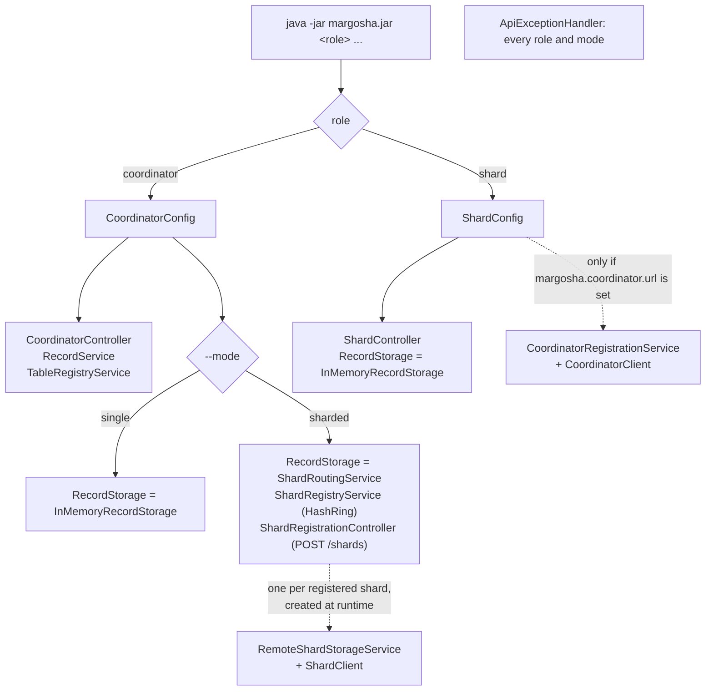
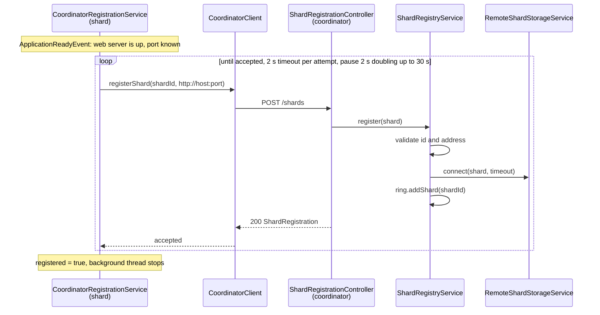
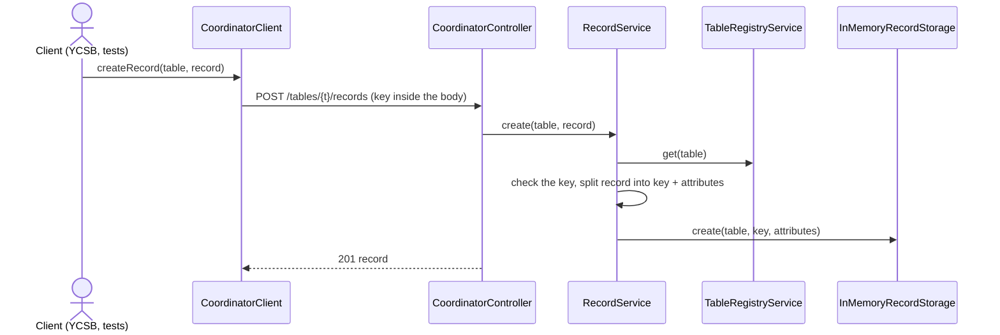
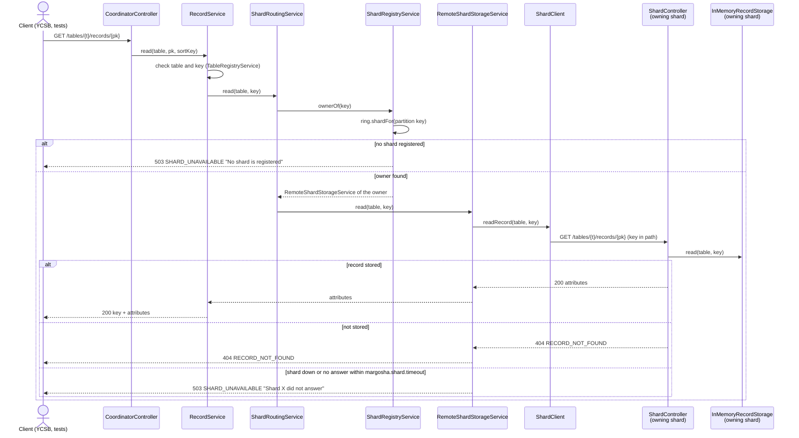

# Margosha DB

A "light" version of a serverless key-value store like DynamoDB, built as the capstone project for the Cloud Architectures course (2026/27).

- **Decisions:** [adr/](adr/)
- **OpenSpec change:** [openspec/changes/setup-m1-infrastructure/](openspec/changes/setup-m1-infrastructure/)
- **IaC templates (AWS CloudFormation):** [cfn/](cfn/)

---

# Milestone 1: Infrastructure setup

**Environment:** AWS Academy Cloud Architecting Sandbox, region `us-east-1`, session role `voclabs`.

## What's in M1

| Task | Document | Template |
|---|---|---|
| 1. Dissect the LabRole | [role_dissection.md](m1/role_dissection.md) | — |
| 2–3. Read-only policy + assumable role (described in IaC, not deployable in the sandbox) | [role_policy_creation.md](m1/role_policy_creation.md) | [read-only-role.yaml](cfn/read-only-role.yaml) |
| 4–5. VPC with public and private subnets, in an IaC stack | [vpc_creation.md](m1/vpc_creation.md) | [margosha-vpc-stack.yaml](cfn/margosha-vpc-stack.yaml) |
| 6–7. Service quotas and budget for M2 | [quotas_and_budget.md](m1/quotas_and_budget.md) | — |
| 8. Recreatability | [recreatability_test.md](m1/recreatability_test.md) | [margosha-vpc-stack.yaml](cfn/margosha-vpc-stack.yaml) |

ADRs: [0001 IaC tool](adr/0001-iac-tool.md), [0002 stack layout](adr/0002-stack-layout.md), [0003 CIDR addressing](adr/0003-cidr-addressing.md).

## How to bring it up

The only deployable piece in M1 is the network stack `margosha-vpc`. The read-only policy and role template can't be deployed in the sandbox (`iam:CreatePolicy` and `iam:CreateRole` are denied), see [role_policy_creation.md](m1/role_policy_creation.md).

**1. Credentials and region.** Paste the AWS CLI credentials from the lab page into `~/.aws/credentials` and set the region (details in [vpc_creation.md](m1/vpc_creation.md#setup-default-region-and-credentials)):
```bash
export AWS_DEFAULT_REGION=us-east-1
aws sts get-caller-identity   # must return assumed-role/voclabs/...
```

**2. Deploy** (from the `cfn/` folder):
```bash
cd cfn
aws cloudformation validate-template --template-body file://margosha-vpc-stack.yaml
aws cloudformation create-stack \
  --stack-name margosha-vpc \
  --template-body file://margosha-vpc-stack.yaml
aws cloudformation wait stack-create-complete --stack-name margosha-vpc
```
It takes about a minute. The sandbox deletes everything when the 3-hour session ends, so this is repeated in every new session.

## How to verify it

**Stack status** should be `CREATE_COMPLETE`:
```bash
aws cloudformation describe-stacks --stack-name margosha-vpc --query 'Stacks[0].StackStatus'
```

**Public subnet reaches the internet:** its route table has a `0.0.0.0/0` route to the Internet Gateway (`igw-...`):
```bash
aws ec2 describe-route-tables \
  --filters "Name=tag:Name,Values=margosha-rt-public" \
  --query "RouteTables[0].Routes"
```

**Private subnets are internal only:** their route table has only the `local` route (`10.0.0.0/16`):
```bash
aws ec2 describe-route-tables \
  --filters "Name=tag:Name,Values=margosha-rt-private" \
  --query "RouteTables[0].Routes"
```

**Exports for the M2 application stack:** 4 exports, `margosha-vpc-VpcId`, `-PublicSubnetId`, `-PrivateSubnetAId` and `-PrivateSubnetBId`:
```bash
aws cloudformation list-exports --query "Exports[?starts_with(Name, 'margosha-vpc-')]"
```

Expected outputs and console screenshots are in [vpc_creation.md](m1/vpc_creation.md#verification).

**Tear down** (used in the [recreatability test](m1/recreatability_test.md)):
```bash
aws cloudformation delete-stack --stack-name margosha-vpc
aws cloudformation wait stack-delete-complete --stack-name margosha-vpc
```

## What changed since the previous milestone

M1 is the first milestone, so there is no previous one. Everything listed in [What's in M1](#whats-in-m1) is new.

---

# Milestone 2: how the application classes work together

One jar, `margosha.jar`, runs in one of three setups. The first argument is the **role** (`coordinator` or `shard`, a Spring profile); a coordinator also gets a **mode** (`--mode=single` or `--mode=sharded`, the property `margosha.mode`). More detail: [m2/routing.md](m2/routing.md).

## Which classes exist in each role and mode



## Shard registration (sharded mode, when a shard starts)



## A record request in single mode



## A record request in sharded mode



CREATE, EXISTS, UPDATE and DELETE take the same path; only the HTTP method and body differ. Errors are turned into JSON answers by `ApiExceptionHandler` on the coordinator.

## Deploy pipeline

[`.github/workflows/pipeline.yml`](.github/workflows/pipeline.yml) has two jobs:

| Job | Runs on | What it does |
|---|---|---|
| `check` | every push and pull request | `./mvnw verify`: builds the jar and runs the tests |
| `deploy` | push to `main`, or started by hand on `main`; only after `check` passed; one run at a time | 1. `margosha-vpc` and 2. `margosha-app` with `aws cloudformation deploy --no-fail-on-empty-changeset`; 3. uploads the tested jar to `s3://margosha-artifacts-<account-id>/releases/margosha.jar`; 4. reboots the coordinator and the shards; 5. waits until all three nodes logged the new jar's sha256 |

- Checks with screenshots (app-only change, template change, deploy by hand): [m2/deploy_pipeline.md](m2/deploy_pipeline.md).
- A stack with no changes prints `No changes to deploy` and the run goes on. The run's **Summary** page lists each stack's result, the jar hash and the node IDs.
- Parameters the pipeline does not pass keep their current values (`OperatorCidr`, `BenchClient`). A new stack gets the defaults, so the operator's access is closed until it is set by hand (see [m2/app_infrastructure.md](m2/app_infrastructure.md#2-create-the-stack-task-93)).
- Nodes the deploy has just created (first deploy, or replaced by a template change) are not rebooted: they are still in their first-boot setup and download the jar when it is done. Stopped nodes are started instead of rebooted.

### Refresh the secrets (every new lab session)

The deploy job uses the Learner Lab session credentials. They stop working when the session ends, so copy the new ones before deploying.

1. Start the lab, open **AWS Details → AWS CLI: Show**, and copy the three values.
2. In GitHub: **Settings → Secrets and variables → Actions → Repository secrets**, update (or create the first time) `AWS_ACCESS_KEY_ID`, `AWS_SECRET_ACCESS_KEY` and `AWS_SESSION_TOKEN`.

Or with the [GitHub CLI](https://cli.github.com/), after pasting the lab credentials into `~/.aws/credentials` as usual. The values are piped from the AWS CLI config, so they never appear on the screen or in the shell history:

Windows (PowerShell):
```powershell
aws configure get aws_access_key_id     | gh secret set AWS_ACCESS_KEY_ID
aws configure get aws_secret_access_key | gh secret set AWS_SECRET_ACCESS_KEY
aws configure get aws_session_token     | gh secret set AWS_SESSION_TOKEN
gh secret list
```

macOS (Terminal):
```bash
aws configure get aws_access_key_id     | gh secret set AWS_ACCESS_KEY_ID
aws configure get aws_secret_access_key | gh secret set AWS_SECRET_ACCESS_KEY
aws configure get aws_session_token     | gh secret set AWS_SESSION_TOKEN
gh secret list
```
`gh secret list` should show all three with today's date. If a deploy fails at **Check the credentials**, the secrets are from an old session.

### Start a deploy by hand

After refreshing the secrets (a push made before that fails at **Check the credentials**, so it is re-run this way):

- GitHub: **Actions → pipeline → Run workflow**, branch `main`, **Run workflow**. The button only appears once the workflow file is on `main`.
- GitHub CLI (same on Windows and macOS):
  ```bash
  gh workflow run pipeline.yml --ref main
  gh run watch
  ```

A manual run runs `check` again (build and tests), then `deploy`.