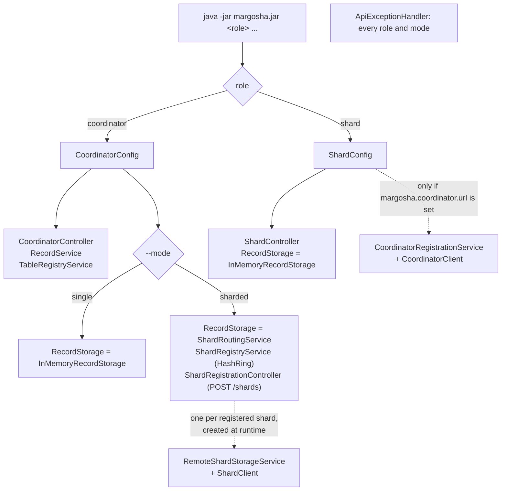
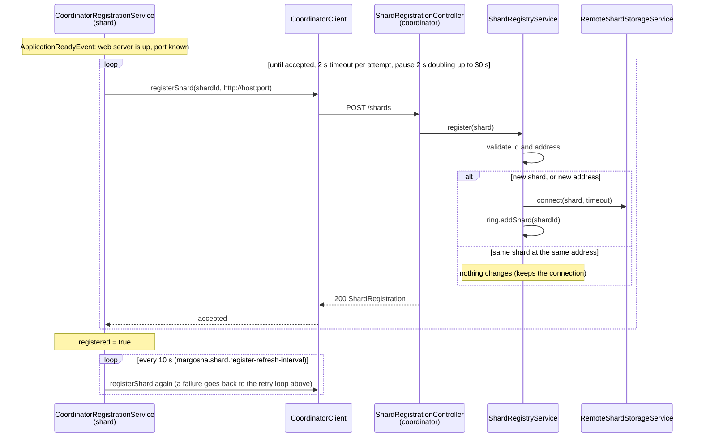
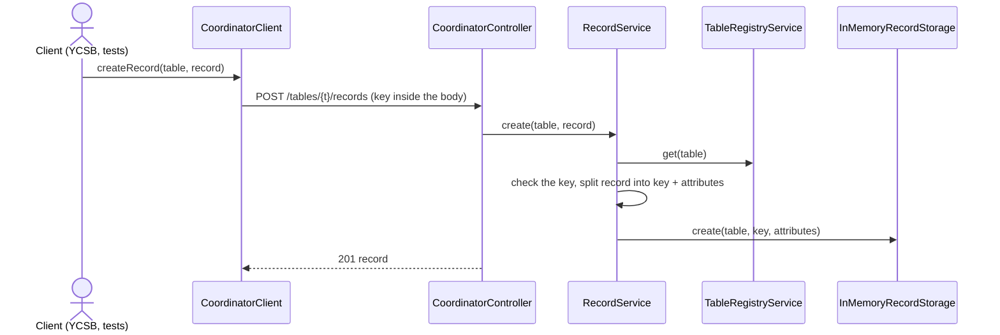
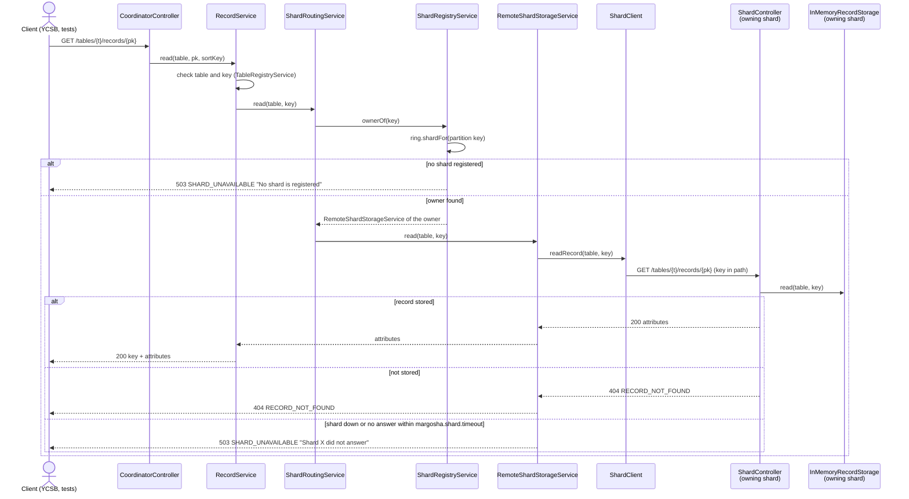

# Margosha DB

A "light" version of a serverless key-value store like DynamoDB, built as the capstone project for the Cloud Architectures course (2026/27).

- **Decisions:** [adr/](adr/)
- **OpenSpec changes:** M1 [openspec/changes/archive/2026-10-24-setup-m1-infrastructure/](openspec/changes/archive/2026-10-24-setup-m1-infrastructure/), M2 [openspec/changes/setup-m2-sharding/](openspec/changes/setup-m2-sharding/)
- **IaC templates (AWS CloudFormation):** [cfn/](cfn/)
- **Application (Java 21, Maven):** [app/](app/)
- **Milestones:** [M1 infrastructure setup](#milestone-1-infrastructure-setup), [M2 sharded key-value store](#milestone-2-sharded-key-value-store)

---

# Milestone 1: Infrastructure setup

**Environment:** AWS Academy Cloud Architecting Sandbox, region `us-east-1`, session role `voclabs`.

## What's in M1

| Task | Document | Template |
|---|---|---|
| 1. Dissect the LabRole | [role_dissection.md](m1/role_dissection.md) | — |
| 2–3. Read-only policy + assumable role (described in IaC, not deployable in the sandbox) | [role_policy_creation.md](m1/role_policy_creation.md) | [read-only-role.yaml](cfn/read-only-role.yaml) |
| 4–5. VPC with public and private subnets, in an IaC stack | [vpc_creation.md](m1/vpc_creation.md) | [margosha-vpc-stack.yaml](cfn/margosha-vpc-stack.yaml) |
| 6–7. Service quotas and budget for M2 | [quotas_and_budget.md](m1/quotas_and_budget.md) | — |
| 8. Recreatability | [recreatability_test.md](m1/recreatability_test.md) | [margosha-vpc-stack.yaml](cfn/margosha-vpc-stack.yaml) |

ADRs: [0001 IaC tool](adr/0001-iac-tool.md), [0002 stack layout](adr/0002-stack-layout.md), [0003 CIDR addressing](adr/0003-cidr-addressing.md).

## How to bring it up

The only deployable piece in M1 is the network stack `margosha-vpc`. The read-only policy and role template can't be deployed in the sandbox (`iam:CreatePolicy` and `iam:CreateRole` are denied), see [role_policy_creation.md](m1/role_policy_creation.md).

**1. Credentials and region.** Paste the AWS CLI credentials from the lab page into `~/.aws/credentials` and set the region (details in [vpc_creation.md](m1/vpc_creation.md#setup-default-region-and-credentials)):
```bash
export AWS_DEFAULT_REGION=us-east-1
aws sts get-caller-identity   # must return assumed-role/voclabs/...
```

**2. Deploy** (from the `cfn/` folder):
```bash
cd cfn
aws cloudformation validate-template --template-body file://margosha-vpc-stack.yaml
aws cloudformation create-stack \
  --stack-name margosha-vpc \
  --template-body file://margosha-vpc-stack.yaml
aws cloudformation wait stack-create-complete --stack-name margosha-vpc
```
It takes about a minute. The sandbox deletes everything when the 3-hour session ends, so this is repeated in every new session.

## How to verify it

**Stack status** should be `CREATE_COMPLETE`:
```bash
aws cloudformation describe-stacks --stack-name margosha-vpc --query 'Stacks[0].StackStatus'
```

**Public subnet reaches the internet:** its route table has a `0.0.0.0/0` route to the Internet Gateway (`igw-...`):
```bash
aws ec2 describe-route-tables \
  --filters "Name=tag:Name,Values=margosha-rt-public" \
  --query "RouteTables[0].Routes"
```

**Private subnets are internal only:** their route table has only the `local` route (`10.0.0.0/16`):
```bash
aws ec2 describe-route-tables \
  --filters "Name=tag:Name,Values=margosha-rt-private" \
  --query "RouteTables[0].Routes"
```

**Exports for the M2 application stack:** 4 exports, `margosha-vpc-VpcId`, `-PublicSubnetId`, `-PrivateSubnetAId` and `-PrivateSubnetBId`:
```bash
aws cloudformation list-exports --query "Exports[?starts_with(Name, 'margosha-vpc-')]"
```

Expected outputs and console screenshots are in [vpc_creation.md](m1/vpc_creation.md#verification).

**Tear down** (used in the [recreatability test](m1/recreatability_test.md)):
```bash
aws cloudformation delete-stack --stack-name margosha-vpc
aws cloudformation wait stack-delete-complete --stack-name margosha-vpc
```

## What changed since the previous milestone

M1 is the first milestone, so there is no previous one. Everything listed in [What's in M1](#whats-in-m1) is new.

---

# Milestone 2: Sharded key-value store

**Environment:** AWS Academy Learner Lab, region `us-east-1`, account role `voclabs`, instance profile `LabInstanceProfile`.

A coordinator and two shards on EC2. Clients call the coordinator's REST API; it hashes each record's partition key on a
consistent hashing ring and forwards the request to the shard that owns it. Records are kept in memory. The pipeline
builds, tests and deploys every push to `main`, and YCSB measured the M2 baseline.

```
                        internet (only OperatorCidr: API 8080 + SSH 22)
 ┌──────────────── VPC 10.0.0.0/16 (margosha-vpc) ─────────────────────────────────┐
 │  public subnet:   coordinator (t3.micro)        YCSB client (t3.small, only     │
 │                        │ 8080                    while benchmarking)            │
 │            ┌───────────┴───────────┐                                            │
 │  private A: shard A (t3.micro)   private B: shard B (t3.micro)   no internet    │
 │            └──── S3 gateway endpoint: AL2023 packages + artifacts bucket ───────┼──► S3
 └─────────────────────────────────────────────────────────────────────────────────┘
 GitHub Actions ──► CloudFormation (margosha-vpc, margosha-app) + s3://margosha-artifacts-<account-id>/releases/
```

## What's in M2

| Part | Document | Code / template |
|---|---|---|
| Decisions: API protocol, hash function and vnodes, partition key | [ADR 0004](adr/0004-api-protocol.md), [0005](adr/0005-hash-function-and-vnodes.md) (with [ring simulation](m2/ring-simulation/README.md)), [0006](adr/0006-partition-key-strategy.md) | — |
| API: tables, CREATE / READ / EXISTS / UPDATE / DELETE, shard registration (REST + JSON) | [openapi.yaml](app/api/src/main/resources/openapi.yaml) | [app/api](app/api) |
| Consistent hashing ring (MurmurHash3, 128 vnodes) and routing | [m2/routing.md](m2/routing.md) | [app/ring](app/ring), [app/node](app/node) |
| One jar: coordinator (single / sharded mode) and shard | [below](#how-the-application-classes-work-together) | [app/node](app/node) |
| S3 gateway endpoint for the private subnets | [m2/s3_gateway_endpoint.md](m2/s3_gateway_endpoint.md) | [margosha-vpc-stack.yaml](cfn/margosha-vpc-stack.yaml) |
| Application stack: bucket, coordinator, 2 shards, YCSB client | [m2/app_infrastructure.md](m2/app_infrastructure.md) | [margosha-app.yaml](cfn/margosha-app.yaml) |
| Pipeline: build, test, deploy | [below](#deploy-pipeline), [m2/deploy_pipeline.md](m2/deploy_pipeline.md) | [pipeline.yml](.github/workflows/pipeline.yml) |
| YCSB binding and benchmark | [procedure.md](m2/benchmark/procedure.md), [results.md](m2/benchmark/results.md) | [app/ycsb-binding](app/ycsb-binding), [run-benchmark.sh](m2/benchmark/run-benchmark.sh) |
| End-to-end: fresh deploy from the pipeline | [m2/end_to_end.md](m2/end_to_end.md) | — |

## How to bring it up

Everything is deployed by the pipeline; no console steps. It needs a GitHub repository with this code and the Learner Lab
credentials in its secrets.

**1. Credentials.** Start the lab. Paste the AWS CLI credentials from **AWS Details → AWS CLI: Show** into
`~/.aws/credentials`, and copy the same three values into the repository secrets `AWS_ACCESS_KEY_ID`,
`AWS_SECRET_ACCESS_KEY` and `AWS_SESSION_TOKEN` ([details](#refresh-the-secrets-every-new-lab-session)). They expire
with the session, so this is repeated in every new session.

**2. Deploy.** Push to `main`, or start **Actions → pipeline → Run workflow** on `main`. The `deploy` job creates or
updates `margosha-vpc` and `margosha-app`, uploads the jars, starts or reboots the nodes, and waits until all three run
the new jar (3–5 minutes). The run's **Summary** page lists the stacks' results, the jar hashes and the node IDs.

**3. Open the API to your IP.** The API has no authentication, so it is closed to the internet by default. This adds two
security group rules to the coordinator and replaces nothing:

Windows (PowerShell):
```powershell
aws configure set region us-east-1
$MY_IP = (Invoke-RestMethod https://checkip.amazonaws.com).Trim()
aws cloudformation deploy --stack-name margosha-app --template-file cfn/margosha-app.yaml `
  --parameter-overrides "OperatorCidr=$MY_IP/32" --no-fail-on-empty-changeset
```

macOS / Linux:
```bash
aws configure set region us-east-1
MY_IP=$(curl -s https://checkip.amazonaws.com)
aws cloudformation deploy --stack-name margosha-app --template-file cfn/margosha-app.yaml \
  --parameter-overrides "OperatorCidr=$MY_IP/32" --no-fail-on-empty-changeset
```
Later deploys keep this value. Run it again when your IP changes.

**In a new lab session** the stacks are still there and the lab starts the nodes again. They download the jar and the
shards register by themselves; only the secrets (step 1) and, if your IP changed, step 3 need to be redone. Nodes you
stopped yourself are started by the next pipeline run (step 2), or with `aws ec2 start-instances`.

**Run it on your machine** (no AWS), from `app/`:
```bash
./mvnw verify                      # Windows: .\mvnw.cmd verify
java -jar node/target/margosha.jar coordinator --mode=single
```
The API is then at `http://localhost:8080`. Sharded mode on one machine: three terminals, each on its own port
(how routing works: [m2/routing.md](m2/routing.md)):
```bash
java -jar node/target/margosha.jar coordinator --mode=sharded --server.port=8080
java -jar node/target/margosha.jar shard --server.port=8081 --margosha.shard.id=shard-a --margosha.coordinator.url=http://localhost:8080 --margosha.shard.host=localhost
java -jar node/target/margosha.jar shard --server.port=8082 --margosha.shard.id=shard-b --margosha.coordinator.url=http://localhost:8080 --margosha.shard.host=localhost
```
The coordinator logs `Registered shard shard-a` and `shard-b` within a few seconds. If a port is already taken
(`Port 8080 was already in use`), pick other ones and change `--margosha.coordinator.url` to match.

## How to verify it

Run from the repo root, in one terminal window.

**Stacks** are `CREATE_COMPLETE` or `UPDATE_COMPLETE`, and the coordinator's public address is known:

Windows (PowerShell):
```powershell
aws cloudformation describe-stacks --query "Stacks[?starts_with(StackName,'margosha')].[StackName,StackStatus]" --output table
function Out($key) { aws cloudformation describe-stacks --stack-name margosha-app --query "Stacks[0].Outputs[?OutputKey=='$key'].OutputValue" --output text }
$COORD = Out CoordinatorInstanceId
$API = "http://$(aws ec2 describe-instances --instance-ids $COORD --query 'Reservations[0].Instances[0].PublicIpAddress' --output text):8080"
$API
```

macOS / Linux:
```bash
aws cloudformation describe-stacks --query "Stacks[?starts_with(StackName,'margosha')].[StackName,StackStatus]" --output table
out() { aws cloudformation describe-stacks --stack-name margosha-app --query "Stacks[0].Outputs[?OutputKey=='$1'].OutputValue" --output text; }
COORD=$(out CoordinatorInstanceId)
API="http://$(aws ec2 describe-instances --instance-ids "$COORD" --query 'Reservations[0].Instances[0].PublicIpAddress' --output text):8080"
echo "$API"
```

**Both shards registered with the coordinator.** The coordinator's log goes to its serial console, so it can be read
without SSH. The last two lines must be `Registered shard shard-a` and `shard-b`, after the time of the last boot:

Windows (PowerShell):
```powershell
$env:PYTHONUTF8 = '1'; [Console]::OutputEncoding = [Text.Encoding]::UTF8   # the log has non-ASCII characters
aws ec2 get-console-output --instance-id $COORD --latest --output text | Select-String "Registered shard|downloaded"
```

macOS / Linux:
```bash
aws ec2 get-console-output --instance-id "$COORD" --latest --output text | grep -E "Registered shard|downloaded"
```

**The store works:** register a table, write a record, read it back, check a missing one:

Windows (PowerShell):
```powershell
Invoke-RestMethod -Method Post -Uri "$API/tables" -ContentType 'application/json' -Body '{"name":"users","partitionKey":"user_id"}' | ConvertTo-Json -Compress
Invoke-RestMethod -Method Post -Uri "$API/tables/users/records" -ContentType 'application/json' -Body '{"user_id":"42","name":"Anna","city":"Kyiv"}' | ConvertTo-Json -Compress
curl.exe -s "$API/tables/users/records/42"; ""
curl.exe -s "$API/tables/users/records/42/exists"; ""
curl.exe -s "$API/tables/users/records/nobody"; ""
```

macOS / Linux:
```bash
curl -s -X POST "$API/tables" -H 'Content-Type: application/json' -d '{"name":"users","partitionKey":"user_id"}'; echo
curl -s -X POST "$API/tables/users/records" -H 'Content-Type: application/json' -d '{"user_id":"42","name":"Anna","city":"Kyiv"}'; echo
curl -s "$API/tables/users/records/42"; echo
curl -s "$API/tables/users/records/42/exists"; echo
curl -s "$API/tables/users/records/nobody"; echo
```
Expected: the table, the record twice (`user_id` 42, Anna, Kyiv), `exists: true`, and
`{"code":"RECORD_NOT_FOUND","message":"Record nobody not found in table users"}`. Records are in memory, so after a
reboot or a new session the table has to be registered again; if it is still there, the first call answers
`409 TABLE_ALREADY_EXISTS` (PowerShell shows it as an error; the other calls still work).

**The tests** (unit and integration, including sharded routing with in-process shards and the YCSB round trip) run on every
push in the pipeline's `check` job, and locally with `./mvnw verify` in `app/`.

More checks, with expected outputs and console screenshots:

| What | Where |
|---|---|
| Private subnets reach S3 (AL2023 packages) and nothing else | [m2/s3_gateway_endpoint.md](m2/s3_gateway_endpoint.md) |
| Instance settings, shards not reachable except from the coordinator, reboot and stop/start, bench client on/off | [m2/app_infrastructure.md](m2/app_infrastructure.md) |
| Pipeline: app-only change, template change, deploy by hand | [m2/deploy_pipeline.md](m2/deploy_pipeline.md) |
| Fresh deploy from the pipeline with only `margosha-vpc` present | [m2/end_to_end.md](m2/end_to_end.md) |
| Benchmark (YCSB workload A) | [m2/benchmark/results.md](m2/benchmark/results.md) |

**Benchmark baseline** (workload A, 100,000 records, 200,000 operations, 8 threads, commit `9a12bf2`):
1,531 ops/s; READ avg / p95 / p99 4.3 / 7.8 / 21.6 ms, UPDATE 6.0 / 11.6 / 29.2 ms, no failed operations.
To repeat it: [m2/benchmark/procedure.md](m2/benchmark/procedure.md).

**Tear down** (the bucket must be empty before its stack can be deleted; `margosha-vpc` last, because `margosha-app`
imports its exports):
```bash
aws s3 rm "s3://margosha-artifacts-$(aws sts get-caller-identity --query Account --output text)" --recursive
aws cloudformation delete-stack --stack-name margosha-app
aws cloudformation wait stack-delete-complete --stack-name margosha-app
```

## What changed since the previous milestone

M1 had only the network stack. M2 adds the application on top of it:

- **Network (`margosha-vpc`, updated in place):** an **S3 gateway endpoint** on the private route table. The shards still
  have no internet route, but can now install Amazon Linux packages (Corretto 21) and download the jar from the
  artifacts bucket. Its policy allows only the AL2023 repository bucket and `margosha-artifacts-<account-id>`.
- **New stack `margosha-app`:** the artifacts bucket, security groups (shards reachable only from the coordinator),
  the coordinator in the public subnet, shard A and B in the two private subnets, and the YCSB client while
  benchmarking (`BenchClient` parameter). It imports the 4 exports M1 prepared.
- **Application:** a Maven project in `app/` with the API spec and client, the hashing ring, one jar for the coordinator
  and the shards, and the YCSB binding; 150+ tests.
- **Delivery:** the GitHub Actions pipeline that tests every push and deploys `main`. In M1 the stack was created by hand.
- **Benchmark:** the YCSB binding, procedure and the M2 baseline results.
- **Decisions:** ADRs 0004–0006.
- **Budget** follows the M1 plan in [quotas_and_budget.md](m1/quotas_and_budget.md): `t3.micro` nodes, `t3.small`
  client only while benchmarking, standard CPU credits, no NAT Gateway.

## How the application classes work together

One jar, `margosha.jar`, runs in one of three setups. The first argument is the **role** (`coordinator` or `shard`, a Spring profile); a coordinator also gets a **mode** (`--mode=single` or `--mode=sharded`, the property `margosha.mode`). More detail: [m2/routing.md](m2/routing.md).

### Which classes exist in each role and mode



### Shard registration (sharded mode, when a shard starts)


The repeat matters after a coordinator restart: its shard list is only in memory, so it starts empty, and the shards are
back on its ring within 10 s without being restarted.

### A record request in single mode



### A record request in sharded mode



CREATE, EXISTS, UPDATE and DELETE take the same path; only the HTTP method and body differ. Errors are turned into JSON answers by `ApiExceptionHandler` on the coordinator.

## Deploy pipeline

[`.github/workflows/pipeline.yml`](.github/workflows/pipeline.yml) has two jobs:

| Job | Runs on | What it does |
|---|---|---|
| `check` | every push and pull request | `./mvnw verify`: builds the jar and runs the tests |
| `deploy` | push to `main`, or started by hand on `main`; only after `check` passed; one run at a time | 1. `margosha-vpc` and 2. `margosha-app` with `aws cloudformation deploy --no-fail-on-empty-changeset`; 3. uploads the tested jars to `s3://margosha-artifacts-<account-id>/releases/`: `margosha.jar` (the nodes) and `margosha-ycsb-binding.jar` (the bench client, see [m2/benchmark/procedure.md](m2/benchmark/procedure.md)); 4. reboots the coordinator and the shards; 5. waits until all three nodes downloaded the new jar (its sha256 in their log) and started it (`Running as …`, logged after the deploy began), and the coordinator registered both shards; fails after 12 minutes otherwise, printing the node's last log lines |

- Checks with screenshots (app-only change, template change, deploy by hand): [m2/deploy_pipeline.md](m2/deploy_pipeline.md).
- A stack with no changes prints `No changes to deploy` and the run goes on. The run's **Summary** page lists each stack's result, the jar hash and the node IDs.
- Parameters the pipeline does not pass keep their current values (`OperatorCidr`, `BenchClient`). A new stack gets the defaults, so the operator's access is closed until it is set by hand (see [m2/app_infrastructure.md](m2/app_infrastructure.md#2-create-the-stack-task-93)).
- Nodes the deployment has just created (first deploy, or replaced by a template change) are not rebooted: they are still in their first-boot setup and download the jar when it is done. Stopped nodes are started instead of rebooted.

### Refresh the secrets (every new lab session)

The deploy job uses the Learner Lab session credentials. They stop working when the session ends, so copy the new ones before deploying.

1. Start the lab, open **AWS Details → AWS CLI: Show**, and copy the three values.
2. In GitHub: **Settings → Secrets and variables → Actions → Repository secrets**, update (or create the first time) `AWS_ACCESS_KEY_ID`, `AWS_SECRET_ACCESS_KEY` and `AWS_SESSION_TOKEN`.

Or with the [GitHub CLI](https://cli.github.com/), after pasting the lab credentials into `~/.aws/credentials` as usual. The values are piped from the AWS CLI config, so they never appear on the screen or in the shell history:

Windows (PowerShell):
```powershell
aws configure get aws_access_key_id     | gh secret set AWS_ACCESS_KEY_ID
aws configure get aws_secret_access_key | gh secret set AWS_SECRET_ACCESS_KEY
aws configure get aws_session_token     | gh secret set AWS_SESSION_TOKEN
gh secret list
```

macOS (Terminal):
```bash
aws configure get aws_access_key_id     | gh secret set AWS_ACCESS_KEY_ID
aws configure get aws_secret_access_key | gh secret set AWS_SECRET_ACCESS_KEY
aws configure get aws_session_token     | gh secret set AWS_SESSION_TOKEN
gh secret list
```
`gh secret list` should show all three with today's date. If a deploy fails at **Check the credentials**, the secrets are from an old session.

### Start a deployment by hand

After refreshing the secrets (a push made before that fails at **Check the credentials**, so it is re-run this way):

- GitHub: **Actions → pipeline → Run workflow**, branch `main`, **Run workflow**. The button only appears once the workflow file is on `main`.
- GitHub CLI (same on Windows and macOS):
  ```bash
  gh workflow run pipeline.yml --ref main
  gh run watch
  ```

A manual run runs `check` again (build and tests), then `deploy`.