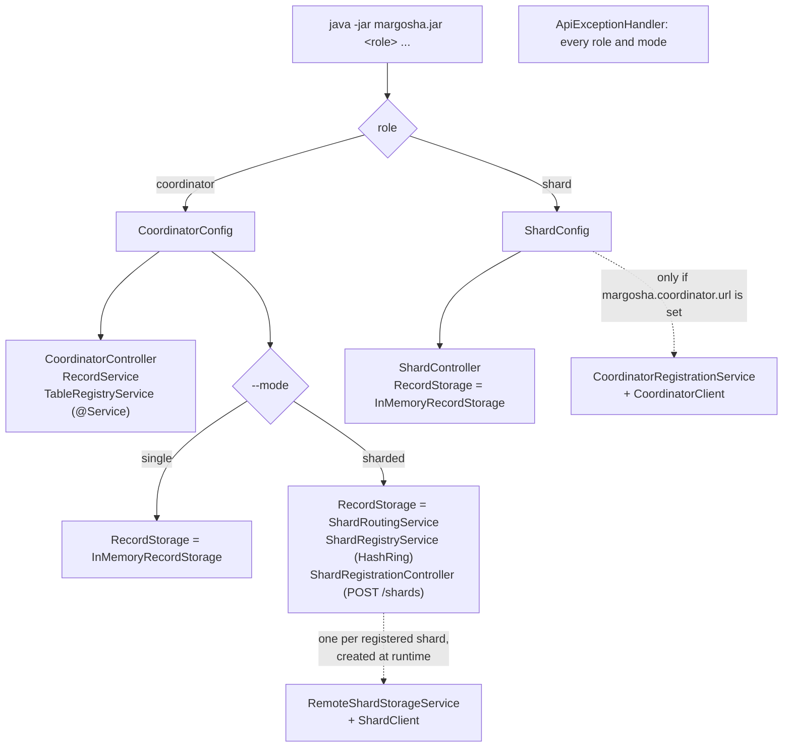
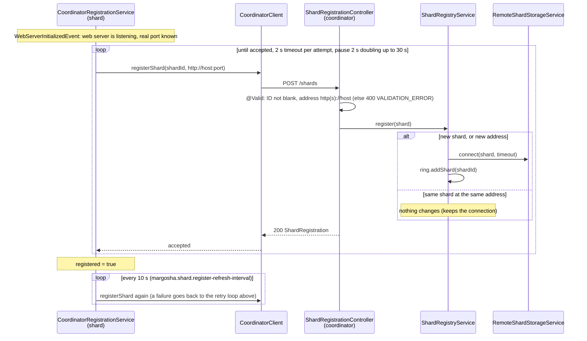
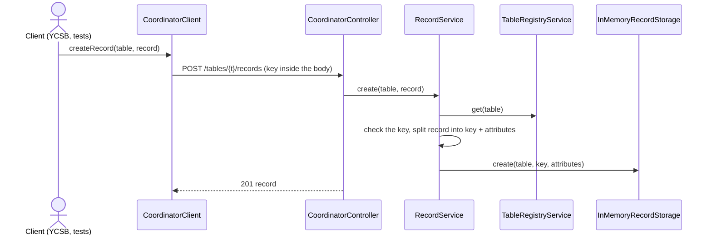
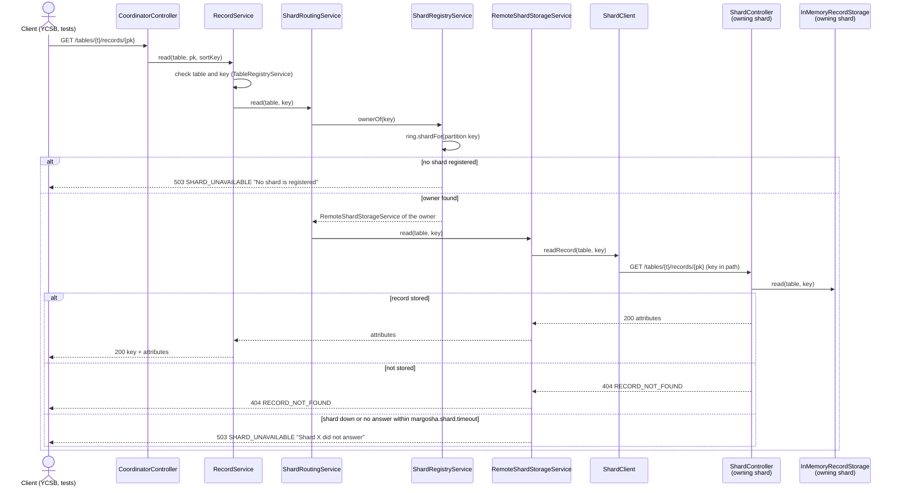
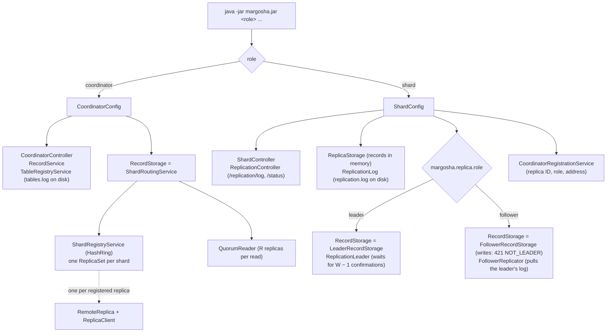
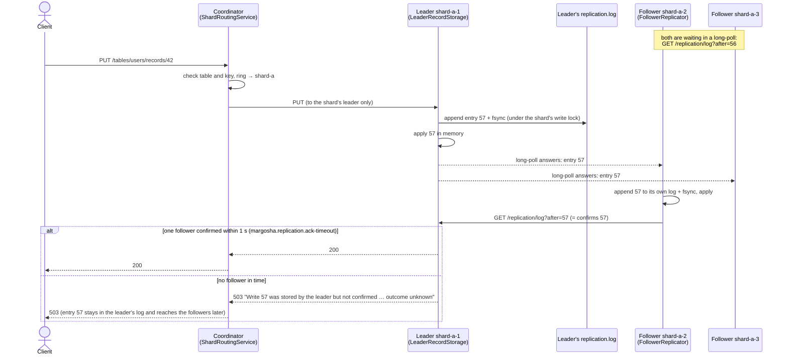
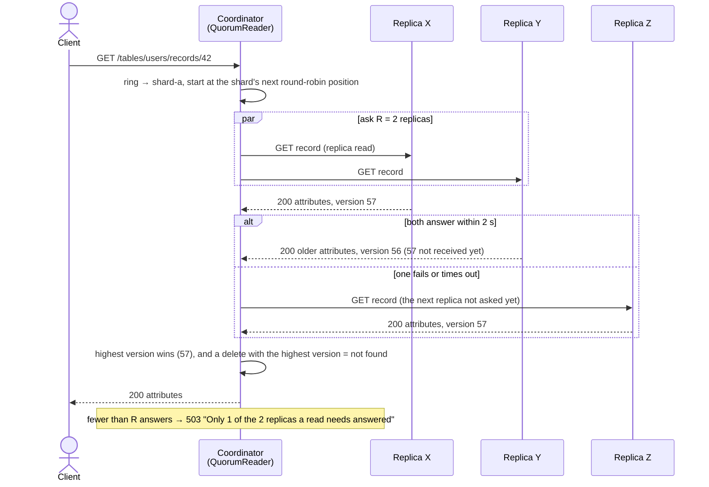
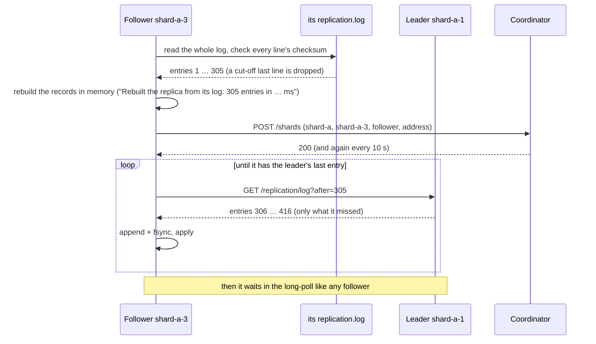
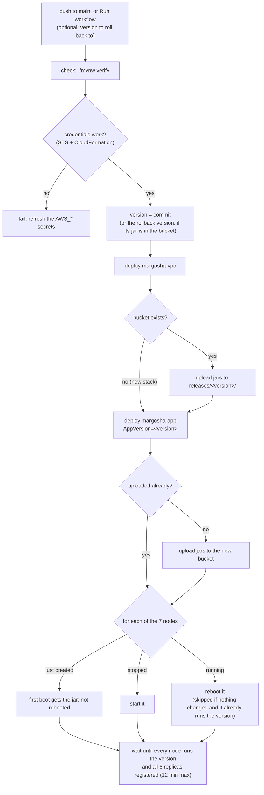

# Margosha DB

A "light" version of a serverless key-value store like DynamoDB, built as the capstone project for the Cloud Architectures course (2026/27).

- **Decisions:** [adr/](adr/)
- **OpenSpec changes:** M1 [openspec/changes/archive/2026-10-24-setup-m1-infrastructure/](openspec/changes/archive/2026-10-24-setup-m1-infrastructure/), M2 [openspec/changes/archive/2026-10-30-setup-m2-sharding/](openspec/changes/archive/2026-10-30-setup-m2-sharding/), M3 [openspec/changes/setup-m3-durability/](openspec/changes/setup-m3-durability/)
- **IaC templates (AWS CloudFormation):** [cfn/](cfn/)
- **Application (Java 21, Maven):** [app/](app/)
- **Milestones:** [M1 infrastructure setup](#milestone-1-infrastructure-setup), [M2 sharded key-value store](#milestone-2-sharded-key-value-store), [M3 replicated, durable store](#milestone-3-replicated-durable-store)

---

# Milestone 1: Infrastructure setup

**Environment:** AWS Academy Cloud Architecting Sandbox, region `us-east-1`, session role `voclabs`.

## What's in M1

| Task | Document | Template |
|---|---|---|
| 1. Dissect the LabRole | [role_dissection.md](m1/role_dissection.md) | — |
| 2–3. Read-only policy + assumable role (described in IaC, not deployable in the sandbox) | [role_policy_creation.md](m1/role_policy_creation.md) | [read-only-role.yaml](cfn/read-only-role.yaml) |
| 4–5. VPC with public and private subnets, in an IaC stack | [vpc_creation.md](m1/vpc_creation.md) | [margosha-vpc-stack.yaml](cfn/margosha-vpc-stack.yaml) |
| 6–7. Service quotas and budget for M2 | [quotas_and_budget.md](m1/quotas_and_budget.md) | — |
| 8. Recreatability | [recreatability_test.md](m1/recreatability_test.md) | [margosha-vpc-stack.yaml](cfn/margosha-vpc-stack.yaml) |

ADRs: [0001 IaC tool](adr/0001-iac-tool.md), [0002 stack layout](adr/0002-stack-layout.md), [0003 CIDR addressing](adr/0003-cidr-addressing.md).

## How to bring it up

The only deployable piece in M1 is the network stack `margosha-vpc`. The read-only policy and role template can't be deployed in the sandbox (`iam:CreatePolicy` and `iam:CreateRole` are denied), see [role_policy_creation.md](m1/role_policy_creation.md).

**1. Credentials and region.** Paste the AWS CLI credentials from the lab page into `~/.aws/credentials` and set the region (details in [vpc_creation.md](m1/vpc_creation.md#setup-default-region-and-credentials)):
```bash
export AWS_DEFAULT_REGION=us-east-1
aws sts get-caller-identity   # must return assumed-role/voclabs/...
```

**2. Deploy** (from the `cfn/` folder):
```bash
cd cfn
aws cloudformation validate-template --template-body file://margosha-vpc-stack.yaml
aws cloudformation create-stack \
  --stack-name margosha-vpc \
  --template-body file://margosha-vpc-stack.yaml
aws cloudformation wait stack-create-complete --stack-name margosha-vpc
```
It takes about a minute. The sandbox deletes everything when the 3-hour session ends, so this is repeated in every new session.

## How to verify it

**Stack status** should be `CREATE_COMPLETE`:
```bash
aws cloudformation describe-stacks --stack-name margosha-vpc --query 'Stacks[0].StackStatus'
```

**Public subnet reaches the internet:** its route table has a `0.0.0.0/0` route to the Internet Gateway (`igw-...`):
```bash
aws ec2 describe-route-tables \
  --filters "Name=tag:Name,Values=margosha-rt-public" \
  --query "RouteTables[0].Routes"
```

**Private subnets are internal only:** their route table has only the `local` route (`10.0.0.0/16`):
```bash
aws ec2 describe-route-tables \
  --filters "Name=tag:Name,Values=margosha-rt-private" \
  --query "RouteTables[0].Routes"
```

**Exports for the M2 application stack:** 4 exports, `margosha-vpc-VpcId`, `-PublicSubnetId`, `-PrivateSubnetAId` and `-PrivateSubnetBId`:
```bash
aws cloudformation list-exports --query "Exports[?starts_with(Name, 'margosha-vpc-')]"
```

Expected outputs and console screenshots are in [vpc_creation.md](m1/vpc_creation.md#verification).

**Tear down** (used in the [recreatability test](m1/recreatability_test.md)):
```bash
aws cloudformation delete-stack --stack-name margosha-vpc
aws cloudformation wait stack-delete-complete --stack-name margosha-vpc
```

## What changed since the previous milestone

M1 is the first milestone, so there is no previous one. Everything listed in [What's in M1](#whats-in-m1) is new.

---

# Milestone 2: Sharded key-value store

**Environment:** AWS Academy Learner Lab, region `us-east-1`, account role `voclabs`, instance profile `LabInstanceProfile`.

A coordinator and two shards on EC2. Clients call the coordinator's REST API; it hashes each record's partition key on a
consistent hashing ring and forwards the request to the shard that owns it. Records are kept in memory. The pipeline
builds, tests and deploys every push to `main`, and YCSB measured the M2 baseline.

```
                        internet (only OperatorCidr: API 8080 + SSH 22)
 ┌──────────────── VPC 10.0.0.0/16 (margosha-vpc) ─────────────────────────────────┐
 │  public subnet:   coordinator (t3.micro)        YCSB client (t3.small, only     │
 │                        │ 8080                    while benchmarking)            │
 │            ┌───────────┴───────────┐                                            │
 │  private A: shard A (t3.micro)   private B: shard B (t3.micro)   no internet    │
 │            └──── S3 gateway endpoint: AL2023 packages + artifacts bucket ───────┼──► S3
 └─────────────────────────────────────────────────────────────────────────────────┘
 GitHub Actions ──► CloudFormation (margosha-vpc, margosha-app) + s3://margosha-artifacts-<account-id>/releases/
```

## What's in M2

| Part | Document | Code / template |
|---|---|---|
| Decisions: API protocol, hash function and vnodes, partition key | [ADR 0004](adr/0004-api-protocol.md), [0005](adr/0005-hash-function-and-vnodes.md) (with [ring simulation](m2/ring-simulation/README.md)), [0006](adr/0006-partition-key-strategy.md) | — |
| API: tables, CREATE / READ / EXISTS / UPDATE / DELETE, shard registration (REST + JSON) | [openapi.yaml](app/api/src/main/resources/openapi.yaml) | [app/api](app/api) |
| Consistent hashing ring (MurmurHash3, 128 vnodes) and routing | [m2/routing.md](m2/routing.md) | [app/ring](app/ring), [app/node](app/node) |
| One jar: coordinator (single / sharded mode) and shard | [below](#how-the-application-classes-work-together) | [app/node](app/node) |
| S3 gateway endpoint for the private subnets | [m2/s3_gateway_endpoint.md](m2/s3_gateway_endpoint.md) | [margosha-vpc-stack.yaml](cfn/margosha-vpc-stack.yaml) |
| Application stack: bucket, coordinator, 2 shards, YCSB client | [m2/app_infrastructure.md](m2/app_infrastructure.md) | [margosha-app.yaml](cfn/margosha-app.yaml) |
| Pipeline: build, test, deploy | [below](#deploy-pipeline), [m2/deploy_pipeline.md](m2/deploy_pipeline.md) | [pipeline.yml](.github/workflows/pipeline.yml) |
| YCSB binding and benchmark | [procedure.md](m2/benchmark/procedure.md), [results.md](m2/benchmark/results.md) | [app/ycsb-binding](app/ycsb-binding), [run-benchmark.sh](m2/benchmark/run-benchmark.sh) |
| End-to-end: fresh deploy from the pipeline | [m2/end_to_end.md](m2/end_to_end.md) | — |

## How to bring it up

Everything is deployed by the pipeline; no console steps. It needs a GitHub repository with this code and the Learner Lab
credentials in its secrets.

**1. Credentials.** Start the lab. Paste the AWS CLI credentials from **AWS Details → AWS CLI: Show** into
`~/.aws/credentials`, and copy the same three values into the repository secrets `AWS_ACCESS_KEY_ID`,
`AWS_SECRET_ACCESS_KEY` and `AWS_SESSION_TOKEN` ([details](#refresh-the-secrets-every-new-lab-session)). They expire
with the session, so this is repeated in every new session.

**2. Deploy.** Push to `main`, or start **Actions → pipeline → Run workflow** on `main`. The `deploy` job creates or
updates `margosha-vpc`, uploads the jars as a new version (the commit), deploys `margosha-app` with that version,
starts or reboots the nodes, and waits until all of them run it (3–5 minutes). The run's **Summary** page lists the
version, the stacks' results, the jar hash and the node IDs.

**3. Open the API to your IP.** The API has no authentication, so it is closed to the internet by default. This adds two
security group rules to the coordinator and replaces nothing:

Windows (PowerShell):
```powershell
aws configure set region us-east-1
$MY_IP = (Invoke-RestMethod https://checkip.amazonaws.com).Trim()
aws cloudformation deploy --stack-name margosha-app --template-file cfn/margosha-app.yaml `
  --parameter-overrides "OperatorCidr=$MY_IP/32" --no-fail-on-empty-changeset
```

macOS / Linux:
```bash
aws configure set region us-east-1
MY_IP=$(curl -s https://checkip.amazonaws.com)
aws cloudformation deploy --stack-name margosha-app --template-file cfn/margosha-app.yaml \
  --parameter-overrides "OperatorCidr=$MY_IP/32" --no-fail-on-empty-changeset
```
Later deploys keep this value. Run it again when your IP changes.

**In a new lab session** the stacks are still there and the lab starts the nodes again. They download the jar and the
shards register by themselves; only the secrets (step 1) and, if your IP changed, step 3 need to be redone. Nodes you
stopped yourself are started by the next pipeline run (step 2), or with `aws ec2 start-instances`.

**Run it on your machine** (no AWS), from `app/`:
```bash
./mvnw verify                      # Windows: .\mvnw.cmd verify
java -jar node/target/margosha.jar coordinator --mode=single
```
The API is then at `http://localhost:8080`. Sharded mode on one machine: three terminals, each on its own port
(how routing works: [m2/routing.md](m2/routing.md)):
```bash
java -jar node/target/margosha.jar coordinator --mode=sharded --server.port=8080
java -jar node/target/margosha.jar shard --server.port=8081 --margosha.shard.id=shard-a --margosha.coordinator.url=http://localhost:8080 --margosha.shard.host=localhost
java -jar node/target/margosha.jar shard --server.port=8082 --margosha.shard.id=shard-b --margosha.coordinator.url=http://localhost:8080 --margosha.shard.host=localhost
```
The coordinator logs `Registered shard shard-a` and `shard-b` within a few seconds. If a port is already taken
(`Port 8080 was already in use`), pick other ones and change `--margosha.coordinator.url` to match.

## How to verify it

Run from the repo root, in one terminal window.

**Stacks** are `CREATE_COMPLETE` or `UPDATE_COMPLETE`, and the coordinator's public address is known:

Windows (PowerShell):
```powershell
aws cloudformation describe-stacks --query "Stacks[?starts_with(StackName,'margosha')].[StackName,StackStatus]" --output table
function Out($key) { aws cloudformation describe-stacks --stack-name margosha-app --query "Stacks[0].Outputs[?OutputKey=='$key'].OutputValue" --output text }
$COORD = Out CoordinatorInstanceId
$API = "http://$(aws ec2 describe-instances --instance-ids $COORD --query 'Reservations[0].Instances[0].PublicIpAddress' --output text):8080"
$API
```

macOS / Linux:
```bash
aws cloudformation describe-stacks --query "Stacks[?starts_with(StackName,'margosha')].[StackName,StackStatus]" --output table
out() { aws cloudformation describe-stacks --stack-name margosha-app --query "Stacks[0].Outputs[?OutputKey=='$1'].OutputValue" --output text; }
COORD=$(out CoordinatorInstanceId)
API="http://$(aws ec2 describe-instances --instance-ids "$COORD" --query 'Reservations[0].Instances[0].PublicIpAddress' --output text):8080"
echo "$API"
```

**Both shards registered with the coordinator.** The coordinator's log goes to its serial console, so it can be read
without SSH. The last two lines must be `Registered shard shard-a` and `shard-b`, after the time of the last boot:

Windows (PowerShell):
```powershell
$env:PYTHONUTF8 = '1'; [Console]::OutputEncoding = [Text.Encoding]::UTF8   # the log has non-ASCII characters
aws ec2 get-console-output --instance-id $COORD --latest --output text | Select-String "Registered shard|downloaded"
```

macOS / Linux:
```bash
aws ec2 get-console-output --instance-id "$COORD" --latest --output text | grep -E "Registered shard|downloaded"
```

**The store works:** register a table, write a record, read it back, check a missing one:

Windows (PowerShell):
```powershell
Invoke-RestMethod -Method Post -Uri "$API/tables" -ContentType 'application/json' -Body '{"name":"users","partitionKey":"user_id"}' | ConvertTo-Json -Compress
Invoke-RestMethod -Method Post -Uri "$API/tables/users/records" -ContentType 'application/json' -Body '{"user_id":"42","name":"Anna","city":"Kyiv"}' | ConvertTo-Json -Compress
curl.exe -s "$API/tables/users/records/42"; ""
curl.exe -s "$API/tables/users/records/42/exists"; ""
curl.exe -s "$API/tables/users/records/nobody"; ""
```

macOS / Linux:
```bash
curl -s -X POST "$API/tables" -H 'Content-Type: application/json' -d '{"name":"users","partitionKey":"user_id"}'; echo
curl -s -X POST "$API/tables/users/records" -H 'Content-Type: application/json' -d '{"user_id":"42","name":"Anna","city":"Kyiv"}'; echo
curl -s "$API/tables/users/records/42"; echo
curl -s "$API/tables/users/records/42/exists"; echo
curl -s "$API/tables/users/records/nobody"; echo
```
Expected: the table, the record twice (`user_id` 42, Anna, Kyiv), `exists: true`, and
`{"code":"RECORD_NOT_FOUND","message":"Record nobody not found in table users"}`. Records are in memory, so after a
reboot or a new session the table has to be registered again; if it is still there, the first call answers
`409 TABLE_ALREADY_EXISTS` (PowerShell shows it as an error; the other calls still work).

**The tests** (unit and integration, including sharded routing with in-process shards and the YCSB round trip) run on every
push in the pipeline's `check` job, and locally with `./mvnw verify` in `app/`.

More checks, with expected outputs and console screenshots:

| What | Where |
|---|---|
| Private subnets reach S3 (AL2023 packages) and nothing else | [m2/s3_gateway_endpoint.md](m2/s3_gateway_endpoint.md) |
| Instance settings, shards not reachable except from the coordinator, reboot and stop/start, bench client on/off | [m2/app_infrastructure.md](m2/app_infrastructure.md) |
| Pipeline: app-only change, template change, deploy by hand | [m2/deploy_pipeline.md](m2/deploy_pipeline.md) |
| Fresh deploy from the pipeline with only `margosha-vpc` present | [m2/end_to_end.md](m2/end_to_end.md) |
| Benchmark (YCSB workload A) | [m2/benchmark/results.md](m2/benchmark/results.md) |

**Benchmark baseline** (workload A, 100,000 records, 200,000 operations, 8 threads, commit `9a12bf2`):
1,531 ops/s; READ avg / p95 / p99 4.3 / 7.8 / 21.6 ms, UPDATE 6.0 / 11.6 / 29.2 ms, no failed operations.
To repeat it: [m2/benchmark/procedure.md](m2/benchmark/procedure.md).

**Tear down** (the bucket must be empty before its stack can be deleted; `margosha-vpc` last, because `margosha-app`
imports its exports):
```bash
aws s3 rm "s3://margosha-artifacts-$(aws sts get-caller-identity --query Account --output text)" --recursive
aws cloudformation delete-stack --stack-name margosha-app
aws cloudformation wait stack-delete-complete --stack-name margosha-app
```

## What changed since the previous milestone

M1 had only the network stack. M2 adds the application on top of it:

- **Network (`margosha-vpc`, updated in place):** an **S3 gateway endpoint** on the private route table. The shards still
  have no internet route, but can now install Amazon Linux packages (Corretto 21) and download the jar from the
  artifacts bucket. Its policy allows only the AL2023 repository bucket and `margosha-artifacts-<account-id>`.
- **New stack `margosha-app`:** the artifacts bucket, security groups (shards reachable only from the coordinator),
  the coordinator in the public subnet, shard A and B in the two private subnets, and the YCSB client while
  benchmarking (`BenchClient` parameter). It imports the 4 exports M1 prepared.
- **Application:** a Maven project in `app/` with the API spec and client, the hashing ring, one jar for the coordinator
  and the shards, and the YCSB binding; 150+ tests.
- **Delivery:** the GitHub Actions pipeline that tests every push and deploys `main`. In M1 the stack was created by hand.
- **Benchmark:** the YCSB binding, procedure and the M2 baseline results.
- **Decisions:** ADRs 0004–0006.
- **Budget** follows the M1 plan in [quotas_and_budget.md](m1/quotas_and_budget.md): `t3.micro` nodes, `t3.small`
  client only while benchmarking, standard CPU credits, no NAT Gateway.

## How the application classes work together

One jar, `margosha.jar`, runs in one of three setups. The first argument is the **role** (`coordinator` or `shard`, a Spring profile); a coordinator also gets a **mode** (`--mode=single` or `--mode=sharded`, the property `margosha.mode`). More detail: [m2/routing.md](m2/routing.md).

### Which classes exist in each role and mode



How the beans are made:
- Classes used in only one role carry `@Profile` and are found by component scanning: the controllers
  (`@RestController`) and `TableRegistryService` (`@Service`, coordinator only).
- Everything that depends on the mode, or is shared between roles, is a `@Bean` method in `CoordinatorConfig` or
  `ShardConfig`: `InMemoryRecordStorage` is used both by a shard and by a single-mode coordinator, and
  `ShardRegistryService` needs a `HashRing` and a timeout that are not beans.
- Settings come from `margosha.*` properties through two `@ConfigurationProperties` records: `CoordinatorSettings`
  (`margosha.shard.timeout`) and `ShardSettings` (`margosha.coordinator.url`, `margosha.shard.id`, `.host`, the
  registration timeout and intervals).

### Shard registration (sharded mode, when a shard starts)


The repeat matters after a coordinator restart: its shard list is only in memory, so it starts empty, and the shards are
back on its ring within 10 s without being restarted.

### A record request in single mode



### A record request in sharded mode



CREATE, EXISTS, UPDATE and DELETE take the same path; only the HTTP method and body differ. Errors are turned into JSON answers by `ApiExceptionHandler` on the coordinator.

### Where requests are validated

Every failed check answers `400 VALIDATION_ERROR` with the reason in `message`; several reasons are joined with `; `.

| What | Checked by | Where |
|---|---|---|
| Table definition: name and partition key not blank, sort key not blank if given and not equal to the partition key | Bean Validation annotations, `@Valid` on the request body | `TableDefinition`, `CoordinatorController.registerTable` |
| Shard registration: ID not blank, address an `http(s)://host[:port]` URL | Bean Validation annotations, `@Valid` on the request body | `ShardRegistration`, `ShardRegistrationController` |
| Partition key in the path not blank | `@NotBlank` on the path variable | `CoordinatorController`, `ShardController` |
| Record body and keys against the table definition: key values present, sort key required or not allowed, no key attributes in an UPDATE body | Code, because the rules depend on which table the request is for | `RecordService` |
| Malformed JSON or missing body | Spring (`HttpMessageNotReadableException`) | `ApiExceptionHandler` |

Annotation failures reach `ApiExceptionHandler` as `MethodArgumentNotValidException` (request body) or
`HandlerMethodValidationException` (path variable). The controllers have no class-level `@Validated`: Spring MVC
checks constraint annotations on controller parameters by itself.

## Deploy pipeline

[`.github/workflows/pipeline.yml`](.github/workflows/pipeline.yml) has two jobs:

| Job | Runs on | What it does |
|---|---|---|
| `check` | every push and pull request | `./mvnw verify`: builds the jar and runs the tests |
| `deploy` | push to `main`, or started by hand on `main`; only after `check` passed; one run at a time | 1. picks the version: the commit (`${GITHUB_SHA::7}`), or the one given to roll back; 2. deploys `margosha-vpc`; 3. uploads the tested jars to `s3://margosha-artifacts-<account-id>/releases/<version>/`: `margosha.jar` (the nodes) and `margosha-ycsb-binding.jar` (the bench client, see [m2/benchmark/procedure.md](m2/benchmark/procedure.md)); 4. deploys `margosha-app` with `--parameter-overrides AppVersion=<version>`; 5. reboots the coordinator and the replicas, which download `releases/<version>/margosha.jar` on boot; 6. waits until every node downloaded that version (its path and sha256 in their log) and started it (`Running as …`, logged after the deploy began), and the coordinator registered every replica; fails after 12 minutes otherwise, printing the node's last log lines |

- Checks with screenshots (app-only change, template change, deploy by hand): [m2/deploy_pipeline.md](m2/deploy_pipeline.md).
- A stack with no changes prints `No changes to deploy` and the run goes on. The run's **Summary** page lists each stack's result, the jar hash and the node IDs.
- Parameters the pipeline does not pass keep their current values (`OperatorCidr`, `BenchClient`). A new stack gets the defaults, so the operator's access is closed until it is set by hand (see [m2/app_infrastructure.md](m2/app_infrastructure.md#2-create-the-stack-task-93)).
- Nodes the deployment has just created (first deploy, or replaced by a template change) are not rebooted: they are still in their first-boot setup and download the jar when it is done. Stopped nodes are started instead of rebooted.
- **The stack knows the version.** `margosha-app` has an `AppVersion` parameter; every node gets it as the `MargoshaVersion` tag and downloads `releases/<AppVersion>/margosha.jar` on every start. A new commit on `main` is a new version, so every push updates the stack and rolls the nodes out, whether it changed the application, a template, or both. Changing only the version updates tags, so no instance is replaced. Running the same commit again changes nothing, and the nodes are not rebooted if they already run that version.
- Every version's jars stay in the bucket, and a node never runs "whatever was uploaded last": after a lab restart it starts the version the stack names.

### Roll back to an earlier version

Each run's **Summary** shows the version it deployed and the previous one. To go back:

- GitHub: **Actions → pipeline → Run workflow**, branch `main`, fill in **version** (e.g. `1a2b3c4`), **Run workflow**.
- GitHub CLI:
  ```bash
  gh workflow run pipeline.yml --ref main -f version=1a2b3c4
  ```

The run deploys the stack with `AppVersion=1a2b3c4` (the jar is taken from the bucket, not rebuilt), reboots the nodes and checks them as usual. This rolls back the application only; the templates stay as on `main`. To roll back a template change, revert the commit (`git revert`) and push. If a stack update fails, CloudFormation rolls the stack, version included, back by itself.

### Before pushing a template change: will it replace the nodes?

Some template changes update an instance in place (tags, e.g. `AppVersion` or the quorums). Others **replace** it: a new
instance with a new, empty disk, and the old one is terminated with its disk. That happens for anything in the launch
template (boot script, AMI, instance type, disk) and for the subnet. Replacing the nodes:

- needs the old and the new nodes running at the same time: 7 + 7 = 14, over the Learner Lab's limit of 9, so the
  update fails ([m3/aws_checks/instance-limit.md](m3/aws_checks/instance-limit.md));
- deletes the replicas' logs and the coordinator's table definitions (`/var/lib/margosha` is on the instance's disk),
  so the store starts empty.

Such a change has to be planned as a migration (back up the data, or accept and document the loss), not just pushed.
To see what a change would do **before** pushing it, let CloudFormation prepare the update without running it. Run
this from the repository root with the lab credentials. It changes nothing: it creates a change set, shows it, and
deletes it.

Windows (PowerShell):
```powershell
$out = aws cloudformation deploy --region us-east-1 --stack-name margosha-app `
  --template-file cfn/margosha-app.yaml --no-execute-changeset
$ARN = ($out | Select-String -Pattern 'arn:aws:cloudformation\S+').Matches.Value
aws cloudformation describe-change-set --region us-east-1 --change-set-name $ARN `
  --query "Changes[].ResourceChange.[LogicalResourceId,Action,Replacement]" --output table
aws cloudformation delete-change-set --region us-east-1 --change-set-name $ARN
```

macOS / Linux:
```bash
ARN=$(aws cloudformation deploy --region us-east-1 --stack-name margosha-app \
  --template-file cfn/margosha-app.yaml --no-execute-changeset | grep -o 'arn:aws:cloudformation[^ ]*')
aws cloudformation describe-change-set --region us-east-1 --change-set-name "$ARN" \
  --query "Changes[].ResourceChange.[LogicalResourceId,Action,Replacement]" --output table
aws cloudformation delete-change-set --region us-east-1 --change-set-name "$ARN"
```

Parameters not given keep their current values, as in the pipeline. Add `--parameter-overrides AppVersion=<version>`
to preview a new version too (the version change itself is always a `Modify` with `False`).

How to read the table (one row per resource that would change):

| `Action` | `Replacement` | Meaning for an instance (`Coordinator`, `ShardA` … `ShardB3`, `BenchClientInstance`) |
|---|---|---|
| `Modify` | `False` | Updated in place: same instance, disk and data kept. Safe to push |
| `Modify` | `True` | Replaced: new empty disk, old one deleted |
| `Modify` | `Conditional` | **Treat as replaced.** CloudFormation shows this for the nodes when the launch template changes, because the new template version is only known during the update. The nodes are then replaced |
| `Add` | `None` | A new instance: counts toward the 9-instance limit |
| `Remove` | `None` | The instance and its disk are deleted |

Example: the first M3 deploy (M2 stack running, M3 template) showed `Coordinator`, `ShardA` and `ShardB` as
`Modify / Conditional` and `ShardA2` … `ShardB3` as `Add`. That is 3 replaced + 4 new = 7 new instances while the 3
old ones still run: 10 > 9, which is exactly why it failed.

If any node shows `True` or `Conditional`, or the old nodes plus the added and replaced ones exceed 9, don't just
push: decide what happens to the data, then terminate the old nodes first (the store is then down during the update).
Stopping them is not enough: the lab's limit of 9 counts stopped instances too
([m3/aws_checks/instance-limit.md](m3/aws_checks/instance-limit.md)).

### Refresh the secrets (every new lab session)

The deploy job uses the Learner Lab session credentials. They stop working when the session ends, so copy the new ones before deploying.

1. Start the lab, open **AWS Details → AWS CLI: Show**, and copy the three values.
2. In GitHub: **Settings → Secrets and variables → Actions → Repository secrets**, update (or create the first time) `AWS_ACCESS_KEY_ID`, `AWS_SECRET_ACCESS_KEY` and `AWS_SESSION_TOKEN`.

Or with the [GitHub CLI](https://cli.github.com/), after pasting the lab credentials into `~/.aws/credentials` as usual. The values are piped from the AWS CLI config, so they never appear on the screen or in the shell history:

Windows and macOS (same commands):
```bash
aws configure get aws_access_key_id     | gh secret set AWS_ACCESS_KEY_ID
aws configure get aws_secret_access_key | gh secret set AWS_SECRET_ACCESS_KEY
aws configure get aws_session_token     | gh secret set AWS_SESSION_TOKEN
gh secret list
```
`gh secret list` should show all three with today's date. If a deploy fails at **Check the credentials**, the secrets are from an old session.
Old credentials are not always rejected outright: when a session ends or new ones are issued, the lab attaches the
`voc-cancel-cred` policy to them, so `sts get-caller-identity` still answers but every other call fails with
`AccessDenied ... explicit deny in an identity-based policy: .../voc-cancel-cred`. The check therefore also calls
CloudFormation. Copy the credentials again after every **Start Lab**, even if the session seemed to be still running.

### Start a deployment by hand

After refreshing the secrets (a push made before that fails at **Check the credentials**, so it is re-run this way):

- GitHub: **Actions → pipeline → Run workflow**, branch `main`, **Run workflow**. The button only appears once the workflow file is on `main`.
- GitHub CLI (same on Windows and macOS):
  ```bash
  gh workflow run pipeline.yml --ref main
  gh run watch
  ```

A manual run runs `check` again (build and tests), then `deploy`.

---

# Milestone 3: Replicated, durable store

**Environment:** AWS Academy Learner Lab, region `us-east-1`, account role `voclabs`, instance profile `LabInstanceProfile`.

Each shard is now a **replica set of 3 nodes**: a leader and two followers. A write goes to the shard's leader, which
appends it to a log on its disk and waits until one follower has stored it too before it answers (W = 2). A read asks
2 of the 3 replicas and returns the newest answer (R = 2). Because W + R > N, a read always reaches at least one replica
that has the latest confirmed write. Every replica keeps its log on its own disk and rebuilds its records from it when
it starts, so the data survives reboots, deploys and the end of a lab session.

```
                        internet (only OperatorCidr: API 8080 + SSH 22)
 ┌──────────────── VPC 10.0.0.0/16 (margosha-vpc) ──────────────────────────────────────────────┐
 │  public subnet (us-east-1a):   coordinator (t3.micro)      YCSB client (t3.small, only        │
 │                                     │ 8080                  while benchmarking)               │
 │              ┌──────────────────────┴─────────────────────────┐                               │
 │  private A (us-east-1a)                          private B (us-east-1b)          no internet  │
 │    shard-a-1  LEADER of shard A                    shard-a-2  follower of A                   │
 │    shard-a-3  follower of A                        shard-b-1  LEADER of shard B               │
 │    shard-b-2  follower of B                        shard-b-3  follower of B                   │
 │      each replica: replication.log on its own gp3 disk (/var/lib/margosha)                    │
 │              └──── S3 gateway endpoint: AL2023 packages + artifacts bucket ───────────────────┼──► S3
 └───────────────────────────────────────────────────────────────────────────────────────────────┘
 replicas accept 8080 only from the coordinator and from each other (replication); SSH only from the coordinator
 GitHub Actions ──► CloudFormation (margosha-vpc, margosha-app, AppVersion=<commit>)
                ──► s3://margosha-artifacts-<account-id>/releases/<commit>/
```

Each shard has replicas in both private subnets, and the two leaders are in different availability zones.

## What's in M3

| Part | Document | Code / template |
|---|---|---|
| Decisions: N / W / R, how replicas sync, log structure, ordering, write acknowledgement | [ADR 0007](adr/0007-n-w-r-values.md), [0008](adr/0008-replica-synchronisation.md), [0009](adr/0009-log-structure.md), [0010](adr/0010-ordering-guarantees.md), [0011](adr/0011-write-acknowledgement.md) | — |
| Replication: replica sets, write path, log and versions, followers and resync, quorum reads, failures | [m3/replication.md](m3/replication.md) | [app/node](app/node) (`shard.replication`, `coordinator.service.QuorumReader`) |
| API: replica registration with ID and role, versioned replica reads, `/replication/log`, `/replication/status`, `421 NOT_LEADER`, `503` "outcome unknown" | [openapi.yaml](app/api/src/main/resources/openapi.yaml) | [app/api](app/api) |
| Application stack: coordinator + 6 replicas, versioned releases | [checks on AWS](m3/aws_checks/README.md) | [margosha-app.yaml](cfn/margosha-app.yaml) |
| Pipeline: versions, rollback, 7 nodes, credential check | [below](#deploy-pipeline-in-m3), [Deploy pipeline](#deploy-pipeline) | [pipeline.yml](.github/workflows/pipeline.yml) |
| Checks on AWS: placement, replication, failures, durability | [m3/aws_checks/](m3/aws_checks/README.md) | — |
| Benchmark: warm-up + 3 measured runs, comparison with M2 | [procedure.md](m3/benchmark/procedure.md), [results.md](m3/benchmark/results.md) | [run-benchmark.sh](m3/benchmark/run-benchmark.sh) |
| End-to-end: fresh deploy from the pipeline | [m3/end_to_end/fresh-deploy.md](m3/end_to_end/fresh-deploy.md) | — |

## How to bring it up

As in M2, everything is deployed by the pipeline; no console steps. The steps are the same:

**1. Credentials.** Start the lab, paste the credentials into `~/.aws/credentials` and into the repository secrets
([details](#refresh-the-secrets-every-new-lab-session)). Repeat this in every new session.

**2. Deploy.** Push to `main`, or **Actions → pipeline → Run workflow** on `main`. The `deploy` job uploads the jars as
the commit's version, creates or updates `margosha-app` with `AppVersion=<commit>`, starts or reboots the 7 nodes, and
waits until all of them run that version and the coordinator has registered all 6 replicas (5–8 minutes). On a new
stack the nodes boot for the first time and are not rebooted.

**3. Open the API to your IP.** A new stack starts with the API closed. This adds two security group rules and replaces
nothing; it works the same on Windows (PowerShell) and macOS (Terminal):

Windows (PowerShell):
```powershell
aws configure set region us-east-1
$MY_IP = (Invoke-RestMethod https://checkip.amazonaws.com).Trim()
```

macOS (Terminal):
```bash
aws configure set region us-east-1
MY_IP=$(curl -s https://checkip.amazonaws.com)
```

```bash
aws cloudformation deploy --stack-name margosha-app --template-file cfn/margosha-app.yaml --parameter-overrides "OperatorCidr=$MY_IP/32" --no-fail-on-empty-changeset
```

**In a new lab session** the stacks are still there, and the lab starts all 7 nodes again. Each replica rebuilds its
records from its log and catches up with its leader; all 6 register by themselves. Only the secrets and, if your IP
changed, step 3 need to be redone. The coordinator gets a new public IP every session.

**Before pushing a template change**, check whether it replaces the nodes: 7 + 7 instances do not fit the lab's limit
of 9, and a replaced node loses its log. See
[Before pushing a template change](#before-pushing-a-template-change-will-it-replace-the-nodes).

**Run it on your machine** (no AWS), from `app/`: one coordinator and one shard of 3 replicas, each in its own terminal
and with its own data folder:

```bash
./mvnw verify                      # Windows: .\mvnw.cmd verify
```
```bash
java -jar node/target/margosha.jar coordinator --mode=sharded --server.port=8080 --margosha.data-dir=data/coordinator
```
```bash
java -jar node/target/margosha.jar shard --server.port=8081 --margosha.shard.id=shard-a --margosha.replica.id=shard-a-1 --margosha.replica.role=leader --margosha.data-dir=data/shard-a-1 --margosha.coordinator.url=http://localhost:8080 --margosha.shard.host=localhost
```
```bash
java -jar node/target/margosha.jar shard --server.port=8082 --margosha.shard.id=shard-a --margosha.replica.id=shard-a-2 --margosha.replica.role=follower --margosha.replica.leader-url=http://localhost:8081 --margosha.data-dir=data/shard-a-2 --margosha.coordinator.url=http://localhost:8080 --margosha.shard.host=localhost
```
```bash
java -jar node/target/margosha.jar shard --server.port=8083 --margosha.shard.id=shard-a --margosha.replica.id=shard-a-3 --margosha.replica.role=follower --margosha.replica.leader-url=http://localhost:8081 --margosha.data-dir=data/shard-a-3 --margosha.coordinator.url=http://localhost:8080 --margosha.shard.host=localhost
```
The coordinator logs `Registered replica shard-a-1 (leader)` and the two followers within a few seconds; the API is at
`http://localhost:8080`, and each replica's status at `http://localhost:808x/replication/status`. Stop a replica
(Ctrl+C) and start it again with the same command: it rebuilds from its `data/` folder and catches up. Delete the
`data/` folders to start empty (git ignores them). If a port is already taken (`Port 8080 was already in use`, for
example by a local web server), use other ports: change every `808x` in the four commands, including the ones in
`--margosha.coordinator.url` and `--margosha.replica.leader-url`.

## How to verify it

Run from the repo root, in one terminal window.

**1. Find the nodes.** `Ip` / `node_ip` prints a node's private IP (or another field) by its name, and
`Status` / `status` asks a replica for its replication status, through the coordinator, because the replicas are
private. The SSH key is the lab's `labsuser.pem` (**AWS Details → Download PEM**), in `~/.ssh/`.

Windows (PowerShell):
```powershell
aws configure set region us-east-1
$env:PYTHONUTF8 = '1'; [Console]::OutputEncoding = [Text.Encoding]::UTF8   # the logs have non-ASCII characters
$PEM = "$HOME\.ssh\labsuser.pem"
function Ip($name, $field = 'PrivateIpAddress') {
  aws ec2 describe-instances --filters "Name=tag:Name,Values=margosha-$name" "Name=instance-state-name,Values=running" `
    --query "Reservations[0].Instances[0].$field" --output text
}
function Status($ip) { ssh -i $PEM -o StrictHostKeyChecking=accept-new "ec2-user@$COORD_PUB" "curl -s -m 5 http://${ip}:8080/replication/status; echo" }
$COORD     = Ip coordinator InstanceId
$COORD_PUB = Ip coordinator PublicIpAddress
$API       = "http://${COORD_PUB}:8080"
$REPLICAS  = 'shard-a-1','shard-a-2','shard-a-3','shard-b-1','shard-b-2','shard-b-3' | ForEach-Object { Ip $_ }
"coordinator $COORD_PUB  replicas $REPLICAS"
```

macOS (Terminal):
```bash
aws configure set region us-east-1
PEM=~/.ssh/labsuser.pem; chmod 400 "$PEM"
node_ip() {
  aws ec2 describe-instances --filters "Name=tag:Name,Values=margosha-$1" "Name=instance-state-name,Values=running" \
    --query "Reservations[0].Instances[0].${2:-PrivateIpAddress}" --output text
}
status() { ssh -i "$PEM" -o StrictHostKeyChecking=accept-new "ec2-user@$COORD_PUB" "curl -s -m 5 http://$1:8080/replication/status"; echo; }
COORD=$(node_ip coordinator InstanceId)
COORD_PUB=$(node_ip coordinator PublicIpAddress)
API="http://$COORD_PUB:8080"
REPLICAS=$(for n in shard-a-1 shard-a-2 shard-a-3 shard-b-1 shard-b-2 shard-b-3; do node_ip $n; done | tr '\n' ' ')
echo "coordinator $COORD_PUB  replicas $REPLICAS"
```
It must print the coordinator's public IP and 6 private IPs, with no `None`.

**2. All 6 replicas registered with the coordinator.** The last 6 lines must be `Registered replica …` for shard-a-1 …
shard-b-3, after the last boot (the coordinator's log goes to its serial console, so no SSH is needed):

Windows (PowerShell):
```powershell
aws ec2 get-console-output --instance-id $COORD --latest --output text | Select-String "Registered replica" | Select-Object -Last 6
```

macOS (Terminal):
```bash
aws ec2 get-console-output --instance-id "$COORD" --latest --output text | grep -E "Registered replica" | tail -n 6
```

**3. The store works:** register a table, write a record, read it back, check a missing one:

Windows (PowerShell):
```powershell
Invoke-RestMethod -Method Post -Uri "$API/tables" -ContentType 'application/json' -Body '{"name":"users","partitionKey":"user_id"}' | ConvertTo-Json -Compress
Invoke-RestMethod -Method Post -Uri "$API/tables/users/records" -ContentType 'application/json' -Body '{"user_id":"42","name":"Anna","city":"Kyiv"}' | ConvertTo-Json -Compress
curl.exe -s "$API/tables/users/records/42"; ""
curl.exe -s "$API/tables/users/records/42/exists"; ""
curl.exe -s "$API/tables/users/records/nobody"; ""
```

macOS (Terminal):
```bash
curl -s -X POST "$API/tables" -H 'Content-Type: application/json' -d '{"name":"users","partitionKey":"user_id"}'; echo
curl -s -X POST "$API/tables/users/records" -H 'Content-Type: application/json' -d '{"user_id":"42","name":"Anna","city":"Kyiv"}'; echo
curl -s "$API/tables/users/records/42"; echo
curl -s "$API/tables/users/records/42/exists"; echo
curl -s "$API/tables/users/records/nobody"; echo
```
Expected: the table, the record twice (`user_id` 42, Anna, Kyiv), `exists: true`, and
`{"code":"RECORD_NOT_FOUND","message":"Record nobody not found in table users"}`. The data is on disk now, so after a
reboot or in a new session the table is still there: the first call then answers `409 TABLE_ALREADY_EXISTS`
(PowerShell shows it as an error; the other calls still work).

**4. Every follower has its leader's entries.** Ask the 6 replicas for their status:

Windows (PowerShell):
```powershell
foreach ($ip in $REPLICAS) { Status $ip }
```

macOS (Terminal):
```bash
for ip in $REPLICAS; do status "$ip"; done
```
Expected: one line per replica. Each leader (`"role":"leader"`) shows both of its followers in `followerPositions` at
its own `lastVersion`, and each follower's `lastVersion` is the same as its leader's. `lastVersion` is how many writes
the replica has; `entriesReceived` and `readsServed` count since the replica last started.

**The tests** (unit and integration, including the replication log, leader and followers, quorum reads and failures
with in-process replicas) run on every push in the pipeline's `check` job, and locally with `./mvnw verify` in `app/`.

More checks, with commands, expected outputs and screenshots:

| What | Where |
|---|---|
| The first M3 deploy and the lab's 9-instance limit | [m3/aws_checks/instance-limit.md](m3/aws_checks/instance-limit.md) |
| Deploy, registration, placement, a follower reaches its leader, the bench client cannot reach replicas | [m3/aws_checks/](m3/aws_checks/README.md) |
| Followers keep up; a restarted follower gets only what it missed; rebuild time | [replicas-in-sync.md](m3/aws_checks/replicas-in-sync.md), [missed-range.md](m3/aws_checks/missed-range.md), [rebuild-time.md](m3/aws_checks/rebuild-time.md) |
| One follower, both followers, the leader down | [one-follower-down.md](m3/aws_checks/one-follower-down.md), [both-followers-down.md](m3/aws_checks/both-followers-down.md), [leader-down.md](m3/aws_checks/leader-down.md) |
| Data survives an app-only deploy, and stopping and starting all instances | [data-survives-deploy.md](m3/aws_checks/data-survives-deploy.md), [data-survives-stop-start.md](m3/aws_checks/data-survives-stop-start.md) |
| Fresh deploy from the pipeline with only `margosha-vpc` present | [m3/end_to_end/fresh-deploy.md](m3/end_to_end/fresh-deploy.md) |
| Benchmark (YCSB workload A), compared with M2 | [m3/benchmark/results.md](m3/benchmark/results.md) |

**Benchmark** (workload A, 100,000 records, 200,000 operations, 8 threads, N = 3, W = 2, R = 2, version `2743bae`,
median of 3 runs): **1,015 ops/s**; READ avg / p95 / p99 3.7 / 6.7 / 14.6 ms, UPDATE 11.9 / 18.6 / 28.3 ms, no failed
operations. Against M2: writes take about 6 ms longer (every write is stored on the disks of the leader and a
follower), reads take the same, so throughput is about a third lower. To repeat it:
[m3/benchmark/procedure.md](m3/benchmark/procedure.md).

**Tear down:** the same as in M2 ([M2, How to verify it](#how-to-verify-it-1)). Deleting `margosha-app` also deletes the
7 nodes and their logs, so all data is lost.

## What changed since the previous milestone

- **Replication:** each shard is a replica set of a leader and two followers (N = 3). The leader orders the writes in
  its log; followers pull the log with long-polling and confirm with their next request. A write is confirmed when
  W = 2 replicas have it; a read asks R = 2 replicas and returns the highest version. Roles are fixed: there is no
  failover yet, so a shard without its leader cannot take writes. (ADRs 0007, 0008, 0010, 0011.)
- **Durability:** records are no longer only in memory. Each replica appends every write to `replication.log` and forces
  it to disk before it counts as stored, and rebuilds its records from the log on start; a follower then asks its leader
  only for the entries after its own last one. The coordinator keeps the table definitions on its disk too
  (`tables.log`). (ADR 0009.)
- **API:** replicas register with their replica ID and role; replica reads return the record's version; new replica
  endpoints `GET /replication/log` and `GET /replication/status`; a follower answers writes with `421 NOT_LEADER`; a
  write the leader stored but no follower confirmed answers `503` "outcome unknown". The client API is unchanged.
- **Infrastructure (`margosha-app`):** 6 replicas instead of 2 shards, placed over both private subnets with the leaders
  in different AZs; replicas may reach each other on 8080 (replication); the quorums are stack parameters passed to
  every node as tags; the data folder `/var/lib/margosha` on each instance's disk. The new boot script replaced all
  nodes on the first M3 deploy ([instance limit](m3/aws_checks/instance-limit.md)).
- **Delivery:** every deploy is a **version** (the commit) kept in the bucket and passed to the stack as `AppVersion`, so
  every commit rolls the nodes out and an earlier version can be deployed again
  ([roll back](#roll-back-to-an-earlier-version)). The deploy job checks all 7 nodes and all 6 registrations, and its
  credential check catches cancelled lab credentials.
- **Benchmark:** the M3 procedure adds a store reset (the data now survives reboots), a discarded warm-up run and
  3 measured runs, and runs the YCSB client in unlimited CPU credit mode
  ([why](m3/benchmark/results.md#what-was-benchmarked)).
- **Checks:** every check on AWS has its own file with commands and screenshots in [m3/aws_checks/](m3/aws_checks/README.md).
- **Budget:** 7 `t3.micro` nodes instead of 3 (about twice the hourly cost, only during work sessions), still standard
  credits and no NAT Gateway; the YCSB client only while benchmarking. With the client the stack runs 8 instances, close
  to the lab's limit of 9.

## How replication works

More detail, with the log format and the failure cases: [m3/replication.md](m3/replication.md).

### Which classes exist in each role



### A write (W = 2)



### A read (R = 2)



### A replica starts (reboot, deploy, new lab session)



A leader starts the same way: it rebuilds from its own log and registers; its followers find it again by themselves.

### Deploy pipeline in M3



### What clients see when replicas are down

| Down in a shard | Writes | Reads | Checked on AWS |
|---|---|---|---|
| nothing | work | work | — |
| one follower | work (the other follower confirms) | work (the third replica is asked instead) | [one-follower-down.md](m3/aws_checks/one-follower-down.md) |
| both followers | `503` after the 1 s ack timeout, outcome unknown (the leader kept the write) | `503`: only the leader answers | [both-followers-down.md](m3/aws_checks/both-followers-down.md) |
| the leader | `503 Replica … did not answer` (no failover yet) | work, from the two followers | [leader-down.md](m3/aws_checks/leader-down.md) |

The other shard is never affected.