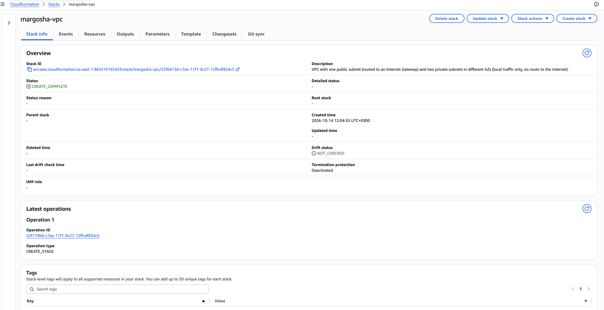
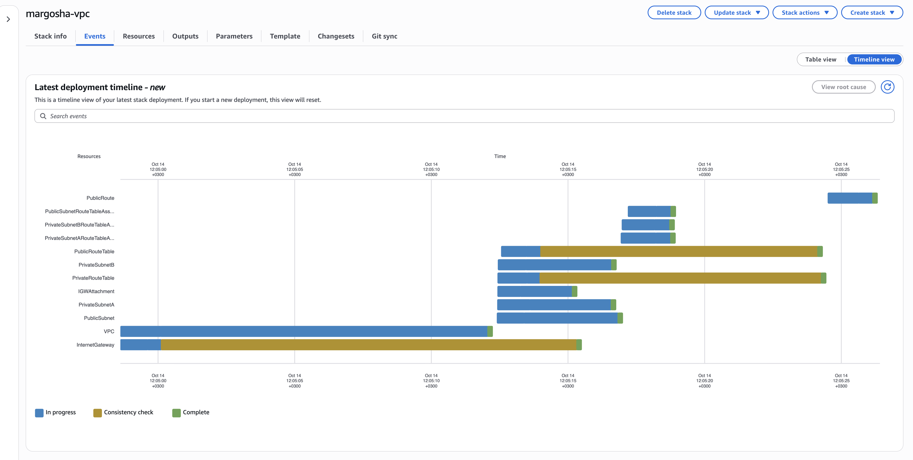
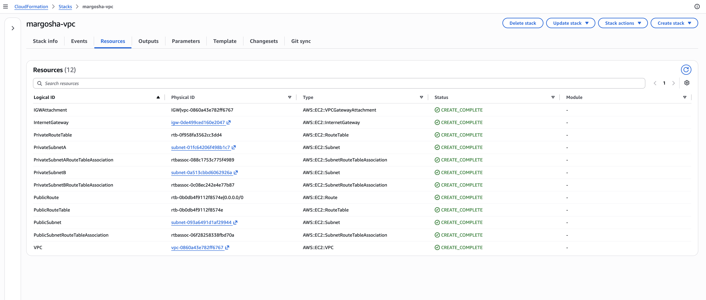
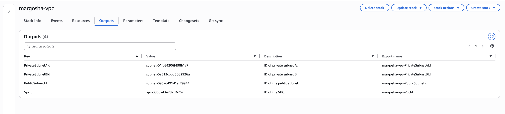
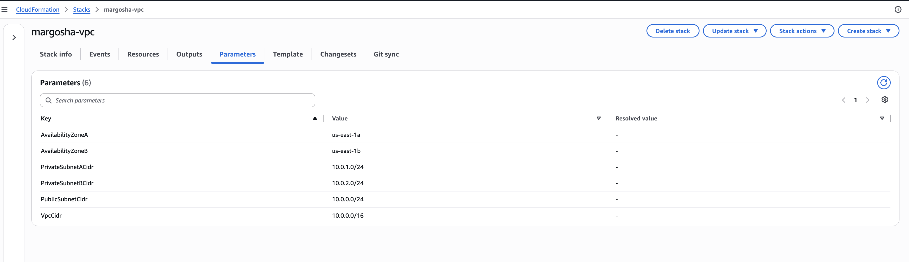
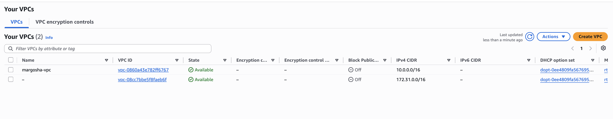
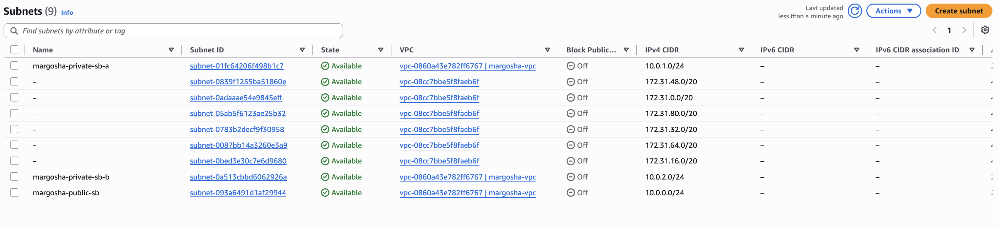
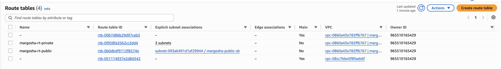
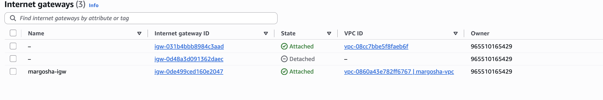

# Recreatability test

**Goal:** prove the stack can be destroyed and rebuilt from the IaC template alone, with no manual console steps.
**Template:** [margosha-vpc-stack.yaml](../cfn/margosha-vpc-stack.yaml)
**Stack name:** `margosha-vpc`

**Scope:** the network stack is the only deployable infrastructure in M1. The IAM policy and role template can't be deployed in the sandbox (see [role and policy creation](./role_policy_creation.md)), so it is not part of this test.

_**Note: Since I started this test within the new session, I had to create a stack beforehand one more time so that I could delete it._**

Run the commands from the `cfn/` folder, since they reference `file://margosha-vpc-stack.yaml`.

---

## Baseline (before teardown)

```bash
aws cloudformation describe-stacks --stack-name margosha-vpc --query 'Stacks[0].Outputs'
```
```json
[
    {
        "OutputKey": "VpcId",
        "OutputValue": "vpc-0714253f0af708583",
        "Description": "ID of the VPC.",
        "ExportName": "margosha-vpc-VpcId"
    },
    {
        "OutputKey": "PublicSubnetId",
        "OutputValue": "subnet-05c6cbcbd43e8aa09",
        "Description": "ID of the public subnet.",
        "ExportName": "margosha-vpc-PublicSubnetId"
    },
    {
        "OutputKey": "PrivateSubnetBId",
        "OutputValue": "subnet-00ec7ec72cf0420e0",
        "Description": "ID of private subnet B.",
        "ExportName": "margosha-vpc-PrivateSubnetBId"
    },
    {
        "OutputKey": "PrivateSubnetAId",
        "OutputValue": "subnet-0fb3e07cf86ef454b",
        "Description": "ID of private subnet A.",
        "ExportName": "margosha-vpc-PrivateSubnetAId"
    }
]
```
---

## Teardown

```bash
date
aws cloudformation delete-stack --stack-name margosha-vpc
aws cloudformation wait stack-delete-complete --stack-name margosha-vpc
date
```

| Step | Timestamp                     |
|---|-------------------------------|
| `delete-stack` issued | Wed Oct 14 12:02:39 EEST 2026 |
| `stack-delete-complete` confirmed | Wed Oct 14 12:03:11 EEST 2026 |
| **Teardown duration** | **32 s**                      |

Confirmed it's gone:
```bash
aws cloudformation describe-stacks --stack-name margosha-vpc
```


---

## First recreate attempt

```bash
date
aws cloudformation create-stack \
  --stack-name margosha-vpc \
  --template-body file://margosha-vpc-stack.yaml
aws cloudformation wait stack-create-complete --stack-name margosha-vpc
date
```

| Step | Timestamp                     |
|---|-------------------------------|
| `create-stack` issued | Wed Oct 14 12:04:54 EEST 2026 |
| Result | `CREATE_COMPLETE`             |
| Timestamp at result | Wed Oct 14 12:05:57 EEST 2026 |
| **Duration** | *57 s**                       |

```bash
aws cloudformation describe-stack-events --stack-name margosha-vpc \
  --query "StackEvents[].[Timestamp,LogicalResourceId,ResourceStatus]" --output table
```
```text
---------------------------------------------------------------------------------------------------
|                                       DescribeStackEvents                                       |
+-----------------------------------+---------------------------------------+---------------------+
|  2026-10-14T09:05:26.929000+00:00 |  margosha-vpc                         |  CREATE_COMPLETE    |
|  2026-10-14T09:05:26.138000+00:00 |  PublicRoute                          |  CREATE_COMPLETE    |
|  2026-10-14T09:05:25.627000+00:00 |  PublicRoute                          |  CREATE_IN_PROGRESS |
|  2026-10-14T09:05:24.508000+00:00 |  PublicRoute                          |  CREATE_IN_PROGRESS |
|  2026-10-14T09:05:24.258000+00:00 |  PrivateRouteTable                    |  CREATE_COMPLETE    |
|  2026-10-14T09:05:24.128000+00:00 |  PublicRouteTable                     |  CREATE_COMPLETE    |
|  2026-10-14T09:05:18.758000+00:00 |  PublicSubnetRouteTableAssociation    |  CREATE_COMPLETE    |
|  2026-10-14T09:05:18.744000+00:00 |  PrivateSubnetARouteTableAssociation  |  CREATE_COMPLETE    |
|  2026-10-14T09:05:18.712000+00:00 |  PrivateSubnetBRouteTableAssociation  |  CREATE_COMPLETE    |
|  2026-10-14T09:05:18.224000+00:00 |  PublicSubnetRouteTableAssociation    |  CREATE_IN_PROGRESS |
|  2026-10-14T09:05:18.201000+00:00 |  PrivateSubnetARouteTableAssociation  |  CREATE_IN_PROGRESS |
|  2026-10-14T09:05:18.148000+00:00 |  PrivateSubnetBRouteTableAssociation  |  CREATE_IN_PROGRESS |
|  2026-10-14T09:05:17.195000+00:00 |  PublicSubnetRouteTableAssociation    |  CREATE_IN_PROGRESS |
|  2026-10-14T09:05:16.973000+00:00 |  PrivateSubnetBRouteTableAssociation  |  CREATE_IN_PROGRESS |
|  2026-10-14T09:05:16.935000+00:00 |  PrivateSubnetARouteTableAssociation  |  CREATE_IN_PROGRESS |
|  2026-10-14T09:05:16.818000+00:00 |  PublicSubnet                         |  CREATE_COMPLETE    |
|  2026-10-14T09:05:16.585000+00:00 |  PrivateSubnetB                       |  CREATE_COMPLETE    |
|  2026-10-14T09:05:16.569000+00:00 |  PrivateSubnetA                       |  CREATE_COMPLETE    |
|  2026-10-14T09:05:15.312000+00:00 |  InternetGateway                      |  CREATE_COMPLETE    |
|  2026-10-14T09:05:15.147000+00:00 |  IGWAttachment                        |  CREATE_COMPLETE    |
|  2026-10-14T09:05:13.992000+00:00 |  PublicRouteTable                     |  CREATE_IN_PROGRESS |
|  2026-10-14T09:05:13.967000+00:00 |  PrivateRouteTable                    |  CREATE_IN_PROGRESS |
|  2026-10-14T09:05:13.593000+00:00 |  PrivateSubnetA                       |  CREATE_IN_PROGRESS |
|  2026-10-14T09:05:13.488000+00:00 |  PrivateRouteTable                    |  CREATE_IN_PROGRESS |
|  2026-10-14T09:05:13.467000+00:00 |  PublicRouteTable                     |  CREATE_IN_PROGRESS |
|  2026-10-14T09:05:13.443000+00:00 |  PrivateSubnetB                       |  CREATE_IN_PROGRESS |
|  2026-10-14T09:05:13.377000+00:00 |  PublicSubnet                         |  CREATE_IN_PROGRESS |
|  2026-10-14T09:05:13.247000+00:00 |  IGWAttachment                        |  CREATE_IN_PROGRESS |
|  2026-10-14T09:05:12.559000+00:00 |  PublicRouteTable                     |  CREATE_IN_PROGRESS |
|  2026-10-14T09:05:12.439000+00:00 |  PrivateSubnetB                       |  CREATE_IN_PROGRESS |
|  2026-10-14T09:05:12.426000+00:00 |  PrivateRouteTable                    |  CREATE_IN_PROGRESS |
|  2026-10-14T09:05:12.423000+00:00 |  IGWAttachment                        |  CREATE_IN_PROGRESS |
|  2026-10-14T09:05:12.417000+00:00 |  PrivateSubnetA                       |  CREATE_IN_PROGRESS |
|  2026-10-14T09:05:12.403000+00:00 |  PublicSubnet                         |  CREATE_IN_PROGRESS |
|  2026-10-14T09:05:12.056000+00:00 |  VPC                                  |  CREATE_COMPLETE    |
|  2026-10-14T09:05:00.110000+00:00 |  InternetGateway                      |  CREATE_IN_PROGRESS |
|  2026-10-14T09:05:00.083000+00:00 |  VPC                                  |  CREATE_IN_PROGRESS |
|  2026-10-14T09:04:59.606000+00:00 |  InternetGateway                      |  CREATE_IN_PROGRESS |
|  2026-10-14T09:04:58.625000+00:00 |  VPC                                  |  CREATE_IN_PROGRESS |
|  2026-10-14T09:04:58.621000+00:00 |  InternetGateway                      |  CREATE_IN_PROGRESS |
|  2026-10-14T09:04:55.521000+00:00 |  margosha-vpc                         |  CREATE_IN_PROGRESS |
+-----------------------------------+---------------------------------------+---------------------+
```

### What broke on the first attempt

Nothing broke: the stack was created successfully on the first attempt. 
The test was done in a new session, but the stack was created at the start of that session, right before the teardown (see the note at the top), so credentials and the default region were already working when the stack was recreated. 
The errors that can appear when starting in a new session (expired credentials, missing region, wrong file path) are listed in the [error reference](vpc_creation.md#basic-error-reference).

---

## Post-recreate verification

```bash
aws cloudformation describe-stacks --stack-name margosha-vpc --query 'Stacks[0].Outputs'
```
```json
[
    {
        "OutputKey": "VpcId",
        "OutputValue": "vpc-0860a43e782ff6767",
        "Description": "ID of the VPC.",
        "ExportName": "margosha-vpc-VpcId"
    },
    {
        "OutputKey": "PublicSubnetId",
        "OutputValue": "subnet-093a6491d1af29944",
        "Description": "ID of the public subnet.",
        "ExportName": "margosha-vpc-PublicSubnetId"
    },
    {
        "OutputKey": "PrivateSubnetBId",
        "OutputValue": "subnet-0a513cbbd6062926a",
        "Description": "ID of private subnet B.",
        "ExportName": "margosha-vpc-PrivateSubnetBId"
    },
    {
        "OutputKey": "PrivateSubnetAId",
        "OutputValue": "subnet-01fc64206f498b1c7",
        "Description": "ID of private subnet A.",
        "ExportName": "margosha-vpc-PrivateSubnetAId"
    }
]
```

The IDs are new because CloudFormation creates new resources. 
The configuration (CIDRs, AZs, routes) is the same because it comes from the template. 
The CIDRs and AZs are visible in the screenshots below.











---

## Summary

| Metric | Result                                                                                                                                                        |
|---|---------------------------------------------------------------------------------------------------------------------------------------------------------------|
| Teardown time | 32 s                                                                                                                                                          |
| Recreate time | 57 s                                                                                                                                                          |
| What broke on the first attempt | Nothing                                                                                                  |
| Conclusion | The stack is fully recreatable from the template alone. |