# Dissecting my AWS role

This document has two parts:

1. **My session role `voclabs`** in the **AWS Academy Cloud Architecting Sandbox**, where M1 is built. 
There is no role named `LabRole` in this sandbox, so I dissected the role my own session runs as.
2. **`LabRole`** in the **AWS Academy Learner Lab**, where M2 and later milestones will run. `LabRole` exists only there.

---

# Part 1: `voclabs` (Cloud Architecting Sandbox)

> **Note:** the Cloud Architecting Sandbox gives a new AWS account every session (3 hours), so account IDs 
> differ between outputs captured in different sessions. Commands use `ACCOUNT_ID` from `aws sts get-caller-identity` instead of a fixed ID:
> ```bash
> ACCOUNT_ID=$(aws sts get-caller-identity --query Account --output text)
> ```

---

## Which role am I?

### CLI
```bash
aws sts get-caller-identity
```

```json
{
  "UserId": "AROA6BTHD6O2RPKRX6KUH:user5162095=mfilipovych@kse.org.ua",
  "Account": "965510165429",
  "Arn": "arn:aws:sts::965510165429:assumed-role/voclabs/user5162095=mfilipovych@kse.org.ua"
}
```

Reading it: `assumed-role/voclabs/...` means I am a **session of the role `voclabs`**, not an IAM user.

### Console
1. Open the console from the lab page (**AWS** button).
2. Click my name in the **top-right corner**.
3. The dropdown shows `voclabs/<session name>` and the Account ID.

### Other confirmations
- Error messages from denied actions print the full ARN (`assumed-role/voclabs/...`).
- CloudTrail > Event history > `userIdentity` of a recent event (may not be permitted).

---

## What policies does the role have? (CLI)

```bash
aws iam list-attached-role-policies --role-name voclabs
```
```json
{
    "AttachedPolicies": [
        {
            "PolicyName": "ReadOnlyAccess",
            "PolicyArn": "arn:aws:iam::aws:policy/ReadOnlyAccess"
        }
    ]
}
```

```bash
aws iam list-role-policies --role-name voclabs
```
```json
{
  "PolicyNames": [
    "Pvoclabs"
  ]
}
```

| Policy | Type | Found with |
|---|---|---|
| `ReadOnlyAccess` (`arn:aws:iam::aws:policy/ReadOnlyAccess`) | AWS managed, attached | `list-attached-role-policies` |
| `Pvoclabs` | Inline | `list-role-policies` |

---

## What does it allow?

### Read access (from `ReadOnlyAccess`) - CLI
```bash
aws iam get-policy --policy-arn arn:aws:iam::aws:policy/ReadOnlyAccess
```
```json
{
  "Policy": {
    "PolicyName": "ReadOnlyAccess",
    "PolicyId": "ANPAILL3HVNFSB6DCOWYQ",
    "Arn": "arn:aws:iam::aws:policy/ReadOnlyAccess",
    "Path": "/",
    "DefaultVersionId": "v190",
    "AttachmentCount": 1,
    "PermissionsBoundaryUsageCount": 0,
    "IsAttachable": true,
    "Description": "Provides read-only access to AWS services and resources.",
    "CreateDate": "2015-02-06T18:39:48+00:00",
    "UpdateDate": "2026-09-24T17:37:08+00:00",
    "Tags": []
  }
}
```

```bash
aws iam get-policy-version \
  --policy-arn arn:aws:iam::aws:policy/ReadOnlyAccess --version-id v190 \
  > readonly-access-policy.json
```
Allows view actions (`Describe*`, `List*`, `Get*`) across AWS services: see result in [here](command_outputs/role_dissection/readonly-access-policy.json)

### Write access (from inline policy `Pvoclabs`)
The contents of `Pvoclabs` could not be read, so the write permissions are **inferred by testing**. Dry runs create nothing:
```bash
aws ec2 create-vpc --cidr-block 10.99.0.0/16 --dry-run
AMI_ID=$(aws ec2 describe-images \
  --owners amazon \
  --filters "Name=name,Values=al2023-ami-*-x86_64" "Name=state,Values=available" \
  --query 'sort_by(Images, &CreationDate)[-1].ImageId' \
  --output text)

aws ec2 run-instances --image-id "$AMI_ID" --instance-type t3.micro --dry-run
```
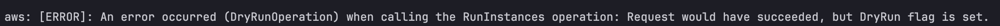

I can create a VPC and launch instances in the console.

**Inference (not read directly):** because `ReadOnlyAccess` has no write actions,
the inline policy `Pvoclabs` must grant the extra EC2/VPC write permissions. AWS combines all Allow statements from all attached policies.

#### Policy simulator

##### CLI
```bash
ACCOUNT_ID=$(aws sts get-caller-identity --query Account --output text)

aws iam simulate-principal-policy \
  --policy-source-arn arn:aws:iam::${ACCOUNT_ID}:role/voclabs \
  --action-names ec2:CreateVpc ec2:RunInstances iam:CreateRole s3:GetObject \
  > vocabrole-policy-simulator.json
```
Result in [here](command_outputs/role_dissection/vocabrole-policy-simulator.json).

| Action | Result | Matched policy | Notes |
|---|---|---|---|
| `ec2:CreateVpc` | **allowed** | `role_voclabs_Pvoclabs` | Org SCP also allows it (`AllowedByOrganizations: true`) |
| `ec2:RunInstances` | **allowed** | `role_voclabs_Pvoclabs` | Same |
| `iam:CreateRole` | **implicitDeny** | none matched | No Allow statement covers it — this is a gap in permissions, not a visible explicit deny (the simulator only showed `MatchedStatements: []`, so it can't name a deny statement the way it names allows) |
| `s3:GetObject` | **allowed** | `ReadOnlyAccess` **and** `role_voclabs_Pvoclabs` | Both policies independently allow it |


##### Console
1. Go to `https://policysim.aws.amazon.com`.
2. Select **Roles** > `voclabs`.
3. Choose services/actions, then **Run Simulation**.
4. The console and the CLI use the same evaluation, so they give the same results. The results in this document come from the CLI simulator above.

This confirms the inference directly: `Pvoclabs` is the policy that grants `ec2:CreateVpc` and `ec2:RunInstances`.
It's no longer just an inference from testing in the console — the simulator names `Pvoclabs` as the matched statement for each allowed action.

---

## What does it deny?

### Explicit denies observed - CLI error messages
```bash
aws iam get-role-policy --role-name voclabs --policy-name Pvoclabs
```
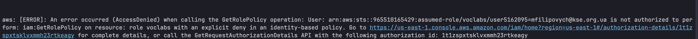
```bash
aws iam get-role --role-name voclabs --query 'Role.PermissionsBoundary'
```
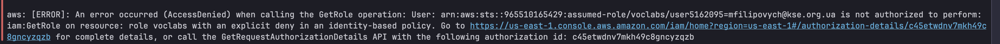

Both failed.


"Explicit deny in an identity-based policy" means a deny statement in one of my role's own policies. An explicit deny always beats any Allow.

### IAM write actions - tested, real API calls (not simulated)
```bash
ACCOUNT_ID=$(aws sts get-caller-identity --query Account --output text)

cat > trust.json << EOF
{
  "Version": "2012-10-17",
  "Statement": [
    {
      "Effect": "Allow",
      "Principal": { "AWS": "arn:aws:iam::${ACCOUNT_ID}:root" },
      "Action": "sts:AssumeRole"
    }
  ]
}
EOF

cat > policy.json << 'EOF'
{
  "Version": "2012-10-17",
  "Statement": [
    {
      "Sid": "ViewResourcesReadOnly",
      "Effect": "Allow",
      "Action": [
        "ec2:Describe*",
        "s3:ListAllMyBuckets",
        "s3:GetBucketLocation",
        "iam:List*",
        "iam:GetRole",
        "cloudformation:Describe*",
        "cloudformation:List*"
      ],
      "Resource": "*"
    }
  ]
}
EOF

aws iam create-role --role-name ViewOnlyRole --assume-role-policy-document file://trust.json
aws iam create-policy --policy-name ViewOnlyResourcesPolicy --policy-document file://policy.json
```

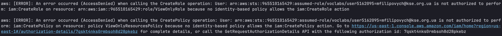

| Action | Result |
|---|---|
| `iam:CreateRole` | **AccessDenied** |
| `iam:CreatePolicy` | **AccessDenied** |


These two errors say *"because no identity-based policy **allows**"* — that is an **implicit deny** (no matching Allow statement anywhere).
This is different in kind from the `iam:GetRole`/`iam:GetRolePolicy` errors, which explicitly said *"with an **explicit deny** in an identity-based policy"*,
meaning a Deny statement specifically targets those two actions. So `Pvoclabs` likely contains:
- an explicit `Deny` on at least `iam:GetRole` and `iam:GetRolePolicy` (and possibly other read-the-role actions), and
- simply no `Allow` at all for IAM write actions like `CreateRole`/`CreatePolicy` — they're blocked by omission, not by a targeted deny.

---

## Console view of the role

**IAM** -> **Roles** -> search `voclabs` and click on it.

Note: for me this is access denied.
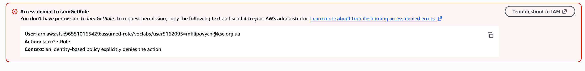

---

## Full role list (console)

Go to **IAM** -> **Roles**
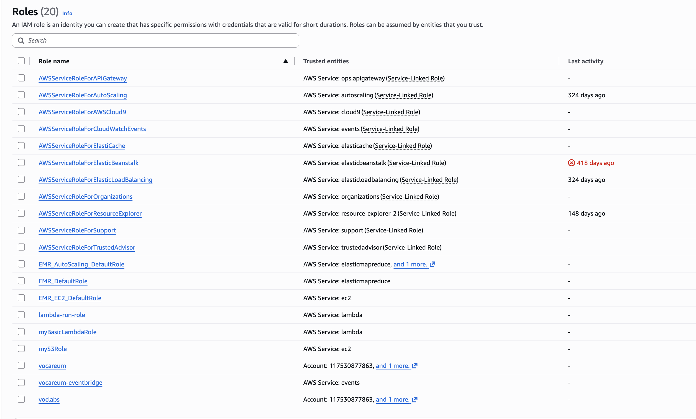

---

### What was read directly vs. inferred
- **Read directly:** attached policy name, inline policy name, the explicit-deny errors, the identity ARN.
- **Inferred:** the exact write permissions in `Pvoclabs`, because its content is hidden by the deny.
---

# Part 2: `LabRole` (Learner Lab)

## What it is

According to the Learner Lab readme, `LabRole` is a pre-created role "designed to be used when you want to attach a role to a resource in an AWS service".
It is not the role my console/CLI session uses (that is still `voclabs`, see `get-caller-identity` below),
but a role that **services** assume: it is attached to EC2 instances through the instance profile `LabInstanceProfile`, or to Lambda functions, ECS tasks, etc.

> **Note:** unlike the Cloud Architecting Sandbox, the Learner Lab keeps the same AWS account between sessions, so the account ID `797089401427` below stays the same.

## Does it exist, and who can assume it?

```bash
aws sts get-caller-identity
```
```json
{
    "UserId": "AROA3TFR3BJJS2YA2AWB3:user5162095=mfilipovych@kse.org.ua",
    "Account": "797089401427",
    "Arn": "arn:aws:sts::797089401427:assumed-role/voclabs/user5162095=mfilipovych@kse.org.ua"
}
```

```bash
aws iam get-role --role-name LabRole
```
```json
{
    "Role": {
        "Path": "/",
        "RoleName": "LabRole",
        "RoleId": "AROA3TFR3BJJVGGS75C7H",
        "Arn": "arn:aws:iam::797089401427:role/LabRole",
        "CreateDate": "2026-10-13T10:52:42+00:00",
        "AssumeRolePolicyDocument": {
            "Version": "2012-10-17",
            "Statement": [
                {
                    "Effect": "Allow",
                    "Principal": {
                        "AWS": "arn:aws:iam::797089401427:role/LabRole",
                        "Service": [
                            "elasticmapreduce.amazonaws.com",
                            "kms.amazonaws.com",
                            "cloudformation.amazonaws.com",
                            "autoscaling.amazonaws.com",
                            "sagemaker.amazonaws.com",
                            "states.amazonaws.com",
                            "elasticbeanstalk.amazonaws.com",
                            "resource-groups.amazonaws.com",
                            "ec2.application-autoscaling.amazonaws.com",
                            "firehose.amazonaws.com",
                            "athena.amazonaws.com",
                            "deepracer.amazonaws.com",
                            "apigateway.amazonaws.com",
                            "backup.amazonaws.com",
                            "pipes.amazonaws.com",
                            "servicecatalog.amazonaws.com",
                            "forecast.amazonaws.com",
                            "codewhisperer.amazonaws.com",
                            "rds.amazonaws.com",
                            "credentials.iot.amazonaws.com",
                            "scheduler.amazonaws.com",
                            "batch.amazonaws.com",
                            "ecs-tasks.amazonaws.com",
                            "elasticloadbalancing.amazonaws.com",
                            "iot.amazonaws.com",
                            "iotevents.amazonaws.com",
                            "rekognition.amazonaws.com",
                            "application-autoscaling.amazonaws.com",
                            "elasticfilesystem.amazonaws.com",
                            "ec2.amazonaws.com",
                            "dynamodb.amazonaws.com",
                            "cloudtrail.amazonaws.com",
                            "logs.amazonaws.com",
                            "glue.amazonaws.com",
                            "events.amazonaws.com",
                            "codecommit.amazonaws.com",
                            "lambda.amazonaws.com",
                            "kinesisanalytics.amazonaws.com",
                            "sqs.amazonaws.com",
                            "cognito-idp.amazonaws.com",
                            "eks.amazonaws.com",
                            "codedeploy.amazonaws.com",
                            "ecs.amazonaws.com",
                            "eks-fargate-pods.amazonaws.com",
                            "redshift.amazonaws.com",
                            "databrew.amazonaws.com",
                            "ssm.amazonaws.com",
                            "secretsmanager.amazonaws.com",
                            "sns.amazonaws.com",
                            "s3.amazonaws.com",
                            "iotanalytics.amazonaws.com",
                            "kinesis.amazonaws.com"
                        ]
                    },
                    "Action": "sts:AssumeRole"
                }
            ]
        },
        "Description": "",
        "MaxSessionDuration": 3600,
        "Tags": [
            {
                "Key": "cloudlab",
                "Value": "c235010a5906184l17592828t1w797089401427"
            }
        ],
        "RoleLastUsed": {}
    }
}
```

### Reading the role details

| Field | Value | Meaning |
|---|---|---|
| `CreateDate` | 2026-10-13 | created by the lab platform when the Learner Lab was first started |
| `MaxSessionDuration` | 3600 (1 hour) | temporary credentials from this role are valid for at most 1 hour (services renew them automatically) |
| `Tags` | `cloudlab = c235010a...797089401427` | the same kind of tag as on the sandbox resources: the role is managed by the lab platform |
| `RoleLastUsed` | empty | nothing has used the role yet |

### Trust policy (who can assume `LabRole`)

The `AssumeRolePolicyDocument` has one `Allow` statement for `sts:AssumeRole` with two kinds of principals:

| Trusted principal | Meaning |
|---|---|
| `"AWS": "arn:aws:iam::797089401427:role/LabRole"` | the role trusts **itself**: a session that already runs as `LabRole` can assume `LabRole` again (role chaining). |
| `"Service": [...]` (52 AWS services) | these services can assume `LabRole` to act on my behalf. Relevant for this project: `ec2.amazonaws.com` (EC2 instances via `LabInstanceProfile`), `ecs-tasks.amazonaws.com` / `ecs.amazonaws.com` (containers), `lambda.amazonaws.com`, `cloudformation.amazonaws.com` (CloudFormation can use it as a service role), `codedeploy.amazonaws.com`, `autoscaling.amazonaws.com`, `elasticloadbalancing.amazonaws.com`, `ssm.amazonaws.com`. |

**Not trusted:** my own session role `voclabs` is not in the trust policy.
So I can't assume `LabRole` myself (e.g. with "Switch role" in the console), even though the console shows a switch-role link.
The role is meant for services, not for people.

## Which policies does it have?

```bash
aws iam list-attached-role-policies --role-name LabRole
aws iam list-role-policies --role-name LabRole
aws iam list-instance-profiles-for-role --role-name LabRole
```

```json lines
{
    "AttachedPolicies": [
        {
            "PolicyName": "AmazonSSMManagedInstanceCore",
            "PolicyArn": "arn:aws:iam::aws:policy/AmazonSSMManagedInstanceCore"
        },
        {
            "PolicyName": "AmazonEKSClusterPolicy",
            "PolicyArn": "arn:aws:iam::aws:policy/AmazonEKSClusterPolicy"
        },
        {
            "PolicyName": "AmazonEC2ContainerRegistryReadOnly",
            "PolicyArn": "arn:aws:iam::aws:policy/AmazonEC2ContainerRegistryReadOnly"
        },
        {
            "PolicyName": "AmazonEKSWorkerNodePolicy",
            "PolicyArn": "arn:aws:iam::aws:policy/AmazonEKSWorkerNodePolicy"
        },
        {
            "PolicyName": "c235010a5906184l17592828t1w797089401427-VocLabPolicy1-1iHmn5jZsBDH",
            "PolicyArn": "arn:aws:iam::797089401427:policy/c235010a5906184l17592828t1w797089401427-VocLabPolicy1-1iHmn5jZsBDH"
        },
        {
            "PolicyName": "c235010a5906184l17592828t1w797089401427-VocLabPolicy3-lEqtuEPBuywr",
            "PolicyArn": "arn:aws:iam::797089401427:policy/c235010a5906184l17592828t1w797089401427-VocLabPolicy3-lEqtuEPBuywr"
        },
        {
            "PolicyName": "c235010a5906184l17592828t1w797089401427-VocLabPolicy2-W9w18pGqhpf9",
            "PolicyArn": "arn:aws:iam::797089401427:policy/c235010a5906184l17592828t1w797089401427-VocLabPolicy2-W9w18pGqhpf9"
        }
    ]
}

{
  "PolicyNames": []
}
{
  "InstanceProfiles": [
    {
      "Path": "/",
      "InstanceProfileName": "LabInstanceProfile",
      "InstanceProfileId": "AIPA3TFR3BJJ22AWAXR66",
      "Arn": "arn:aws:iam::797089401427:instance-profile/LabInstanceProfile",
      "CreateDate": "2026-10-13T10:53:01+00:00",
      "Roles": [
        {
          "Path": "/",
          "RoleName": "LabRole",
          "RoleId": "AROA3TFR3BJJVGGS75C7H",
          "Arn": "arn:aws:iam::797089401427:role/LabRole",
          "CreateDate": "2026-10-13T10:52:42+00:00",
          "AssumeRolePolicyDocument": {
            "Version": "2012-10-17",
            "Statement": [
              {
                "Effect": "Allow",
                "Principal": {
                  "AWS": "arn:aws:iam::797089401427:role/LabRole",
                  "Service": [
                    "rekognition.amazonaws.com",
                    "codecommit.amazonaws.com",
                    "lambda.amazonaws.com",
                    "application-autoscaling.amazonaws.com",
                    "elasticfilesystem.amazonaws.com",
                    "iotanalytics.amazonaws.com",
                    "ecs-tasks.amazonaws.com",
                    "sns.amazonaws.com",
                    "elasticloadbalancing.amazonaws.com",
                    "iot.amazonaws.com",
                    "cloudtrail.amazonaws.com",
                    "iotevents.amazonaws.com",
                    "logs.amazonaws.com",
                    "events.amazonaws.com",
                    "forecast.amazonaws.com",
                    "rds.amazonaws.com",
                    "ec2.amazonaws.com",
                    "codewhisperer.amazonaws.com",
                    "batch.amazonaws.com",
                    "scheduler.amazonaws.com",
                    "resource-groups.amazonaws.com",
                    "credentials.iot.amazonaws.com",
                    "servicecatalog.amazonaws.com",
                    "pipes.amazonaws.com",
                    "backup.amazonaws.com",
                    "autoscaling.amazonaws.com",
                    "kms.amazonaws.com",
                    "elasticbeanstalk.amazonaws.com",
                    "ec2.application-autoscaling.amazonaws.com",
                    "elasticmapreduce.amazonaws.com",
                    "athena.amazonaws.com",
                    "cloudformation.amazonaws.com",
                    "ecs.amazonaws.com",
                    "states.amazonaws.com",
                    "codedeploy.amazonaws.com",
                    "firehose.amazonaws.com",
                    "sqs.amazonaws.com",
                    "apigateway.amazonaws.com",
                    "kinesisanalytics.amazonaws.com",
                    "kinesis.amazonaws.com",
                    "eks.amazonaws.com",
                    "glue.amazonaws.com",
                    "cognito-idp.amazonaws.com",
                    "databrew.amazonaws.com",
                    "secretsmanager.amazonaws.com",
                    "deepracer.amazonaws.com",
                    "redshift.amazonaws.com",
                    "eks-fargate-pods.amazonaws.com",
                    "s3.amazonaws.com",
                    "dynamodb.amazonaws.com",
                    "ssm.amazonaws.com",
                    "sagemaker.amazonaws.com"
                  ]
                },
                "Action": "sts:AssumeRole"
              }
            ]
          }
        }
      ]
    }
  ]
}
```

| Policy | Type | Found with |
|---|---|---|
| `AmazonSSMManagedInstanceCore` | AWS managed, attached | `list-attached-role-policies` |
| `AmazonEKSClusterPolicy` | AWS managed, attached | `list-attached-role-policies` |
| `AmazonEC2ContainerRegistryReadOnly` | AWS managed, attached | `list-attached-role-policies` |
| `AmazonEKSWorkerNodePolicy` | AWS managed, attached | `list-attached-role-policies` |
| `...-VocLabPolicy1-1iHmn5jZsBDH` | customer managed (created by the lab), attached | `list-attached-role-policies` |
| `...-VocLabPolicy2-W9w18pGqhpf9` | customer managed (created by the lab), attached | `list-attached-role-policies` |
| `...-VocLabPolicy3-lEqtuEPBuywr` | customer managed (created by the lab), attached | `list-attached-role-policies` |
| (none) | inline | `list-role-policies` returned an empty list |
| `LabInstanceProfile` | instance profile containing `LabRole` | `list-instance-profiles-for-role` |

## What does it allow?

### AWS managed policies (readable)

The content of AWS managed policies can be read (console: **IAM** -> **Policies** -> policy -> **Permissions**, or `aws iam get-policy-version`):

| Policy | Allows (console summary) | What it means |
|---|---|---|
| `AmazonSSMManagedInstanceCore` | EC2 Messages: full; SSM Messages: full; Systems Manager: limited List, Read, Write | an EC2 instance with this role can register with Systems Manager, so I can open a terminal on it with **Session Manager** (no SSH key, no open port 22) |
| `AmazonEC2ContainerRegistryReadOnly` | Elastic Container Registry: limited List, Read | pull container images from ECR, but not push |
| `AmazonEKSClusterPolicy` | EC2: limited List, Write, Tagging (only with condition `ec2:ResourceTag/eks:eni:owner = amazon-vpc-cni`); EC2 Auto Scaling: limited List, Write; ELB and ELB v2: List, Read, Write, Tagging; IAM: limited Write (only with condition `iam:AWSServiceName = elasticloadbalancing.amazonaws.com`); KMS: limited Read | what EKS needs to manage a cluster: network interfaces it tags itself, Auto Scaling groups, load balancers, and creating the Elastic Load Balancing service-linked role (the only IAM write, and only for that one service) |
| `AmazonEKSWorkerNodePolicy` | EC2: limited List; EKS: limited Read; EKS Auth: full | what an EKS worker node needs to join a cluster |

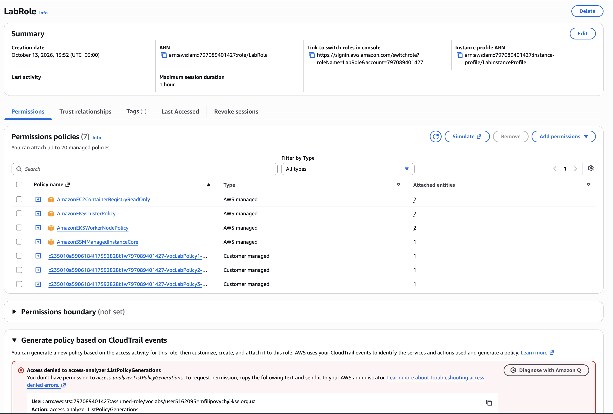
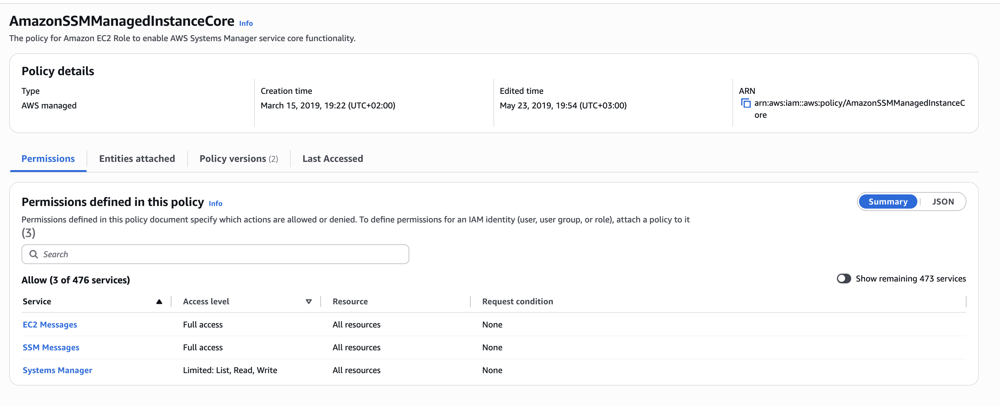
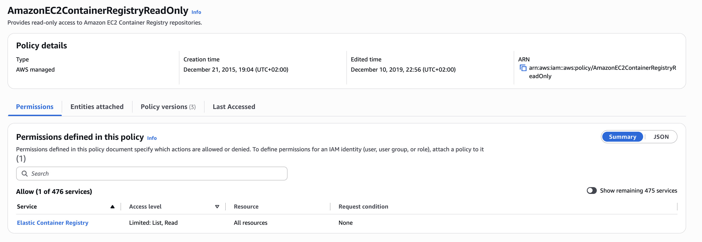
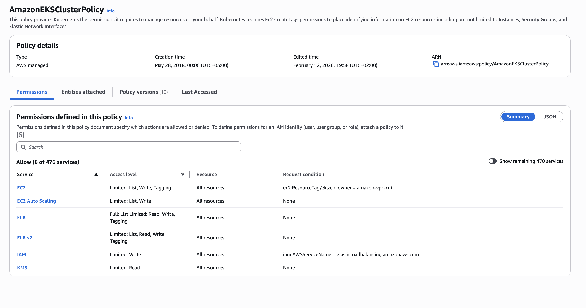
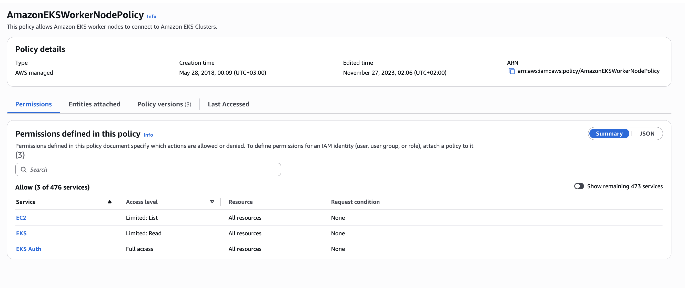

### Lab-created policies `VocLabPolicy1/2/3` (not readable)

I tried to open each of them (console, and `aws iam get-policy --policy-arn <ARN>`). All three failed with the same error:

```text
Access denied to iam:GetPolicy
User: arn:aws:sts::797089401427:assumed-role/voclabs/user5162095=...
Action: iam:GetPolicy
On resource: arn:aws:iam::797089401427:policy/c235010a5906184l17592828t1w797089401427-VocLabPolicy1-1iHmn5jZsBDH   (same for 2 and 3)
Context: an identity-based policy explicitly denies the action
Policy ARN: arn:aws:iam::797089401427:policy/Pvoclabs1
```

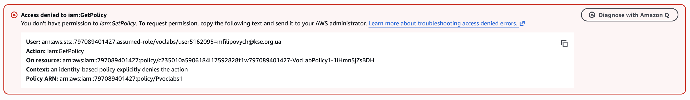
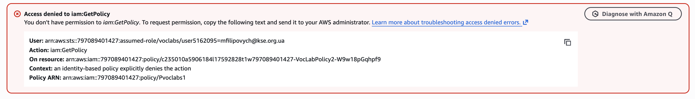
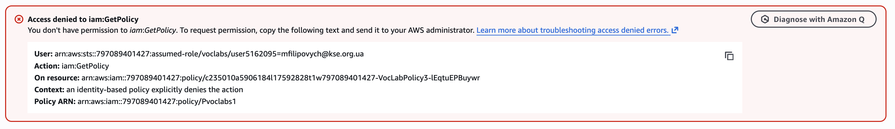

Reading the error:
- It's an **explicit deny**, and the error names where it comes from: the policy `Pvoclabs1`.
- The denied identity is **my session** (`voclabs`), not `LabRole`. So this deny says nothing about what `LabRole` can do. 
  It only stops me from reading these three policies, in the same way `Pvoclabs` in the sandbox stopped me from reading my own role's inline policy (Part 1).

**Inference (checked below):** the readme says `LabRole` "has permissions very similar to the permissions you have as a user in the console".
The four AWS managed policies only cover SSM, ECR, EKS and some EC2/ELB/Auto Scaling actions, so the broad permissions (e.g. EC2, S3) most likely come from `VocLabPolicy1/2/3`.
The policy simulator below confirms this without reading the policies.

## Policy simulator

```bash
ACCOUNT_ID=$(aws sts get-caller-identity --query Account --output text)

aws iam simulate-principal-policy \
  --policy-source-arn arn:aws:iam::${ACCOUNT_ID}:role/LabRole \
  --action-names ec2:CreateVpc ec2:RunInstances iam:CreateRole iam:CreatePolicy s3:GetObject \
  > labrole-policy-simulator.json
```

The result: [here](command_outputs/role_dissection/labrole-policy-simulator.json).

| Action | Result | Matched policy | Notes |
|---|---|---|---|
| `ec2:CreateVpc` | **allowed** | `VocLabPolicy1` | same statement as `RunInstances` (characters 38–1086 of the policy) |
| `ec2:RunInstances` | **allowed** | `VocLabPolicy1` | same statement as `CreateVpc` |
| `iam:CreateRole` | **implicitDeny** | none matched | no Allow statement covers it |
| `iam:CreatePolicy` | **allowed** | `VocLabPolicy2` | the role can create IAM policies (characters 954–1339 of the policy) |
| `s3:GetObject` | **allowed** | `VocLabPolicy1` | a different statement in the same policy (characters 1086–2663) |

All five have `AllowedByOrganizations: true`, so no organization-level policy (SCP) blocks them.

Reading the results:
- **The inference is confirmed:** the broad service permissions (EC2, S3) come from `VocLabPolicy1`, not from the AWS managed policies. 
  The simulator names the policy and even the position of the matching statement, without me being able to read the policy.
- **`LabRole` can create IAM policies, but not roles** (`VocLabPolicy2` allows `iam:CreatePolicy`; nothing allows `iam:CreateRole`). 
  This matches the readme ("You cannot create roles, except that you can create service-linked roles").

## What does it deny?

- **Anything no attached policy allows** (implicit deny), as for every role. Example: `iam:CreateRole` (simulator: `implicitDeny`, no matching statement).
- **Being assumed by anyone not in the trust policy**, including my own session role `voclabs`.
- **Creating IAM roles:** denied (implicit). Creating IAM **policies** is allowed (`VocLabPolicy2`), 
  and the readable `AmazonEKSClusterPolicy` allows creating the Elastic Load Balancing service-linked role. 
  This matches the readme: in the Learner Lab "you cannot create roles, except that you can create service-linked roles".
- **Most likely, anything outside the lab restrictions** (other instance types, volume types, regions, RDS classes): inferred from the condition keys the simulator reported, not tested.
- No explicit deny on `LabRole` itself could be seen: the explicit denies I hit were on my session (`Pvoclabs1`), 
  not on `LabRole`, and the simulator found no deny statements for the tested actions.

## Console

**IAM** -> **Roles** -> `LabRole`:
- **Permissions** tab: the 7 attached policies (screenshot above). No permissions boundary is set.
- **Trust relationships** tab: shows the same JSON document as `AssumeRolePolicyDocument` in the `get-role` output above.
- **Tags** tab: the `cloudlab` tag.

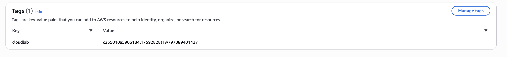

Also observed in the console: "Generate policy based on CloudTrail events" failed with `Access denied to access-analyzer:ListPolicyGenerations`, 
so I couldn't use IAM Access Analyzer to see which permissions the role actually uses.

## What was read directly vs. inferred

- **Read directly:** the role, its trust policy, the 7 attached policies and the instance profile (CLI and console); 
  the content of the 4 AWS managed policies (console); that my session is explicitly denied `iam:GetPolicy` on the 3 lab policies, and by which policy (`Pvoclabs1`).
- **Found with the simulator (without reading the policies):** `VocLabPolicy1` allows `ec2:CreateVpc`, `ec2:RunInstances` and `s3:GetObject`; `VocLabPolicy2`
  allows `iam:CreatePolicy`; nothing allows `iam:CreateRole`.
- **Inferred:** the exact full content of `VocLabPolicy1/2/3`, and that the lab restrictions (instance types, volumes, regions, RDS) 
  are enforced with conditions in them (from the condition keys the simulator reported and the readme).

## What it means for M2

- EC2 instances (coordinator, shards) can get `LabRole` through `LabInstanceProfile`, so the app can use AWS services without access keys on the instance.
- Thanks to `AmazonSSMManagedInstanceCore`, I can connect to instances with **Session Manager**, also in private subnets without public IPs (they still need a network path to SSM).
- `AmazonEC2ContainerRegistryReadOnly` lets instances pull images from ECR, if M2 uses containers.

---

# Summary

| Role | Environment | Allows | Denies | How found |
|---|---|---|---|---|
| `voclabs` | Cloud Architecting Sandbox | view everything (`ReadOnlyAccess`); EC2/VPC writes (`Pvoclabs`) | IAM writes (implicit); reading its own role (explicit) | CLI, dry runs, policy simulator, error messages |
| `LabRole` | Learner Lab | assumed by 52 AWS services (incl. EC2, ECS, Lambda, CloudFormation) and by itself; broad service access such as EC2 and S3 (`VocLabPolicy1`); creating IAM policies (`VocLabPolicy2`); SSM Session Manager, ECR pull, EKS cluster/node actions, ELB/Auto Scaling management (AWS managed policies) | being assumed by people (incl. `voclabs`); creating IAM roles (implicit); most likely anything outside the lab restrictions (conditions); everything not allowed (implicit) | CLI (`get-role`, `list-*`), console policy summaries, error messages, policy simulator |