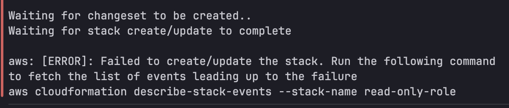
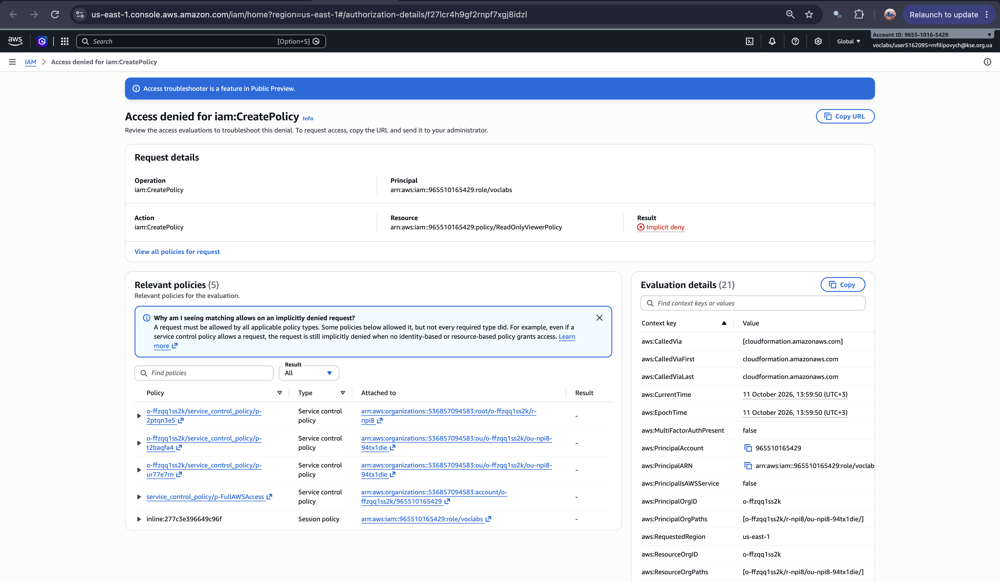

# Role and Policy Creation

This CloudFormation template creates:

1. **A view-only IAM managed policy.** It allows only viewing resources (their metadata) across EC2/VPC, S3, IAM, CloudFormation and other common AWS services.
   It gives no create, update or delete access, and it doesn't allow reading data contents (for example S3 object contents, secret values or log contents).
2. **An IAM role** with that policy attached, which another principal can assume.

File: [read-only-role.yaml](../cfn/read-only-role.yaml)

The stack could not be deployed in the AWS Academy sandbox due to permissions set. See [Deployment in the sandbox fails](#deployment-in-the-sandbox-fails).

## What the policy would do

Anyone who assumes the role could see the resources in the account (EC2 instances, VPCs, subnets, route tables, security groups,
S3 buckets and the names of objects in them, IAM users/roles/policies, CloudFormation stacks, load balancers, databases, containers, queues and more), 
but could not create, change or delete anything. They also could not read data, such as the contents of S3 objects, secret values, parameter values or log contents.

| Statement | Actions | What it allows |
|---|---|---|
| `ViewEC2AndVPC` | `ec2:Describe*` | See instances, VPCs, subnets, Internet Gateways, route tables, security groups |
| `ViewS3BucketsNotObjects` | `s3:ListAllMyBuckets`, `s3:GetBucketLocation`, `s3:ListBucket` | See buckets, their region and object names. No `s3:GetObject`, so object contents can't be read |
| `ViewIAM` | `iam:List*`, `iam:Get*` | See users, roles, policies and their details |
| `ViewCloudFormation` | `cloudformation:Describe*`, `cloudformation:List*` | See stacks, their resources and events |
| `ViewOtherServicesMetadata` | `Describe*` / `List*` for Elastic Load Balancing, Auto Scaling, CloudWatch, CloudWatch Logs, Lambda, RDS, DynamoDB, ECS, EKS, ECR, SNS, SQS, KMS, Route 53, ACM, CloudTrail; `secretsmanager:ListSecrets`/`DescribeSecret`; `ssm:DescribeParameters`; `tag:GetResources` | See these resources and their configuration. Secret and parameter **names** are visible, their **values** are not; log groups are visible, log contents are not |

Everything not listed is implicitly denied. IAM denies every action that no policy allows, so no extra `Deny` statements are needed.

## Parameters

| Parameter | Description |
|---|---|
| `TrustedPrincipalArn` | ARN of the principal allowed to assume the role (account root, IAM user, or IAM role). |
| `MaxSessionDuration` | Maximum session length in seconds (3600 to 43200). Default: 3600. |

The account ID changes every sandbox session (3 hours), so it is never hardcoded. Get the current one with:
```bash
ACCOUNT_ID=$(aws sts get-caller-identity --query Account --output text)
```

## Steps

Run the commands from the `cfn/` folder, since they reference `file://read-only-role.yaml`.

### Validate the Template

```bash
aws cloudformation validate-template --template-body file://read-only-role.yaml
```

_This checks the syntax and structure and prints the parameters._
It doesn't check IAM permissions or whether your parameter values are valid, so those errors only show up at deploy time.

```json
{
    "Parameters": [
        {
            "ParameterKey": "MaxSessionDuration",
            "DefaultValue": "3600",
            "NoEcho": false,
            "Description": "Maximum session duration in seconds (1 to 12 hours)."
        },
        {
            "ParameterKey": "TrustedPrincipalArn",
            "NoEcho": false,
            "Description": "ARN of the principal allowed to assume the role. Examples: arn:aws:iam::123456789012:root (whole account), arn:aws:iam::123456789012:user/alice, arn:aws:iam::123456789012:role/SomeRole\n"
        }
    ],
    "Description": "Creates a view-only (read-only) IAM managed policy and an IAM role that has the policy attached and can be assumed by another principal.\n",
    "Capabilities": [
        "CAPABILITY_NAMED_IAM"
    ],
    "CapabilitiesReason": "The following resource(s) require capabilities: [AWS::IAM::ManagedPolicy]"
}
```

### Create the Stack

#### CLI

```bash
ACCOUNT_ID=$(aws sts get-caller-identity --query Account --output text)

aws cloudformation deploy \
  --template-file read-only-role.yaml \
  --stack-name read-only-role \
  --capabilities CAPABILITY_NAMED_IAM \
  --parameter-overrides TrustedPrincipalArn=arn:aws:iam::${ACCOUNT_ID}:root
```

`CAPABILITY_NAMED_IAM` is a safety acknowledgment you give CloudFormation. 
It says: "I know this template creates IAM resources (roles, policies, users) with custom names, and I approve that." 
It's needed here because the template sets custom names (`ManagedPolicyName`, `RoleName`). `CAPABILITY_IAM` is not enough for named IAM resources,
and the deployment would fail with `InsufficientCapabilities`.

The example trusts the whole current account (`:root`). To trust a specific identity instead, use `arn:aws:iam::<ACCOUNT_ID>:role/<ROLE_NAME>` or `arn:aws:iam::<ACCOUNT_ID>:user/<USER_NAME>`.

The deployment creates the stack and waits for it to finish.
If you want to review the changes before anything is created, add a `--no-execute-changeset` flag.
That makes deploy build a change set and stop.
You can then inspect it with `aws cloudformation describe-change-set` and apply it with `aws cloudformation execute-change-set`.

#### Console

1. Open **CloudFormation**, choose **Create stack**, then **With new resources**.
2. Upload `read-only-role.yaml`.
3. Enter the _stack name_ and the `TrustedPrincipalArn` parameter.
4. On the last page, tick the box acknowledging that CloudFormation may create IAM resources with custom names.
5. Choose **Submit**.

### Check the Result

```bash
aws cloudformation describe-stacks --stack-name read-only-role \
  --query "Stacks[0].Outputs"
```

The output should show the role ARN and the policy ARN, and the stack status should be `CREATE_COMPLETE`.
If the stack rolls back, see why with:
```bash
aws cloudformation describe-stack-events --stack-name read-only-role \
  --query "StackEvents[?ResourceStatus=='CREATE_FAILED'].[LogicalResourceId,ResourceStatusReason]"
```

### How it would be tested (not possible in the sandbox)

The stack can't be deployed in the sandbox (see below), so these steps were **not** run. 
They describe how the role would be tested in an account that allows IAM changes.

#### CLI (as the trusted principal)

```bash
aws sts assume-role \
  --role-arn <RoleArn from outputs> \
  --role-session-name readonly-test
```

Export the returned temporary credentials as `AWS_ACCESS_KEY_ID`, `AWS_SECRET_ACCESS_KEY` and `AWS_SESSION_TOKEN`.
Then confirm that viewing works and writing fails:
```bash
aws ec2 describe-vpcs                        # should succeed
aws s3 ls                                    # should succeed (lists buckets)
aws s3 cp s3://<bucket>/<key> .              # should fail: no s3:GetObject
aws s3 mb s3://some-test-bucket              # should fail with AccessDenied
aws ec2 create-vpc --cidr-block 10.99.0.0/16 # should fail with UnauthorizedOperation
```

#### Console

1. **Get the role details:** in CloudFormation, open the stack, go to the **Outputs** tab and copy the role ARN. 
    You need two parts of it: the 12-digit account ID and the role name (`ReadOnlyViewerRole`).
2. **Sign in as the trusted principal:** sign in as the identity you passed in `TrustedPrincipalArn`. 
    If you used the account root ARN, any user in that account works, but that user also needs an identity policy allowing `sts:AssumeRole` on the role. 
    If you named a specific user in the trust policy, that's enough on its own.
3. **Switch role:**
    - Click your account name in the top-right corner and choose **Switch role**.
    - Enter the **Account ID** and **Role name**.
    - Optionally set a display name (for example `ReadOnly`) and a color, so you can tell at a glance that you're in the role.
    - Choose **Switch Role**. The top bar now shows the role's display name instead of your user.
4. **Confirm viewing works:**
    - **EC2 → Instances** and **VPC → Your VPCs:** the lists load.
    - **S3:** you can list buckets and see object names inside them.
    - **IAM → Roles:** you can view roles and their policies.
    - **CloudFormation:** you can view stacks and their events.
    - **Secrets Manager:** you can see the list of secrets, but **Retrieve secret value** is denied.
5. **Confirm writing and reading data fail:**
    - **S3:** choose **Create bucket**. You should get an *access denied* error on submit. Trying to open or download an object should also be denied.
    - **EC2:** select an instance and try **Instance state → Stop**. You should get an *UnauthorizedOperation* error.
    - **IAM:** try to create a role or edit a policy. It should fail.
6. **Switch back:** click the role name in the top bar and choose **Back to <your user>**.

### Cleanup

```bash
aws cloudformation delete-stack --stack-name read-only-role
```

This removes both the role and the policy.

## Deployment in the sandbox fails



Why?
```bash
aws cloudformation describe-stack-events --stack-name read-only-role \
  > why_role_policy_creation_failed.json
```

Output: in [here](command_outputs/read_only_role/why-role-policy-creation-failed.json).



### Why the sandbox refuses it

- CloudFormation creates resources using the permissions of the identity that runs the deployment. In the Learner Lab, that is the pre-made `voclabs` role.
- Learner Lab deliberately restricts IAM so students cannot create their own roles, policies or users. 
  The `voclabs` role has no policy allowing `iam:CreatePolicy` or `iam:CreateRole`. 
  This is an **implicit deny**: the error says "no identity-based policy allows" the action. 
  See the [role dissection](./role_dissection.md), where both actions were tested directly and the policy simulator returned `implicitDeny` for `iam:CreateRole`.
- CloudFormation therefore gets a `403` from IAM, the stack goes to `CREATE_FAILED`, and it rolls back (`ROLLBACK_COMPLETE`).
- **Why the error names `CreatePolicy` and not `CreateRole`:** the role references the policy (`ManagedPolicyArns: !Ref ReadOnlyPolicy`), so CloudFormation creates the policy first. It failed there, so the role was never attempted inside the stack. The role dissection shows that `iam:CreateRole` is denied as well.

This is an environment restriction, not an error in the template. The request reached IAM and was refused only because of missing permissions.

### Notes

- Converting the managed policy to an inline policy does not help, because creating the role itself (`iam:CreateRole`) is blocked too.
- A failed stack must be deleted before reusing its name:
  `aws cloudformation delete-stack --stack-name read-only-role`