# VPC creation

_**Note:** you can easily achieve the same results via console, but I decided to go with stack directly so that I can recreate it as many times as needed._

**Template:** [margosha-vpc-stack.yaml](../cfn/margosha-vpc-stack.yaml)
**Stack name:** `margosha-vpc`
**Region:** `us-east-1`
**Role:** `voclabs`

---

## Setup: default region and credentials

CloudFormation and EC2 calls need both credentials and a region before anything else works.

**Credentials** (from Learner Lab → AWS Details → Show, AWS CLI block):
```bash
mkdir -p ~/.aws
nano ~/.aws/credentials
```
Paste the `[default]` block with `aws_access_key_id`, `aws_secret_access_key`, `aws_session_token`. 
These expire with the lab session — when calls start failing with `ExpiredToken` or `InvalidClientTokenId`, refresh from the same page and overwrite the file.

**Default region** — set once per terminal session, or persist it:
```bash
export AWS_DEFAULT_REGION=us-east-1
```
To persist across terminal restarts:
```bash
echo 'export AWS_DEFAULT_REGION=us-east-1' >> ~/.zshrc
source ~/.zshrc
```
Or skip the env var and pass `--region us-east-1` on each individual command.

**Verify both are working:**
```bash
aws sts get-caller-identity
```
Should return the `assumed-role/voclabs/...` ARN with no errors.
If this fails with `NoRegion`, the region isn't set; if it fails with `InvalidClientTokenId`/`ExpiredToken`, the credentials are missing or stale.

---

## Pre-flight

Run all commands below from the `cfn/` folder, since they reference `file://margosha-vpc-stack.yaml`.

```bash
aws cloudformation validate-template --template-body file://margosha-vpc-stack.yaml
```

or put into a file:
```bash
aws cloudformation validate-template --template-body file://margosha-vpc-stack.yaml \
  > validation.json
```

**[Result](./command_outputs/vpc_creation/validation.json):** valid — returned all 6 parameters with correct defaults 
(`VpcCidr: 10.0.0.0/16`, `PublicSubnetCidr: 10.0.0.0/24`, `PrivateSubnetACidr: 10.0.1.0/24`, `PrivateSubnetBCidr: 10.0.2.0/24`,
`AvailabilityZoneA: us-east-1a`, `AvailabilityZoneB: us-east-1b`), no syntax errors.

---

## Create

```bash
date
aws cloudformation create-stack \
  --stack-name margosha-vpc \
  --template-body file://margosha-vpc-stack.yaml
aws cloudformation wait stack-create-complete --stack-name margosha-vpc
date
```

_The account ID in the `StackId` below is from the session in which this was run.
The sandbox gives a new AWS account every session (see the note in the [role dissection](role_dissection.md)), so it differs between outputs._

| Step | Timestamp |
|---|---|
| Command issued | Tue Oct 13 19:48:34 EEST 2026 |
| `StackId` returned | `arn:aws:cloudformation:us-east-1:965510165429:stack/margosha-vpc/ee67e660-c725-11f1-bdef-0e243170b00d` |
| `stack-create-complete` | Tue Oct 13 19:49:37 EEST 2026 |
| **Duration** | **~63 seconds** |
---

## Verification

### CLI

```bash
aws cloudformation describe-stacks --stack-name margosha-vpc --query 'Stacks[0].StackStatus' -> "CREATE_COMPLETE"
```

Check that the private route table has no route to the Internet Gateway (only the `local` route):
```bash
aws ec2 describe-route-tables \
  --filters "Name=tag:Name,Values=margosha-rt-private" \
  --query "RouteTables[0].Routes"
```
```json
[
    {
        "DestinationCidrBlock": "10.0.0.0/16",
        "GatewayId": "local",
        "Origin": "CreateRouteTable",
        "State": "active"
    }
]
```

Check the exported outputs (used by the application stack from M2 with `!ImportValue`):
```bash
aws cloudformation list-exports --query "Exports[?starts_with(Name, 'margosha-vpc-')]"
```
```json
[
    {
        "ExportingStackId": "arn:aws:cloudformation:us-east-1:965510165429:stack/margosha-vpc/ee67e660-c725-11f1-bdef-0e243170b00d",
        "Name": "margosha-vpc-PrivateSubnetAId",
        "Value": "subnet-07708037ef7631938"
    },
    {
        "ExportingStackId": "arn:aws:cloudformation:us-east-1:965510165429:stack/margosha-vpc/ee67e660-c725-11f1-bdef-0e243170b00d",
        "Name": "margosha-vpc-PrivateSubnetBId",
        "Value": "subnet-06d1195b6c7d05438"
    },
    {
        "ExportingStackId": "arn:aws:cloudformation:us-east-1:965510165429:stack/margosha-vpc/ee67e660-c725-11f1-bdef-0e243170b00d",
        "Name": "margosha-vpc-PublicSubnetId",
        "Value": "subnet-0d8528c6c0ddcdf63"
    },
    {
        "ExportingStackId": "arn:aws:cloudformation:us-east-1:965510165429:stack/margosha-vpc/ee67e660-c725-11f1-bdef-0e243170b00d",
        "Name": "margosha-vpc-VpcId",
        "Value": "vpc-048fd9fb8c3b4ccd1"
    }
]
```
### Console

1. Go to VPC -> Move between tabs Your VPCs -> Subnets -> Route tables -> Internet gateways and click on the resources prefixed with `margosha-`.
2. Go to CloudFormation -> Stacks -> `margosha-vpc`. Move between tabs to observe the results:
   [Stack info](./images/vpc_creation/stack-info.png) -> [Events](./images/vpc_creation/stack-events.png) (creation progress)
   -> [Resources](./images/vpc_creation/stack-resources.png) (all listed with ids and statuses)
   -> [Outputs](./images/vpc_creation/stack-outputs.png) (subnets' ids and vpc id, with their export names)
   -> [Parameters](./images/vpc_creation/stack-parameters.png) (parameters provided for creation)
   -> Template (our template from [here](../cfn/margosha-vpc-stack.yaml))
   -> Changesets (nothing in here for now)
   -> Git sync (not in this case / disabled)

| Resource           | Expected | Confirmed in console |
|--------------------|---|---|
| VPC         | `margosha-vpc`, `10.0.0.0/16` | ✅ |
| Public subnet      | `margosha-public-sb`, `10.0.0.0/24`, `us-east-1a` | ✅ |
| Private subnet A   | `margosha-private-sb-a`, `10.0.1.0/24`, `us-east-1a` | ✅ |
| Private subnet B   | `margosha-private-sb-b`, `10.0.2.0/24`, `us-east-1b` | ✅ |
| Public route table | `margosha-rt-public` — 1 subnet association, 2 routes (local + IGW) | ✅ |
| Private route table | `margosha-rt-private` — 2 subnet associations, 1 route (local only) | ✅ |
| Internet Gateway   | `margosha-igw` — attached, routes to 1 public subnet, 0 private subnets route to internet | ✅ |


**Note:** an additional, unmanaged route table appeared in the console with 0 subnet associations and only the local route.
This is AWS's implicit **main route table**, auto-created with every VPC and not part of the CloudFormation template — harmless, 
since no subnet uses it (all three are explicitly associated with one of the two custom route tables).

---

## Basic error reference

Errors seen (and likely to recur) while setting up and running this deployment, and how to read them.

| Error | Meaning | Fix |
|---|---|---|
| `NoRegion: You must specify a region` | No default region configured for this terminal/profile | `export AWS_DEFAULT_REGION=us-east-1`, or add `--region us-east-1` to the command, or set it in `~/.aws/config` |
| `Unable to load paramfile file://X: No such file or directory` | A `file://` argument points to a file that doesn't exist in the current directory | Check `ls` in the current directory; use the correct relative or absolute path |
| `ExpiredToken` / `InvalidClientTokenId` | Learner Lab session credentials have expired (session time-boxed) | Get a fresh credential block from **AWS Details → AWS CLI** and overwrite `~/.aws/credentials` |
| `AccessDenied ... with an explicit deny` | A specific Deny statement targets this exact action in an attached policy | Not fixable from the CLI side — the policy author (here, the lab platform) would need to change it. Note which policy ARN is named in the error; it identifies the source |
| `AccessDenied ... because no identity-based policy allows` | No policy grants this action at all (implicit deny, not a targeted block) | Same as above — the role needs an `Allow` added, which this lab role cannot add to itself |
| `ValidationError` from `validate-template` or `create-stack` | Template YAML/JSON is malformed, or references an undefined parameter/resource | Re-run `validate-template` alone first — it reports the exact line/property at fault without attempting to create anything |
| `ROLLBACK_COMPLETE` stack status | One or more resources failed to create; CloudFormation automatically rolled back | Run `aws cloudformation describe-stack-events --stack-name margosha-vpc --query "StackEvents[?ResourceStatus=='CREATE_FAILED']"` to see which resource and why. A stack stuck in `ROLLBACK_COMPLETE` must be deleted before it can be recreated under the same name |
| `AuthFailure` | The credentials themselves are wrong or expired (not a permissions problem) | Refresh the credential block from **AWS Details → AWS CLI** and overwrite `~/.aws/credentials` |
| `UnauthorizedOperation` (e.g. on a `--dry-run` call) | The role lacks permission for that action, possibly only in that region | Confirms a genuine permissions gap. Try the same dry-run in a region you know works (e.g. `us-east-1`) to see if it's region-specific or role-wide |

**General habit:** validate before creating, and always check status after creating — don't assume success from a `create-stack` call returning a `StackId`, since that only means the request was *accepted*, not that it *completed*:
```bash
aws cloudformation validate-template --template-body file://margosha-vpc-stack.yaml
aws cloudformation create-stack --stack-name margosha-vpc --template-body file://margosha-vpc-stack.yaml
aws cloudformation wait stack-create-complete --stack-name margosha-vpc
```
`wait` blocks until the real outcome is known and exits with a non-zero code on failure, which is more reliable than eyeballing the immediate response.
 
---

## Results

### VPC
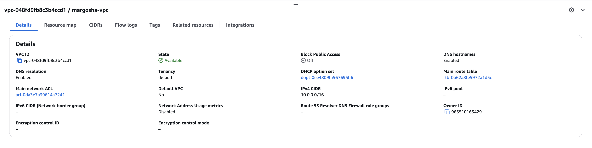
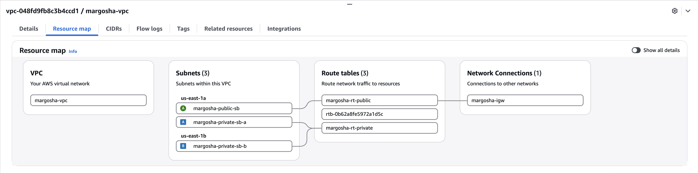
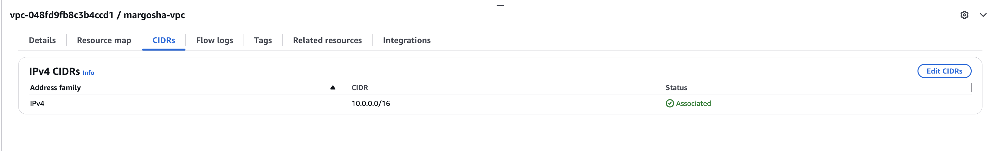
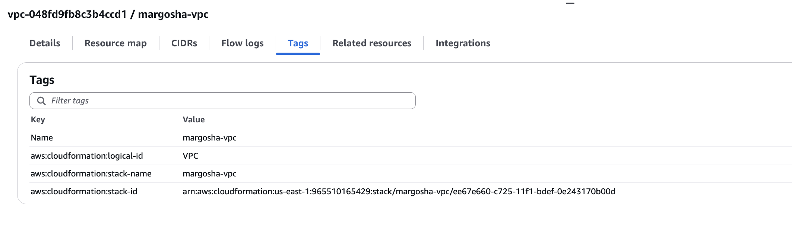

### Subnets
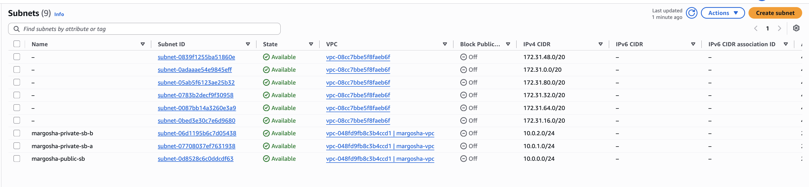

### Public Subnet
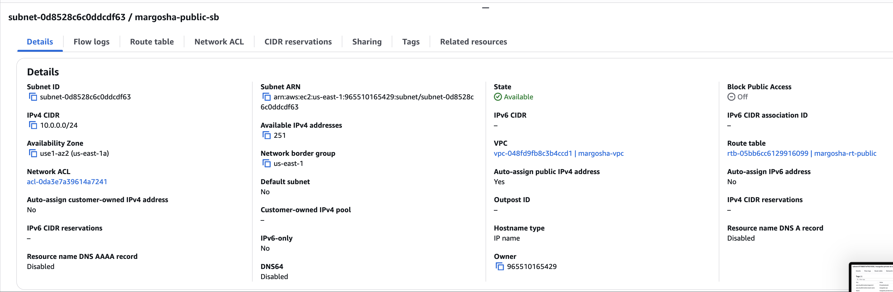
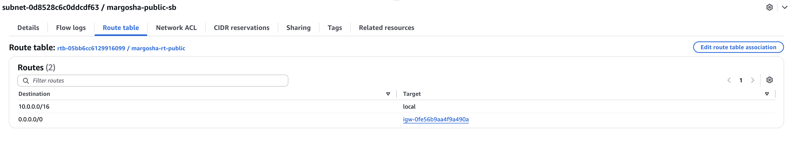
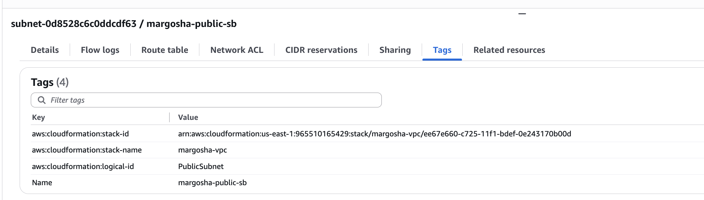

### Private Subnet A
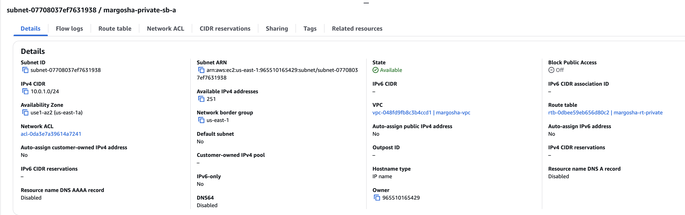
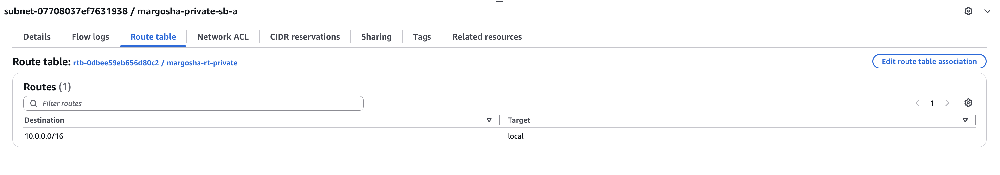
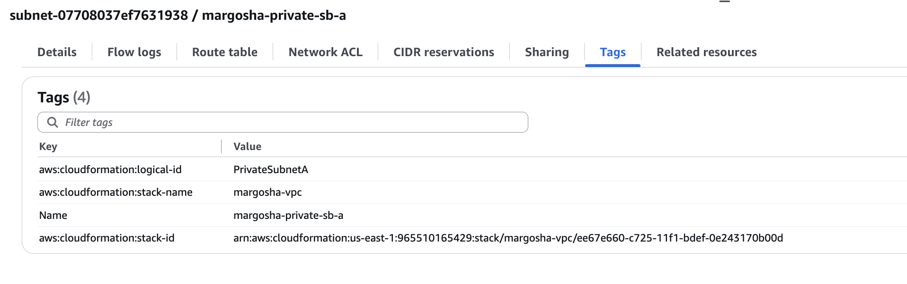

### Private Subnet B
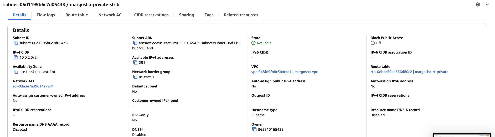
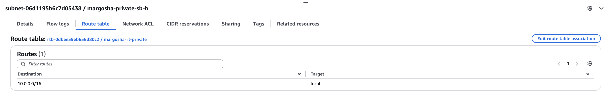
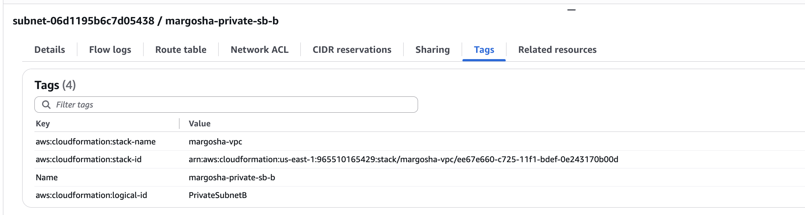

### Internet Gateway
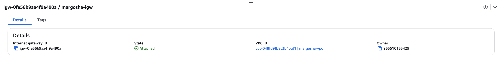
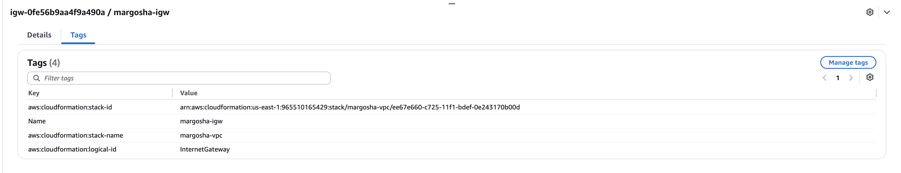

### Route Tables
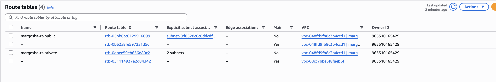

### Public Route Table
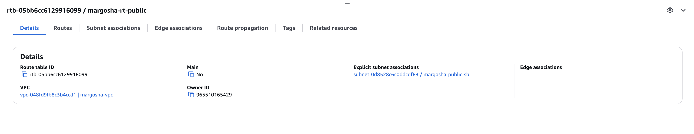
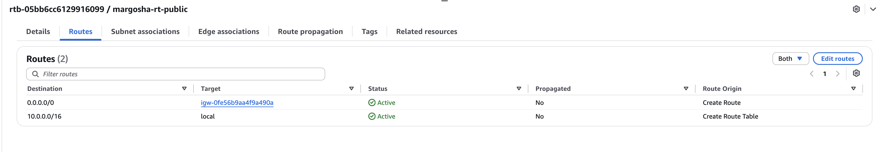
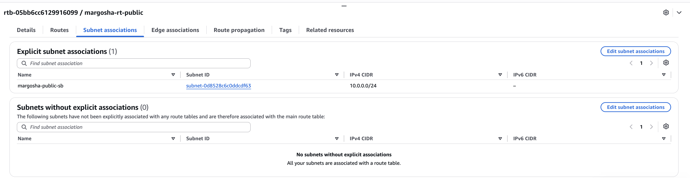
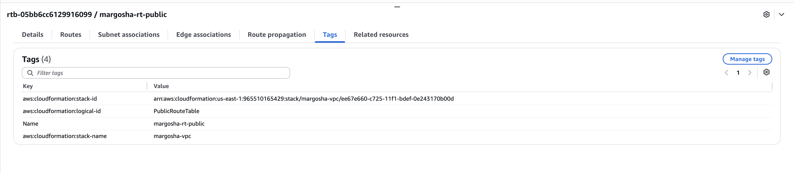
_Note: within subnet associations picture the id is different because of a stack recreation but the concept stays the same._

### Private Route Table
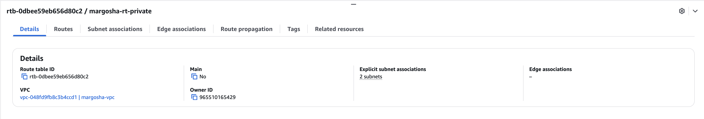
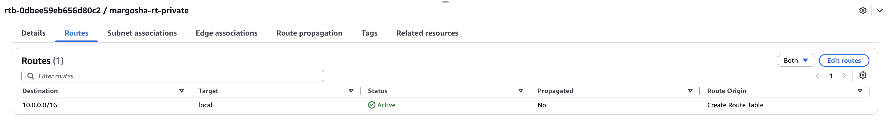
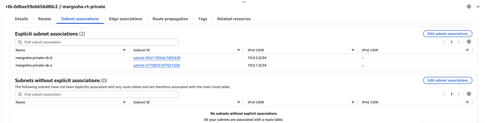
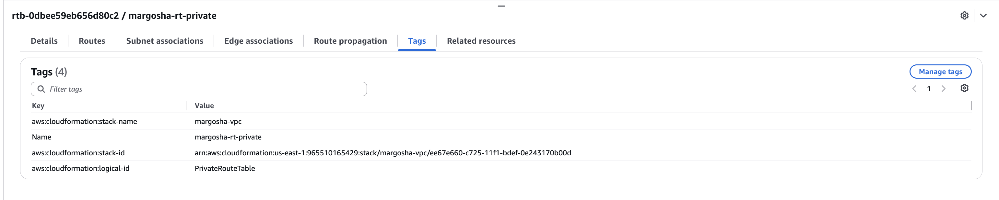
_Note: within routes picture the id is different because of a stack recreation but the concept stays the same._