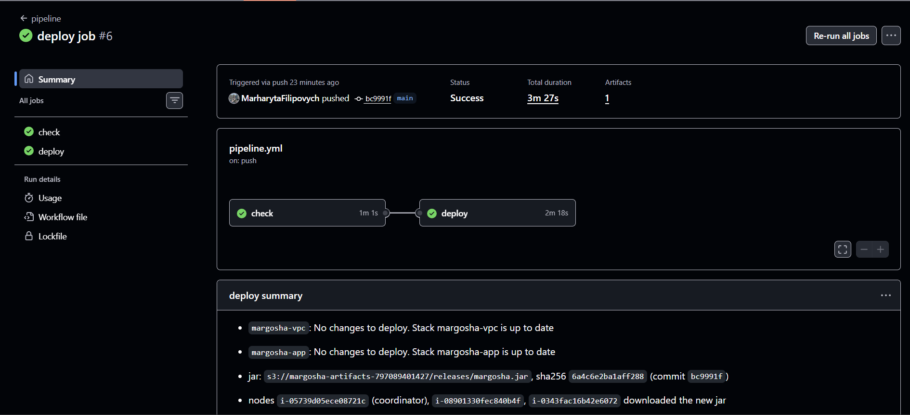
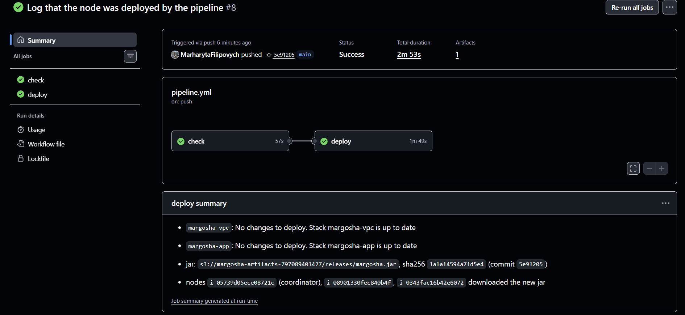
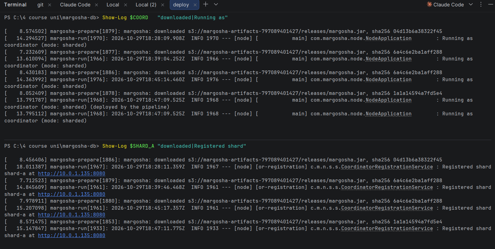
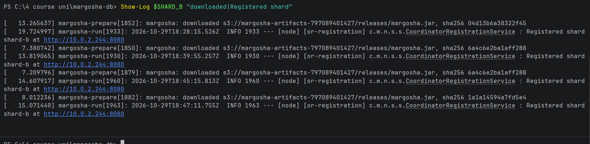
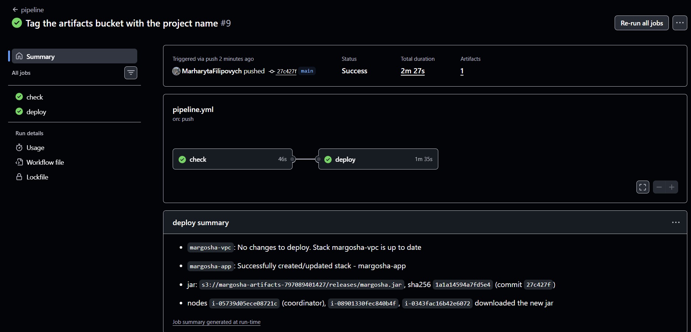
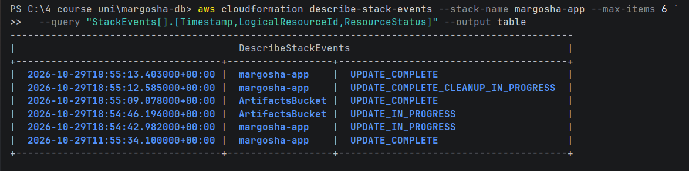
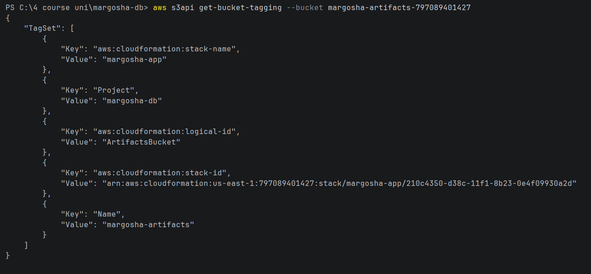
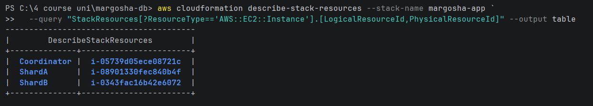
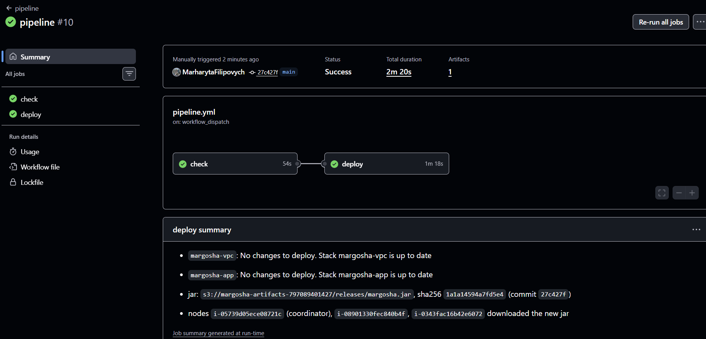

# Deploy pipeline (`deploy` job)

**Workflow:** [.github/workflows/pipeline.yml](../.github/workflows/pipeline.yml)
**Spec:** `delivery-pipeline` in `openspec/changes/setup-m2-sharding`; this note covers tasks 10.1–10.3.
**How to use it** (refresh the secrets, start a deploy by hand): [README, "Deploy pipeline"](../README.md#deploy-pipeline).

The `deploy` job runs after `check` passes on a push to `main` or when started by hand, one run at a time. In order, it:
1. deploys `margosha-vpc`;
2. deploys `margosha-app` (`aws cloudformation deploy --no-fail-on-empty-changeset`);
3. uploads the jar that `check` tested to `s3://margosha-artifacts-<account-id>/releases/margosha.jar`;
4. reboots the coordinator and the shards;
5. waits until all three nodes have logged the new jar's sha256 on their serial console. (Since the fix for
   [ai_critique.md](ai_critique.md) finding 4 it also waits until each node started the jar and the coordinator
   registered both shards, all logged after the deploy began; the checks below ran before that change.)

Each run writes the result of every step to the run's **Summary** page, as in the screenshots below.

---

## Checks

Run on **2026-10-29** in a new Learner Lab session, account `797089401427`. Times are UTC.

### 1. Refresh the secrets, merge into `main`, deploy by hand (task 10.3)

At the start of the session the three `AWS_*` repository secrets were refreshed as the README describes. Then `m2` was
merged into `main` (fast-forward to `bc9991f`), and the push started run **#6**:

- Both stacks: `No changes to deploy`, because the templates were already deployed by hand in section 9.
- Jar `6a4c6e2ba1aff288` uploaded; all three nodes downloaded it (18:39 boot in the logs below).

Next, a deploy was started by hand (**Actions → pipeline → Run workflow**, branch `main`). It deployed the same commit,
so it uploaded the same jar, and the nodes rebooted again at **18:45** and downloaded `6a4c6e2ba1aff288` again (logs below).
Another hand-started run, after the template change, is shown in [check 4](#4-deploy-started-by-hand-task-103).

### 2. Application-only change (task 10.2, scenario *Application-only change*)

Test commit `5e91205` changed one log line in `NodeApplication` and nothing else. The push started run **#8**:

- `margosha-vpc` and `margosha-app`: **`No changes to deploy`**. The run did not fail on the empty change sets.
- New jar `1a1a14594a7fd5e4` uploaded; the job waited until all three nodes logged that hash.

The nodes' serial consoles (`Show-Log` from [app_infrastructure.md](app_infrastructure.md#0-session-setup)) show one
`downloaded … sha256 …` line per boot:

| Boot | Jar sha256 | Cause |
|---|---|---|
| 18:28 | `04d13b6a38322f45` | Nodes started at the start of the lab session, with the jar uploaded by hand in section 9 |
| 18:39 | `6a4c6e2ba1aff288` | Run #6 (merge into `main`) |
| 18:45 | `6a4c6e2ba1aff288` | Deploy started by hand (same commit, same jar) |
| 18:47 | `1a1a14594a7fd5e4` | Run #8 (application-only change) |

After the 18:47 boot the coordinator logged the changed line, `Running as coordinator (mode: sharded) (deployed by
the pipeline)`, and both shards registered again within 15 s of booting. So the nodes ran the new code with no stack
change and no manual step.

### 3. Template change (task 10.2, scenario *Infrastructure change*)

Test commit `27c427f` added one tag (`Project=margosha-db`) to `ArtifactsBucket` in `cfn/margosha-app.yaml`: a change
that updates the stack without replacing anything. The push started run **#9**:

- `margosha-vpc`: `No changes to deploy` (its template didn't change).
- `margosha-app`: **`Successfully created/updated stack - margosha-app`**.

Stack events: CloudFormation updated only `ArtifactsBucket` (18:54:46 → 18:55:09), and the stack reached `UPDATE_COMPLETE` at 18:55:13:

The bucket has the new tag:

The instances were not replaced (same IDs as before the change):

### 4. Deploy started by hand (task 10.3)

Run **#10** was started from **Actions → pipeline → Run workflow** on `main` (commit `27c427f`). The page shows
**Manually triggered** and `on: workflow_dispatch`:

- `check` ran again first, then `deploy`.
- Both stacks: `No changes to deploy` (run #9 had already applied the template change).
- Jar `1a1a14594a7fd5e4` uploaded again; the job finished with all three nodes on that jar.

---

## Results by task and spec scenario

| Task / scenario | Evidence | Result |
|---|---|---|
| 10.1 `deploy` job: needs `check`, `main` and manual start, one run at a time, lab credentials from secrets | workflow file; runs #6, #8, #9 (push) and #10 (by hand) ran `check` → `deploy` | ✅ |
| 10.2 steps in order, `--no-fail-on-empty-changeset` | Summary pages of runs #6, #8, #9, #10 | ✅ |
| *Application-only change*: stacks unchanged, nodes run the new jar | check 2 | ✅ no stack changes; all nodes on `1a1a14594a7fd5e4`, new log line printed |
| *Infrastructure change*: the stack is updated through CloudFormation | check 3 | ✅ only `ArtifactsBucket` updated; instances kept |
| 10.3 refresh the secrets, deploy by hand in a new lab session | checks 1 and 4 (run #10, `workflow_dispatch`) | ✅ |
| *Failing test*: nothing is deployed | `deploy` has `needs: check` (task 2.3 showed `check` fails on a failing test) | ✅ by design |

## Notes

- **The jar build is reproducible.** Run #9 built the same Java code as run #8 and got the same hash
  (`1a1a14594a7fd5e4`). The jar step still runs then (upload and reboot), but the wait step can't tell this boot from
  the previous one: it finds the hash from the earlier boot and finishes at once. That's fine for a template-only
  change, because the nodes already run that jar. (Fixed later: the step now also needs a `Running as` line logged
  after the deploy began, so it waits for the new boot; see [ai_critique.md](ai_critique.md) finding 4.)
- **The test changes were removed afterwards.** Commits `5e91205` (log line) and `27c427f` (bucket tag) were only for
  these checks and were reverted in the next commit. The next deploy removes the `Project` tag from the bucket (another
  in-place update) and uploads a jar without the extra log line.
