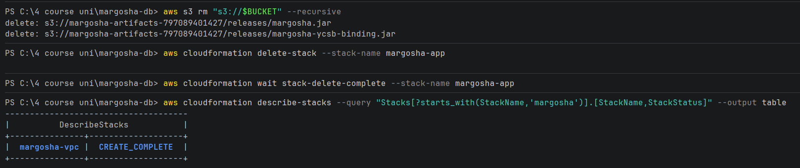
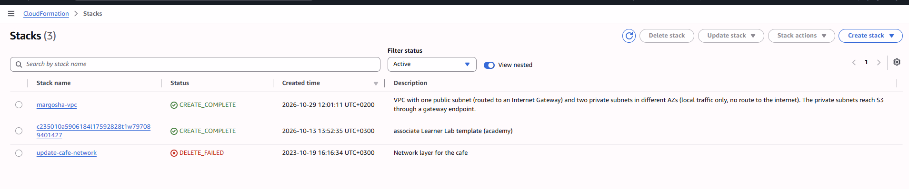
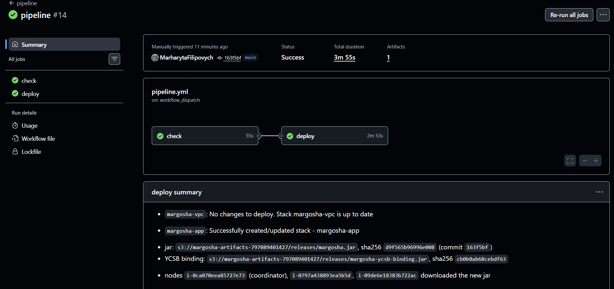

# End-to-end checks

**Spec:** `openspec/changes/setup-m2-sharding`, section 12 of `tasks.md`.

## 1. Fresh deploy from the pipeline (task 12.1)

**Goal:** with only `margosha-vpc` in the account, the pipeline alone creates the application stack, delivers the jar and
starts the store, and the store works, with no console steps.

Before this check the pipeline had only ever **updated** `margosha-app`: the stack was created by hand in section 9
([app_infrastructure.md](app_infrastructure.md)). A first deploy takes paths that updates never take: the stack and the
bucket are created, the nodes boot while the bucket is still empty, and the deploy job must not reboot nodes that are
still in their first-boot setup.

Run on **2026-10-29**, Learner Lab account `797089401427`. Times are UTC. The commands use the helpers from
[benchmark/procedure.md, step 0](benchmark/procedure.md#0-session-setup).

### Remove `margosha-app`, so only `margosha-vpc` is left

The bucket is emptied first: CloudFormation can't delete a bucket that still has objects.

```powershell
aws s3 rm "s3://$BUCKET" --recursive
aws cloudformation delete-stack --stack-name margosha-app
aws cloudformation wait stack-delete-complete --stack-name margosha-app
aws cloudformation describe-stacks --query "Stacks[?starts_with(StackName,'margosha')].[StackName,StackStatus]" --output table
```

Both jars were deleted, the stack was deleted, and only `margosha-vpc` was left:



The console shows the same. The two other stacks are not this project's: `c235010a…` is the Learner Lab's own stack, and
`update-cafe-network` is left over from an earlier course exercise.



### Deploy with the pipeline

**Actions → pipeline → Run workflow** on `main`, no code change. Run **#14** (`workflow_dispatch`, commit `163f5bf`):



- `margosha-vpc`: `No changes to deploy`.
- `margosha-app`: **`Successfully created/updated stack`**, this time a create.
- Both jars uploaded to the new, empty bucket. `margosha.jar` has sha256 `d9f565b96996e008`, the same as run #12: no Java
  code changed since, and the build is reproducible.
- **Three new instances**: coordinator `i-0ca070eea85727e73`, shards `i-0797a438893ea5b5d` and `i-09de6e18383b722ac`.
  The old ones (`i-05739d05ece08721c`, …) were deleted with the stack. The deploy job found no earlier node IDs, so it
  rebooted none of them (they were still installing Java) and waited until all three had downloaded the jar.
- Whole run: 3 min 55 s (deploy job 2 min 53 s).

### Check that the store works

The new stack starts with `OperatorCidr` empty, so the API is closed to the internet. The new instance IDs are loaded,
and access is opened to the operator's IP with the CLI (a parameter update: it adds two security group rules and replaces
nothing):

```powershell
$BUCKET  = Out ArtifactsBucketName
$COORD   = Out CoordinatorInstanceId
$SHARD_A = Out ShardAInstanceId
$SHARD_B = Out ShardBInstanceId
Show-Log $COORD "Registered shard|downloaded"

$MY_IP = (Invoke-RestMethod https://checkip.amazonaws.com).Trim()
aws cloudformation deploy --stack-name margosha-app --template-file cfn/margosha-app.yaml `
  --parameter-overrides "OperatorCidr=$MY_IP/32" --no-fail-on-empty-changeset
$COORD_PUBLIC = aws ec2 describe-instances --instance-ids $COORD --query "Reservations[0].Instances[0].PublicIpAddress" --output text
$API = "http://$($COORD_PUBLIC):8080"

Api POST "/tables" '{"name":"users","partitionKey":"user_id"}'
Api POST "/tables/users/records" '{"user_id":"42","name":"Anna","city":"Kyiv"}'
Api GET  "/tables/users/records/42"
1..20 | ForEach-Object { Api POST "/tables/users/records" ("{""user_id"":""u$_"",""name"":""n$_""}") } | Group-Object { $_.Substring(0,3) } | Select-Object Name, Count
1..20 | ForEach-Object { Api GET "/tables/users/records/u$_" } | Group-Object { $_.Substring(0,3) } | Select-Object Name, Count
```

**Coordinator log** (its only boot so far):
```
[   73.673546] margosha-prepare[4016]: margosha: downloaded s3://margosha-artifacts-797089401427/releases/margosha.jar, sha256 d9f565b96996e008
[  164.311413] margosha-run[5212]: 2026-10-29T21:39:08.143Z  INFO ... ShardRegistryService : Registered shard shard-b at http://10.0.2.146:8080
[  164.475389] margosha-run[5212]: 2026-10-29T21:39:08.382Z  INFO ... ShardRegistryService : Registered shard shard-a at http://10.0.1.244:8080
```
- The coordinator downloaded the jar from run #14 (same hash) 74 s after its first boot, once Java was installed.
- Both new shards registered 164 s after boot, at their new private IPs, with no step in between.

**API:**
```
201 {"name":"users","partitionKey":"user_id"}
201 {"name":"Anna","city":"Kyiv","user_id":"42"}
200 {"name":"Anna","city":"Kyiv","user_id":"42"}
201 × 20
200 × 20
```
All 42 calls succeeded. With two shards on the ring, 20 keys land on both of them, so both shards answer through the
coordinator.

### Result

| What | Evidence | Result |
|---|---|---|
| Only `margosha-vpc` existed before the deploy | CLI table and console | ✅ |
| The pipeline alone created `margosha-app` and the bucket | run #14 Summary | ✅ `Successfully created/updated stack` |
| New nodes got the jar without a reboot or manual upload | run #14 Summary, coordinator log | ✅ all three downloaded `d9f565b96996e008` |
| Shards registered by themselves | coordinator log | ✅ 164 s after boot |
| The store works | API calls | ✅ 21 creates, 21 reads |
| No console steps | the steps above | ✅ CLI and GitHub only. The one manual action after the deploy, opening the API to the operator's IP, is a CLI parameter update, needed only because the API is closed by default |

The instance IDs and IPs in [app_infrastructure.md](app_infrastructure.md), [deploy_pipeline.md](deploy_pipeline.md)
and [benchmark/results.md](benchmark/results.md) belong to the stack deleted here. Those notes record what was true on
their dates.
