# S3 gateway endpoint

**Template:** [margosha-vpc-stack.yaml](../cfn/margosha-vpc-stack.yaml) (resource `S3GatewayEndpoint`)
**Stack name:** `margosha-vpc` (same stack as in [vpc_creation.md](../m1/vpc_creation.md), now with the endpoint)
**Region:** `us-east-1`

The shards run in the private subnets, which have no route to the internet and no NAT Gateway.
They still need two things from S3:

- **Amazon Linux 2023 packages** (Corretto 21 and others), installed with `dnf`, the AL2023 package manager.
  The AL2023 repositories are hosted in the S3 bucket `al2023-repos-us-east-1-de612dc2`.
- **The application jar**, from the artifacts bucket `margosha-artifacts-<account-id>`.

A **gateway endpoint** for S3 does this at no cost. It adds a route for the S3 prefix list
(the IP ranges of S3 in the region) to the private route table, pointing at the endpoint instead of an
Internet Gateway. Traffic to S3 stays on the AWS network; everything else still has nowhere to go.

## Endpoint policy

The endpoint policy limits what can be reached *through the endpoint* (on top of the instance's IAM permissions):

| Statement | Actions | Resource |
|---|---|---|
| `AmazonLinux2023Repos` | `s3:GetObject` | `arn:aws:s3:::al2023-repos-us-east-1-de612dc2/*` |
| `ArtifactsBucketRead` | `s3:GetObject`, `s3:ListBucket` | `arn:aws:s3:::margosha-artifacts-<account-id>` and `/*` |

- The bucket name is fixed by convention, so the policy builds it with `${AWS::AccountId}` and does not need to
  import anything from the app stack. The Learner Lab gives a new account every session, so the name changes with it.
- `s3:ListBucket` makes a missing jar come back as `404 Not Found` rather than `403 Forbidden`, so the boot retry
  loop sees the real reason.
- Any other bucket (and any write to the artifacts bucket) is denied from the private subnets.
  Uploads happen from the pipeline, not from the shards.

---

## How to read the commands

Each step has a **Windows (PowerShell)** and a **macOS (Terminal)** version. Where a command is the same in both,
there is one block marked **Both**. The differences are only shell syntax:

| | Windows (PowerShell) | macOS (zsh/bash) |
|---|---|---|
| Continue a command on the next line | `` ` `` (backtick) at the end of the line | `\` at the end of the line |
| Save a command's output in a variable | `$VPC_ID = aws ...` | `VPC_ID=$(aws ...)` |
| Filter output lines | `Select-String "text"` | `grep "text"` |
| Temp folder | `$env:TEMP` | `/tmp` |

Variables only live in the window that set them, so run the verification steps in one window.

---

## Setup

**Credentials.** Learner Lab → **AWS Details → AWS CLI: Show**, copy the whole `[default]` block, then replace the
contents of the credentials file with it. They expire with the lab session; repeat this when calls fail with
`ExpiredToken`.

Windows (PowerShell) — file is `C:\Users\<you>\.aws\credentials`:
```powershell
notepad "$HOME\.aws\credentials"
```

macOS (Terminal) — file is `~/.aws/credentials`. With the block copied to the clipboard:
```bash
mkdir -p ~/.aws
pbpaste > ~/.aws/credentials
```
(or open it with `nano ~/.aws/credentials`, paste, save with Ctrl+O, Enter, exit with Ctrl+X).

**Region and check** — Both:
```bash
aws configure set region us-east-1
aws sts get-caller-identity
```
Should return an `assumed-role/voclabs/...` ARN.

**cfn-lint.**

Windows (PowerShell):
```powershell
python -m pip install --user cfn-lint
$env:Path += ";$env:APPDATA\Python\Python312\Scripts"
```
`pip --user` puts `cfn-lint.exe` in a folder that is not on `PATH`; the second line adds it for the current window.
(`python -m cfnlint` does not work: the package has no `__main__`.)

macOS (Terminal):
```bash
brew install cfn-lint
```
(or `pip3 install --user cfn-lint` without Homebrew).

---

## Deploy

Go to the `cfn/` folder.

Windows (PowerShell):
```powershell
cd "C:\4 course uni\margosha-db\cfn"
```
macOS (Terminal), with the repo wherever you cloned it:
```bash
cd ~/margosha-db/cfn
```

Lint and validate — Both:
```bash
cfn-lint margosha-vpc-stack.yaml
aws cloudformation validate-template --template-body file://margosha-vpc-stack.yaml
```
`cfn-lint` prints nothing when the template is clean.

**New account (stack does not exist yet)** — Both:
```bash
aws cloudformation create-stack --stack-name margosha-vpc --template-body file://margosha-vpc-stack.yaml
aws cloudformation wait stack-create-complete --stack-name margosha-vpc
aws cloudformation describe-stacks --stack-name margosha-vpc --query "Stacks[0].StackStatus"
```
Expected: `"CREATE_COMPLETE"`.

**Existing stack without the endpoint:** preview with a change set (should be a single `Add` of
`S3GatewayEndpoint`, no replacements), then apply it. All lines are single commands, so this is the same on both:
```bash
aws cloudformation create-change-set --stack-name margosha-vpc --change-set-name add-s3-endpoint --template-body file://margosha-vpc-stack.yaml
aws cloudformation wait change-set-create-complete --stack-name margosha-vpc --change-set-name add-s3-endpoint
aws cloudformation describe-change-set --stack-name margosha-vpc --change-set-name add-s3-endpoint --query "Changes[].ResourceChange.[Action,LogicalResourceId,ResourceType,Replacement]" --output table
aws cloudformation execute-change-set --stack-name margosha-vpc --change-set-name add-s3-endpoint
aws cloudformation wait stack-update-complete --stack-name margosha-vpc
```
Expected status: `"UPDATE_COMPLETE"`.

---

## Verification

### 1. The endpoint exists and is attached to the private route table

Windows (PowerShell):
```powershell
$VPC_ID = aws cloudformation list-exports --query "Exports[?Name=='margosha-vpc-VpcId'].Value" --output text
$PRIVATE_RT = aws ec2 describe-route-tables --filters "Name=tag:Name,Values=margosha-rt-private" `
  --query "RouteTables[0].RouteTableId" --output text

aws ec2 describe-vpc-endpoints `
  --filters "Name=vpc-id,Values=$VPC_ID" "Name=service-name,Values=com.amazonaws.us-east-1.s3" `
  --query "VpcEndpoints[0].{Id:VpcEndpointId,Type:VpcEndpointType,State:State,RouteTables:RouteTableIds}"
```

macOS (Terminal):
```bash
VPC_ID=$(aws cloudformation list-exports --query "Exports[?Name=='margosha-vpc-VpcId'].Value" --output text)
PRIVATE_RT=$(aws ec2 describe-route-tables --filters "Name=tag:Name,Values=margosha-rt-private" \
  --query "RouteTables[0].RouteTableId" --output text)

aws ec2 describe-vpc-endpoints \
  --filters "Name=vpc-id,Values=$VPC_ID" "Name=service-name,Values=com.amazonaws.us-east-1.s3" \
  --query "VpcEndpoints[0].{Id:VpcEndpointId,Type:VpcEndpointType,State:State,RouteTables:RouteTableIds}"
```
Expected: `Type` is `Gateway`, `State` is `available`, `RouteTables` contains only the private route table.

### 2. Private route table: local + S3 prefix list, no IGW

Windows (PowerShell):
```powershell
aws ec2 describe-prefix-lists --filters "Name=prefix-list-name,Values=com.amazonaws.us-east-1.s3" `
  --query "PrefixLists[0].PrefixListId" --output text

aws ec2 describe-route-tables --route-table-ids $PRIVATE_RT `
  --query "RouteTables[0].Routes[].{Dest:DestinationCidrBlock||DestinationPrefixListId,Target:GatewayId,State:State}" `
  --output table

aws ec2 describe-route-tables --route-table-ids $PRIVATE_RT `
  --query "RouteTables[0].Routes[?GatewayId && starts_with(GatewayId, 'igw-')]"
```

macOS (Terminal):
```bash
aws ec2 describe-prefix-lists --filters "Name=prefix-list-name,Values=com.amazonaws.us-east-1.s3" \
  --query "PrefixLists[0].PrefixListId" --output text

aws ec2 describe-route-tables --route-table-ids "$PRIVATE_RT" \
  --query "RouteTables[0].Routes[].{Dest:DestinationCidrBlock||DestinationPrefixListId,Target:GatewayId,State:State}" \
  --output table

aws ec2 describe-route-tables --route-table-ids "$PRIVATE_RT" \
  --query "RouteTables[0].Routes[?GatewayId && starts_with(GatewayId, 'igw-')]"
```
Expected: two active routes (`10.0.0.0/16 → local`, `<S3 prefix list> → vpce-…`), and `[]` for the IGW check.

### 3. An instance in a private subnet can `dnf install`

The private subnets have no SSH path and no SSM, so the test runs as UserData and prints the result to the
serial console, which is read with `get-console-output`. It installs `tree` (a 56 kB package; any package would do)
and also checks that the internet is still unreachable.
The script must have Linux line endings (`\n`): Windows `\r\n` breaks the `#!/bin/bash` line, so the Windows version
converts them. On macOS the heredoc already writes `\n`.

**Write the script and launch the instance.**

Windows (PowerShell):
```powershell
$SUBNET_A = aws cloudformation list-exports --query "Exports[?Name=='margosha-vpc-PrivateSubnetAId'].Value" --output text

$script = @'
#!/bin/bash
exec > >(tee /dev/console) 2>&1
echo "DNF-TEST start"
if dnf install -y tree; then echo "DNF-TEST dnf: OK"; else echo "DNF-TEST dnf: FAILED"; fi
if curl -s -m 5 -o /dev/null https://example.com; then echo "DNF-TEST internet: REACHABLE (unexpected)"; else echo "DNF-TEST internet: unreachable (expected)"; fi
'@
[IO.File]::WriteAllText("$env:TEMP\dnf-test.sh", ($script -replace "`r`n", "`n"))

$INSTANCE_ID = aws ec2 run-instances `
  --image-id resolve:ssm:/aws/service/ami-amazon-linux-latest/al2023-ami-kernel-default-x86_64 `
  --instance-type t3.micro `
  --subnet-id $SUBNET_A `
  --user-data "file://$env:TEMP\dnf-test.sh" `
  --tag-specifications 'ResourceType=instance,Tags=[{Key=Name,Value=margosha-dnf-test}]' `
  --query "Instances[0].InstanceId" --output text
aws ec2 wait instance-running --instance-ids $INSTANCE_ID
```

macOS (Terminal):
```bash
SUBNET_A=$(aws cloudformation list-exports --query "Exports[?Name=='margosha-vpc-PrivateSubnetAId'].Value" --output text)

cat > /tmp/dnf-test.sh <<'EOF'
#!/bin/bash
exec > >(tee /dev/console) 2>&1
echo "DNF-TEST start"
if dnf install -y tree; then echo "DNF-TEST dnf: OK"; else echo "DNF-TEST dnf: FAILED"; fi
if curl -s -m 5 -o /dev/null https://example.com; then echo "DNF-TEST internet: REACHABLE (unexpected)"; else echo "DNF-TEST internet: unreachable (expected)"; fi
EOF

INSTANCE_ID=$(aws ec2 run-instances \
  --image-id resolve:ssm:/aws/service/ami-amazon-linux-latest/al2023-ami-kernel-default-x86_64 \
  --instance-type t3.micro \
  --subnet-id "$SUBNET_A" \
  --user-data file:///tmp/dnf-test.sh \
  --tag-specifications 'ResourceType=instance,Tags=[{Key=Name,Value=margosha-dnf-test}]' \
  --query "Instances[0].InstanceId" --output text)
aws ec2 wait instance-running --instance-ids "$INSTANCE_ID"
```

**Poll the console** until the result lines appear (every 15 s, up to 5 min).

Windows (PowerShell):
```powershell
for ($i = 0; $i -lt 20; $i++) {
  $out = aws ec2 get-console-output --instance-id $INSTANCE_ID --latest --output text | Select-String "DNF-TEST"
  if ($out -match "internet:") { $out; break }
  Start-Sleep 15
}
```

macOS (Terminal):
```bash
for i in {1..20}; do
  out=$(aws ec2 get-console-output --instance-id "$INSTANCE_ID" --latest --output text | grep "DNF-TEST")
  if echo "$out" | grep -q "internet:"; then echo "$out"; break; fi
  sleep 15
done
```

Expected (each line may also appear a second time with a `cloud-init[...]:` prefix):
```
DNF-TEST start
DNF-TEST dnf: OK
DNF-TEST internet: unreachable (expected)
```

**Clean up.** Read the result **before** terminating: once the instance is terminated, its console output is gone.

Windows (PowerShell):
```powershell
aws ec2 terminate-instances --instance-ids $INSTANCE_ID
aws ec2 wait instance-terminated --instance-ids $INSTANCE_ID
```

macOS (Terminal):
```bash
aws ec2 terminate-instances --instance-ids "$INSTANCE_ID"
aws ec2 wait instance-terminated --instance-ids "$INSTANCE_ID"
```

---

## Results

Run on 2026-10-29 from Windows (PowerShell) in a fresh Learner Lab account (`797089401427`), so the stack was
created, not updated.

| Check | Result |
|---|---|
| `cfn-lint` 1.59.0 | no findings |
| `validate-template` | valid, 6 parameters with the expected defaults |
| Stack | `CREATE_COMPLETE` (`arn:aws:cloudformation:us-east-1:797089401427:stack/margosha-vpc/ab3cc570-d37f-11f1-b734-12ffd573e3f9`) |
| Endpoint | `vpce-04d2a3a4b4ead41eb`, `Gateway`, `available`, route tables `[rtb-045bb8b263ca2af36]` (= `margosha-rt-private`) |
| S3 prefix list | `pl-63a5400a` |
| IGW routes on private RT | `[]` |
| `dnf install` from private subnet A | `OK` (`tree-1.8.0-6.amzn2023.0.2` installed) |
| Internet from private subnet A | unreachable (as expected) |

Private route table:
```
+--------------+---------+--------------------------+
|     Dest     |  State  |         Target           |
+--------------+---------+--------------------------+
|  10.0.0.0/16 |  active |  local                   |
|  pl-63a5400a |  active |  vpce-04d2a3a4b4ead41eb  |
+--------------+---------+--------------------------+
```

Test instance console (`i-0401bab0f4d86699c` in `subnet-0bfe08bb08c6efd0d`), trimmed:
```
DNF-TEST start
Amazon Linux 2023 repository                     74 MB/s |  86 MB     00:01
Installing:
tree-1.8.0-6.amzn2023.0.2.x86_64.rpm            1.9 MB/s |  56 kB     00:00
Installed:
  tree-1.8.0-6.amzn2023.0.2.x86_64
Complete!
DNF-TEST dnf: OK
DNF-TEST internet: unreachable (expected)
```
The repository metadata (86 MB) came down at 74 MB/s from S3 through the endpoint, while `curl https://example.com`
timed out: the subnet reaches S3 and nothing else. The test instance was terminated afterwards.

### Console screenshots

| Resource | Expected | Confirmed in console |
|---|---|---|
| Stack | `margosha-vpc`, `CREATE_COMPLETE`, 13 resources (12 from M1 + `S3GatewayEndpoint`) | ✅ |
| VPC | `margosha-vpc`, `10.0.0.0/16`; resource map shows 2 network connections (`margosha-igw`, `vpce-…`) | ✅ |
| Public subnet | `margosha-public-sb`, `10.0.0.0/24`, `us-east-1a`, routes: local + `0.0.0.0/0 → igw-…` | ✅ |
| Private subnet A | `margosha-private-sb-a`, `10.0.1.0/24`, `us-east-1a`, routes: local + `pl-63a5400a → vpce-…` | ✅ |
| Private subnet B | `margosha-private-sb-b`, `10.0.2.0/24`, `us-east-1b`, routes: local + `pl-63a5400a → vpce-…` | ✅ |
| Private route table | `margosha-rt-private`, 2 subnet associations, 2 routes (local + S3 prefix list), no IGW | ✅ |
| Public route table | `margosha-rt-public`, 1 subnet association, 2 routes (local + IGW), unchanged | ✅ |
| Internet Gateway | `margosha-igw`, attached to `margosha-vpc` | ✅ |
| S3 endpoint | `vpce-04d2a3a4b4ead41eb`, `Gateway`, `com.amazonaws.us-east-1.s3`, `Available`, only on `margosha-rt-private`, policy as in the table above | ✅ |

#### CloudFormation stack
Stack info: `CREATE_COMPLETE`, description mentions the gateway endpoint.
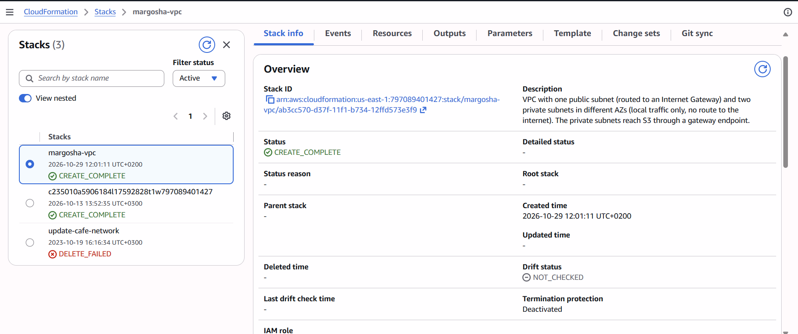
Deployment timeline: `S3GatewayEndpoint` is created right after the VPC and the private route table.
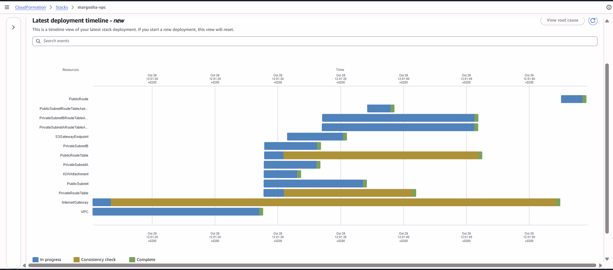
Resources (13), including `S3GatewayEndpoint` → `vpce-04d2a3a4b4ead41eb`.
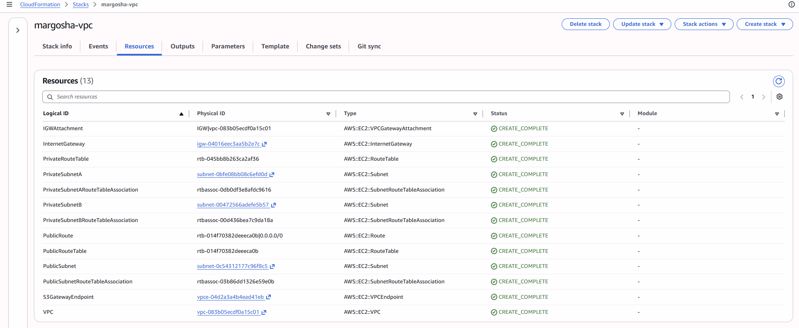
Outputs and exports (unchanged from M1).
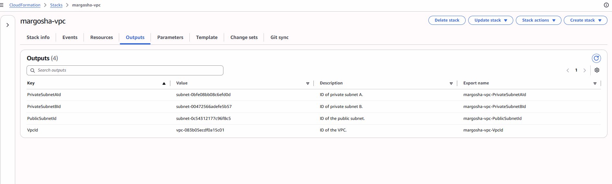
Parameters (defaults).
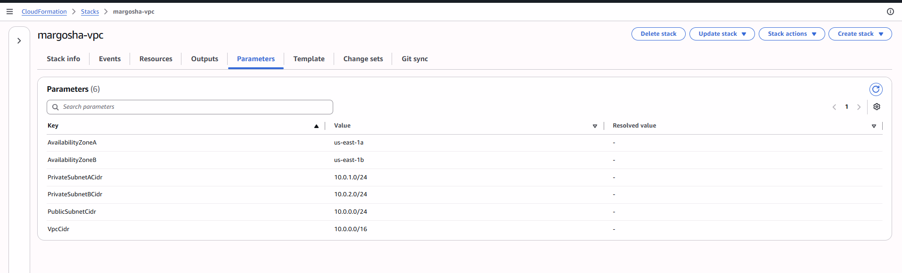

#### VPC
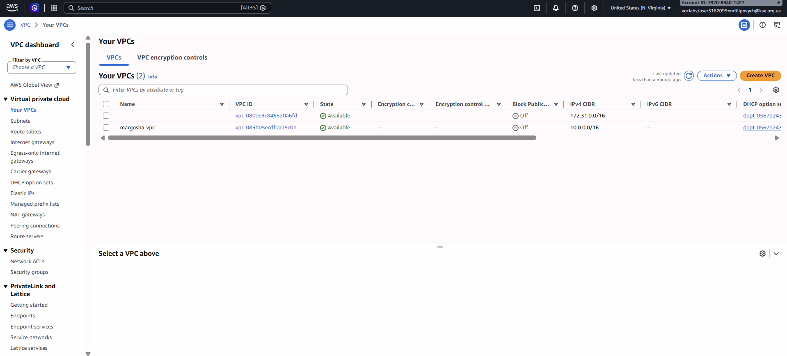
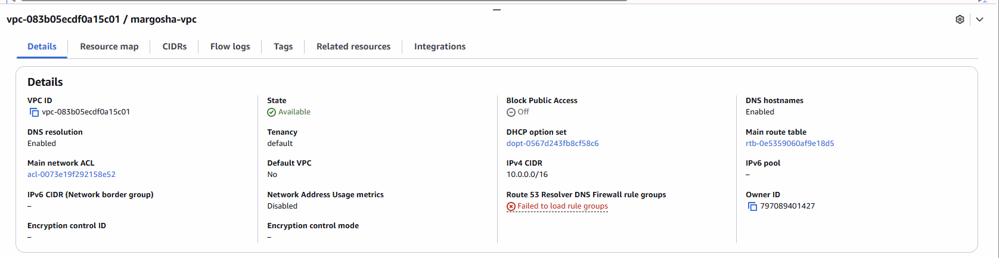
Resource map: `margosha-rt-private` connects to the endpoint, `margosha-rt-public` to the Internet Gateway.
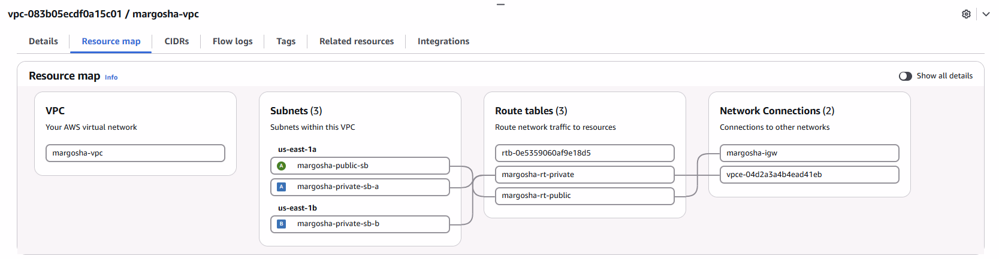
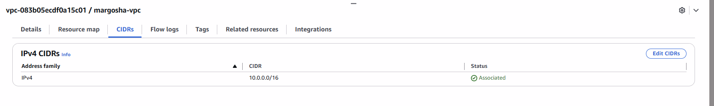
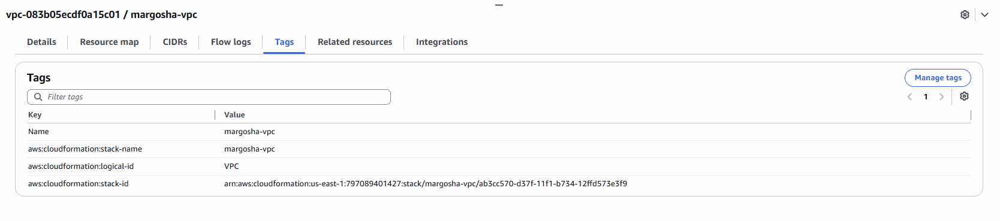

#### Subnets
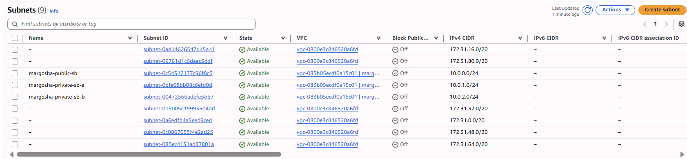

Public subnet:
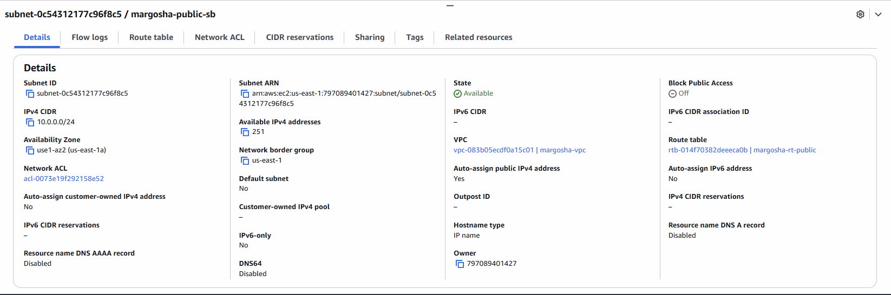
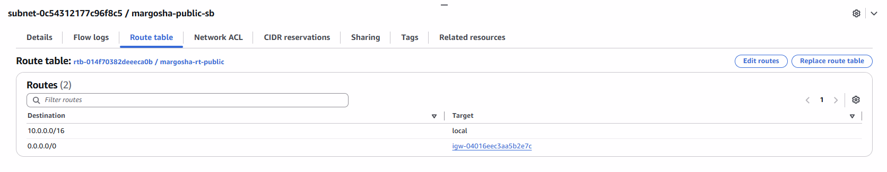
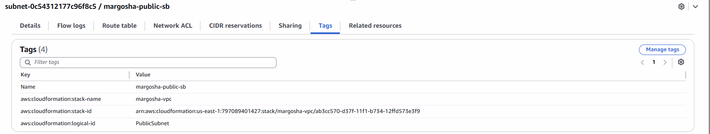

Private subnet A:
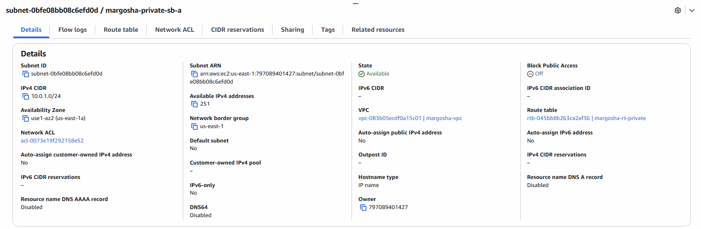

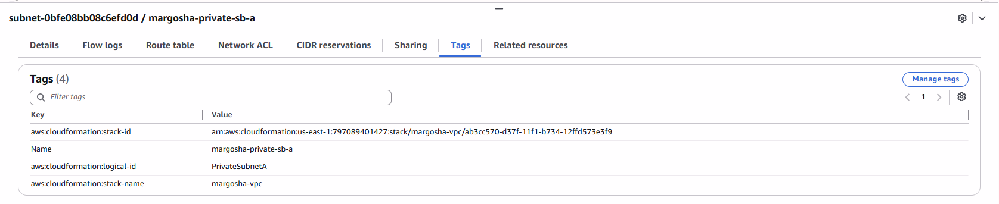

Private subnet B:
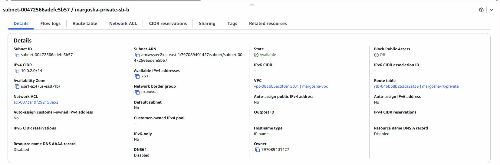
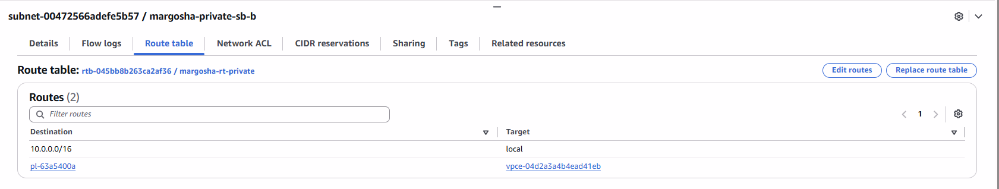
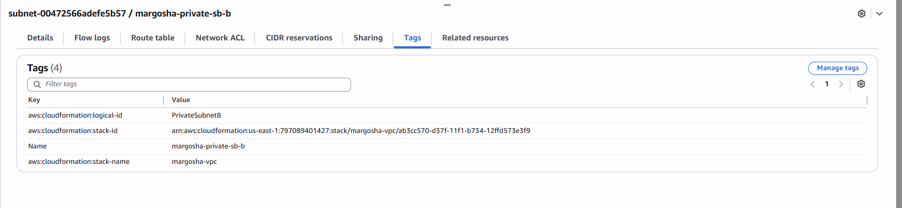

#### Route tables
The two unnamed tables with `Main: Yes` are the implicit main route tables of `margosha-vpc` and of the default VPC;
no subnet uses them (see the note in [vpc_creation.md](../m1/vpc_creation.md)).
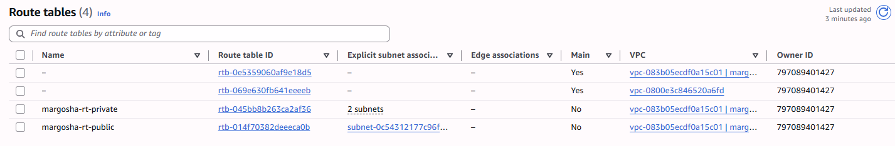

Private route table:
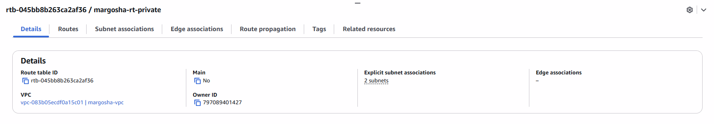
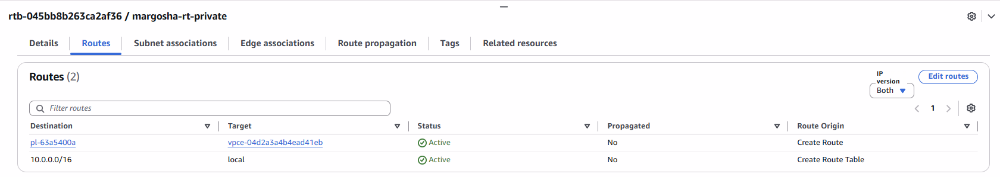
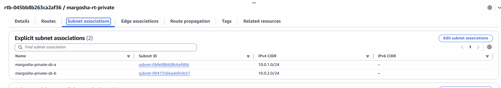
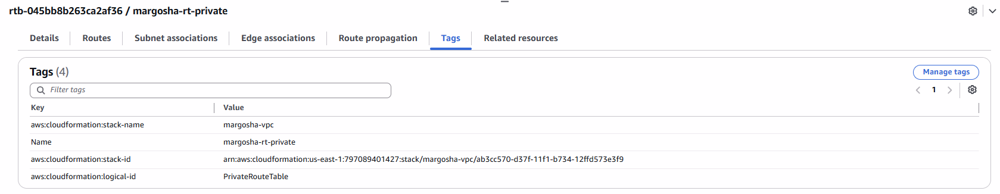

Public route table:
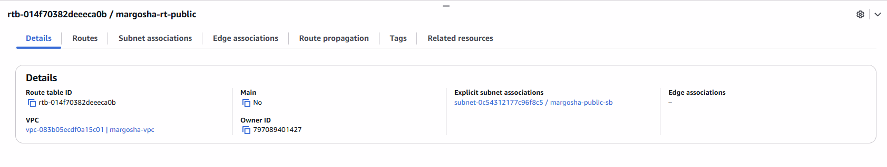
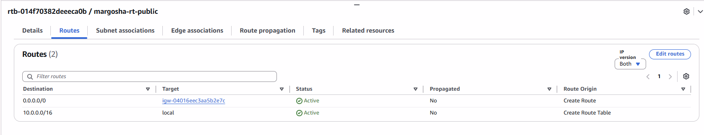
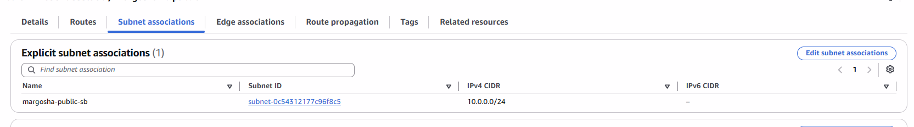
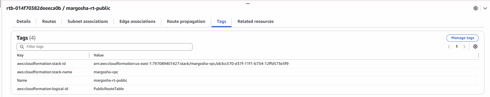

#### Internet Gateway
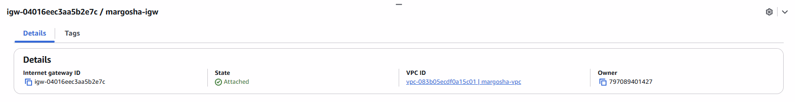
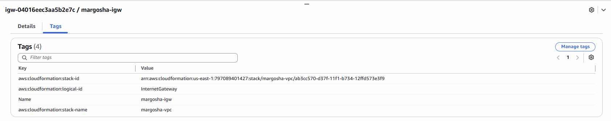

#### S3 gateway endpoint
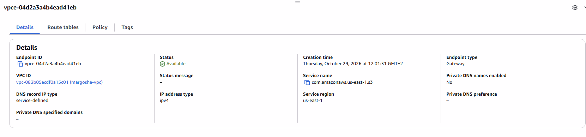
Attached only to the private route table (which has the 2 private subnets).
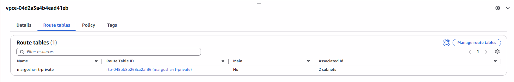
Policy, with the account ID filled in for the artifacts bucket.
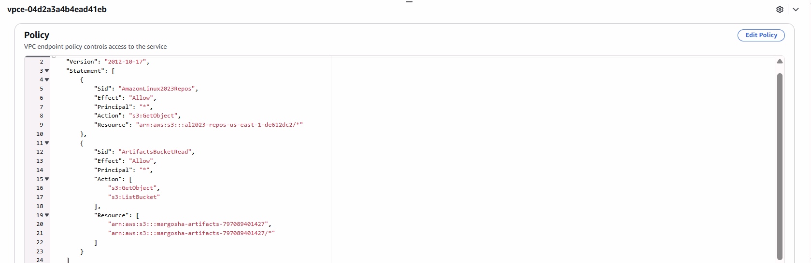
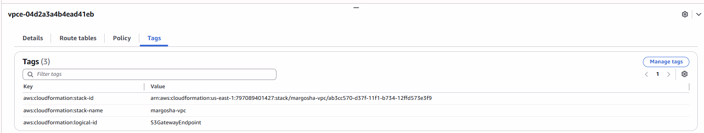
