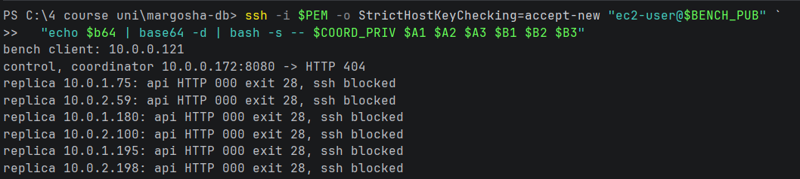
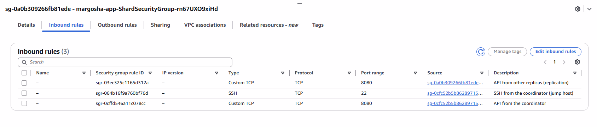
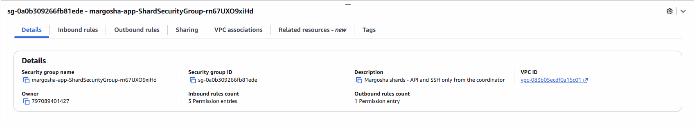
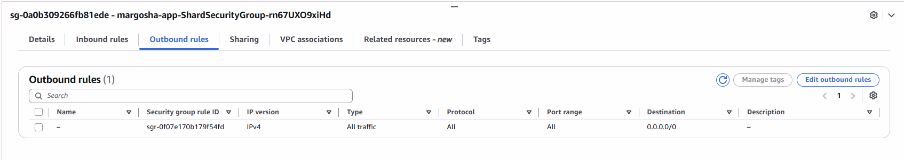
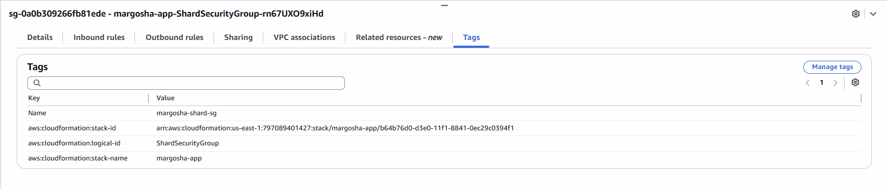
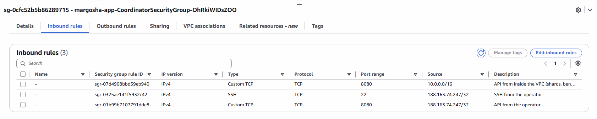
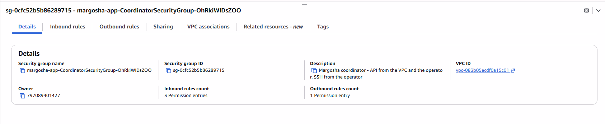
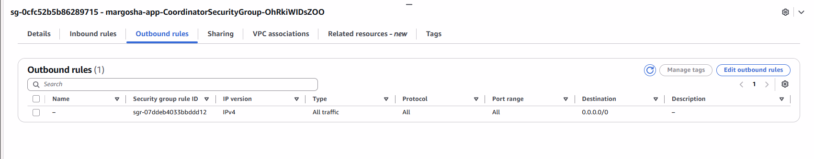
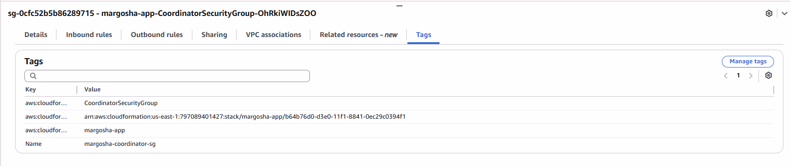

# The bench client cannot reach the replicas

**What was checked:** the bench client (the YCSB machine) can talk to the coordinator, but not to any replica. Only the
coordinator and the other replicas may reach a replica.

Uses the setup from [setup.md](setup.md).

## Commands

Create the bench client. This makes 8 instances, within the limit:

```bash
aws cloudformation deploy --stack-name margosha-app --template-file cfn/margosha-app.yaml --parameter-overrides BenchClient=true --no-fail-on-empty-changeset
```

Get its public IP:

Windows (PowerShell):
```powershell
$BENCH_PUB = Ip bench PublicIpAddress
```

macOS (Terminal):
```bash
BENCH_PUB=$(node_ip bench PublicIpAddress)
```

Run the test on the bench client. It is a short bash script that gets the coordinator's and the 6 replicas' IPs:
- first a **control request** to the coordinator, to show that the bench client's network works;
- then, for each replica, a request to its API (port 8080) and a connection attempt to its SSH port (22).

On Windows the script is sent base64-encoded inside the SSH command. Piping it into `ssh` does not work there, because
PowerShell adds a `\r` to the last line and bash then fails with `unexpected end of file`. On macOS it can be sent as
it is.

Windows (PowerShell):
```powershell
$test = @'
coord=$1; shift
echo "bench client: $(hostname -I)"
echo "control, coordinator $coord:8080 -> HTTP $(curl -s -m 5 -o /dev/null -w '%{http_code}' "http://$coord:8080/tables/none/records/1")"
for ip in "$@"; do
  api=$(curl -s -m 5 -o /dev/null -w '%{http_code}' "http://$ip:8080/replication/status"; echo " exit $?")
  if timeout 5 bash -c "</dev/tcp/$ip/22" 2>/dev/null; then ssh=OPEN; else ssh=blocked; fi
  echo "replica $ip: api HTTP $api, ssh $ssh"
done
'@
$b64 = [Convert]::ToBase64String([Text.Encoding]::UTF8.GetBytes(($test -replace "`r", "")))
ssh -i $PEM -o StrictHostKeyChecking=accept-new "ec2-user@$BENCH_PUB" `
  "echo $b64 | base64 -d | bash -s -- $COORD_PRIV $A1 $A2 $A3 $B1 $B2 $B3"
```

macOS (Terminal):
```bash
ssh -i "$PEM" -o StrictHostKeyChecking=accept-new "ec2-user@$BENCH_PUB" \
  bash -s -- "$COORD_PRIV" "$A1" "$A2" "$A3" "$B1" "$B2" "$B3" <<'EOF'
coord=$1; shift
echo "bench client: $(hostname -I)"
echo "control, coordinator $coord:8080 -> HTTP $(curl -s -m 5 -o /dev/null -w '%{http_code}' "http://$coord:8080/tables/none/records/1")"
for ip in "$@"; do
  api=$(curl -s -m 5 -o /dev/null -w '%{http_code}' "http://$ip:8080/replication/status"; echo " exit $?")
  if timeout 5 bash -c "</dev/tcp/$ip/22" 2>/dev/null; then ssh=OPEN; else ssh=blocked; fi
  echo "replica $ip: api HTTP $api, ssh $ssh"
done
EOF
```



Remove the bench client again, to save budget. This brings the account back to 7 instances:

```bash
aws cloudformation deploy --stack-name margosha-app --template-file cfn/margosha-app.yaml --parameter-overrides BenchClient=false --no-fail-on-empty-changeset
```

## Result

- **Coordinator:** `404` means the request arrived and the coordinator answered (the table `none` does not exist). So
  the bench client's network works.
- **All 6 replicas:** no answer from the API (`000`, curl exit 28 = timed out after 5 s), and SSH is blocked. The
  traffic is silently dropped, which is what a security group does when no rule allows it.

## Why: the security group rules

Seen in the console under **EC2 → Security Groups**.

`margosha-shard-sg` is on every replica. Its 3 inbound rules only allow other security groups, never an address range:
- API (8080) from the replicas' own group, for replication;
- API (8080) and SSH (22) from `margosha-coordinator-sg`.

The bench client is in neither group, so nothing lets it in:






`margosha-coordinator-sg` is on the coordinator. Its inbound rules:
- API (8080) from the whole VPC, `10.0.0.0/16`, which includes the bench client (`10.0.0.121`). That is why the control
  request gets an answer;
- API and SSH from the operator's IP (`188.163.74.247/32`, the `OperatorCidr` parameter).






Both groups allow all outgoing traffic, so only the inbound rules of the target decide.
