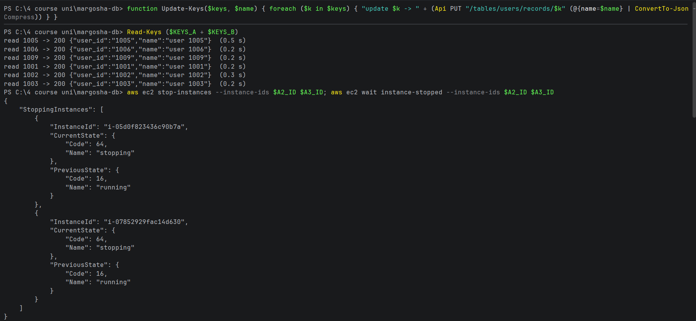
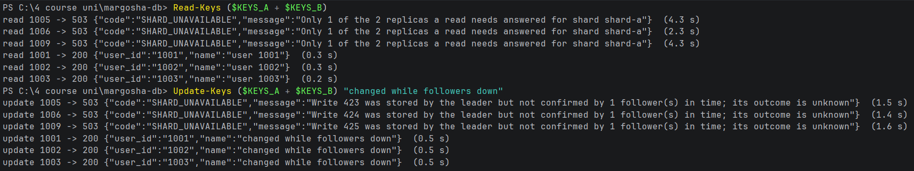
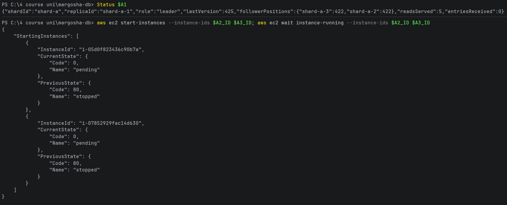
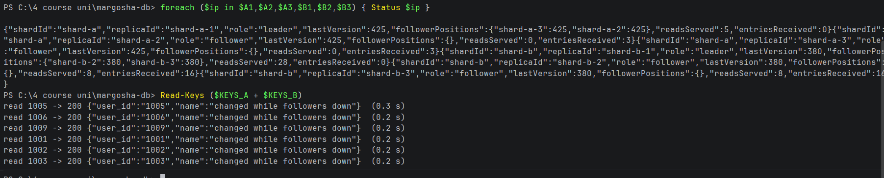

# Both followers down

**What was checked:** with both followers of a shard down, reads and writes to that shard fail with `503`, and the
other shard is not affected. Also what the write error "outcome unknown" means.

A write needs 2 replicas (the leader + 1 follower) and a read asks 2 replicas. With both followers down, only the
leader is left, which is not enough for either.

Uses the setup from [setup.md](setup.md), including the helpers and keys for the failure checks. The followers stopped
are shard-a-2 and shard-a-3.

The writes here are **updates** of users that are known to be on shard A (1005, 1006, 1009) or shard B (1001, 1002,
1003). New users would land on a shard by chance, so not every write would test shard A.

## Commands

**1. One more helper.** `Update-Keys` / `update_keys` changes the `name` of each user in a list:

Windows (PowerShell):
```powershell
function Update-Keys($keys, $name) { foreach ($k in $keys) { "update $k -> " + (Api PUT "/tables/users/records/$k" (@{name=$name} | ConvertTo-Json -Compress)) } }
```

macOS (Terminal):
```bash
update_keys() { name=$1; shift; for k in "$@"; do printf 'update %s -> ' "$k"; api PUT "/tables/users/records/$k" "{\"name\":\"$name\"}"; done; }
```

**2. Before: read the users,** then stop both followers and wait until they are stopped:

Windows (PowerShell):
```powershell
Read-Keys ($KEYS_A + $KEYS_B)
```

macOS (Terminal):
```bash
read_keys $KEYS_A $KEYS_B
```

```bash
aws ec2 stop-instances --instance-ids $A2_ID $A3_ID; aws ec2 wait instance-stopped --instance-ids $A2_ID $A3_ID
```



**3. Read and update the users while both followers are down:**

Windows (PowerShell):
```powershell
Read-Keys ($KEYS_A + $KEYS_B)
Update-Keys ($KEYS_A + $KEYS_B) "changed while followers down"
```

macOS (Terminal):
```bash
read_keys $KEYS_A $KEYS_B
update_keys "changed while followers down" $KEYS_A $KEYS_B
```



```
read 1005 -> 503 {"code":"SHARD_UNAVAILABLE","message":"Only 1 of the 2 replicas a read needs answered for shard shard-a"}  (4.3 s)
read 1006 -> 503 {"code":"SHARD_UNAVAILABLE","message":"Only 1 of the 2 replicas a read needs answered for shard shard-a"}  (2.3 s)
read 1009 -> 503 {"code":"SHARD_UNAVAILABLE","message":"Only 1 of the 2 replicas a read needs answered for shard shard-a"}  (4.3 s)
read 1001 -> 200 {"user_id":"1001","name":"user 1001"}  (0.3 s)
read 1002 -> 200 {"user_id":"1002","name":"user 1002"}  (0.3 s)
read 1003 -> 200 {"user_id":"1003","name":"user 1003"}  (0.2 s)
update 1005 -> 503 {"code":"SHARD_UNAVAILABLE","message":"Write 423 was stored by the leader but not confirmed by 1 follower(s) in time; its outcome is unknown"}  (1.5 s)
update 1006 -> 503 {"code":"SHARD_UNAVAILABLE","message":"Write 424 was stored by the leader but not confirmed by 1 follower(s) in time; its outcome is unknown"}  (1.4 s)
update 1009 -> 503 {"code":"SHARD_UNAVAILABLE","message":"Write 425 was stored by the leader but not confirmed by 1 follower(s) in time; its outcome is unknown"}  (1.6 s)
update 1001 -> 200 {"user_id":"1001","name":"changed while followers down"}  (0.5 s)
update 1002 -> 200 {"user_id":"1002","name":"changed while followers down"}  (0.5 s)
update 1003 -> 200 {"user_id":"1003","name":"changed while followers down"}  (0.5 s)
```

**4. Show the leader's status,** then start both followers again:

Windows (PowerShell):
```powershell
Status $A1
```

macOS (Terminal):
```bash
status "$A1"
```

```bash
aws ec2 start-instances --instance-ids $A2_ID $A3_ID; aws ec2 wait instance-running --instance-ids $A2_ID $A3_ID
```

```
{"shardId":"shard-a","replicaId":"shard-a-1","role":"leader","lastVersion":425,"followerPositions":{"shard-a-3":422,"shard-a-2":422},"readsServed":5,"entriesReceived":0}
```



**5. After: ask all 6 replicas for their status and read the users again:**

Windows (PowerShell):
```powershell
foreach ($ip in $A1,$A2,$A3,$B1,$B2,$B3) { Status $ip }
Read-Keys ($KEYS_A + $KEYS_B)
```

macOS (Terminal):
```bash
for ip in $A1 $A2 $A3 $B1 $B2 $B3; do status "$ip"; done
read_keys $KEYS_A $KEYS_B
```



```
read 1005 -> 200 {"user_id":"1005","name":"changed while followers down"}  (0.3 s)
read 1006 -> 200 {"user_id":"1006","name":"changed while followers down"}  (0.2 s)
read 1009 -> 200 {"user_id":"1009","name":"changed while followers down"}  (0.2 s)
read 1001 -> 200 {"user_id":"1001","name":"changed while followers down"}  (0.2 s)
read 1002 -> 200 {"user_id":"1002","name":"changed while followers down"}  (0.2 s)
read 1003 -> 200 {"user_id":"1003","name":"changed while followers down"}  (0.2 s)
```

## Result

- **Reads from shard A fail:** `503 Only 1 of the 2 replicas a read needs answered for shard shard-a`. Only the leader
  answered. They took 2.3–4.3 s: the coordinator waited 2 s for each stopped follower it asked.
- **Writes to shard A fail:** `503 … stored by the leader but not confirmed by 1 follower(s) in time; its outcome is
  unknown`, after 1.4–1.6 s. The leader waited 1 s (the ack timeout) for a follower to confirm, then gave up.
- **Shard B is not affected:** its reads and updates worked as usual (`200`, 0.2–0.5 s).
- **The leader kept the 3 unconfirmed writes.** Its last entry went from 422 to 425 (writes 423, 424, 425, as the
  errors say), while both followers stayed at 422.
- **After the start, everything is back:**
  - both followers of shard A are at 425 again, and each received exactly the 3 entries it missed (`entriesReceived`
    3);
  - shard B is at 380: the 3 updates of shard B users (377 → 380).

**What "outcome unknown" means.** After the followers came back, users 1005, 1006 and 1009 read
`"changed while followers down"`. The updates that got `503` **did happen**: the leader had stored them, and the
followers copied them when they returned. So a client that gets this `503` must not assume its write failed. Retrying
an update is safe, because it sets the same value again. Retrying a create would get `409`, because the record already
exists.
