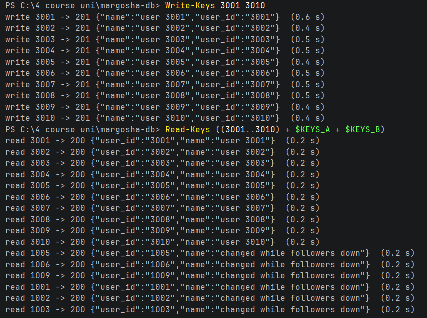
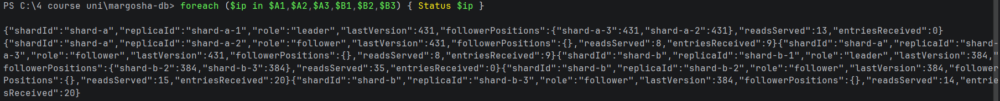
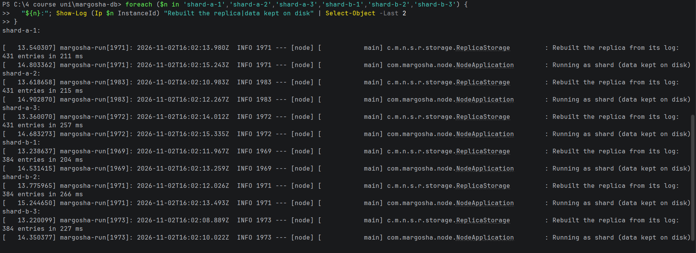
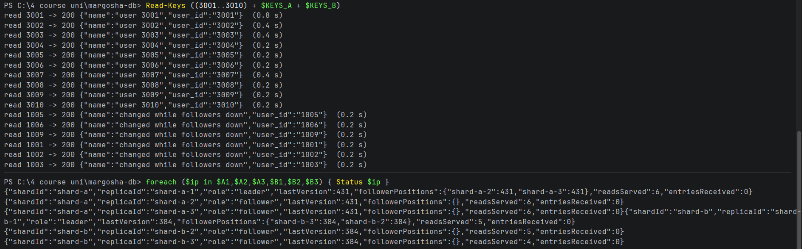

# Data survives an app-only deploy

**What was checked:** records written before a deploy can still be read after it. A deploy reboots every node; each
replica keeps its log on its own disk and rebuilds its records from it when it starts.

Uses the setup from [setup.md](setup.md), including the helpers and keys for the failure checks.

## Commands

**1. Before: write 10 new users (3001–3010), read them and 6 known users, and show every replica's last entry:**

Windows (PowerShell):
```powershell
Write-Keys 3001 3010
Read-Keys ((3001..3010) + $KEYS_A + $KEYS_B)
foreach ($ip in $A1,$A2,$A3,$B1,$B2,$B3) { Status $ip }
```

macOS (Terminal):
```bash
write_keys 3001 3010
read_keys $(seq 3001 3010) $KEYS_A $KEYS_B
for ip in $A1 $A2 $A3 $B1 $B2 $B3; do status "$ip"; done
```




**2. Push an app-only change.** The commit changes one log line, so a new jar is built and the start-up log shows
that it runs: `Running as … (data kept on disk)`. No template changes, so the pipeline only reboots the nodes:

```bash
git add app/node/src/main/java/com/margosha/node/NodeApplication.java
```
```bash
git commit -m "Durability check: app-only change"
```
```bash
git push
```
```bash
gh run watch
```

Pipeline run [**#21**](https://github.com/MarharytaFilipovych/margosha-db/actions/runs/41476892134) (commit `dfd7084`)
succeeded: `check` 15:58:46–16:00:37, `deploy` 16:00:40–16:03:23. Between the previous deploy (`d6a6f05`) and this one,
the only change to the app, the templates or the pipeline is that one log line.

**3. After: show each replica's start-up lines** (the rebuild from its log, then the new log line):

Windows (PowerShell):
```powershell
foreach ($n in 'shard-a-1','shard-a-2','shard-a-3','shard-b-1','shard-b-2','shard-b-3') {
  "${n}:"; Show-Log (Ip $n InstanceId) "Rebuilt the replica|data kept on disk" | Select-Object -Last 2
}
```

macOS (Terminal):
```bash
for n in shard-a-1 shard-a-2 shard-a-3 shard-b-1 shard-b-2 shard-b-3; do
  echo "$n:"; show_log "$(node_ip $n InstanceId)" "Rebuilt the replica|data kept on disk" | tail -n 2
done
```



**4. After: read the same users and show every replica's last entry again** (same commands as in step 1, without the
writes):

Windows (PowerShell):
```powershell
Read-Keys ((3001..3010) + $KEYS_A + $KEYS_B)
foreach ($ip in $A1,$A2,$A3,$B1,$B2,$B3) { Status $ip }
```

macOS (Terminal):
```bash
read_keys $(seq 3001 3010) $KEYS_A $KEYS_B
for ip in $A1 $A2 $A3 $B1 $B2 $B3; do status "$ip"; done
```



## Result

| | Before the deploy (15:57) | After the deploy (16:05) |
|---|---|---|
| Users 3001–3010 | `200`, `"user 3001"` … `"user 3010"` | `200`, the same |
| Users 1001–1003, 1005, 1006, 1009 | `200`, `"changed while followers down"` | `200`, the same |
| Shard A, all 3 replicas | last entry 431 | 431 |
| Shard B, all 3 replicas | last entry 384 | 384 |

- **Every record is still there, with the same value**, including the updates made in
  [both-followers-down.md](both-followers-down.md).
- **Each replica rebuilt its data from its own disk** at 16:02: shard A's replicas `431 entries`, shard B's
  `384 entries`, in 204–266 ms. These are exactly their last entries before the deploy.
- **The new jar runs:** every replica logged `Running as shard (data kept on disk)` right after the rebuild.
- **Nothing had to be copied again:** after the deploy every follower shows `entriesReceived 0`. Each one already had
  everything on its own disk.
