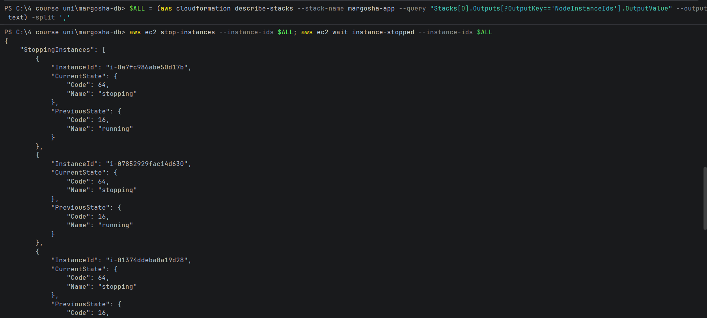
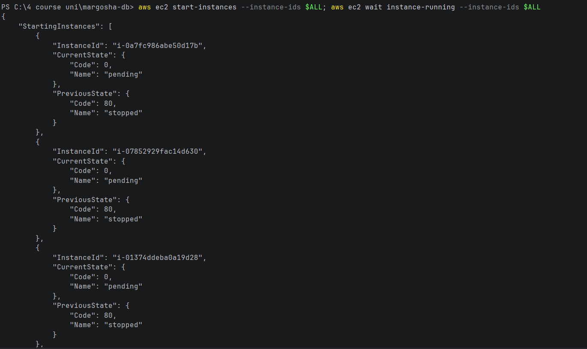
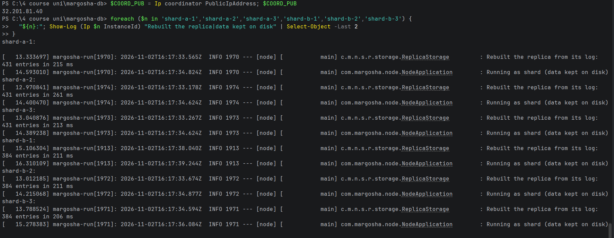
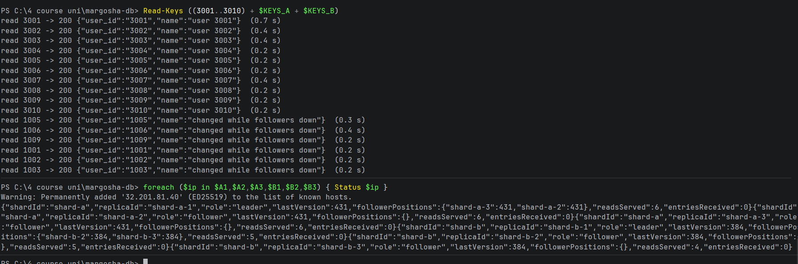

# Data survives stopping and starting all instances

**What was checked:** records can still be read after every node was stopped and started again. This is what happens
at the end of a Learner Lab session: the lab stops all instances, and starts them in the next session.

Uses the setup from [setup.md](setup.md), including the helpers and keys for the failure checks. It ran right after
[data-survives-deploy.md](data-survives-deploy.md), so the records and last entries to compare are the ones from there.

## Commands

**1. Get the 7 node IDs from the stack:**

Windows (PowerShell):
```powershell
$ALL = (aws cloudformation describe-stacks --stack-name margosha-app --query "Stacks[0].Outputs[?OutputKey=='NodeInstanceIds'].OutputValue" --output text) -split ','
```

macOS (Terminal):
```bash
ALL=$(aws cloudformation describe-stacks --stack-name margosha-app --query "Stacks[0].Outputs[?OutputKey=='NodeInstanceIds'].OutputValue" --output text | tr ',' ' ')
```

**2. Stop all 7 nodes and wait until they are stopped:**

```bash
aws ec2 stop-instances --instance-ids $ALL; aws ec2 wait instance-stopped --instance-ids $ALL
```



**3. Start them again, wait until they run, then give them 3 minutes to boot:**

```bash
aws ec2 start-instances --instance-ids $ALL; aws ec2 wait instance-running --instance-ids $ALL
```

Windows (PowerShell):
```powershell
Start-Sleep 180
```

macOS (Terminal):
```bash
sleep 180
```



**4. Look up the coordinator's new public IP.** A stopped instance has no public IP; when it starts it gets a new one.
The private IPs stay the same:

Windows (PowerShell):
```powershell
$COORD_PUB = Ip coordinator PublicIpAddress; $COORD_PUB
```

macOS (Terminal):
```bash
COORD_PUB=$(node_ip coordinator PublicIpAddress); echo "$COORD_PUB"
```

It printed `32.201.81.40`.

**5. Show each replica's start-up lines:**

Windows (PowerShell):
```powershell
foreach ($n in 'shard-a-1','shard-a-2','shard-a-3','shard-b-1','shard-b-2','shard-b-3') {
  "${n}:"; Show-Log (Ip $n InstanceId) "Rebuilt the replica|data kept on disk" | Select-Object -Last 2
}
```

macOS (Terminal):
```bash
for n in shard-a-1 shard-a-2 shard-a-3 shard-b-1 shard-b-2 shard-b-3; do
  echo "$n:"; show_log "$(node_ip $n InstanceId)" "Rebuilt the replica|data kept on disk" | tail -n 2
done
```



**6. Read the same users and show every replica's last entry:**

Windows (PowerShell):
```powershell
Read-Keys ((3001..3010) + $KEYS_A + $KEYS_B)
foreach ($ip in $A1,$A2,$A3,$B1,$B2,$B3) { Status $ip }
```

macOS (Terminal):
```bash
read_keys $(seq 3001 3010) $KEYS_A $KEYS_B
for ip in $A1 $A2 $A3 $B1 $B2 $B3; do status "$ip"; done
```



## Result

| | Before the stop (16:05) | After the start (16:19) |
|---|---|---|
| Users 3001–3010 | `200`, `"user 3001"` … `"user 3010"` | `200`, the same |
| Users 1001–1003, 1005, 1006, 1009 | `200`, `"changed while followers down"` | `200`, the same |
| Shard A, all 3 replicas | last entry 431 | 431 |
| Shard B, all 3 replicas | last entry 384 | 384 |

- **Every record is still there, with the same value.**
- **Each replica rebuilt its data from its own disk** at 16:17: shard A's replicas `431 entries`, shard B's
  `384 entries`, in 206–261 ms.
- **The coordinator kept the `users` table.** It keeps table definitions on its own disk too. Had it lost them, every
  read would have answered `404`.
- **Nothing had to be copied again:** every follower shows `entriesReceived 0`.

**The same happened at the end of a real lab session.** Users 1001–1020 were written in one lab session. In the next
session, after the lab had stopped and started all nodes, they were all still on their shard (see
[setup.md, "Which shard a key is on"](setup.md#which-shard-a-key-is-on)). Shard A's leader was still at its last entry
from the session before, 416: the next 6 writes took it to 422 (see [one-follower-down.md](one-follower-down.md)).
