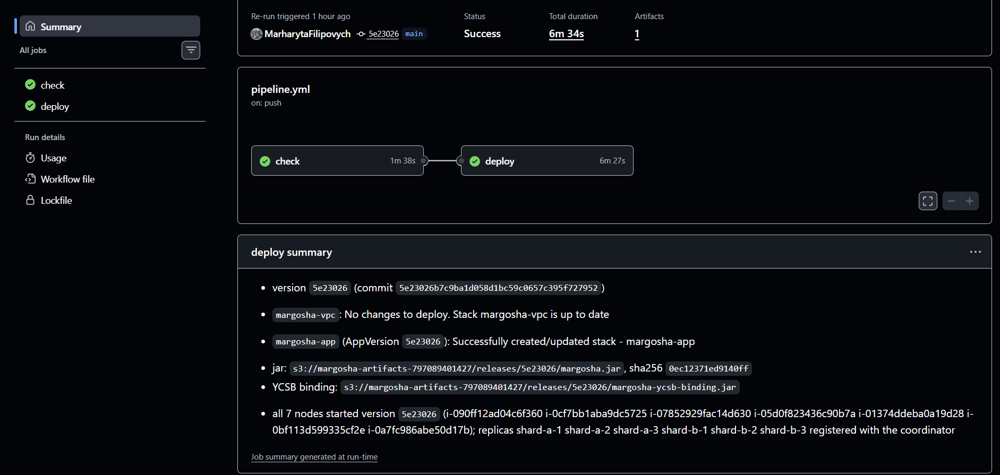
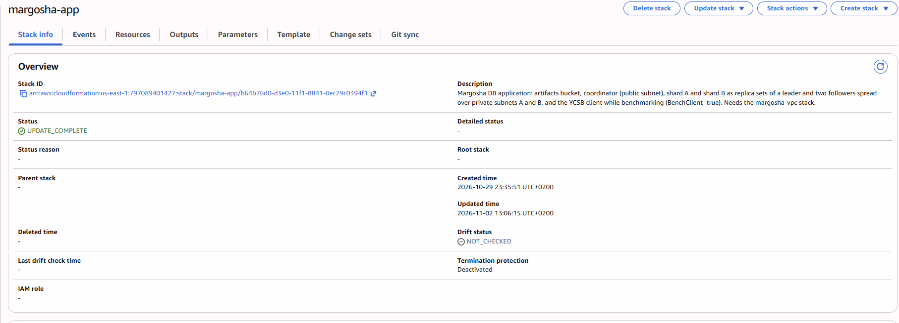
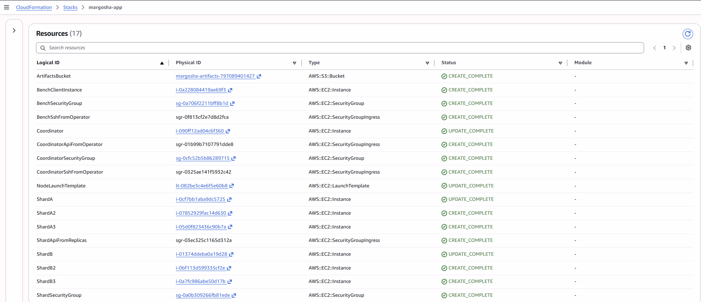
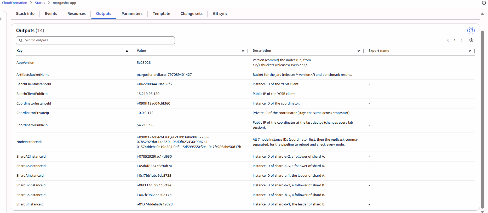
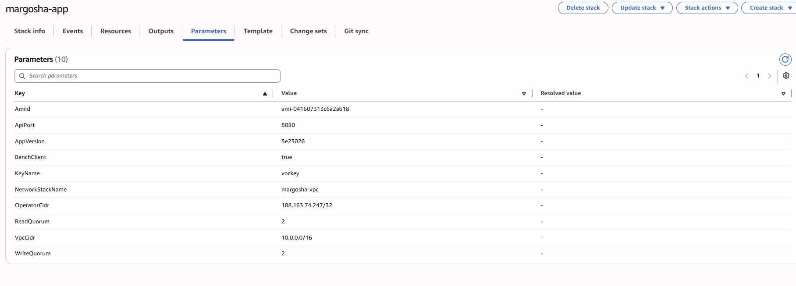

# Deploy through the pipeline

**What was checked:** the pipeline deploys the M3 stack (the coordinator and 6 replicas) and all nodes run the new
version.

## What was done

After the old M2 nodes were terminated (see [instance-limit.md](instance-limit.md)), the failed run was started
again. Pipeline run [**#19**](https://github.com/MarharytaFilipovych/margosha-db/actions/runs/41420930336) (commit
`5e23026`, attempt 5) succeeded:
- `check` (build and tests): 09:54:51–09:56:29;
- `deploy`: 10:05:59–10:12:26.

## Result

The run's Summary shows:
- the version, `5e23026`;
- the jar uploaded to `releases/5e23026/`;
- `margosha-app` updated with `AppVersion 5e23026`;
- all 7 nodes running that version, and all 6 replicas registered with the coordinator.

The account then held exactly 7 instances.

The stack in the console (**CloudFormation → margosha-app**) is `UPDATE_COMPLETE`:
- the coordinator, `ShardA` and `ShardB` were replaced;
- the 4 new followers and `ShardApiFromReplicas` were created;
- the stack shows the version it runs (`AppVersion`, in Outputs and Parameters).

These screenshots were taken later, while the bench client from
[bench-client-isolation.md](bench-client-isolation.md) existed, so they also show `BenchClientInstance` and
`BenchClient = true`:

