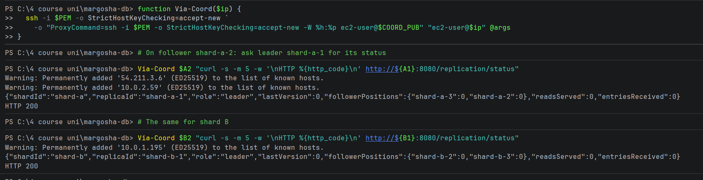

# A follower can reach its leader

**What was checked:** a follower can connect to its shard's leader. Followers need this to copy the leader's writes.

Uses the setup from [setup.md](setup.md).

## Commands

The replicas can only be reached from the coordinator, so SSH goes through it. `Via-Coord` / `via_coord` opens SSH to
a replica through the coordinator and runs a command there. Here, on shard-a-2 and shard-b-2, it asks their leader for
its replication status:

Windows (PowerShell):
```powershell
function Via-Coord($ip) {
  ssh -i $PEM -o StrictHostKeyChecking=accept-new `
    -o "ProxyCommand=ssh -i $PEM -o StrictHostKeyChecking=accept-new -W %h:%p ec2-user@$COORD_PUB" "ec2-user@$ip" @args
}
Via-Coord $A2 "curl -s -m 5 -w '\nHTTP %{http_code}\n' http://${A1}:8080/replication/status"
Via-Coord $B2 "curl -s -m 5 -w '\nHTTP %{http_code}\n' http://${B1}:8080/replication/status"
```

macOS (Terminal):
```bash
via_coord() {
  ssh -i "$PEM" -o StrictHostKeyChecking=accept-new \
    -o "ProxyCommand=ssh -i $PEM -o StrictHostKeyChecking=accept-new -W %h:%p ec2-user@$COORD_PUB" "ec2-user@$1" "$2"
}
via_coord "$A2" "curl -s -m 5 -w '\nHTTP %{http_code}\n' http://$A1:8080/replication/status"
via_coord "$B2" "curl -s -m 5 -w '\nHTTP %{http_code}\n' http://$B1:8080/replication/status"
```



```
{"shardId":"shard-a","replicaId":"shard-a-1","role":"leader","lastVersion":0,"followerPositions":{"shard-a-3":0,"shard-a-2":0},"readsServed":0,"entriesReceived":0}
HTTP 200
{"shardId":"shard-b","replicaId":"shard-b-1","role":"leader","lastVersion":0,"followerPositions":{"shard-b-2":0,"shard-b-3":0},"readsServed":0,"entriesReceived":0}
HTTP 200
```

## Result

- Both followers get an answer (`HTTP 200`) from their leader, across AZs: shard-a-2 (us-east-1b) → shard-a-1
  (us-east-1a), and shard-b-2 (us-east-1a) → shard-b-1 (us-east-1b).
- Each leader also lists both of its followers in `followerPositions`, so all four followers are already connected to
  their leader. The positions are 0 because nothing was written yet.
