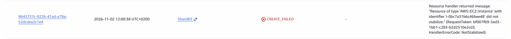
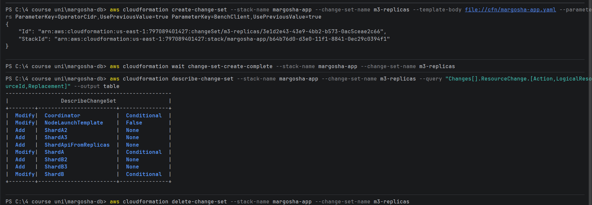

# The first M3 deploy and the 9-instance limit

**What happened:** the first pipeline run of M3 (version `5e23026`) failed. The Learner Lab allows at most 9 instances,
and during the update the old M2 nodes and the new M3 nodes together were 10.

## The error

The `deploy` job failed while updating the app stack:

```
Waiting for changeset to be created..
Waiting for stack create/update to complete

aws: [ERROR]: Failed to create/update the stack. Run the following command
to fetch the list of events leading up to the failure
aws cloudformation describe-stack-events --stack-name margosha-app
Error: Process completed with exit code 255.
```

It says the update failed, but not why. The run's log shows that the 3 M2 nodes were still running before the deploy
(`NODES_BEFORE: i-09de6e18383b722ac i-0ca070eea85727e73 i-0797a438893ea5b5d`).

## How it was found

**1. Which resource failed.** List the stack's events, keeping only failures and rollbacks:

```bash
aws cloudformation describe-stack-events --stack-name margosha-app --region us-east-1 --max-items 40 --query "StackEvents[?contains(ResourceStatus,'FAILED') || contains(ResourceStatus,'ROLLBACK')].[Timestamp,LogicalResourceId,ResourceStatus,ResourceStatusReason]" --output text
```

```
09:31:35  ShardB3      CREATE_FAILED  Resource ... 'AWS::EC2::Instance' with identifier 'i-0ccb0c997405e7e56' did not stabilize. (NotStabilized)
09:31:36  ShardA2      CREATE_FAILED  Resource creation cancelled
09:31:36  ShardA3      CREATE_FAILED  Resource creation cancelled
09:31:36  ShardB2      CREATE_FAILED  Resource creation cancelled
09:31:37  margosha-app UPDATE_ROLLBACK_IN_PROGRESS  The following resource(s) failed to create: [ShardA3, ShardB3, ShardA2, ShardB2].
09:33:22  margosha-app UPDATE_ROLLBACK_COMPLETE
```

The same event in the console (**CloudFormation → margosha-app → Events**), from the deploy run at 10:00:



Only `ShardB3` failed; the other three were cancelled because of it. "Did not stabilize" means the instance was started
but never reached `running`. The template was fine: the same launch template created the other nodes without errors.

**2. What happened to that instance.** Show its state and why it changed:

```bash
aws ec2 describe-instances --region us-east-1 --instance-ids i-0ccb0c997405e7e56 --query "Reservations[0].Instances[0].[State.Name,StateReason.Message,StateTransitionReason]" --output text
```

```
terminated  Client.UserInitiatedShutdown: User initiated shutdown  User initiated (2026-11-02 09:31:30 GMT)
```

Nobody stopped it by hand, and it was only 2 minutes old. In the Learner Lab, "user initiated" means the lab itself
terminated it.

**3. Why the lab terminated it.** The Learner Lab rules (also in the M1 quota analysis,
[quotas_and_budget.md](../../m1/quotas_and_budget.md), section 2.1):

> Maximum of 9 concurrently running EC2 instances [...] the excess instances will be terminated

| Instances at the moment of the failure | Count |
|---|---|
| Old M2 nodes, still running (coordinator, shard A, shard B) | 3 |
| New M3 nodes created by the update (coordinator + 6 replicas) | 7 |
| **Total** | **10 > 9** |

**4. Why old and new nodes ran at the same time.** M3 changes the boot script in the launch template, so CloudFormation
**replaces** the nodes. It creates the new instances first and deletes the old ones only at the end of the update. For
a moment, all old and all new nodes run together.

M1 had warned that M3 "gets close" to the limit (8 instances with the bench client), but it only counted a running M3
stack, not the overlap during the update.

**5. State after the failure.** CloudFormation rolled back to the M2 stack, and the 3 old nodes kept running:

```
i-09de6e18383b722ac  running  t3.micro  margosha-shard-b
i-0797a438893ea5b5d  running  t3.micro  margosha-shard-a
i-0ca070eea85727e73  running  t3.micro  margosha-coordinator
```

## Fix

To move to M3, the 3 old M2 nodes had to be **terminated, not just stopped**: the lab's limit of 9 also counts stopped
instances. Then the deploy was run again and created the 7 M3 nodes. M2 kept its records in memory, so no data was lost.

Terminate the 3 old M2 nodes:

```bash
aws ec2 terminate-instances --region us-east-1 --instance-ids i-0ca070eea85727e73 i-0797a438893ea5b5d i-09de6e18383b722ac
```

## What it means for later

- **Normal deploys are not affected:** a new app version only changes tags and reboots the nodes. No instance is added.
- **A template change that replaces the nodes** (boot script, AMI, instance type, subnet) needs 7 + 7 = 14 instances
  during the update and fails the same way. In M3 it also costs data: the old nodes must be terminated first, so the
  store is down during the update, and the replicas' logs on their disks are lost. Such a change must be planned as a
  migration. To see before pushing whether a change replaces the nodes, see
  [README, "Before pushing a template change"](../../README.md#before-pushing-a-template-change-will-it-replace-the-nodes).
  For this deploy, the preview showed `Coordinator`, `ShardA` and `ShardB` as `Modify / Conditional` (replaced) and
  `ShardA2` … `ShardB3` as `Add`:

  
- **The bench client counts too:** with `BenchClient=true` the M3 stack runs 8 instances, leaving room for only 1 more.
