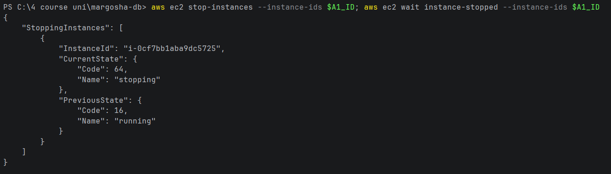
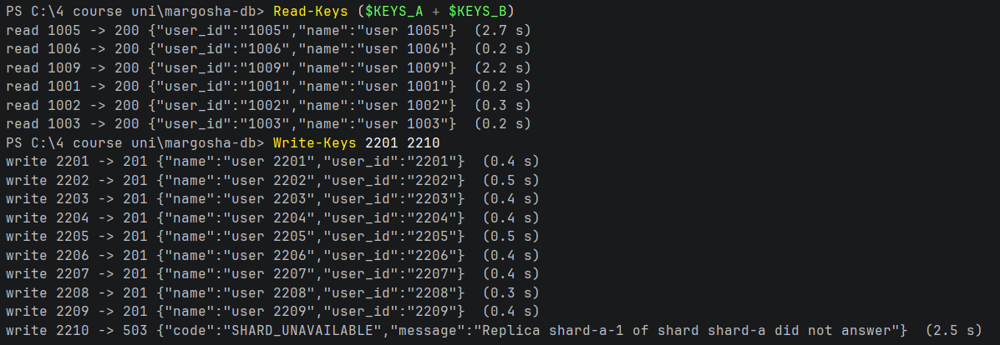
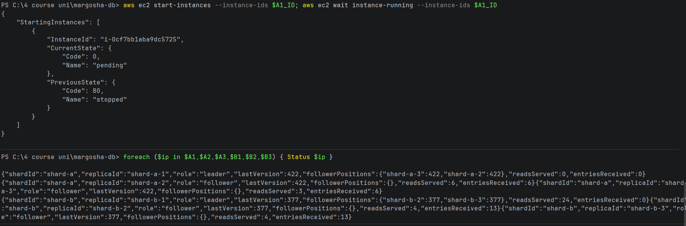

# Leader down

**What was checked:** with a shard's leader down, reads still work, writes to that shard fail with `503`, and the
other shard is not affected.

Only the leader accepts writes, so without it a shard cannot be written to (there is no failover yet). A read asks 2
replicas, and the two followers are enough for that.

Uses the setup from [setup.md](setup.md), including the helpers and keys for the failure checks. The leader stopped is
shard-a-1. This ran right after [one-follower-down.md](one-follower-down.md), once shard-a-3 was running again.

## Commands

**1. Stop shard-a-1** and wait until it is stopped:

```bash
aws ec2 stop-instances --instance-ids $A1_ID; aws ec2 wait instance-stopped --instance-ids $A1_ID
```



**2. Read 3 users from each shard and write 10 new users (2201–2210):**

Windows (PowerShell):
```powershell
Read-Keys ($KEYS_A + $KEYS_B)
Write-Keys 2201 2210
```

macOS (Terminal):
```bash
read_keys $KEYS_A $KEYS_B
write_keys 2201 2210
```



```
read 1005 -> 200 {"user_id":"1005","name":"user 1005"}  (2.7 s)
read 1006 -> 200 {"user_id":"1006","name":"user 1006"}  (0.2 s)
read 1009 -> 200 {"user_id":"1009","name":"user 1009"}  (2.2 s)
read 1001 -> 200 {"user_id":"1001","name":"user 1001"}  (0.2 s)
read 1002 -> 200 {"user_id":"1002","name":"user 1002"}  (0.3 s)
read 1003 -> 200 {"user_id":"1003","name":"user 1003"}  (0.2 s)
write 2201 -> 201 {"name":"user 2201","user_id":"2201"}  (0.4 s)
...
write 2209 -> 201 {"name":"user 2209","user_id":"2209"}  (0.4 s)
write 2210 -> 503 {"code":"SHARD_UNAVAILABLE","message":"Replica shard-a-1 of shard shard-a did not answer"}  (2.5 s)
```

**3. Start shard-a-1 again, then ask all 6 replicas for their status:**

```bash
aws ec2 start-instances --instance-ids $A1_ID; aws ec2 wait instance-running --instance-ids $A1_ID
```

Windows (PowerShell):
```powershell
foreach ($ip in $A1,$A2,$A3,$B1,$B2,$B3) { Status $ip }
```

macOS (Terminal):
```bash
for ip in $A1 $A2 $A3 $B1 $B2 $B3; do status "$ip"; done
```



## Result

- **Reads from shard A work.** All 3 answered `200`, from the two followers. Two of them took 2.2–2.7 s: the
  coordinator asked shard-a-1 first, waited 2 s for it, then asked the other follower.
- **Writes to shard A fail.** User 2210 belongs to shard A and got
  `503 SHARD_UNAVAILABLE: Replica shard-a-1 of shard shard-a did not answer` after 2.5 s (the 2 s shard timeout).
  The client gets a clear error and nothing is written.
- **Shard B is not affected.** Users 2201–2209 all happened to belong to shard B, and all 9 were written (`201` in
  0.3–0.5 s). Shard B's reads took 0.2–0.3 s as usual. Shard B grew from 368 to 377 entries, exactly these 9; shard A
  stayed at 422.
- **Back to normal after the start.** Every follower is at its leader's last entry again: shard A at 422, shard B at
  377. shard-a-3 received the 6 entries it had missed while it was down in
  [one-follower-down.md](one-follower-down.md) (`"entriesReceived":6`).

Only one of the 10 new users belonged to shard A, so only one write to shard A was tried. To try more, write a range
whose keys are on shard A.
