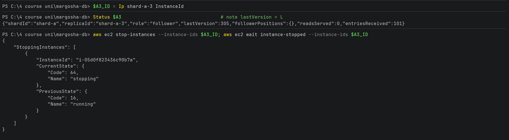
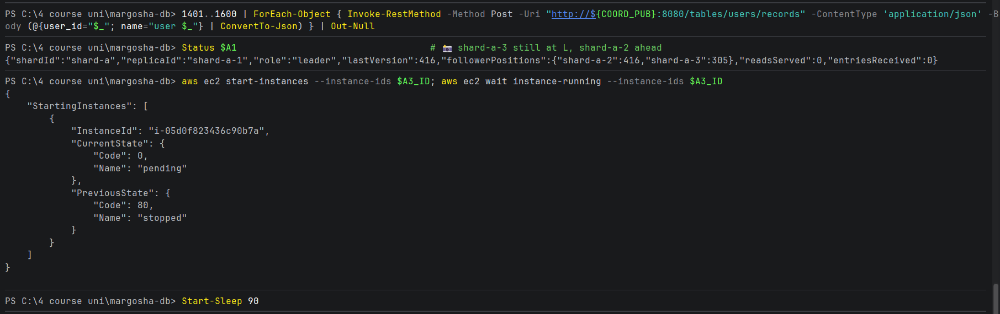
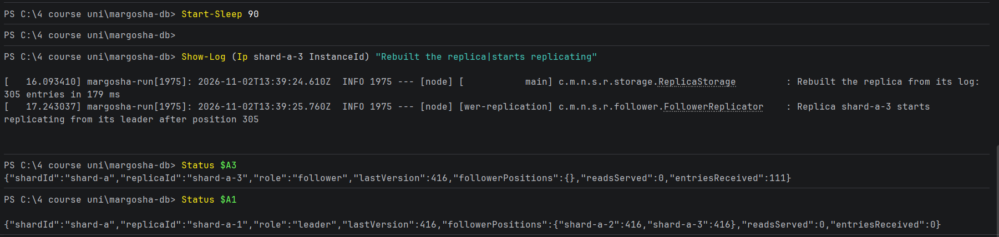

# A restarted follower gets only what it missed

**What was checked:** a follower that was down while records were written catches up when it starts again, and it
receives only the entries it missed, not the whole log. Writes keep working while it is down.

Uses the setup from [setup.md](setup.md). The follower used is shard-a-3.

## Commands

**1. Note where shard-a-3 is, then stop it.**

Get its instance ID:

Windows (PowerShell):
```powershell
$A3_ID = Ip shard-a-3 InstanceId
```

macOS (Terminal):
```bash
A3_ID=$(node_ip shard-a-3 InstanceId)
```

Show its last entry (`lastVersion`):

Windows (PowerShell):
```powershell
Status $A3
```

macOS (Terminal):
```bash
status "$A3"
```

Stop it and wait until it is stopped:

```bash
aws ec2 stop-instances --instance-ids $A3_ID; aws ec2 wait instance-stopped --instance-ids $A3_ID
```



**2. Write while it is down,** then ask the leader where its followers are.

Write 200 records (users 1401–1600). Each failed write prints an error:

Windows (PowerShell):
```powershell
1401..1600 | ForEach-Object { Invoke-RestMethod -Method Post -Uri "http://${COORD_PUB}:8080/tables/users/records" -ContentType 'application/json' -Body (@{user_id="$_"; name="user $_"} | ConvertTo-Json) } | Out-Null
```

macOS (Terminal):
```bash
for i in $(seq 1401 1600); do curl -sf -o /dev/null -X POST "http://$COORD_PUB:8080/tables/users/records" -H 'Content-Type: application/json' -d "{\"user_id\":\"$i\",\"name\":\"user $i\"}" || echo "user $i failed"; done
```

Show the leader's status:

Windows (PowerShell):
```powershell
Status $A1
```

macOS (Terminal):
```bash
status "$A1"
```

**3. Start shard-a-3 again** and wait until it is running:

```bash
aws ec2 start-instances --instance-ids $A3_ID; aws ec2 wait instance-running --instance-ids $A3_ID
```



Wait 90 seconds for it to boot (it downloads the jar and starts the app):

Windows (PowerShell):
```powershell
Start-Sleep 90
```

macOS (Terminal):
```bash
sleep 90
```

**4. Check what it did after starting:** its log (rebuild and where it continued), its status, and the leader's status.

Windows (PowerShell):
```powershell
Show-Log $A3_ID "Rebuilt the replica|starts replicating"
Status $A3
Status $A1
```

macOS (Terminal):
```bash
show_log "$A3_ID" "Rebuilt the replica|starts replicating"
status "$A3"
status "$A1"
```



## Result

| Moment | shard-a-1 (leader) | shard-a-2 | shard-a-3 |
|---|---|---|---|
| Before the stop | 305 | 305 | **305** |
| shard-a-3 stopped, 200 records written | 416 | 416 | still 305 (down) |
| shard-a-3 started again | 416 | 416 | **416** |

- **Writes kept working** with shard-a-3 down: all 200 writes succeeded (no errors printed). The leader and shard-a-2
  are enough to confirm a write. 111 of the 200 records belong to shard A (305 → 416); the rest went to shard B.
- **While it was down,** the leader showed `"shard-a-3":305` and `"shard-a-2":416`: it knew exactly what shard-a-3 was
  missing.
- **After the start,** shard-a-3:
  1. rebuilt its own log from disk: `Rebuilt the replica from its log: 305 entries in 179 ms`;
  2. asked the leader only for what came after: `starts replicating from its leader after position 305`;
  3. received **111** entries (`entriesReceived`), which is exactly the missed range: 416 − 305 = 111.
- The leader then showed shard-a-3 at 416 again, like shard-a-2.
