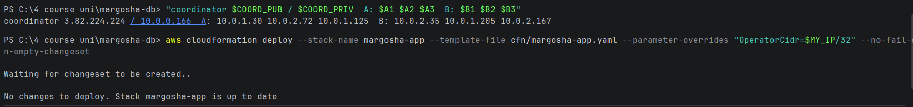
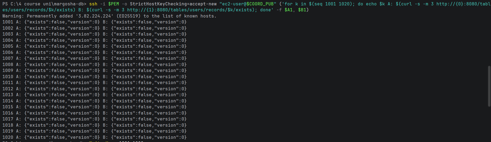
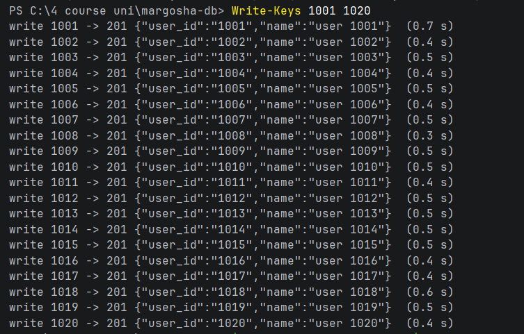
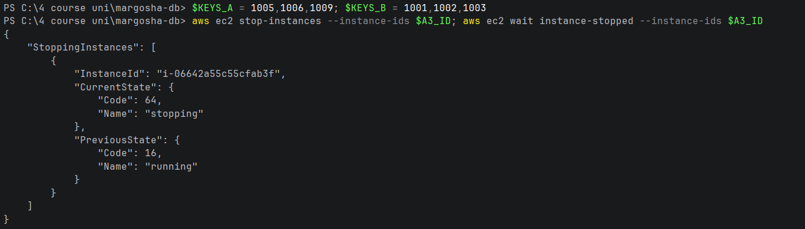
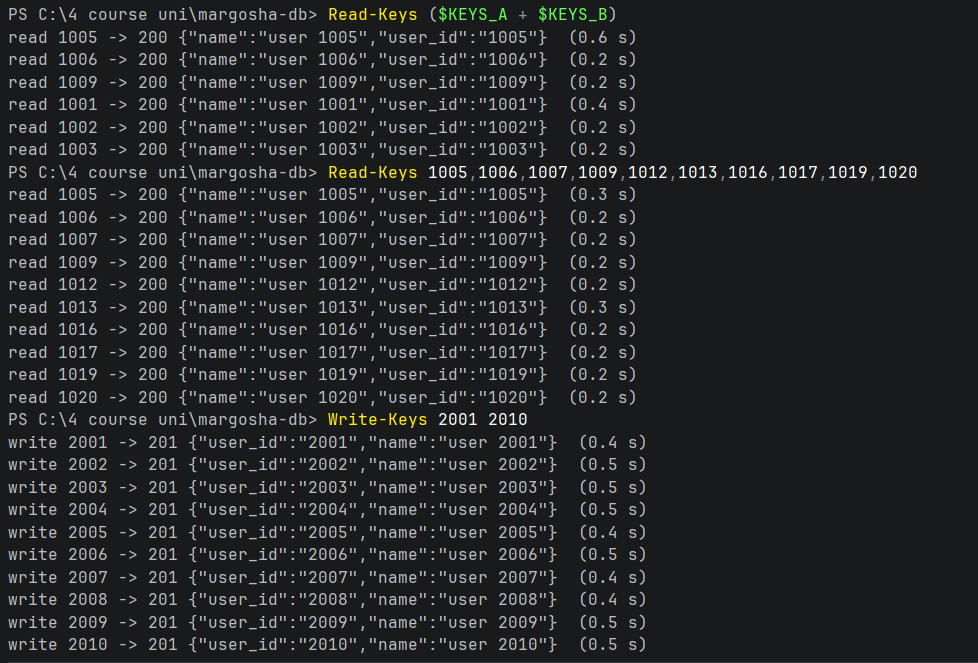
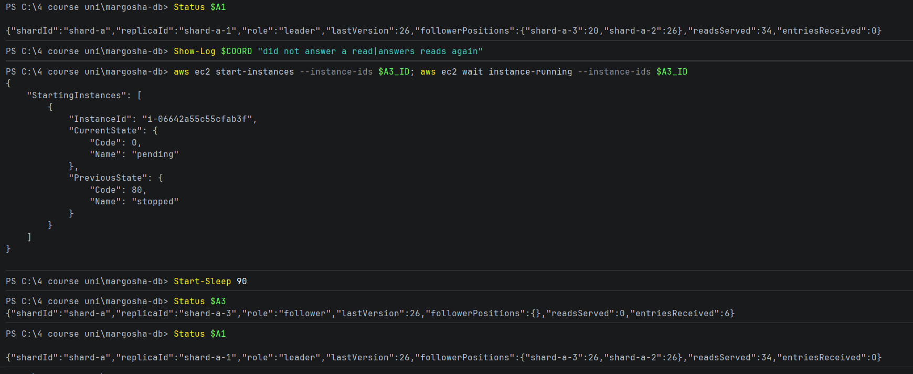
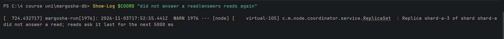

# One follower down

**What was checked:** with one follower of a shard down, reads and writes still work, and the other shard is not
affected.

With 3 replicas per shard, a write needs 2 of them (the leader + 1 follower) and a read asks 2 of them. With one
follower down, 2 replicas are left, which is enough for both.

Uses the setup from [setup.md](setup.md), including the helpers and keys for the failure checks. The follower stopped
is shard-a-3.

The check was run twice:
- [before the fix](#before-the-fix-2026-11-02) for [AI critique](../ai_critique.md) finding 3: two of the three
  shard A reads took 2.2 s;
- [after the fix](#after-the-fix-2026-11-03-version-d891f95): every read took 0.2–0.6 s.

## Before the fix (2026-11-02)

### Commands

**1. Stop shard-a-3** and wait until it is stopped:

```bash
aws ec2 stop-instances --instance-ids $A3_ID; aws ec2 wait instance-stopped --instance-ids $A3_ID
```


**2. Read 3 users from each shard, write 10 new users (2001–2010), and show the leader's status:**

Windows (PowerShell):
```powershell
Read-Keys ($KEYS_A + $KEYS_B)
Write-Keys 2001 2010
Status $A1
```

macOS (Terminal):
```bash
read_keys $KEYS_A $KEYS_B
write_keys 2001 2010
status "$A1"
```


```
read 1005 -> 200 {"user_id":"1005","name":"user 1005"}  (0.7 s)
read 1006 -> 200 {"user_id":"1006","name":"user 1006"}  (2.2 s)
read 1009 -> 200 {"user_id":"1009","name":"user 1009"}  (2.2 s)
read 1001 -> 200 {"user_id":"1001","name":"user 1001"}  (0.4 s)
read 1002 -> 200 {"user_id":"1002","name":"user 1002"}  (0.4 s)
read 1003 -> 200 {"user_id":"1003","name":"user 1003"}  (0.2 s)
write 2001 -> 201 {"name":"user 2001","user_id":"2001"}  (0.4 s)
...
write 2010 -> 201 {"name":"user 2010","user_id":"2010"}  (0.4 s)
{"shardId":"shard-a","replicaId":"shard-a-1","role":"leader","lastVersion":422,"followerPositions":{"shard-a-3":416,"shard-a-2":422},"readsServed":23,"entriesReceived":0}
```

**3. Start shard-a-3 again:**

```bash
aws ec2 start-instances --instance-ids $A3_ID; aws ec2 wait instance-running --instance-ids $A3_ID
```


### Result

- **Reads work.** All 6 reads answered `200` with the right record. Two shard A reads took 2.2 s instead of under
  1 s: the coordinator asked shard-a-3 first, waited 2 s for it (the shard timeout), then asked the other follower.
- **Writes work.** All 10 writes answered `201` in 0.4–0.5 s. A write needs the leader and one follower, and
  shard-a-2 was there.
- **The leader knows who is behind.** It shows `"shard-a-2":422` and `"shard-a-3":416`: shard-a-3 missed the 6 writes
  that went to shard A (416 → 422). It received exactly those 6 when it came back
  (`"entriesReceived":6`, see [leader-down.md](leader-down.md)).
- **Shard B is not affected:** its reads took 0.2–0.4 s as usual.

## After the fix (2026-11-03, version `d891f95`)

The same check, run again after the fix for [AI critique](../ai_critique.md) finding 3 was deployed by the pipeline.
Since the fix, a quorum read that still misses an answer after 50 ms also asks the next replica, and a replica that
failed to answer is asked last for 5 s ([replication.md](../replication.md), "Quorum reads").

### Commands

**0. Setup.** The same setup and helpers as above ([setup.md](setup.md)). In this session the coordinator's public IP
was `3.82.224.224`:



**1. Write the users again.** The benchmark's reset had emptied every data folder
([benchmark procedure, step 3](../benchmark/procedure.md#3-start-from-an-empty-store)), so users 1001–1020 no longer
existed on either leader:



Windows (PowerShell):
```powershell
Write-Keys 1001 1020
```

macOS (Terminal):
```bash
write_keys 1001 1020
```



The ring did not change, so the keys are on the same shards as in [setup.md](setup.md), and the same keys are used:
`$KEYS_A = 1005,1006,1009; $KEYS_B = 1001,1002,1003`.

**2. Stop shard-a-3** and wait until it is stopped:

```bash
aws ec2 stop-instances --instance-ids $A3_ID; aws ec2 wait instance-stopped --instance-ids $A3_ID
```



**3. Read 3 users from each shard, then all 10 users on shard A, and write 10 new users (2001–2010):**

Windows (PowerShell):
```powershell
Read-Keys ($KEYS_A + $KEYS_B)
Read-Keys 1005,1006,1007,1009,1012,1013,1016,1017,1019,1020
Write-Keys 2001 2010
```

macOS (Terminal):
```bash
read_keys $KEYS_A $KEYS_B
read_keys 1005 1006 1007 1009 1012 1013 1016 1017 1019 1020
write_keys 2001 2010
```



```
read 1005 -> 200 {"name":"user 1005","user_id":"1005"}  (0.6 s)
read 1006 -> 200 {"name":"user 1006","user_id":"1006"}  (0.2 s)
read 1009 -> 200 {"name":"user 1009","user_id":"1009"}  (0.2 s)
read 1001 -> 200 {"name":"user 1001","user_id":"1001"}  (0.4 s)
read 1002 -> 200 {"name":"user 1002","user_id":"1002"}  (0.2 s)
read 1003 -> 200 {"name":"user 1003","user_id":"1003"}  (0.2 s)
read 1005 -> 200 {"name":"user 1005","user_id":"1005"}  (0.3 s)
...
read 1020 -> 200 {"name":"user 1020","user_id":"1020"}  (0.2 s)
write 2001 -> 201 {"user_id":"2001","name":"user 2001"}  (0.4 s)
...
write 2010 -> 201 {"user_id":"2010","name":"user 2010"}  (0.5 s)
```

**4. Show the leader's status, start shard-a-3 again, wait for it to boot, and show both statuses:**

Windows (PowerShell):
```powershell
Status $A1
aws ec2 start-instances --instance-ids $A3_ID; aws ec2 wait instance-running --instance-ids $A3_ID
Start-Sleep 90
Status $A3
Status $A1
```

macOS (Terminal):
```bash
status "$A1"
aws ec2 start-instances --instance-ids $A3_ID; aws ec2 wait instance-running --instance-ids $A3_ID
sleep 90
status "$A3"
status "$A1"
```



```
{"shardId":"shard-a","replicaId":"shard-a-1","role":"leader","lastVersion":26,"followerPositions":{"shard-a-3":20,"shard-a-2":26},"readsServed":34,"entriesReceived":0}
{"shardId":"shard-a","replicaId":"shard-a-3","role":"follower","lastVersion":26,"followerPositions":{},"readsServed":0,"entriesReceived":6}
{"shardId":"shard-a","replicaId":"shard-a-1","role":"leader","lastVersion":26,"followerPositions":{"shard-a-3":26,"shard-a-2":26},"readsServed":34,"entriesReceived":0}
```

**5. Show what the coordinator logged about shard-a-3.** EC2's console output lags a few minutes behind, so this
printed nothing right after the reads and the line appeared later:

Windows (PowerShell):
```powershell
Show-Log $COORD "did not answer a read|answers reads again"
```

macOS (Terminal):
```bash
show_log "$COORD" "did not answer a read|answers reads again"
```



```
2026-11-03T17:52:55.441Z  WARN ... c.m.node.coordinator.service.ReplicaSet  : Replica shard-a-3 of shard shard-a did not answer a read; reads ask it last for the next 5000 ms
```

### Result

| Reads of shard A with shard-a-3 stopped | Before the fix | After the fix |
|---|---|---|
| 3 users (1005, 1006, 1009) | 0.7 s, **2.2 s, 2.2 s** | 0.6 s, 0.2 s, 0.2 s |
| All 10 users on shard A | not run | 0.2–0.3 s each |

- **No read waits for the stopped replica any more.** All 16 reads answered `200` with the right record in 0.2–0.6 s,
  the same as shard B's reads. A read that asked shard-a-3 did not get an answer within 50 ms, so it also asked the
  third replica and used the first two answers. That costs about 50 ms, which doesn't show at this precision: most of
  the 0.2 s is the trip from the laptop to AWS.
- **The coordinator then skipped shard-a-3.** When the request to it timed out in the background, the coordinator
  logged that reads ask it last for 5 s.
- **The slower first reads are not the stopped replica.** 1005 (0.6 s) and 1001 (0.4 s) were the first reads of each
  shard in the run, which open new connections. The run before the fix shows the same thing (0.7 s and 0.4 s).
- **Writes work, as before:** all 10 answered `201` in 0.4–0.5 s.
- **Resync works, as before:** while shard-a-3 was down the leader showed `"shard-a-3":20` and `"shard-a-2":26`.
  shard-a-3 missed the 6 writes from 2001–2010 that went to shard A. When it came back it received exactly those 6
  (`"entriesReceived":6`) and reached the leader's 26.
- The "answers reads again" line did not appear in the console output we read. The 90-second wait plus the `Status`
  calls go to the replicas directly, not through quorum reads, so no read had tried shard-a-3 again by then.
