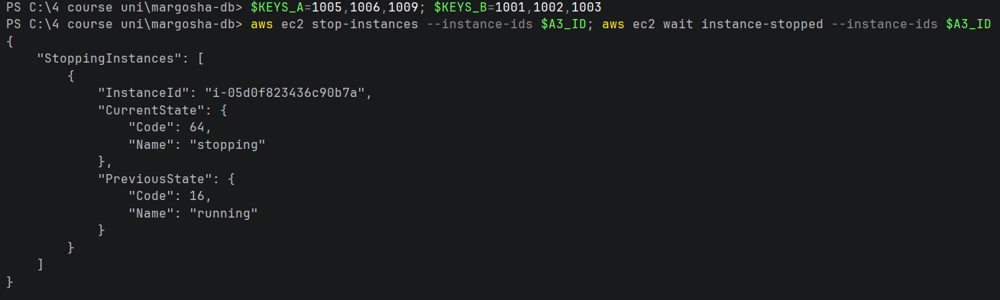
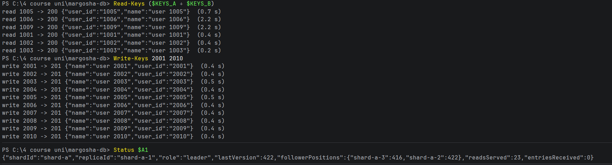
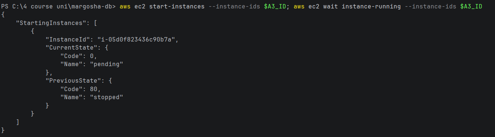

# One follower down

**What was checked:** with one follower of a shard down, reads and writes still work, and the other shard is not
affected.

With 3 replicas per shard, a write needs 2 of them (the leader + 1 follower) and a read asks 2 of them. With one
follower down, 2 replicas are left, which is enough for both.

Uses the setup from [setup.md](setup.md), including the helpers and keys for the failure checks. The follower stopped
is shard-a-3.

> **Note:** this check ran before the fix for [AI critique](../ai_critique.md) finding 3. The 2.2 s reads below are
> the problem that finding describes. Since the fix, a read asks the third replica after 50 ms and then skips the
> stopped one for 5 s. This check has not been run on AWS again yet.

## Commands

**1. Stop shard-a-3** and wait until it is stopped:

```bash
aws ec2 stop-instances --instance-ids $A3_ID; aws ec2 wait instance-stopped --instance-ids $A3_ID
```



**2. Read 3 users from each shard, write 10 new users (2001–2010), and show the leader's status:**

Windows (PowerShell):
```powershell
Read-Keys ($KEYS_A + $KEYS_B)
Write-Keys 2001 2010
Status $A1
```

macOS (Terminal):
```bash
read_keys $KEYS_A $KEYS_B
write_keys 2001 2010
status "$A1"
```



```
read 1005 -> 200 {"user_id":"1005","name":"user 1005"}  (0.7 s)
read 1006 -> 200 {"user_id":"1006","name":"user 1006"}  (2.2 s)
read 1009 -> 200 {"user_id":"1009","name":"user 1009"}  (2.2 s)
read 1001 -> 200 {"user_id":"1001","name":"user 1001"}  (0.4 s)
read 1002 -> 200 {"user_id":"1002","name":"user 1002"}  (0.4 s)
read 1003 -> 200 {"user_id":"1003","name":"user 1003"}  (0.2 s)
write 2001 -> 201 {"name":"user 2001","user_id":"2001"}  (0.4 s)
...
write 2010 -> 201 {"name":"user 2010","user_id":"2010"}  (0.4 s)
{"shardId":"shard-a","replicaId":"shard-a-1","role":"leader","lastVersion":422,"followerPositions":{"shard-a-3":416,"shard-a-2":422},"readsServed":23,"entriesReceived":0}
```

**3. Start shard-a-3 again:**

```bash
aws ec2 start-instances --instance-ids $A3_ID; aws ec2 wait instance-running --instance-ids $A3_ID
```



## Result

- **Reads work.** All 6 reads answered `200` with the right record. Two shard A reads took 2.2 s instead of under
  1 s: the coordinator asked shard-a-3 first, waited 2 s for it (the shard timeout), then asked the other follower.
- **Writes work.** All 10 writes answered `201` in 0.4–0.5 s. A write needs the leader and one follower, and
  shard-a-2 was there.
- **The leader knows who is behind.** It shows `"shard-a-2":422` and `"shard-a-3":416`: shard-a-3 missed the 6 writes
  that went to shard A (416 → 422). It received exactly those 6 when it came back
  (`"entriesReceived":6`, see [leader-down.md](leader-down.md)).
- **Shard B is not affected:** its reads took 0.2–0.4 s as usual.
