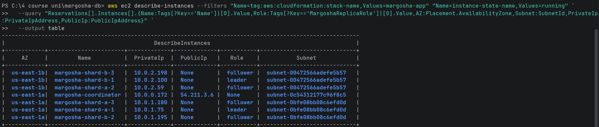
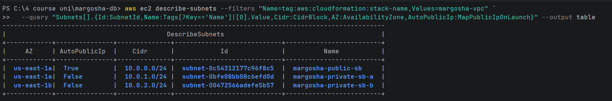
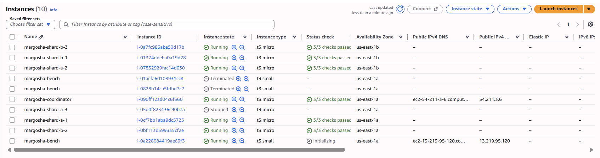

# Placement

**What was checked:**
- each shard has replicas in both private subnets;
- the two leaders are in different availability zones (AZs);
- no replica has a public IP.

## Commands

List the stack's running instances (name, role, AZ, subnet, IPs):

```bash
aws ec2 describe-instances --filters "Name=tag:aws:cloudformation:stack-name,Values=margosha-app" "Name=instance-state-name,Values=running" --query "Reservations[].Instances[].{Name:Tags[?Key=='Name']|[0].Value,Role:Tags[?Key=='MargoshaReplicaRole']|[0].Value,AZ:Placement.AvailabilityZone,Subnet:SubnetId,PrivateIp:PrivateIpAddress,PublicIp:PublicIpAddress}" --output table
```



List the network stack's subnets (name, address range, AZ, whether they give out public IPs):

```bash
aws ec2 describe-subnets --filters "Name=tag:aws:cloudformation:stack-name,Values=margosha-vpc" --query "Subnets[].{Id:SubnetId,Name:Tags[?Key=='Name']|[0].Value,Cidr:CidrBlock,AZ:AvailabilityZone,AutoPublicIp:MapPublicIpOnLaunch}" --output table
```



The same in the console (**EC2 → Instances**). This screenshot was taken later, during the replication checks, so it
also shows `shard-a-3` stopped, a running bench client and two earlier bench clients already terminated:



## Result

| Node | Role | Subnet | AZ | Private IP | Public IP |
|---|---|---|---|---|---|
| coordinator | — | `margosha-public-sb` (10.0.0.0/24) | us-east-1a | 10.0.0.172 | 54.211.3.6 |
| shard-a-1 | leader | `margosha-private-sb-a` (10.0.1.0/24) | us-east-1a | 10.0.1.75 | None |
| shard-a-2 | follower | `margosha-private-sb-b` (10.0.2.0/24) | us-east-1b | 10.0.2.59 | None |
| shard-a-3 | follower | `margosha-private-sb-a` | us-east-1a | 10.0.1.180 | None |
| shard-b-1 | leader | `margosha-private-sb-b` | us-east-1b | 10.0.2.100 | None |
| shard-b-2 | follower | `margosha-private-sb-a` | us-east-1a | 10.0.1.195 | None |
| shard-b-3 | follower | `margosha-private-sb-b` | us-east-1b | 10.0.2.198 | None |

- **Both private subnets:** shard A has 2 replicas in subnet A and 1 in subnet B; shard B has 1 in A and 2 in B.
- **Leaders in different AZs:** shard-a-1 is in us-east-1a, shard-b-1 in us-east-1b.
- **No public IPs:** every replica shows `None`, and neither private subnet gives out public IPs.
