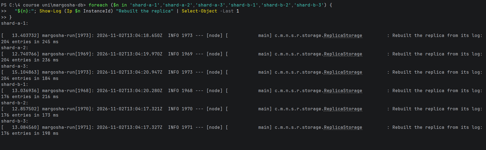
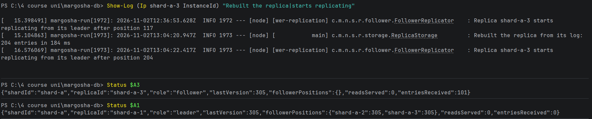

# Rebuild time on start

**What was checked:** how long a replica takes to rebuild its data from its log when it starts. On start, a replica
reads its whole log from disk, checks every entry and loads the records into memory. It logs how long that took:
`Rebuilt the replica from its log: <entries> entries in <time> ms`.

Uses the setup from [setup.md](setup.md).

## Commands

Show the rebuild line of every replica, from its last start:

Windows (PowerShell):
```powershell
foreach ($n in 'shard-a-1','shard-a-2','shard-a-3','shard-b-1','shard-b-2','shard-b-3') {
  "${n}:"; Show-Log (Ip $n InstanceId) "Rebuilt the replica" | Select-Object -Last 1
}
```

macOS (Terminal):
```bash
for n in shard-a-1 shard-a-2 shard-a-3 shard-b-1 shard-b-2 shard-b-3; do
  echo "$n:"; show_log "$(node_ip $n InstanceId)" "Rebuilt the replica" | tail -n 1
done
```



What one replica (shard-a-3) did right after the rebuild: its log and status, and the leader's status:

Windows (PowerShell):
```powershell
Show-Log (Ip shard-a-3 InstanceId) "Rebuilt the replica|starts replicating"
Status $A3
Status $A1
```

macOS (Terminal):
```bash
show_log "$(node_ip shard-a-3 InstanceId)" "Rebuilt the replica|starts replicating"
status "$A3"
status "$A1"
```



## Result

All replicas were restarted by the deploy at 13:04, and shard-a-3 once more in
[missed-range.md](missed-range.md):

| Replica | When | Entries in its log | Rebuild time |
|---|---|---|---|
| shard-a-1 | 13:04 (deploy) | 204 | 245 ms |
| shard-a-2 | 13:04 (deploy) | 204 | 236 ms |
| shard-a-3 | 13:04 (deploy) | 204 | 184 ms |
| shard-b-1 | 13:04 (deploy) | 176 | 216 ms |
| shard-b-2 | 13:04 (deploy) | 176 | 173 ms |
| shard-b-3 | 13:04 (deploy) | 176 | 198 ms |
| shard-a-3 | 13:39 (restart after being down) | 305 | 179 ms |

- With 176–305 entries, a rebuild takes about **0.2 s** on a `t3.micro`. Most of that is a fixed start-up cost: 305
  entries were not slower than 204. Start-up time is not a problem at this size.
- After the rebuild, a follower continues from the end of its own log. On the deploy at 13:04, shard-a-3 rebuilt 204
  entries and then asked its leader for the entries `after position 204`. It then received the 101 entries written
  after the deploy (`entriesReceived 101`), reaching the leader's 305.
- The first line in the shard-a-3 screenshot (12:36, `after position 117`) is from an earlier start, before the version
  that logs the rebuild time was deployed.
