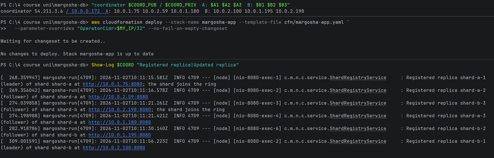

# All replicas register with the coordinator

**What was checked:** after the deploy, each of the 6 replicas registers with the coordinator, so the coordinator knows
where every replica is.

Uses the setup from [setup.md](setup.md).

## Commands

Show the coordinator's log lines about replicas registering:

Windows (PowerShell):
```powershell
Show-Log $COORD "Registered replica|Updated replica"
```

macOS (Terminal):
```bash
show_log "$COORD" "Registered replica|Updated replica"
```



## Result

All 6 replicas registered within a minute after the deploy:

| Time | Replica | Role | Address |
|---|---|---|---|
| 10:11:15 | shard-a-1 | leader | 10.0.1.75 (shard A joins the ring) |
| 10:11:16 | shard-a-2 | follower | 10.0.2.59 |
| 10:11:21 | shard-b-3 | follower | 10.0.2.198 (shard B joins the ring) |
| 10:11:21 | shard-a-3 | follower | 10.0.1.180 |
| 10:11:30 | shard-b-2 | follower | 10.0.1.195 |
| 10:11:56 | shard-b-1 | leader | 10.0.2.100 |

A shard joins the ring with its first replica, whatever its role: shard B joined when its follower shard-b-3
registered, before its leader.
