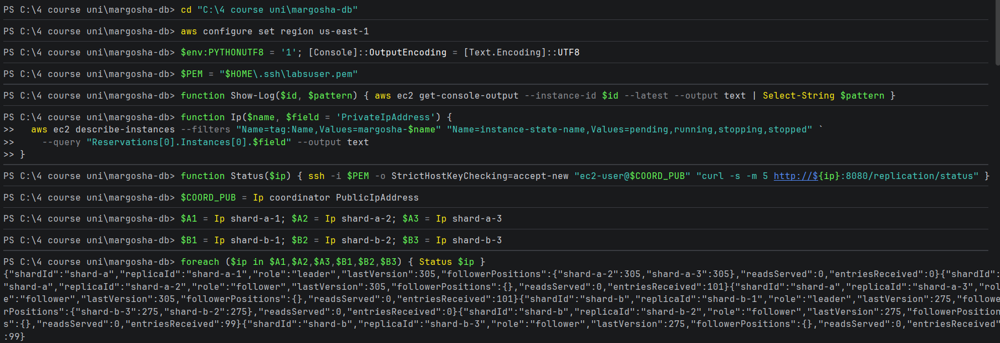

# Followers keep up with their leader

**What was checked:** after writes, every follower has the same last log entry as its leader. A replica's
`lastVersion` is the number of its last log entry, and a leader's `followerPositions` shows how far each follower has
confirmed.

Uses the setup from [setup.md](setup.md).

## Commands

Create the `users` table (once; if it already exists the answer is `409`, which is fine):

Windows (PowerShell):
```powershell
Invoke-RestMethod -Method Post -Uri "http://${COORD_PUB}:8080/tables" -ContentType 'application/json' -Body '{"name":"users","partitionKey":"user_id"}'
```

macOS (Terminal):
```bash
curl -s -X POST "http://$COORD_PUB:8080/tables" -H 'Content-Type: application/json' -d '{"name":"users","partitionKey":"user_id"}'
```

Write a batch of records (here users 1001–1200). Each failed write prints an error:

Windows (PowerShell):
```powershell
1001..1200 | ForEach-Object { Invoke-RestMethod -Method Post -Uri "http://${COORD_PUB}:8080/tables/users/records" -ContentType 'application/json' -Body (@{user_id="$_"; name="user $_"} | ConvertTo-Json) } | Out-Null
```

macOS (Terminal):
```bash
for i in $(seq 1001 1200); do curl -sf -o /dev/null -X POST "http://$COORD_PUB:8080/tables/users/records" -H 'Content-Type: application/json' -d "{\"user_id\":\"$i\",\"name\":\"user $i\"}" || echo "user $i failed"; done
```

Ask all 6 replicas for their replication status:

Windows (PowerShell):
```powershell
foreach ($ip in $A1,$A2,$A3,$B1,$B2,$B3) { Status $ip }
```

macOS (Terminal):
```bash
for ip in $A1 $A2 $A3 $B1 $B2 $B3; do status "$ip"; done
```



The output, one replica per line:

```
{"shardId":"shard-a","replicaId":"shard-a-1","role":"leader","lastVersion":305,"followerPositions":{"shard-a-2":305,"shard-a-3":305},"readsServed":0,"entriesReceived":0}
{"shardId":"shard-a","replicaId":"shard-a-2","role":"follower","lastVersion":305,"followerPositions":{},"readsServed":0,"entriesReceived":101}
{"shardId":"shard-a","replicaId":"shard-a-3","role":"follower","lastVersion":305,"followerPositions":{},"readsServed":0,"entriesReceived":101}
{"shardId":"shard-b","replicaId":"shard-b-1","role":"leader","lastVersion":275,"followerPositions":{"shard-b-3":275,"shard-b-2":275},"readsServed":0,"entriesReceived":0}
{"shardId":"shard-b","replicaId":"shard-b-2","role":"follower","lastVersion":275,"followerPositions":{},"readsServed":0,"entriesReceived":99}
{"shardId":"shard-b","replicaId":"shard-b-3","role":"follower","lastVersion":275,"followerPositions":{},"readsServed":0,"entriesReceived":99}
```

## Result

| Shard | Leader's last entry | Followers' last entry | Leader's view of its followers |
|---|---|---|---|
| A | 305 | shard-a-2: 305, shard-a-3: 305 | both at 305 |
| B | 275 | shard-b-2: 275, shard-b-3: 275 | both at 275 |

Every follower has all of its leader's entries, and each leader knows it. The two shards have different numbers
because each one holds a different part of the keys.

`entriesReceived` counts the entries a follower received since it last started. All nodes were restarted by the deploy
at 13:04; since then shard A got 101 new entries and shard B 99, and every follower received exactly those.
