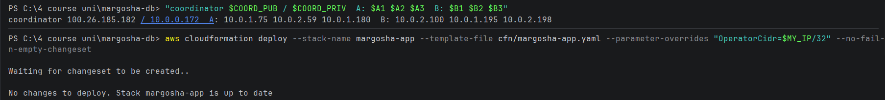
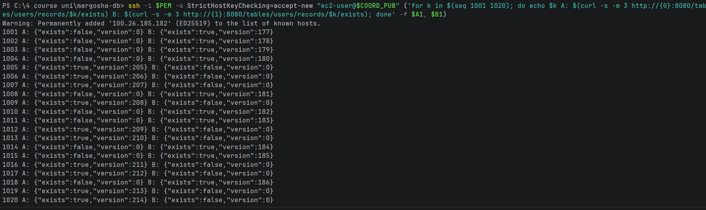

# Setup for the checks

Run this once at the start, in the terminal you use for the checks. Keep that window open: the variables are lost when
it is closed.

It goes to the repo, sets the region, gets your public IP and the SSH key, defines the helpers, and looks up the nodes'
IP addresses. The SSH key comes from the lab page: **AWS Details → Download PEM** (`labsuser.pem`), saved in `~/.ssh/`.

The helpers:
- `Show-Log` / `show_log` prints the lines of a node's log that match a pattern. It reads the node's serial console, so
  no SSH is needed.
- `Ip` / `node_ip` prints a field of an instance, found by its name: the private IP by default, or another field such
  as `PublicIpAddress`, `InstanceId` or `State.Name`.
- `Status` / `status` asks a replica for its replication status. The replicas are in private subnets, so the request
  runs on the coordinator over SSH.

Windows (PowerShell):
```powershell
cd ~\margosha-db                      # wherever the repo is cloned
aws configure set region us-east-1
# The logs contain non-ASCII characters; without this line the AWS CLI on Windows fails with a 'charmap' error.
$env:PYTHONUTF8 = '1'; [Console]::OutputEncoding = [Text.Encoding]::UTF8
$MY_IP = (Invoke-RestMethod https://checkip.amazonaws.com).Trim()
$PEM = "$HOME\.ssh\labsuser.pem"

function Show-Log($id, $pattern) {
  aws ec2 get-console-output --instance-id $id --latest --output text | Select-String $pattern
}
function Ip($name, $field = 'PrivateIpAddress') {
  aws ec2 describe-instances --filters "Name=tag:Name,Values=margosha-$name" "Name=instance-state-name,Values=pending,running,stopping,stopped" `
    --query "Reservations[0].Instances[0].$field" --output text
}
function Status($ip) {
  ssh -i $PEM -o StrictHostKeyChecking=accept-new "ec2-user@$COORD_PUB" "curl -s -m 5 http://${ip}:8080/replication/status"
}

$COORD      = Ip coordinator InstanceId
$COORD_PUB  = Ip coordinator PublicIpAddress
$COORD_PRIV = Ip coordinator
$A1 = Ip shard-a-1; $A2 = Ip shard-a-2; $A3 = Ip shard-a-3
$B1 = Ip shard-b-1; $B2 = Ip shard-b-2; $B3 = Ip shard-b-3
"coordinator $COORD_PUB / $COORD_PRIV  A: $A1 $A2 $A3  B: $B1 $B2 $B3"
```

macOS (Terminal):
```bash
cd ~/margosha-db                      # wherever the repo is cloned
aws configure set region us-east-1
MY_IP=$(curl -s https://checkip.amazonaws.com)
PEM=~/.ssh/labsuser.pem
chmod 400 "$PEM"                      # ssh refuses a key that others can read

show_log() { aws ec2 get-console-output --instance-id "$1" --latest --output text | grep -E "$2"; }
node_ip() {
  aws ec2 describe-instances --filters "Name=tag:Name,Values=margosha-$1" "Name=instance-state-name,Values=pending,running,stopping,stopped" \
    --query "Reservations[0].Instances[0].${2:-PrivateIpAddress}" --output text
}
status() {
  ssh -i "$PEM" -o StrictHostKeyChecking=accept-new "ec2-user@$COORD_PUB" "curl -s -m 5 http://$1:8080/replication/status"; echo
}

COORD=$(node_ip coordinator InstanceId)
COORD_PUB=$(node_ip coordinator PublicIpAddress)
COORD_PRIV=$(node_ip coordinator)
A1=$(node_ip shard-a-1); A2=$(node_ip shard-a-2); A3=$(node_ip shard-a-3)
B1=$(node_ip shard-b-1); B2=$(node_ip shard-b-2); B3=$(node_ip shard-b-3)
echo "coordinator $COORD_PUB / $COORD_PRIV  A: $A1 $A2 $A3  B: $B1 $B2 $B3"
```

Output on 2026-11-02:

```
coordinator 54.211.3.6 / 10.0.0.172  A: 10.0.1.75 10.0.2.59 10.0.1.180  B: 10.0.2.100 10.0.1.195 10.0.2.198
```

If a value is `None`, that node does not exist (yet). A replica that is stopped or still starting makes `Status` wait
5 seconds and print nothing.

**Open the API and SSH to your IP.** The checks reach the coordinator from your computer, so the stack must allow your
IP. This changes two security group rules and replaces nothing. Run it again when your IP changes:

```bash
aws cloudformation deploy --stack-name margosha-app --template-file cfn/margosha-app.yaml --parameter-overrides "OperatorCidr=$MY_IP/32" --no-fail-on-empty-changeset
```

On 2026-11-02 it printed `No changes to deploy`: the stack already allowed this IP.

## In a new lab session

The lab stops all instances when a session ends and starts them again in the next one. Run the setup again: the
coordinator gets a **new public IP** every session, while all private IPs stay the same. In the session of 16:00 the
coordinator's public IP was `100.26.185.182`:



## Helpers for the failure checks

The failure checks ([one-follower-down.md](one-follower-down.md), [both-followers-down.md](both-followers-down.md),
[leader-down.md](leader-down.md)) read and write
records through the coordinator's API and show what a client gets back:
- `Api` / `api` calls the API and prints the HTTP code, the answer and how long it took;
- `Read-Keys` / `read_keys` reads a list of users;
- `Write-Keys` / `write_keys` creates new users in a range;
- the last line saves the instance IDs of shard A's replicas, to stop and start them.

Windows (PowerShell):
```powershell
function Api($method, $path, $body) {
  $sw = [Diagnostics.Stopwatch]::StartNew()
  try {
    $r = Invoke-WebRequest -UseBasicParsing -Method $method -Uri "http://${COORD_PUB}:8080$path" -ContentType 'application/json' -Body $body -TimeoutSec 15
    $out = "$($r.StatusCode) $($r.Content)"
  } catch {
    $resp = $_.Exception.Response
    if ($resp) { $sr = New-Object IO.StreamReader($resp.GetResponseStream()); $out = "$([int]$resp.StatusCode) $($sr.ReadToEnd())" }
    else { $out = "ERROR $($_.Exception.Message)" }
  }
  "$out  ($([math]::Round($sw.Elapsed.TotalSeconds, 1)) s)"
}
function Read-Keys($keys) { foreach ($k in $keys) { "read $k -> " + (Api GET "/tables/users/records/$k") } }
function Write-Keys($from, $to) {
  foreach ($k in $from..$to) { "write $k -> " + (Api POST "/tables/users/records" (@{user_id="$k"; name="user $k"} | ConvertTo-Json -Compress)) }
}
$A1_ID = Ip shard-a-1 InstanceId; $A2_ID = Ip shard-a-2 InstanceId; $A3_ID = Ip shard-a-3 InstanceId
```

macOS (Terminal):
```bash
api() { curl -s -m 15 -X "$1" "http://$COORD_PUB:8080$2" -H 'Content-Type: application/json' ${3:+-d "$3"} -w '  (HTTP %{http_code}, %{time_total} s)\n'; }
read_keys() { for k in "$@"; do printf 'read %s -> ' "$k"; api GET "/tables/users/records/$k"; done; }
write_keys() { for k in $(seq "$1" "$2"); do printf 'write %s -> ' "$k"; api POST /tables/users/records "{\"user_id\":\"$k\",\"name\":\"user $k\"}"; done; }
A1_ID=$(node_ip shard-a-1 InstanceId); A2_ID=$(node_ip shard-a-2 InstanceId); A3_ID=$(node_ip shard-a-3 InstanceId)
```

## Which shard a key is on

The failure checks stop replicas of shard A, so they need keys that are on shard A, and keys on shard B to compare.
Ask both leaders whether they hold users 1001–1020. The request runs on the coordinator, because the replicas are
private:

Windows (PowerShell):
```powershell
ssh -i $PEM -o StrictHostKeyChecking=accept-new "ec2-user@$COORD_PUB" ('for k in $(seq 1001 1020); do echo $k A: $(curl -s -m 3 http://{0}:8080/tables/users/records/$k/exists) B: $(curl -s -m 3 http://{1}:8080/tables/users/records/$k/exists); done' -f $A1, $B1)
```

macOS (Terminal):
```bash
ssh -i "$PEM" -o StrictHostKeyChecking=accept-new "ec2-user@$COORD_PUB" "for k in \$(seq 1001 1020); do echo \$k A: \$(curl -s -m 3 http://$A1:8080/tables/users/records/\$k/exists) B: \$(curl -s -m 3 http://$B1:8080/tables/users/records/\$k/exists); done"
```



Each key is on exactly one shard (`"exists":true` on one leader, `false` on the other):
- **shard A:** 1005, 1006, 1007, 1009, 1012, 1013, 1016, 1017, 1019, 1020;
- **shard B:** 1001, 1002, 1003, 1004, 1008, 1010, 1011, 1014, 1015, 1018.

These users were written in the previous lab session, so they also survived the lab stopping and starting all nodes.

The keys used in the failure checks:

Windows (PowerShell):
```powershell
$KEYS_A = 1005,1006,1009; $KEYS_B = 1001,1002,1003
```

macOS (Terminal):
```bash
KEYS_A="1005 1006 1009"; KEYS_B="1001 1002 1003"
```
