# M3 benchmark results

**Spec:** `benchmarking` in `openspec/changes/setup-m3-durability`.

**How it was run:** [procedure.md](procedure.md).

**Raw output:** [raw/](raw/), one folder per run (see [Raw files](#raw-files)).

**Baseline:** [M2 results](../../m2/benchmark/results.md).

This is the replicated, durable store: 2 shards of 3 replicas each, every write stored on disk by the leader and at
least one follower before it is confirmed. It is compared with the M2 baseline (2 shards, 1 node each, records in
memory only), with the same workload and parameters.

## What was benchmarked

| | |
|---|---|
| Date | 2026-11-03, 10:23–10:44 UTC (Learner Lab, `us-east-1`) |
| Version | `2743bae` (deployed by the pipeline; jars in `releases/2743bae/`) |
| YCSB | 0.17.0, Java 21 (Corretto 21.0.13), binding `com.margosha.ycsb.MargoshaDbClient` (jar sha256 `fb84f8ecadc823a2`) |
| Workload | **A** (`workloada`): 50% read / 50% update, zipfian key choice, read all fields (same as M2) |
| `recordcount` | 100,000 (10 fields × 100 bytes each) (same as M2) |
| `operationcount` | 200,000 per run (same as M2) |
| Threads | 8 (same as M2) |
| Table | `usertable`, partition key `ycsb_key`, no sort key (same as M2) |
| Runs | load + a warm-up run (discarded), then 3 measured runs on the same data |
| Replication | **N = 3** replicas per shard, write quorum **W = 2**, read quorum **R = 2** (in each run's `params.txt`) |
| Coordinator | `t3.micro`, public subnet (`us-east-1a`), `-Xmx512m`, standard credits |
| Replicas | 6 × `t3.micro`, 2 shards × (leader + 2 followers) over private subnets A and B, `-Xmx512m`, standard credits, data on each instance's gp3 disk |
| YCSB client | `t3.small`, public subnet, same VPC, **unlimited credits** during the runs; calls the coordinator's private IP |

The store was emptied before the load (all 7 nodes stopped, data folders deleted, started again), so every run started
from the same state: see [procedure.md, step 3](procedure.md#3-start-from-an-empty-store).

**Why the YCSB client ran in unlimited credit mode.** The benchmark must be limited by the store, not by the machine
that sends the requests. A new T3 instance in standard mode starts with **0 CPU credits**, and at 0 a `t3.small` is held
at 20% of its CPU. YCSB would then send requests more slowly, and the numbers would show the client's limit instead of
the store's. Earning enough credits takes about an hour (a `t3.small` earns 24 per hour). In unlimited mode the client
runs at full speed at once; AWS charges the CPU it uses above its baseline at $0.05 per vCPU-hour, a few cents for this
benchmark. It needed that: during the runs it used up to 61% CPU, three times its 20% limit at 0 credits. Only the
client was switched, and only for the runs ([procedure.md, step 2](procedure.md#2-turn-on-the-bench-client)); the
7 nodes stayed in standard mode, and each kept over 110 credits, so nothing in the store was held back either.

## Results

All latencies in ms. YCSB writes them in µs in `run.txt` / `load.txt`.

### Measured runs

| Run | Throughput | READ avg | READ p95 | READ p99 | UPDATE avg | UPDATE p95 | UPDATE p99 |
|---|---|---|---|---|---|---|---|
| Run 1 | 1,015 ops/s (197.0 s) | 3.73 | 6.67 | 14.56 | 11.88 | 18.56 | 28.27 |
| Run 2 | 1,001 ops/s (199.8 s) | 3.76 | 6.94 | 18.46 | 12.08 | 19.36 | 34.05 |
| Run 3 | 1,029 ops/s (194.3 s) | 3.65 | 6.43 | 12.86 | 11.79 | 18.18 | 25.71 |
| **Median** | **1,015 ops/s** | **3.73** | **6.67** | **14.56** | **11.88** | **18.56** | **28.27** |

The median of every column happens to be run 1's value.

- **The averages are very stable:** throughput 1,001–1,029 ops/s (within 3%), read and update averages within 3%.
- **The p99 varies much more:** reads 12.9–18.5 ms, updates 25.7–34.0 ms. The slowest 1% depends on rare events (see
  [Why p99 changed](#why-p99-changed)), which is why 3 runs and their median are reported.
- **No failed operations** in any run: every operation returned `Return=OK` (about 100,000 reads and 100,000 updates
  per run), and no node logged an error or ran out of heap.
- Min / max: reads 1.6 / 300–340 ms, updates 6.0–6.5 / 298–336 ms.

### Load and warm-up (discarded)

| Phase | Throughput | Avg | p95 | p99 | Failed |
|---|---|---|---|---|---|
| Load, 100,000 INSERT | 574 ops/s (174.3 s) | 13.83 | 23.78 | 40.19 | 0 |
| Warm-up run: READ | 969 ops/s overall (206.4 s) | 4.08 | 8.14 | 19.39 | 0 |
| Warm-up run: UPDATE | | 12.28 | 19.79 | 32.42 | 0 |

The warm-up ran right after the load, while the nodes' JVMs were still compiling the hot code. It was a little slower
than the measured runs (969 vs about 1,015 ops/s).

### Throughput over time

From YCSB's 10-second status lines (`run.log`), in ops/s:

| | 0–10 s | 10–20 s | 20–30 s | rest of the run |
|---|---|---|---|---|
| Warm-up | 414 | 589 | 843 | 1,020–1,090, short dips to 800–950 |
| Runs 1–3 | 500–650 | 690–970 | 800–1,050 | **1,030–1,110**, short dips to 800–950 |

Each run starts YCSB in a new JVM, so its first 20–30 seconds are slower. After that the store holds about
**1,030–1,110 ops/s**. About once every 1–2 minutes one 10-second window drops to 800–950 ops/s.

### Resources during the measured runs

From CloudWatch, 10:25–10:45 UTC, 5-minute averages:

| Instance | CPU (5-min averages) | Highest sample | Lowest CPU credit balance |
|---|---|---|---|
| Coordinator | 36–63% | 74% | 113 |
| Leaders (shard-a-1, shard-b-1) | 7–17% | 18% | 143 |
| Followers (4) | 7–17% | 18–21% | 123 |
| YCSB client | 28–43% | 61% | unlimited mode |

No node got close to 0 credits, and the client was in unlimited mode, so nothing was throttled. The coordinator is the
busiest machine again; the replicas have plenty of CPU left.

After the runs every follower had all of its leader's entries: shard A 280,939, shard B 219,602, 500,541 in total. That
is the 100,000 inserts plus about 400,000 updates of the 4 runs.

## Comparison with M2

M2 reported **one** run, right after the load, which included the JIT warm-up. So two comparisons are shown:
- **M3 median** (the 3 measured runs) against M2: the comparison the spec asks for;
- **M3 warm-up** against M2: the same conditions (right after a load on freshly started nodes).

| | M2 | M3 median | change | M3 warm-up | change |
|---|---|---|---|---|---|
| **Throughput** | 1,531 ops/s | 1,015 ops/s | **−34%** | 969 ops/s | −37% |
| READ avg | 4.3 | 3.73 | −13% | 4.08 | −5% |
| READ p95 | 7.8 | 6.67 | −14% | 8.14 | +4% |
| READ p99 | 21.6 | 14.56 | −33% | 19.39 | −10% |
| UPDATE avg | 6.0 | 11.88 | **+98%** | 12.28 | +105% |
| UPDATE p95 | 11.6 | 18.56 | +60% | 19.79 | +71% |
| UPDATE p99 | 29.2 | 28.27 | **−3%** | 32.42 | +11% |

| Load (100,000 INSERT) | M2 | M3 | change |
|---|---|---|---|
| Throughput | 1,006 ops/s | 574 ops/s | −43% |
| avg | 7.9 | 13.83 | +75% |
| p95 | 16.9 | 23.78 | +41% |
| p99 | 33.7 | 40.19 | +19% |

M3 quorum settings: N = 3, W = 2, R = 2. In short: **writes take about 6 ms longer, reads take the same, and because of
the slower writes the throughput is about a third lower.**

### Why writes are slower

In M2 a shard stored a write in memory and answered. In M3 the leader of the shard does this for every write (create,
update, delete), as in [ADR 0009](../../adr/0009-log-structure.md) and [ADR 0011](../../adr/0011-write-acknowledgement.md):

1. it appends the entry to its replication log and **forces it to disk** (`fsync` on the gp3 volume);
2. it waits until **one follower has confirmed** it (W = 2: the leader + 1 follower). The follower picks the entry up
   from the leader over HTTP, appends it to **its own** log, forces it to disk, and confirms on its next request.

So every write now pays **two disk syncs and an extra round trip to a follower**, which is the roughly 6 ms more per
update (6.0 → 11.9 ms) and per insert (7.9 → 13.8 ms). The leader holds the shard's write lock only while it appends
and syncs, not while it waits for the follower, so several writes can wait for confirmations at the same time.

### Why reads are not slower

Reads do not touch the log: a replica serves them from memory. With R = 2 the coordinator asks 2 replicas in parallel
and waits for both. That is twice the requests of M2 and the slower of two answers, but it did not make reads slower:
the warm-up comparison (same conditions as M2) shows reads about equal (avg −5%, p95 +4%). In the measured runs they
are even a bit faster, because the JVMs were warm and the whole store handled a third fewer requests per second, so
fewer requests queued at the coordinator.

### Why throughput is lower

YCSB's 8 threads each send a request and wait for the answer before sending the next one. So throughput is set by the
latency: **throughput ≈ 8 threads ÷ average latency**.
- M2: the average of reads and updates is (4.3 + 6.0) / 2 = 5.15 ms → 8 / 5.15 ms ≈ 1,550 ops/s (measured 1,531);
- M3: (3.73 + 11.88) / 2 = 7.8 ms → 8 / 7.8 ms ≈ 1,025 ops/s (measured 1,015).

The lower throughput is therefore **fully explained by the slower writes**; the store is not at its limit. The replicas
used about 15% CPU and the coordinator at most 74%. More client threads would most likely give more throughput (not
measured: the threads are kept at 8 to compare with M2). The same holds for the load: 8 / 13.8 ms ≈ 580 ops/s
(measured 574).

### Why p99 changed

- **Update p99 stayed the same (29.2 → 28.3 ms) while the average doubled.** The new cost (2 syncs + the follower round
  trip) is about the same for *every* write, so it shifts the typical write, not the slowest ones. In M2 the slowest 1%
  were already about 5 times the average: occasional stalls such as garbage collection pauses and requests queueing for
  the coordinator's 2 vCPUs. Those stalls are still there and still about as long. They now sit on top of a higher
  typical latency, so p99 is only 2.4 times the average instead of 4.9 times. Waiting for **one** of the two followers
  also keeps the tail in check: a follower that is slow for a moment does not hold up the write, as long as the other
  one confirms.
- **Read p99 went down (21.6 → 14.6 ms).** Partly because M2's run included the warm-up (against the M3 warm-up the
  difference is only −10%: 21.6 → 19.4 ms), partly because of the lower load on the coordinator.
- **p99 is the least stable number.** Between the 3 runs, update p99 ranged from 25.7 to 34.0 ms while the averages
  differed by under 3%. The short throughput dips every 1–2 minutes (see above) are such stalls; a few of them more or
  less in a run move its p99.

### Same caveat as in M2

YCSB's updates send one field and UPDATE replaces all attributes, so an updated record keeps only that one field. This
makes reads of updated records lighter. It was left as in M2 so the two can be compared (M2 results, "What the numbers
say"; [M2 AI critique](../../m2/ai_critique.md), finding 8).

## After the benchmark

The bench client was switched back to standard credits, then removed with `BenchClient=false`
([procedure.md, step 7](procedure.md#7-turn-off-the-bench-client)):

- `aws ec2 describe-instances` → `"terminated"`;
- through the coordinator's public IP: creating the record `after-bench` in `usertable` and reading it back both
  returned it (`{"ycsb_key":"after-bench","field0":"x"}`). The store still answered, and `usertable` was still
  registered, so the nodes were not restarted by the stack update.

## Screenshots of the run

Setup, jars of the version, bench client on and switched to unlimited credits, script copied:

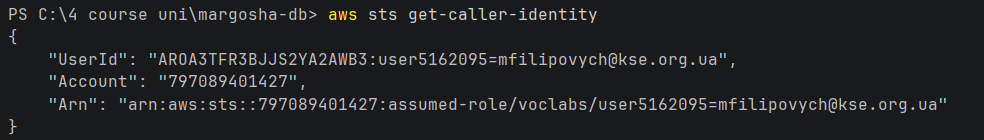
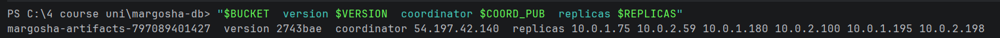
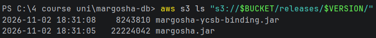
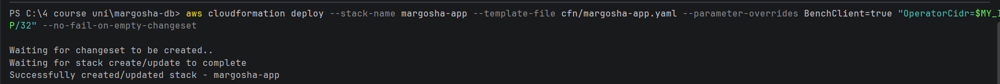
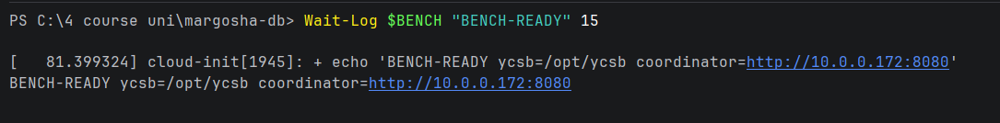
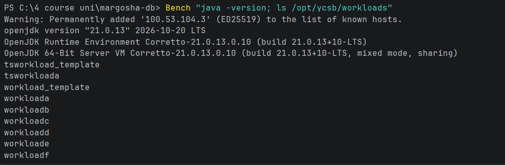
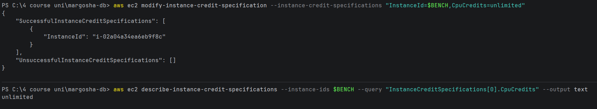
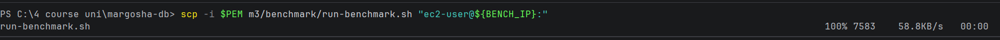

Store emptied, all 6 replicas registered again and empty, credits before the load:

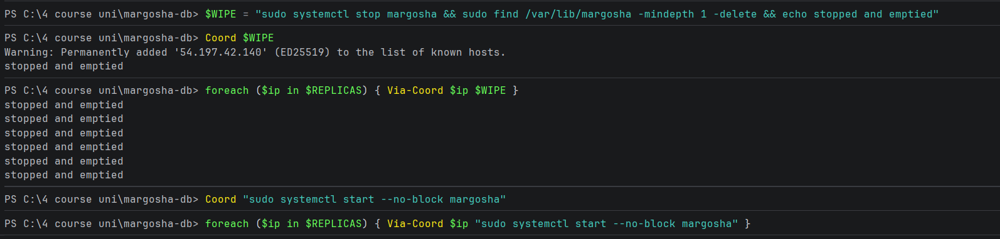
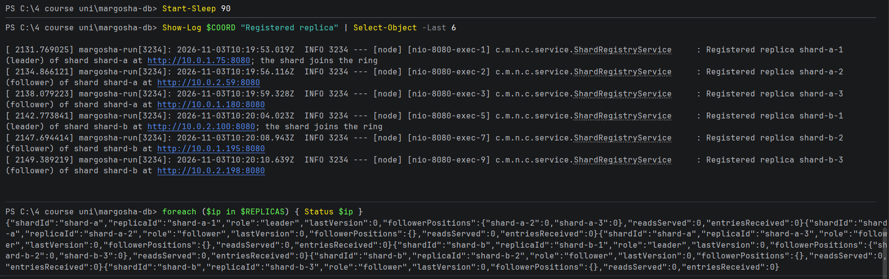
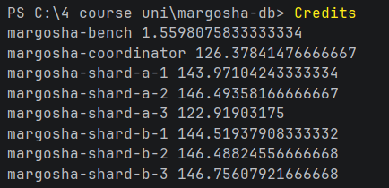

Load and warm-up, then the 3 measured runs, each followed by the credits:

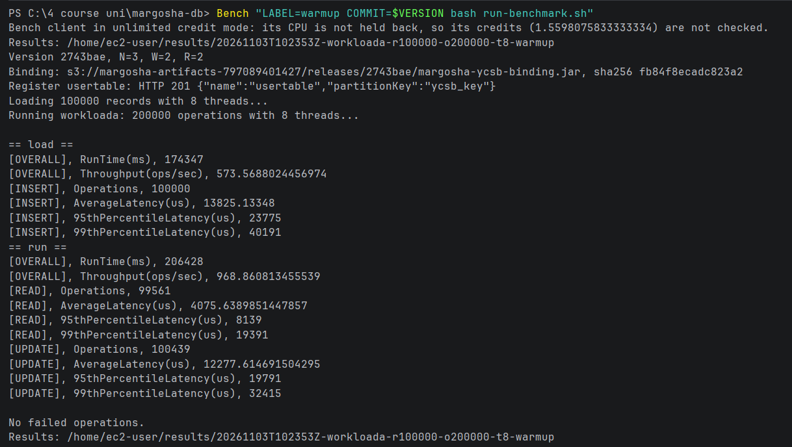
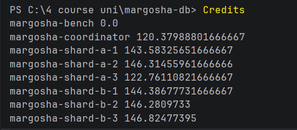
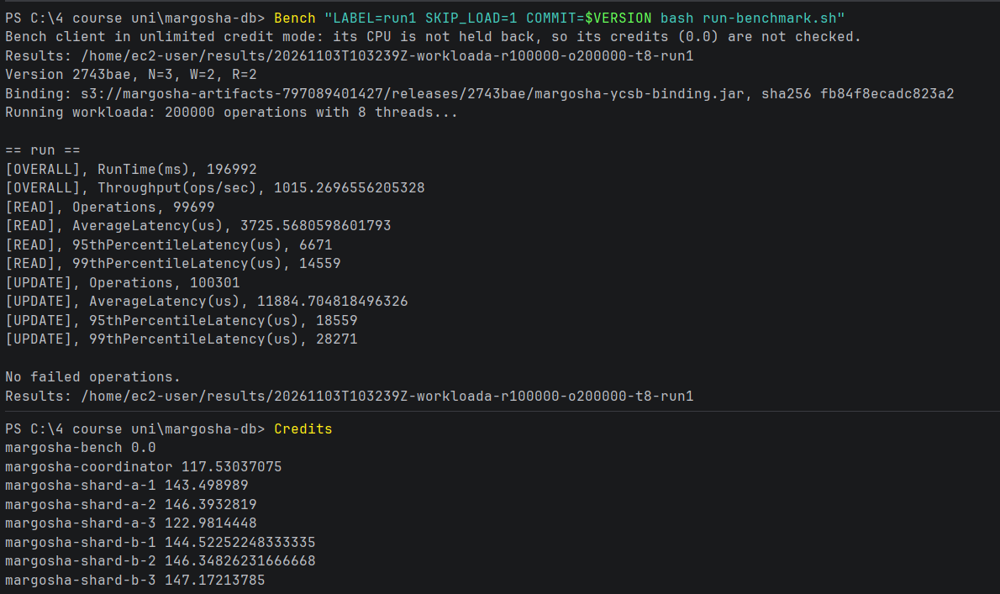
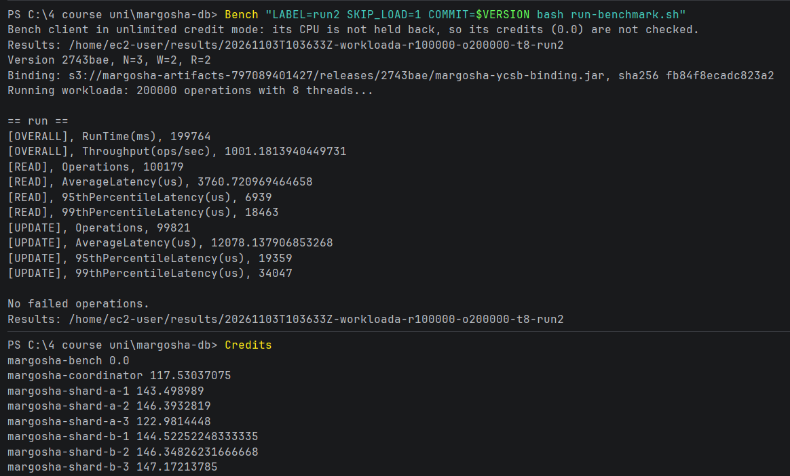
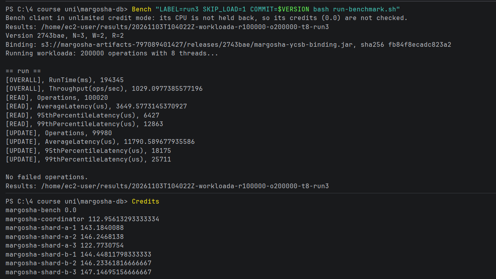

No errors on the nodes, every follower in sync, outputs copied, bench client off, store still answers:

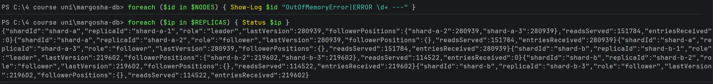
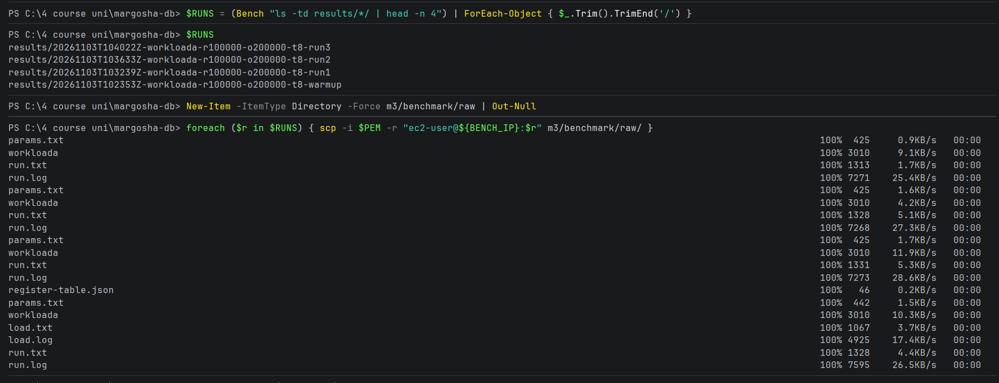
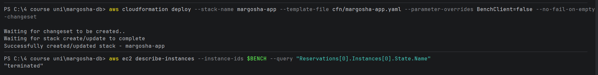
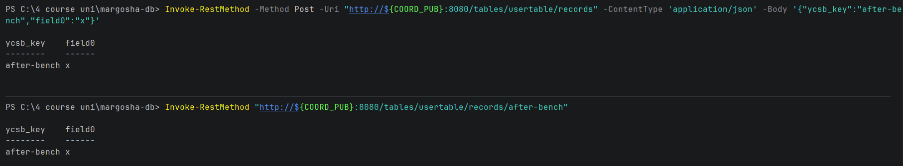

## Raw files

| Folder | Run |
|---|---|
| [20261103T102353Z-workloada-r100000-o200000-t8-warmup](raw/20261103T102353Z-workloada-r100000-o200000-t8-warmup/) | load + warm-up (discarded) |
| [20261103T103239Z-workloada-r100000-o200000-t8-run1](raw/20261103T103239Z-workloada-r100000-o200000-t8-run1/) | run 1 |
| [20261103T103633Z-workloada-r100000-o200000-t8-run2](raw/20261103T103633Z-workloada-r100000-o200000-t8-run2/) | run 2 |
| [20261103T104022Z-workloada-r100000-o200000-t8-run3](raw/20261103T104022Z-workloada-r100000-o200000-t8-run3/) | run 3 |

Each folder has:

| File | Content |
|---|---|
| `params.txt` | date, label, version, YCSB version, workload, counts, threads, N / W / R, coordinator, binding hash, client type, credit mode and credits, Java version |
| `workloada` | the workload file as used |
| `run.txt` / `run.log` | YCSB's final results (latencies in µs) / its progress every 10 s |
| `register-table.json`, `load.txt`, `load.log` | warm-up folder only: registering `usertable`, and the load's results and progress |
