# Fresh deploy from the pipeline

**What was checked:** with only the network stack `margosha-vpc` in the account, the pipeline alone creates the whole
M3 store (bucket, coordinator, 6 replicas), every replica registers by itself, and the store works. No step in the AWS
console.

**Date:** 2026-11-03, Learner Lab account `797089401427`, `us-east-1`. Times are UTC.

Before this check the pipeline had only **updated** the M3 stack. A first deploy takes paths that updates never take:
- the stack and its bucket are created;
- the bucket does not exist when the pipeline wants to upload the jars, so it uploads them after the stack is created;
- all 7 nodes boot for the first time, and the pipeline must not reboot them while they are still installing Java.

Plain `aws` commands are written on one line and run as they are on Windows (PowerShell) and macOS (Terminal); the
others are given for both.

## 1. Remove `margosha-app`, so only `margosha-vpc` is left

**This deletes the 7 nodes and all data on them**, and emptying the bucket deletes the jars of all earlier versions.

Get the bucket's name (it is fixed: `margosha-artifacts-<account-id>`):

Windows (PowerShell):
```powershell
aws configure set region us-east-1
$env:PYTHONUTF8 = '1'; [Console]::OutputEncoding = [Text.Encoding]::UTF8
$BUCKET = "margosha-artifacts-$(aws sts get-caller-identity --query Account --output text)"; $BUCKET
```

macOS (Terminal):
```bash
aws configure set region us-east-1
BUCKET="margosha-artifacts-$(aws sts get-caller-identity --query Account --output text)"; echo "$BUCKET"
```

Empty the bucket first (CloudFormation cannot delete a bucket that still has files), then delete the stack and wait
until it is gone:

```bash
aws s3 rm "s3://$BUCKET" --recursive
```
```bash
aws cloudformation delete-stack --stack-name margosha-app
```
```bash
aws cloudformation wait stack-delete-complete --stack-name margosha-app
```

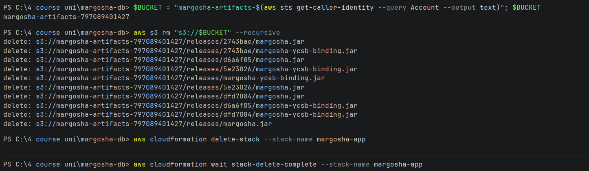
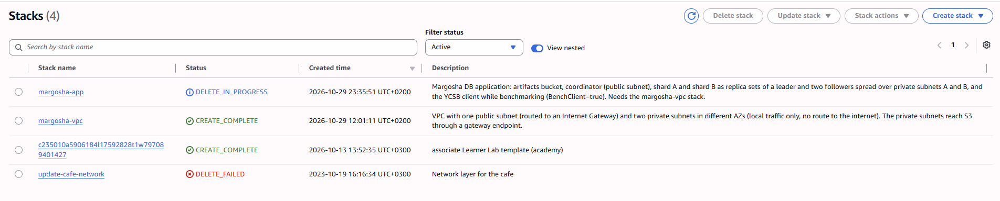

The bucket held the jars of 4 earlier versions (`5e23026`, `d6a6f05`, `dfd7084`, `2743bae`) and the two jars from
before versions existed (`releases/margosha.jar`, `releases/margosha-ycsb-binding.jar`); all were deleted.

Check that only `margosha-vpc` is left and that no node is running:

```bash
aws cloudformation describe-stacks --query "Stacks[?starts_with(StackName,'margosha')].[StackName,StackStatus]" --output table
```
```bash
aws ec2 describe-instances --filters "Name=tag:Name,Values=margosha-*" "Name=instance-state-name,Values=pending,running,stopping,stopped" --query "Reservations[].Instances[].Tags[?Key=='Name']|[].Value" --output text
```

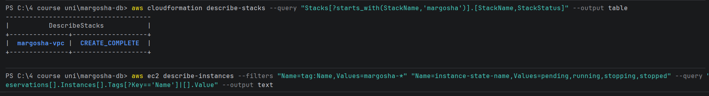

The first command lists only `margosha-vpc`; the second prints nothing (no node left). The console shows the same, and
the bucket is gone with the stack. The two other stacks are not this project's: `c235010a…` is the Learner Lab's own
stack, and `update-cafe-network` is left over from an earlier course exercise.

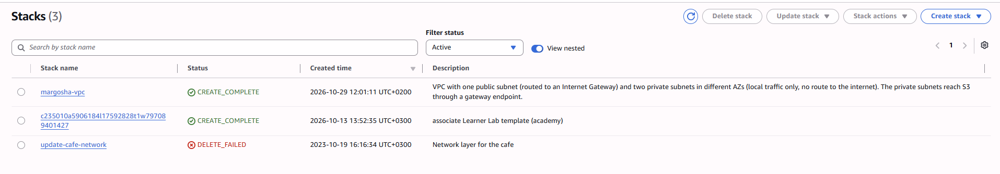
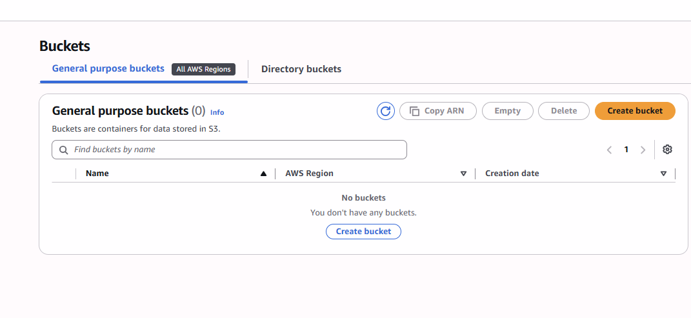

## 2. Deploy with the pipeline only

Start the pipeline on `main` with no code change (**Actions → pipeline → Run workflow**, version left empty), and
follow it:

```bash
gh workflow run pipeline.yml --ref main
```
```bash
gh run watch
```

Pipeline run [**#24**](https://github.com/MarharytaFilipovych/margosha-db/actions/runs/41627319731)
(`workflow_dispatch`, commit `a201541`) succeeded: `check` 11:24:56–11:26:28, `deploy` 11:26:32–11:33:15.

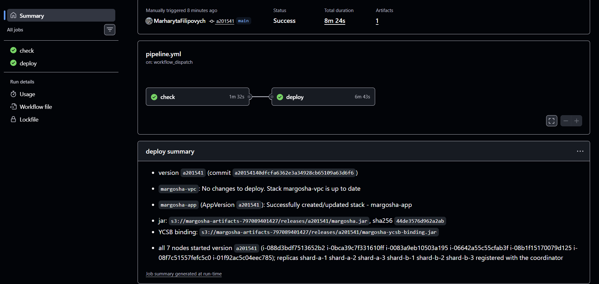

What the deploy job did, from its log and Summary:
- `margosha-vpc`: `No changes to deploy`.
- `Nodes before the deploy: none (new stack)`, `Version before the deploy: none`.
- **Upload before the stack:** the bucket did not exist yet, so the step postponed the upload:
  `The bucket margosha-artifacts-797089401427 does not exist yet (new stack): uploading after the stack is created`.
- `margosha-app` (AppVersion `a201541`): `Successfully created/updated stack`, this time a **create**.
- **Upload after the stack:** `Uploaded the jars to s3://margosha-artifacts-797089401427/releases/a201541/`.
- **7 new nodes, none rebooted:** for each one, `… was just created: it gets the jar on its first boot, not rebooted`.
- **All 7 ran the new version** (jar sha256 `44de3576d962a2ab`), started between 11:28:31 and 11:32:16, and
  `coordinator: all 6 replicas registered (shard-a-1 shard-a-2 shard-a-3 shard-b-1 shard-b-2 shard-b-3)`.

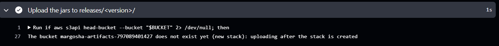
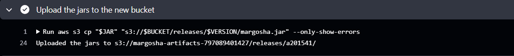

The new bucket, created by the stack at 11:27:02, with only this version's jars in `releases/a201541/`:

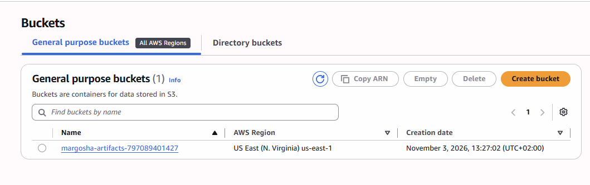
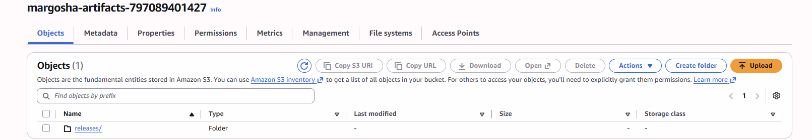
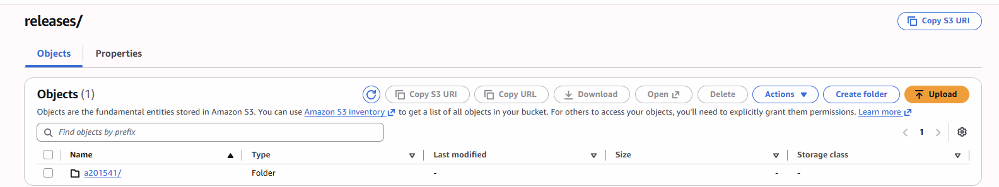
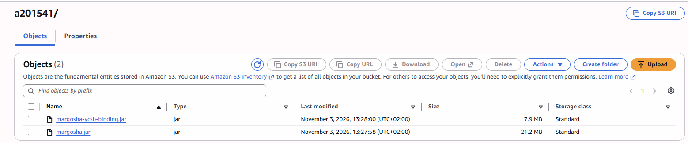

## 3. Check that the store works

**Load the new nodes and open the API.** All instance IDs and IPs are new. Run the setup from
[aws_checks/setup.md](../aws_checks/setup.md) again: its main block, the `OperatorCidr` command, and "Helpers for the
failure checks". A new stack starts with the API **closed** (`OperatorCidr` empty), so the `OperatorCidr` command is
needed this time; it printed `Successfully created/updated stack` (it adds two security group rules and replaces
nothing):

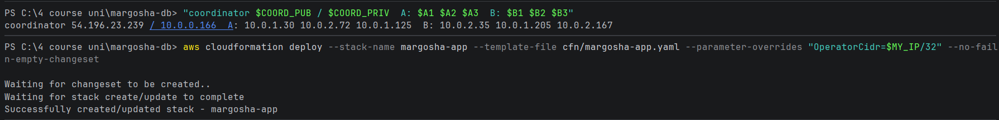

```
coordinator 54.196.23.239 / 10.0.0.166  A: 10.0.1.30 10.0.2.72 10.0.1.125  B: 10.0.2.35 10.0.1.205 10.0.2.167
```

**All 6 replicas registered by themselves:**

Windows (PowerShell):
```powershell
Show-Log $COORD "Registered replica" | Select-Object -Last 6
```

macOS (Terminal):
```bash
show_log "$COORD" "Registered replica" | tail -n 6
```

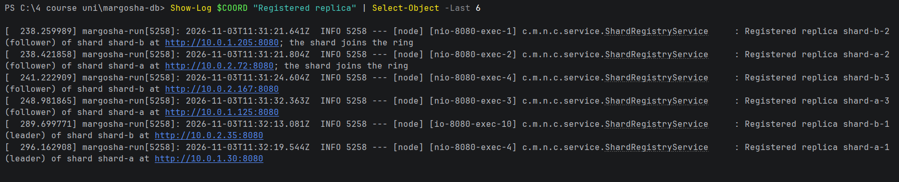

| Time | Replica | Role | Address |
|---|---|---|---|
| 11:31:21 | shard-b-2 | follower | 10.0.1.205 (shard B joins the ring) |
| 11:31:21 | shard-a-2 | follower | 10.0.2.72 (shard A joins the ring) |
| 11:31:24 | shard-b-3 | follower | 10.0.2.167 |
| 11:31:32 | shard-a-3 | follower | 10.0.1.125 |
| 11:32:13 | shard-b-1 | leader | 10.0.2.35 |
| 11:32:19 | shard-a-1 | leader | 10.0.1.30 |

**The store answers and replicates.** Create a table, write 20 users and read them back, then ask every replica for its
status:

Windows (PowerShell):
```powershell
Invoke-RestMethod -Method Post -Uri "http://${COORD_PUB}:8080/tables" -ContentType 'application/json' -Body '{"name":"users","partitionKey":"user_id"}'
Write-Keys 1 20
Read-Keys (1..20)
foreach ($ip in $A1,$A2,$A3,$B1,$B2,$B3) { Status $ip }
```

macOS (Terminal):
```bash
curl -s -X POST "http://$COORD_PUB:8080/tables" -H 'Content-Type: application/json' -d '{"name":"users","partitionKey":"user_id"}'; echo
write_keys 1 20
read_keys $(seq 1 20)
for ip in $A1 $A2 $A3 $B1 $B2 $B3; do status "$ip"; done
```

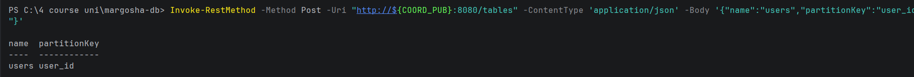
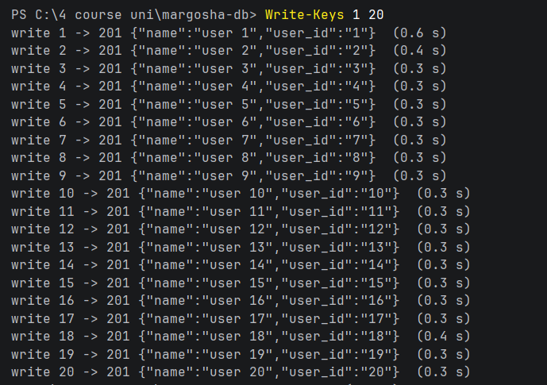
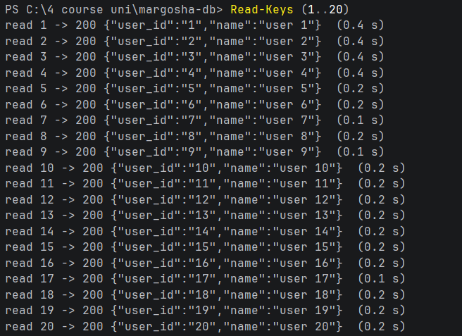
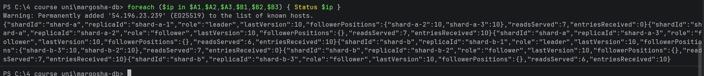

- The table was created, all 20 writes answered `201` and all 20 reads `200` with the right user.
- **The keys spread over both shards:** each leader's last entry is 10, so 10 users went to shard A and 10 to shard B.
- **Every follower has them:** all four followers are at 10 too (`entriesReceived` 10), and each leader shows both of
  its followers at 10.

The stack after the check: `margosha-app` was created at 11:26:50 by the pipeline; its status is `UPDATE_COMPLETE`
because of the `OperatorCidr` update afterwards:

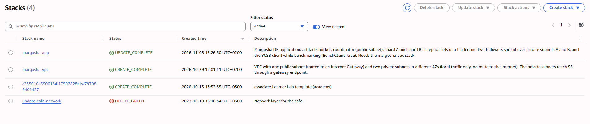

## Result

| What | Evidence | Result |
|---|---|---|
| Only `margosha-vpc` existed before the deploy | CLI table, console, no buckets | ✅ |
| The pipeline alone created `margosha-app` and its bucket | run #24 Summary and log | ✅ a create, bucket created at 11:27:02 |
| The jars reached the new bucket although it did not exist at first | the two upload steps | ✅ upload postponed, then done after the stack |
| New nodes got the jar without a reboot or manual upload | run #24 log | ✅ 7 nodes, none rebooted, all on `a201541` |
| Every replica registered by itself | coordinator log | ✅ all 6 within a minute |
| The store works and replicates | API calls, statuses | ✅ 20 writes, 20 reads, every follower at its leader's entry |
| No console steps | the steps above | ✅ CLI and GitHub only. The one action after the deploy, opening the API to the operator's IP, is a CLI parameter update, needed because the API is closed by default |

The instance IDs and IPs in [aws_checks](../aws_checks/README.md) and [benchmark](../benchmark/results.md) belong to the
stack deleted here. Those notes record what was true on their dates.
