# M3 checks on AWS

Checks of the replicated store on AWS. Account `797089401427`, region `us-east-1`. All times are UTC.

Plain `aws` commands are written on one line, so they run as they are on **Windows (PowerShell)** and **macOS
(Terminal)**. Commands that use shell features (variables, helpers, scripts) are given for both.

---

## Finding: the first M3 deploy hit the Learner Lab's 9-instance limit

**Date:** 2026-11-02, first pipeline run of M3 (version `5e23026`).

### What happened

The `deploy` job failed while updating the app stack:

```
Waiting for changeset to be created..
Waiting for stack create/update to complete

aws: [ERROR]: Failed to create/update the stack. Run the following command
to fetch the list of events leading up to the failure
aws cloudformation describe-stack-events --stack-name margosha-app
Error: Process completed with exit code 255.
```

The error says the update failed, but not why. The run's log shows that the 3 M2 nodes were still running before the
deploy (`NODES_BEFORE: i-09de6e18383b722ac i-0ca070eea85727e73 i-0797a438893ea5b5d`).

### How it was found

**1. Which resource failed.**

List the stack's events, keeping only failures and rollbacks:

```bash
aws cloudformation describe-stack-events --stack-name margosha-app --region us-east-1 --max-items 40 --query "StackEvents[?contains(ResourceStatus,'FAILED') || contains(ResourceStatus,'ROLLBACK')].[Timestamp,LogicalResourceId,ResourceStatus,ResourceStatusReason]" --output text
```

```
09:31:35  ShardB3      CREATE_FAILED  Resource ... 'AWS::EC2::Instance' with identifier 'i-0ccb0c997405e7e56' did not stabilize. (NotStabilized)
09:31:36  ShardA2      CREATE_FAILED  Resource creation cancelled
09:31:36  ShardA3      CREATE_FAILED  Resource creation cancelled
09:31:36  ShardB2      CREATE_FAILED  Resource creation cancelled
09:31:37  margosha-app UPDATE_ROLLBACK_IN_PROGRESS  The following resource(s) failed to create: [ShardA3, ShardB3, ShardA2, ShardB2].
09:33:22  margosha-app UPDATE_ROLLBACK_COMPLETE
```

The same event in the console (**CloudFormation → margosha-app → Events**), from the deploy run at 10:00:

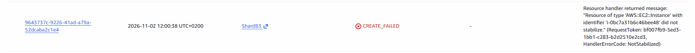

Only `ShardB3` failed; the other three were cancelled because of it. "Did not stabilize" means the instance was started
but never reached `running`. The template was fine: the same launch template created the other nodes without errors.

**2. What happened to that instance.**

Show the instance's state and why it changed:

```bash
aws ec2 describe-instances --region us-east-1 --instance-ids i-0ccb0c997405e7e56 --query "Reservations[0].Instances[0].[State.Name,StateReason.Message,StateTransitionReason]" --output text
```

```
terminated  Client.UserInitiatedShutdown: User initiated shutdown  User initiated (2026-11-02 09:31:30 GMT)
```

Nobody stopped it by hand, and it was only 2 minutes old. In the Learner Lab, "user initiated" means the lab itself
terminated it.

**3. Why the lab terminated it.** The Learner Lab rules (also in the M1 quota analysis,
[quotas_and_budget.md](../m1/quotas_and_budget.md), section 2.1):

> Maximum of 9 concurrently running EC2 instances [...] the excess instances will be terminated

Instances at the moment of the failure:

| Instances | Count |
|---|---|
| Old M2 nodes, still running (coordinator, shard A, shard B) | 3 |
| New M3 nodes created by the update (coordinator + 6 replicas) | 7 |
| **Total** | **10 > 9** |

**4. Why old and new nodes ran at the same time.** M3 changes the boot script in the launch template, so CloudFormation
**replaces** the nodes. It creates the new instances first and deletes the old ones only at the end of the update. For
a moment, all old and all new nodes run together.

M1 had warned that M3 "gets close" to the limit (8 instances with the bench client), but it only counted a running M3
stack, not the overlap during the update.

**5. State after the failure.** CloudFormation rolled back to the M2 stack, and the 3 old nodes kept running:

```
i-09de6e18383b722ac  running  t3.micro  margosha-shard-b
i-0797a438893ea5b5d  running  t3.micro  margosha-shard-a
i-0ca070eea85727e73  running  t3.micro  margosha-coordinator
```

### Fix and consequences

- **Fix:** to move to M3, the 3 old M2 nodes had to be **terminated, not just stopped**, because the lab's limit of 9
  also counts stopped instances. Then the deploy was run again and created the 7 M3 nodes. M2 kept its records in
  memory, so no data was lost.

  Terminate the 3 old M2 nodes:
  ```bash
  aws ec2 terminate-instances --region us-east-1 --instance-ids i-0ca070eea85727e73 i-0797a438893ea5b5d i-09de6e18383b722ac
  ```
- **Later deploys** are not affected: a new app version only changes tags and reboots the nodes. No instance is added.
- **A template change that replaces the nodes** (boot script, AMI, instance type, subnet) needs 7 + 7 = 14 instances
  during the update and fails the same way. In M3 it also costs data: the old nodes must be terminated first, so the
  store is down during the update, and the replicas' logs on their disks are lost. Such a change must be planned as a
  migration. To see before pushing whether a change replaces the nodes, see
  [README, "Before pushing a template change"](../README.md#before-pushing-a-template-change-will-it-replace-the-nodes).
  For this deploy, the preview showed `Coordinator`, `ShardA` and `ShardB` as `Modify / Conditional` (replaced) and
  `ShardA2` … `ShardB3` as `Add`:

  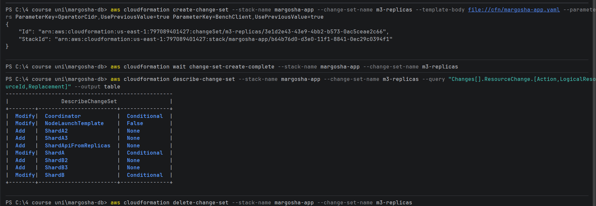
- **The bench client counts too:** with `BenchClient=true` the M3 stack runs 8 instances, leaving room for only 1 more.

---

## Deploy through the pipeline, placement and network

**Date:** 2026-11-02. Run all commands in one terminal window: the variables are lost when it is closed.

### 0. Session setup

Go to the repo, set the region, get your public IP and the SSH key, define two helpers, and look up the nodes' IPs:
- `Show-Log` / `show_log` prints the lines of a node's log that match a pattern. It reads the serial console, so no
  SSH is needed.
- `Ip` / `node_ip` prints the private IP of a running instance by its name, or another field such as its public IP.

The SSH key comes from the lab page: **AWS Details → Download PEM** (`labsuser.pem`), saved in `~/.ssh/`.

Windows (PowerShell):
```powershell
cd "C:\4 course uni\margosha-db"
aws configure set region us-east-1
# The logs contain non-ASCII characters; without this line the AWS CLI on Windows fails with a 'charmap' error.
$env:PYTHONUTF8 = '1'; [Console]::OutputEncoding = [Text.Encoding]::UTF8
$MY_IP = (Invoke-RestMethod https://checkip.amazonaws.com).Trim()
$PEM = "$HOME\.ssh\labsuser.pem"

function Show-Log($id, $pattern) {
  aws ec2 get-console-output --instance-id $id --latest --output text | Select-String $pattern
}
function Ip($name, $field = 'PrivateIpAddress') {
  aws ec2 describe-instances --filters "Name=tag:Name,Values=margosha-$name" "Name=instance-state-name,Values=running" `
    --query "Reservations[0].Instances[0].$field" --output text
}

$COORD      = aws cloudformation describe-stacks --stack-name margosha-app --query "Stacks[0].Outputs[?OutputKey=='CoordinatorInstanceId'].OutputValue" --output text
$COORD_PUB  = Ip coordinator PublicIpAddress
$COORD_PRIV = Ip coordinator
$A1 = Ip shard-a-1; $A2 = Ip shard-a-2; $A3 = Ip shard-a-3
$B1 = Ip shard-b-1; $B2 = Ip shard-b-2; $B3 = Ip shard-b-3
"coordinator $COORD_PUB / $COORD_PRIV  A: $A1 $A2 $A3  B: $B1 $B2 $B3"
```

macOS (Terminal):
```bash
cd ~/margosha-db                      # wherever the repo is cloned
aws configure set region us-east-1
MY_IP=$(curl -s https://checkip.amazonaws.com)
PEM=~/.ssh/labsuser.pem
chmod 400 "$PEM"                      # ssh refuses a key that others can read

show_log() { aws ec2 get-console-output --instance-id "$1" --latest --output text | grep -E "$2"; }
node_ip() {
  aws ec2 describe-instances --filters "Name=tag:Name,Values=margosha-$1" "Name=instance-state-name,Values=running" \
    --query "Reservations[0].Instances[0].${2:-PrivateIpAddress}" --output text
}

COORD=$(aws cloudformation describe-stacks --stack-name margosha-app --query "Stacks[0].Outputs[?OutputKey=='CoordinatorInstanceId'].OutputValue" --output text)
COORD_PUB=$(node_ip coordinator PublicIpAddress)
COORD_PRIV=$(node_ip coordinator)
A1=$(node_ip shard-a-1); A2=$(node_ip shard-a-2); A3=$(node_ip shard-a-3)
B1=$(node_ip shard-b-1); B2=$(node_ip shard-b-2); B3=$(node_ip shard-b-3)
echo "coordinator $COORD_PUB / $COORD_PRIV  A: $A1 $A2 $A3  B: $B1 $B2 $B3"
```

```
coordinator 54.211.3.6 / 10.0.0.172  A: 10.0.1.75 10.0.2.59 10.0.1.180  B: 10.0.2.100 10.0.1.195 10.0.2.198
```

If any value is `None`, that node is not running.

### 1. Deploy

After the old M2 nodes were terminated (see the finding above), pipeline run
[**#19**](https://github.com/MarharytaFilipovych/margosha-db/actions/runs/41420930336) (commit `5e23026`, attempt 5)
succeeded: `check` 09:54:51–09:56:29, `deploy` 10:05:59–10:12:26. It created the M3 stack with version `5e23026`: the
coordinator and 6 replicas, 7 instances in total.

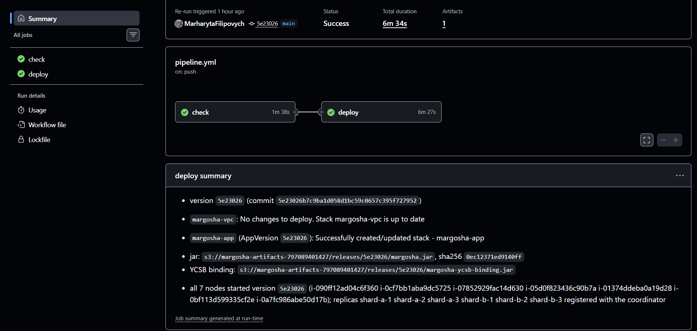

The run's Summary shows:
- the version, `5e23026`;
- the jar uploaded to `releases/5e23026/`;
- `margosha-app` updated with `AppVersion 5e23026`;
- all 7 nodes running that version, and all 6 replicas registered.

The stack in the console (**CloudFormation → margosha-app**) is `UPDATE_COMPLETE`:
- the coordinator, `ShardA` and `ShardB` were replaced;
- the 4 new followers and `ShardApiFromReplicas` were created;
- the stack shows the version it runs (`AppVersion`, in Outputs and Parameters).

These screenshots were taken later, while the bench client from step 5 existed, so they also show
`BenchClientInstance` and `BenchClient = true`:

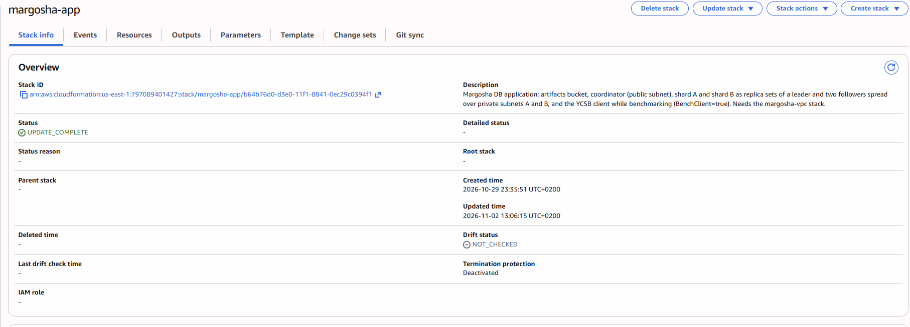
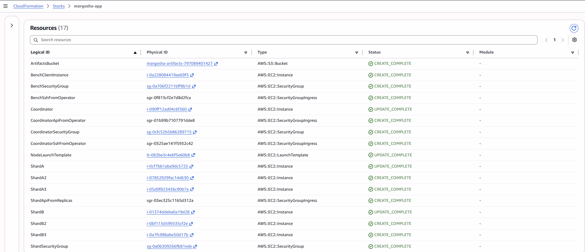
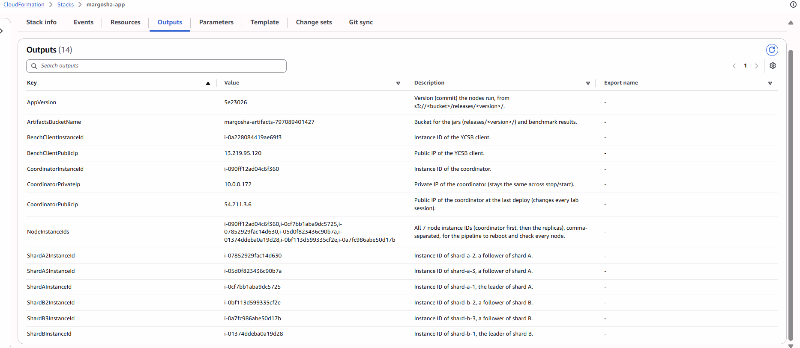
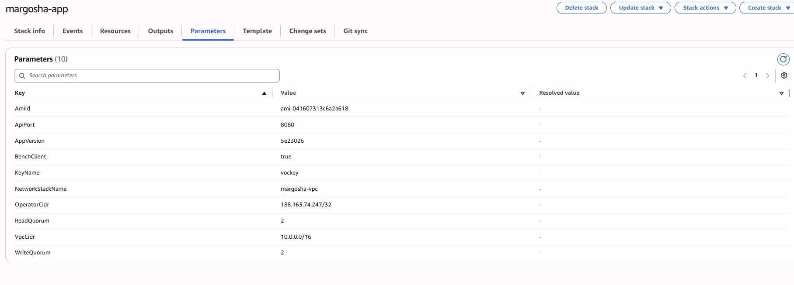

Open the API and SSH to your IP (`$MY_IP` from the setup). This is needed for the SSH steps below and replaces
nothing:

```bash
aws cloudformation deploy --stack-name margosha-app --template-file cfn/margosha-app.yaml --parameter-overrides "OperatorCidr=$MY_IP/32" --no-fail-on-empty-changeset
```

It printed `No changes to deploy`: the stack already allowed this IP.

### 2. All 6 replicas registered

Show the coordinator's log lines about replicas registering:

Windows (PowerShell):
```powershell
Show-Log $COORD "Registered replica|Updated replica"
```

macOS (Terminal):
```bash
show_log "$COORD" "Registered replica|Updated replica"
```

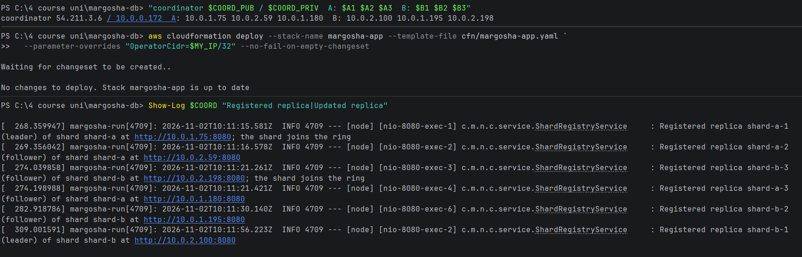

| Time | Replica | Role | Address |
|---|---|---|---|
| 10:11:15 | shard-a-1 | leader | 10.0.1.75 (shard A joins the ring) |
| 10:11:16 | shard-a-2 | follower | 10.0.2.59 |
| 10:11:21 | shard-b-3 | follower | 10.0.2.198 (shard B joins the ring) |
| 10:11:21 | shard-a-3 | follower | 10.0.1.180 |
| 10:11:30 | shard-b-2 | follower | 10.0.1.195 |
| 10:11:56 | shard-b-1 | leader | 10.0.2.100 |

Shard B joined the ring when its follower shard-b-3 registered, before its leader: a shard joins with its first
replica, whatever its role.

### 3. Placement

List the stack's running instances (name, role, AZ, subnet, IPs), then the network stack's subnets (name, range, AZ,
whether they give out public IPs):

```bash
aws ec2 describe-instances --filters "Name=tag:aws:cloudformation:stack-name,Values=margosha-app" "Name=instance-state-name,Values=running" --query "Reservations[].Instances[].{Name:Tags[?Key=='Name']|[0].Value,Role:Tags[?Key=='MargoshaReplicaRole']|[0].Value,AZ:Placement.AvailabilityZone,Subnet:SubnetId,PrivateIp:PrivateIpAddress,PublicIp:PublicIpAddress}" --output table
aws ec2 describe-subnets --filters "Name=tag:aws:cloudformation:stack-name,Values=margosha-vpc" --query "Subnets[].{Id:SubnetId,Name:Tags[?Key=='Name']|[0].Value,Cidr:CidrBlock,AZ:AvailabilityZone,AutoPublicIp:MapPublicIpOnLaunch}" --output table
```

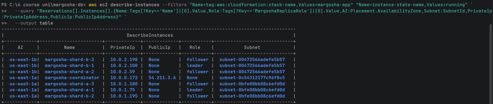
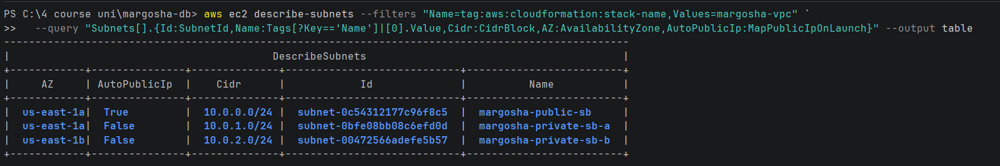

The same in the console (**EC2 → Instances**). This screenshot was taken later, during the replication checks, so it
also shows `shard-a-3` stopped, a running bench client and two earlier bench clients already terminated:

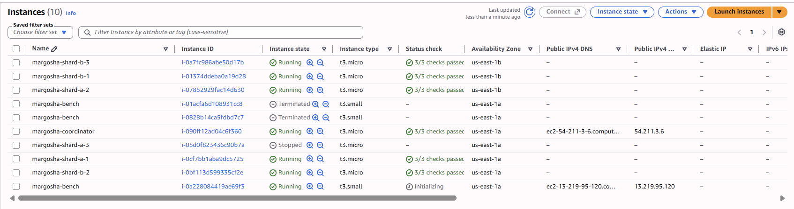

| Node | Role | Subnet | AZ | Private IP | Public IP |
|---|---|---|---|---|---|
| coordinator | — | `margosha-public-sb` (10.0.0.0/24) | us-east-1a | 10.0.0.172 | 54.211.3.6 |
| shard-a-1 | leader | `margosha-private-sb-a` (10.0.1.0/24) | us-east-1a | 10.0.1.75 | None |
| shard-a-2 | follower | `margosha-private-sb-b` (10.0.2.0/24) | us-east-1b | 10.0.2.59 | None |
| shard-a-3 | follower | `margosha-private-sb-a` | us-east-1a | 10.0.1.180 | None |
| shard-b-1 | leader | `margosha-private-sb-b` | us-east-1b | 10.0.2.100 | None |
| shard-b-2 | follower | `margosha-private-sb-a` | us-east-1a | 10.0.1.195 | None |
| shard-b-3 | follower | `margosha-private-sb-b` | us-east-1b | 10.0.2.198 | None |

| Check | Result |
|---|---|
| Each shard has replicas in both private subnets | shard A: 2 in A, 1 in B; shard B: 1 in A, 2 in B |
| Leaders in different AZs | shard-a-1 in us-east-1a, shard-b-1 in us-east-1b |
| No public IPs on replicas | all `None`; neither private subnet gives out public IPs |

### 4. A follower can reach its leader

The replicas can only be reached from the coordinator, so SSH goes through it. `Via-Coord` / `via_coord` opens SSH to
a replica through the coordinator and runs a command there. On shard-a-2 and shard-b-2, ask their leader for its
replication status:

Windows (PowerShell):
```powershell
function Via-Coord($ip) {
  ssh -i $PEM -o StrictHostKeyChecking=accept-new `
    -o "ProxyCommand=ssh -i $PEM -o StrictHostKeyChecking=accept-new -W %h:%p ec2-user@$COORD_PUB" "ec2-user@$ip" @args
}
Via-Coord $A2 "curl -s -m 5 -w '\nHTTP %{http_code}\n' http://${A1}:8080/replication/status"
Via-Coord $B2 "curl -s -m 5 -w '\nHTTP %{http_code}\n' http://${B1}:8080/replication/status"
```

macOS (Terminal):
```bash
via_coord() {
  ssh -i "$PEM" -o StrictHostKeyChecking=accept-new \
    -o "ProxyCommand=ssh -i $PEM -o StrictHostKeyChecking=accept-new -W %h:%p ec2-user@$COORD_PUB" "ec2-user@$1" "$2"
}
via_coord "$A2" "curl -s -m 5 -w '\nHTTP %{http_code}\n' http://$A1:8080/replication/status"
via_coord "$B2" "curl -s -m 5 -w '\nHTTP %{http_code}\n' http://$B1:8080/replication/status"
```

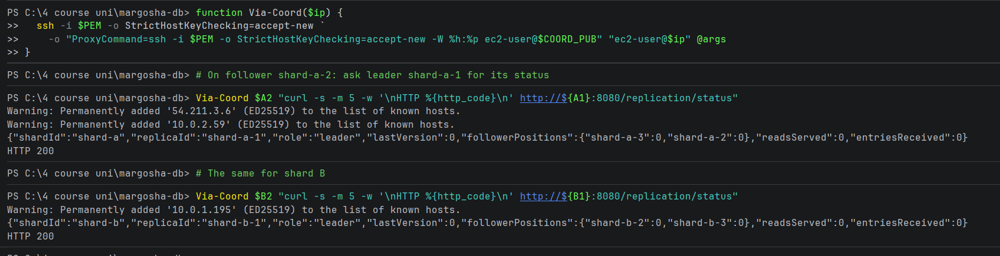

```
{"shardId":"shard-a","replicaId":"shard-a-1","role":"leader","lastVersion":0,"followerPositions":{"shard-a-3":0,"shard-a-2":0},"readsServed":0,"entriesReceived":0}
HTTP 200
{"shardId":"shard-b","replicaId":"shard-b-1","role":"leader","lastVersion":0,"followerPositions":{"shard-b-2":0,"shard-b-3":0},"readsServed":0,"entriesReceived":0}
HTTP 200
```

Both followers reach their leader, across AZs: shard-a-2 (1b) → shard-a-1 (1a), and shard-b-2 (1a) → shard-b-1 (1b).
Each leader also lists both of its followers in `followerPositions` (at 0, as the store is empty), so all four
followers are already connected to their leader.

### 5. The bench client cannot reach any replica

Create the bench client. This makes 8 instances, within the limit:

```bash
aws cloudformation deploy --stack-name margosha-app --template-file cfn/margosha-app.yaml --parameter-overrides BenchClient=true --no-fail-on-empty-changeset
```

Get its public IP:

Windows (PowerShell):
```powershell
$BENCH_PUB = Ip bench PublicIpAddress
```

macOS (Terminal):
```bash
BENCH_PUB=$(node_ip bench PublicIpAddress)
```

Run the test on the bench client (`10.0.0.121`, public `13.219.95.120`). It is a short bash script that gets the
coordinator's and the 6 replicas' IPs:
- first a **control request** to the coordinator, to show the bench client's network works;
- then, for each replica, a request to its API (port 8080) and a connection attempt to its SSH port (22).

On Windows the script is sent base64-encoded inside the SSH command. Piping it into `ssh` does not work there,
because PowerShell adds a `\r` to the last line and bash then fails with `unexpected end of file`. On macOS it can be
sent as is.

Windows (PowerShell):
```powershell
$test = @'
coord=$1; shift
echo "bench client: $(hostname -I)"
echo "control, coordinator $coord:8080 -> HTTP $(curl -s -m 5 -o /dev/null -w '%{http_code}' "http://$coord:8080/tables/none/records/1")"
for ip in "$@"; do
  api=$(curl -s -m 5 -o /dev/null -w '%{http_code}' "http://$ip:8080/replication/status"; echo " exit $?")
  if timeout 5 bash -c "</dev/tcp/$ip/22" 2>/dev/null; then ssh=OPEN; else ssh=blocked; fi
  echo "replica $ip: api HTTP $api, ssh $ssh"
done
'@
$b64 = [Convert]::ToBase64String([Text.Encoding]::UTF8.GetBytes(($test -replace "`r", "")))
ssh -i $PEM -o StrictHostKeyChecking=accept-new "ec2-user@$BENCH_PUB" `
  "echo $b64 | base64 -d | bash -s -- $COORD_PRIV $A1 $A2 $A3 $B1 $B2 $B3"
```

macOS (Terminal):
```bash
ssh -i "$PEM" -o StrictHostKeyChecking=accept-new "ec2-user@$BENCH_PUB" \
  bash -s -- "$COORD_PRIV" "$A1" "$A2" "$A3" "$B1" "$B2" "$B3" <<'EOF'
coord=$1; shift
echo "bench client: $(hostname -I)"
echo "control, coordinator $coord:8080 -> HTTP $(curl -s -m 5 -o /dev/null -w '%{http_code}' "http://$coord:8080/tables/none/records/1")"
for ip in "$@"; do
  api=$(curl -s -m 5 -o /dev/null -w '%{http_code}' "http://$ip:8080/replication/status"; echo " exit $?")
  if timeout 5 bash -c "</dev/tcp/$ip/22" 2>/dev/null; then ssh=OPEN; else ssh=blocked; fi
  echo "replica $ip: api HTTP $api, ssh $ssh"
done
EOF
```

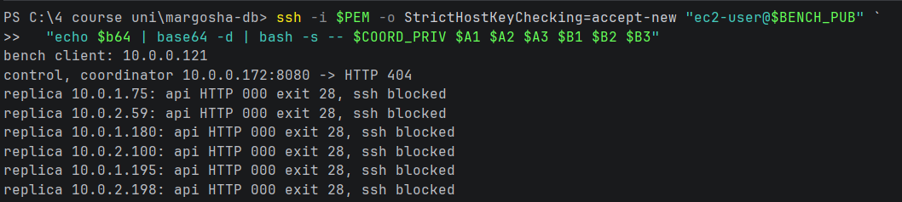

```
bench client: 10.0.0.121
control, coordinator 10.0.0.172:8080 -> HTTP 404
replica 10.0.1.75: api HTTP 000 exit 28, ssh blocked
replica 10.0.2.59: api HTTP 000 exit 28, ssh blocked
replica 10.0.1.180: api HTTP 000 exit 28, ssh blocked
replica 10.0.2.100: api HTTP 000 exit 28, ssh blocked
replica 10.0.1.195: api HTTP 000 exit 28, ssh blocked
replica 10.0.2.198: api HTTP 000 exit 28, ssh blocked
```

- **Coordinator:** `404` means the request arrived and the coordinator answered (the table `none` does not exist). So
  the bench client's network works.
- **All 6 replicas:** no answer from the API (`000`, curl exit 28 = timed out after 5 s), and SSH is blocked. The
  traffic is silently dropped, which is what a security group does when no rule allows it.

**Why: the security group rules** (**EC2 → Security Groups**).

`margosha-shard-sg` is on every replica. Its 3 inbound rules only allow other security groups, never an address range:
- API (8080) from the replicas' own group, for replication;
- API (8080) and SSH (22) from `margosha-coordinator-sg`.

The bench client is in neither group, so nothing lets it in:

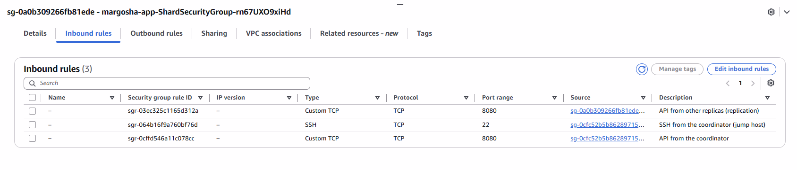
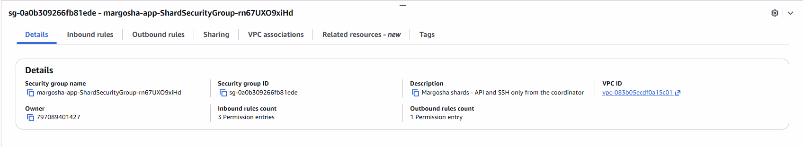
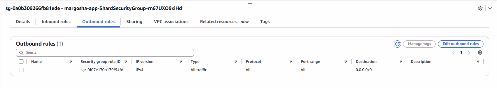
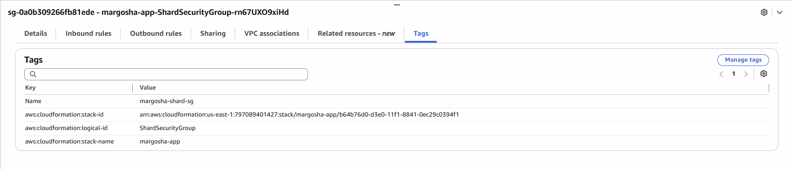

`margosha-coordinator-sg` is on the coordinator. Its inbound rules:
- API (8080) from the whole VPC, `10.0.0.0/16`, which includes the bench client (`10.0.0.121`). That is why the control
  request gets an answer.
- API and SSH from the operator's IP (`188.163.74.247/32`, the `OperatorCidr` parameter).

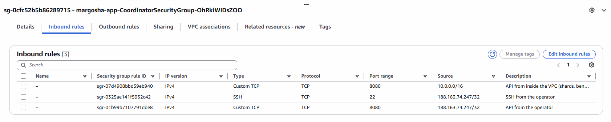
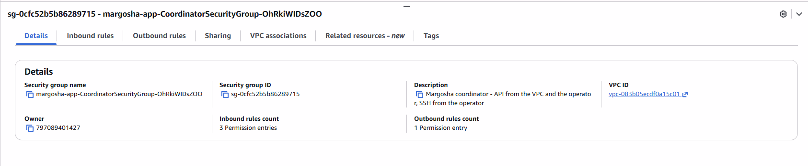
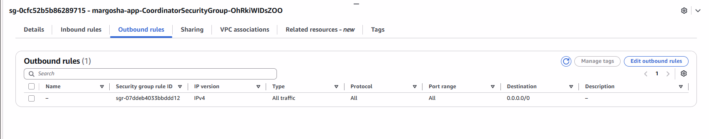
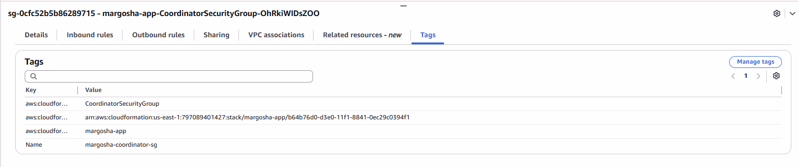

Both groups allow all outgoing traffic, so only the inbound rules of the target decide.

Remove the bench client again, to save budget. This brings the account back to 7 instances:

```bash
aws cloudformation deploy --stack-name margosha-app --template-file cfn/margosha-app.yaml --parameter-overrides BenchClient=false --no-fail-on-empty-changeset
```

### Result

- Each shard has replicas in both private subnets
- The leaders are in different AZs
- No replica has a public IP
- All 6 replicas registered with the coordinator
- A follower can reach its leader
- The bench client cannot reach any replica
