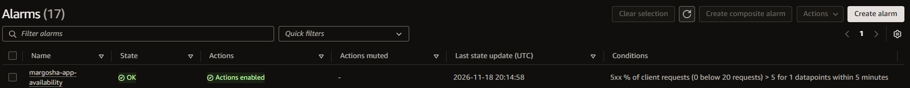
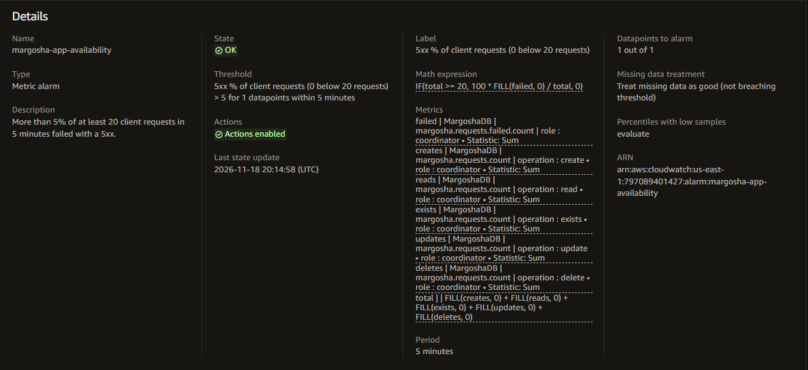
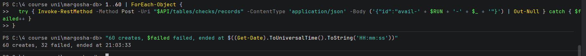
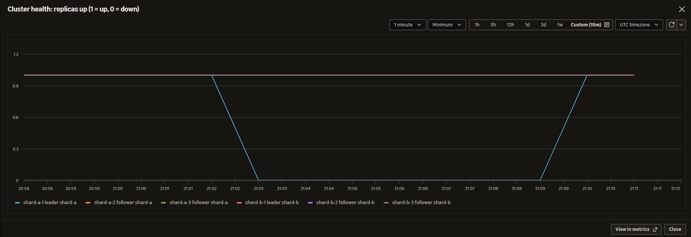
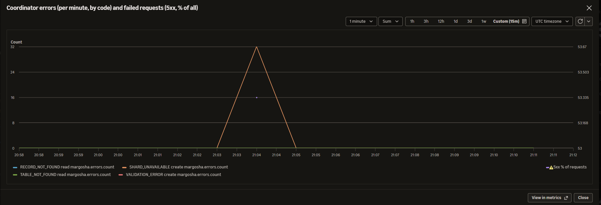
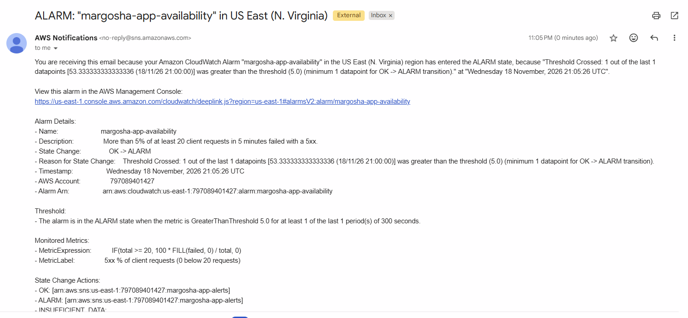
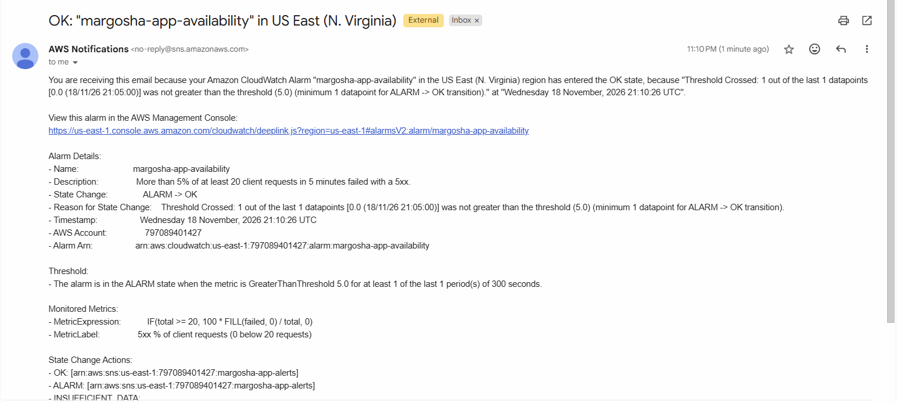
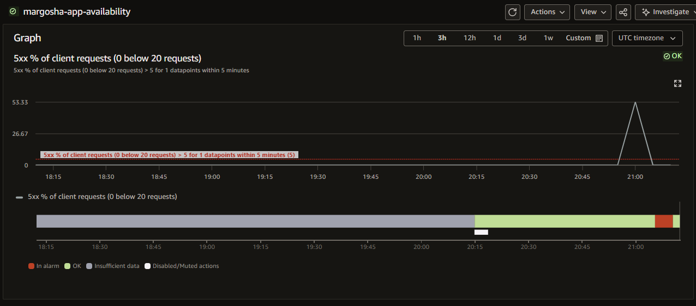
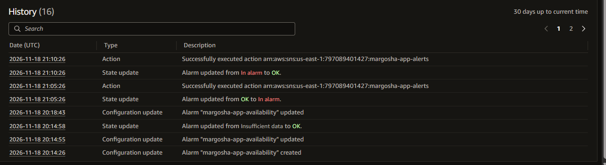

# Availability alarm

**What is checked:** the new alarm `margosha-app-availability` ([ADR 0021](../../adr/0021-availability-alarm.md))
fires when more than 5% of at least 20 client requests in 5 minutes are answered with a 5xx, also when every other
alarm about speed and lag stays `OK` ([ai_critique.md](../ai_critique.md), finding 4). To get real 5xx answers,
shard A's leader is stopped: writes to shard A then fail with 503, writes to shard B still work. When the leader is
back, the alarm goes back to `OK` by itself.

Checked on 2026-11-18, right after the deploy of the fix. All times are UTC.

Uses the setup from [first_m4_deploy.md](first_m4_deploy.md#0-setup), plus the IP of shard-a-1:

Windows (PowerShell):
```powershell
$A1 = $REPLICAS[0]
```

macOS (Terminal):
```bash
A1=$(echo $REPLICAS | cut -d' ' -f1)
```

## Before the check

The deploy created the alarm at 20:14:26. The stack now has 17 alarms, all `OK` with their actions on:

```bash
aws cloudwatch describe-alarms --alarm-name-prefix margosha-app- --query "MetricAlarms[].[AlarmName,StateValue,ActionsEnabled]" --output table
```



The alarm's definition in the console: the 6 metrics (the 5xx count and the request count of each of the 5
operations), the sum `total`, the share `IF(total >= 20, 100 * FILL(failed, 0) / total, 0)`, above 5 for 1 datapoint
of 5 minutes:



## Commands

**1. Stop shard A's leader.**:

```bash
ssh -i "$PEM" -o ProxyCommand="ssh -i $PEM -W %h:%p ec2-user@$COORD_PUB" "ec2-user@$A1" "sudo systemctl stop margosha"
```

The leader stopped at about 21:02. Its node-down alarm `margosha-app-shard-a-1-down` fired at 21:04:34.

**2. Send 60 creates with different keys.** About half of them belong to shard A.

Windows (PowerShell):
```powershell
try { Invoke-RestMethod -Method Post -Uri "$API/tables" -ContentType 'application/json' -Body '{"name":"checks","partitionKey":"id"}' } catch { }
$RUN = Get-Date -Format HHmmss
$failed = 0
1..60 | ForEach-Object {
  try { Invoke-RestMethod -Method Post -Uri "$API/tables/checks/records" -ContentType 'application/json' -Body ('{"id":"avail-' + $RUN + '-' + $_ + '"}') | Out-Null } catch { $failed++ }
}
"60 creates, $failed failed, ended at $((Get-Date).ToUniversalTime().ToString('HH:mm:ss'))"
```

macOS (Terminal):
```bash
curl -s -X POST "$API/tables" -H 'Content-Type: application/json' -d '{"name":"checks","partitionKey":"id"}' > /dev/null
RUN=$(date +%H%M%S)
failed=0
for i in $(seq 1 60); do
  code=$(curl -s -o /dev/null -w '%{http_code}' -X POST "$API/tables/checks/records" -H 'Content-Type: application/json' -d "{\"id\":\"avail-$RUN-$i\"}")
  [ "$code" = 201 ] || failed=$((failed+1))
done
echo "60 creates, $failed failed, ended at $(date -u +%H:%M:%S)"
```



**32 of 60** creates failed, and the loop ended at 21:03:33. The dashboard shows why: shard-a-1 is down from 21:03 to
21:09, and the coordinator answered 32 creates with `SHARD_UNAVAILABLE` (503) in the minute 21:04. Its 5xx share was
53.33%.





**3. Wait for the alarm,** up to about 10 minutes (the alarm uses 5-minute windows):

```bash
aws cloudwatch describe-alarms --alarm-names margosha-app-availability --query "MetricAlarms[0].[StateValue,StateReason]" --output table
```

The alarm went to `ALARM` at **21:05:26**, as soon as the window 21:00–21:05 was complete. Its value was **53.33**:
32 failed of the 60 requests in that window, far above 5.



**4. Start shard A's leader again.**:

```bash
ssh -i "$PEM" -o ProxyCommand="ssh -i $PEM -W %h:%p ec2-user@$COORD_PUB" "ec2-user@$A1" "sudo systemctl start margosha"
```

shard-a-1 was up again at 21:10. The window 21:05–21:10 had fewer than 20 requests, so its share counts as 0, and
the alarm went back to `OK` at **21:10:26**, with an email. The node-down alarm of shard-a-1 was `OK` at 21:11:34.



**5. The alarm's graph and history.** The share is 0 in every window except 21:00–21:05 (53.33). The window
20:55–21:00 is 0 too, although it holds the 3,000 reads of the [log file check](log_file.md), all answered 404:
a 4xx is a correct answer and doesn't count as failed. The history has both state changes, each followed by a
successful e-mail action.





## Timeline

| Time (UTC) | What happened |
|---|---|
| 20:14:26 | deploy creates the alarm, `OK` at 20:14:58 |
| 20:57 | 3,000 reads answered 404 (log file check): share 0 |
| about 21:02 | shard-a-1 stopped |
| until 21:03:33 | 60 creates, 32 failed with `SHARD_UNAVAILABLE` |
| 21:04:34 | `shard-a-1-down` `ALARM` |
| 21:05:26 | `availability` `ALARM` (53.33% in 21:00–21:05), email sent |
| about 21:09 | shard-a-1 started, up at 21:10 |
| 21:10:26 | `availability` `OK`, email sent |
| 21:11:34 | `shard-a-1-down` `OK` |

## Result

- **The alarm fires on failed answers:** with 32 of 60 requests answered 503, it went to `ALARM` about 2 minutes
  after the creates ended, at the end of the 5-minute window.
- **Only 5xx answers count:** 3,000 answers with 404 earlier left the share at 0.
- **It clears by itself:** in the next window, with the leader back and fewer than 20 requests, it was `OK` again.
- The share is counted by the coordinator, so it doesn't see the time when the coordinator itself is down. The coordinator-down alarm reports that.
