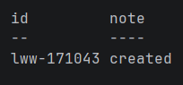
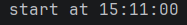
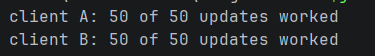
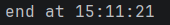
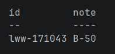
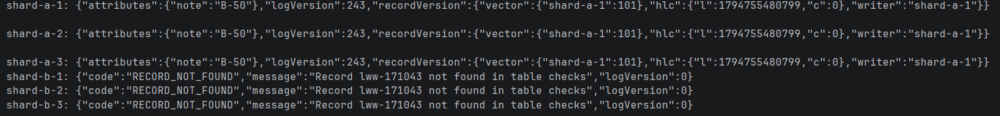

# Two clients writing the same record (Last-Write-Wins)

**What is checked:** two clients update the same record at the same time, 50 times each. Then the record is read from
every replica directly, without the coordinator. All replicas of the record's shard should hold the same copy: the
same attributes and the same record version.

Checked on 2026-11-15. All times are UTC.

Uses the setup from [first_m4_deploy.md](first_m4_deploy.md#0-setup).

## What should happen

From [lww.md](../lww.md) and [ADR 0016](../../adr/0016-record-versioning.md):

- Every write goes to the shard's leader. The leader handles writes one at a time, so it puts the 100 updates from both
  clients in one order. Each write gets a record version: the leader's counter goes up by 1 every time.
- The followers copy the leader's log as it is. So when they have caught up, all 3 replicas hold the leader's last
  write, with the same version.
- With 1 create and 100 updates, the leader's counter should end at 101.
- The replicas of the other shard never got this record, so they answer 404.

## Commands

**1. Write the record.** If the table is already there, the answer is 409, which is fine.

Windows (PowerShell):
```powershell
try { Invoke-RestMethod -Method Post -Uri "$API/tables" -ContentType 'application/json' -Body '{"name":"checks","partitionKey":"id"}' } catch { $_.ErrorDetails.Message }
$ID = "lww-" + (Get-Date -Format HHmmss)
Invoke-RestMethod -Method Post -Uri "$API/tables/checks/records" -ContentType 'application/json' -Body ('{"id":"' + $ID + '","note":"created"}')
```

macOS (Terminal):
```bash
curl -s -X POST "$API/tables" -H 'Content-Type: application/json' -d '{"name":"checks","partitionKey":"id"}'; echo
ID="lww-$(date +%H%M%S)"
curl -s -X POST "$API/tables/checks/records" -H 'Content-Type: application/json' -d "{\"id\":\"$ID\",\"note\":\"created\"}"; echo
```



The record `lww-171043` was created with `note` = `created`.

**2. Two clients update the record at the same time.** Client A writes `A-1` … `A-50`, client B writes `B-1` …
`B-50`. Both run in the background and start together. At the end each client prints how many of its updates
worked.

Windows (PowerShell):
```powershell
$client = {
  param($api, $id, $name)
  $ok = 0
  1..50 | ForEach-Object {
    try { Invoke-RestMethod -Method Put -Uri "$api/tables/checks/records/$id" -ContentType 'application/json' -Body ('{"note":"' + "$name-$_" + '"}') | Out-Null; $ok++ } catch { }
  }
  "client ${name}: $ok of 50 updates worked"
}
"start at " + (Get-Date).ToUniversalTime().ToString('HH:mm:ss')
$jobs = Start-Job $client -ArgumentList $API, $ID, 'A'
$jobs = @($jobs) + (Start-Job $client -ArgumentList $API, $ID, 'B')
$jobs | Wait-Job | Receive-Job
$jobs | Remove-Job
"end at " + (Get-Date).ToUniversalTime().ToString('HH:mm:ss')
```

macOS (Terminal):
```bash
client() {
  ok=0
  for i in $(seq 1 50); do
    code=$(curl -s -o /dev/null -w '%{http_code}' -X PUT "$API/tables/checks/records/$ID" -H 'Content-Type: application/json' -d "{\"note\":\"$1-$i\"}")
    [ "$code" = 200 ] && ok=$((ok+1))
  done
  echo "client $1: $ok of 50 updates worked"
}
echo "start at $(date -u +%H:%M:%S)"
client A & client B & wait
echo "end at $(date -u +%H:%M:%S)"
```







The two clients ran from 15:11:00 to 15:11:21. All 50 updates of client A and all 50 of client B worked, so the record
got 100 updates in about 20 seconds, from both clients mixed together.

**3. Read the record through the coordinator.** This is what a client sees: the copy that wins in the quorum read.

Windows (PowerShell):
```powershell
Invoke-RestMethod -Uri "$API/tables/checks/records/$ID"
```

macOS (Terminal):
```bash
curl -s "$API/tables/checks/records/$ID"; echo
```



A client sees `note` = `B-50`: client B's last update was the last write the leader got.

**4. Read the record from every replica directly.** The replicas are private, so each request runs on the coordinator
over SSH. A replica answers with its own copy: the attributes, its log position (`logVersion`) and the record version
(`recordVersion`).

Windows (PowerShell):
```powershell
$names = 'shard-a-1','shard-a-2','shard-a-3','shard-b-1','shard-b-2','shard-b-3'
for ($i = 0; $i -lt 6; $i++) {
  "$($names[$i]): " + (ssh -i $PEM "ec2-user@$COORD_PUB" "curl -s -m 5 http://$($REPLICAS[$i]):8080/tables/checks/records/$ID")
}
```

macOS (Terminal):
```bash
set -- shard-a-1 shard-a-2 shard-a-3 shard-b-1 shard-b-2 shard-b-3
for ip in $REPLICAS; do
  echo "$1: $(ssh -i "$PEM" "ec2-user@$COORD_PUB" "curl -s -m 5 http://$ip:8080/tables/checks/records/$ID")"
  shift
done
```



The record is on shard A. Its 3 replicas hold exactly the same copy:

- `attributes`: `note` = `B-50`, the same as the coordinator returned.
- `logVersion`: 243, the same log position on all 3.
- `recordVersion`: vector `{"shard-a-1": 101}`, HLC `l` = 1794755480799 (15:11:20.799 UTC, the time of the last
  write), `c` = 0, writer `shard-a-1`.

The counter 101 is the create plus the 100 updates. Only the leader shard-a-1 appears in the vector, because it is the
only node that writes this shard. The 3 replicas of shard B answer `RECORD_NOT_FOUND` with `logVersion` 0: they never
got this record.

## Result

- **Both clients' writes worked:** 100 of 100 updates, sent by two clients at the same time.
- **All replicas hold the same winner:** shard A's 3 replicas have the same attributes (`B-50`), the same log position
  and the same record version, and the coordinator returns the same copy.
- **The version counts every write:** the leader's counter is 101, for 1 create and 100 updates, as
  [lww.md](../lww.md) describes. The leader put the two clients' writes in one order, and the last one, `B-50`, won
  everywhere.
- **The other shard is not involved:** shard B's replicas never got the record.
