# Coordinator down

**What was checked:** the coordinator was stopped. Its node-down alarm fired and sent an email, although the
coordinator is the node that sends all the metrics. The 6 replica alarms did not fire, as
[ADR 0013](../../adr/0013-monitoring-stack.md) decides. After the coordinator was started again, the alarm went back
to `OK` by itself and the store worked.

**Found:** the alarm fired **7 min 31 s** after the stop, not within 1–2 minutes as
[ADR 0014](../../adr/0014-slo-values.md) expects. See [Why the alarm took 7.5 minutes](#why-the-alarm-took-75-minutes).
The alarm was then changed to count a minute without values as 0. Run again in [After the fix](#after-the-fix), it
fired **2 min 47 s** after the stop.

Checked on 2026-11-14. All times are UTC.

Uses the setup from [first_m4_deploy.md](first_m4_deploy.md#0-setup).

## What should happen

The limits come from [ADR 0014](../../adr/0014-slo-values.md) and the alarms in `cfn/margosha-app.yaml`:

- **Coordinator down** (`margosha-app-coordinator-down`): the coordinator sends `margosha.cluster.replicas` every
  minute. The alarm counts its values for shard A's leader. Missing data counts as breaching, so a minute with no value
  should put the alarm in `ALARM`. CloudWatch itself does this check, so it doesn't need the coordinator to report its
  own absence.
- **Replica alarms** (`margosha-app-shard-*-down`): while the coordinator is stopped, no replica values reach
  CloudWatch. For these alarms missing data counts as fine, so they stay `OK`. Only one alarm fires, not seven.
- The coordinator alarm has `OKActions`, so an email comes also when it is `OK` again.

## Commands

**1. Add a time helper and check the starting point:** no alarm is in `ALARM`, and every alarm has its actions on.

Windows (PowerShell):
```powershell
function Utc { (Get-Date).ToUniversalTime().ToString('HH:mm:ss') }
"COORD $COORD  API $API  now $(Utc)"
```

macOS (Terminal):
```bash
utc() { date -u +%H:%M:%S; }
echo "COORD $COORD  API $API  now $(utc)"
```

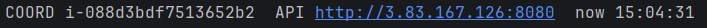

```bash
aws cloudwatch describe-alarms --alarm-name-prefix margosha-app- --query "MetricAlarms[].[AlarmName,StateValue,ActionsEnabled]" --output table
```

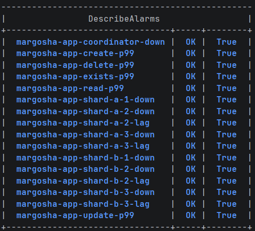

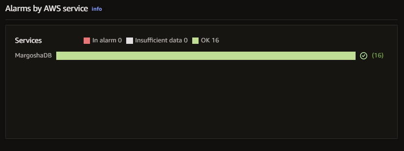

At 15:04:31 the coordinator was `i-088d3bdf7513652b2` at `3.83.167.126`. All 16 alarms were `OK` with actions on.

**2. Stop the coordinator** and wait until it is stopped:

Windows (PowerShell):
```powershell
aws ec2 stop-instances --instance-ids $COORD --query "StoppingInstances[0].CurrentState.Name" --output text
"stop sent at $(Utc)"
aws ec2 wait instance-stopped --instance-ids $COORD
"stopped at $(Utc)"
```

macOS (Terminal):
```bash
aws ec2 stop-instances --instance-ids "$COORD" --query "StoppingInstances[0].CurrentState.Name" --output text
echo "stop sent at $(utc)"
aws ec2 wait instance-stopped --instance-ids "$COORD"
echo "stopped at $(utc)"
```

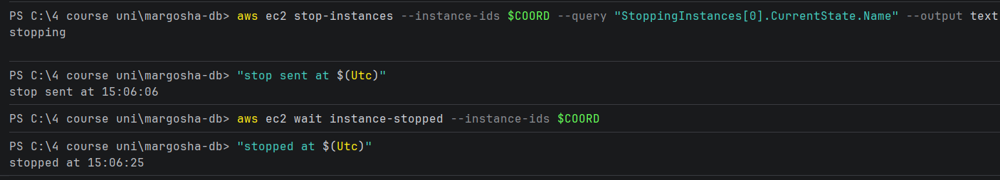

The stop was sent at **15:06:06** and the instance was stopped at **15:06:25**.

**3. Show that a client can't reach the store:**

Windows (PowerShell):
```powershell
curl.exe -s -m 5 "$API/tables/checks/records/missing"
"curl exit code $LASTEXITCODE"
```

macOS (Terminal):
```bash
curl -s -m 5 "$API/tables/checks/records/missing"
echo "curl exit code $?"
```

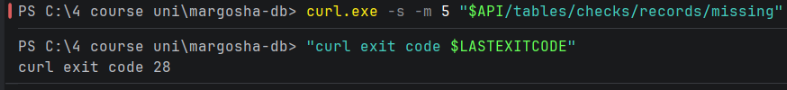

`curl` got no answer within 5 seconds (exit code 28, time out).

**4. Wait until the coordinator alarm fires.** The loop asks every 30 seconds which alarms are in `ALARM`. Then it waits
3 more minutes and asks again, to show that no replica alarm fires later.

Windows (PowerShell):
```powershell
do {
  Start-Sleep 30
  $s = aws cloudwatch describe-alarms --alarm-name-prefix margosha-app- --state-value ALARM --query "MetricAlarms[].AlarmName" --output text
  "$(Utc) in alarm: $s"
} while ("$s" -notmatch 'coordinator-down')
Start-Sleep 180
"$(Utc) in alarm: " + (aws cloudwatch describe-alarms --alarm-name-prefix margosha-app- --state-value ALARM --query "MetricAlarms[].AlarmName" --output text)
```

macOS (Terminal):
```bash
while true; do
  sleep 30
  s=$(aws cloudwatch describe-alarms --alarm-name-prefix margosha-app- --state-value ALARM --query "MetricAlarms[].AlarmName" --output text)
  echo "$(utc) in alarm: $s"
  echo "$s" | grep -q coordinator-down && break
done
sleep 180
echo "$(utc) in alarm: $(aws cloudwatch describe-alarms --alarm-name-prefix margosha-app- --state-value ALARM --query "MetricAlarms[].AlarmName" --output text)"
```

The alarm went to `ALARM` at **15:13:37** and the email came at the same minute. Its reason: no data for 1 period,
treated as breaching.

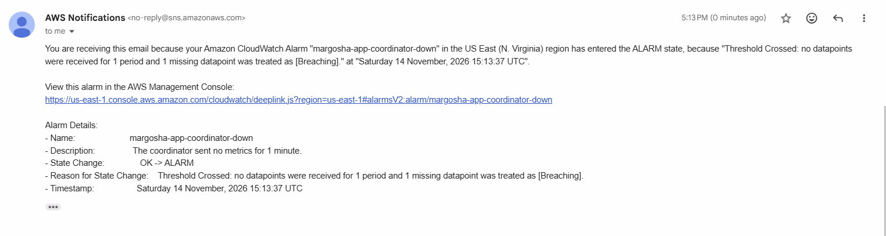

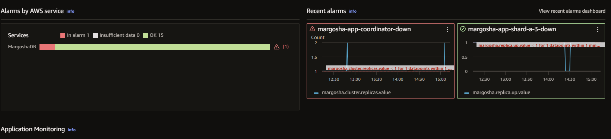

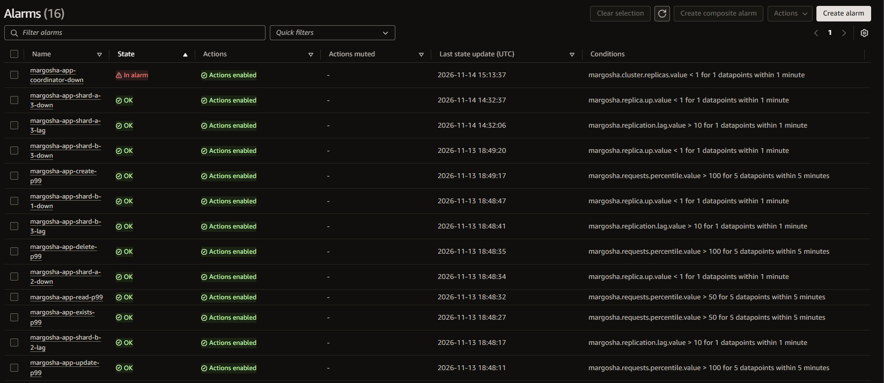

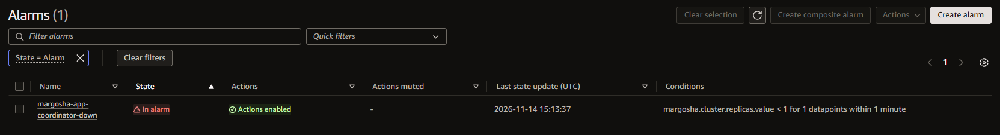

Only `margosha-app-coordinator-down` is in alarm. The 6 replica alarms are `OK`, and their last change is from before
this check (14:32:37 for shard-a-3, the follower check, and 2026-11-13 for the others). So they did not change while
the coordinator was down.

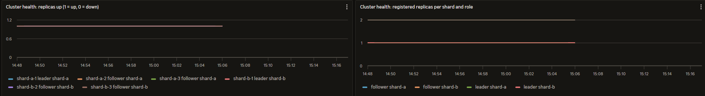

Both health panels stop at 15:06. The lines end, they don't drop to 0: no value reaches CloudWatch, not even a 0 for
the replicas. This is why the replica alarms stay `OK`.

**5. Start the coordinator again.** It gets a new public IP, so `$COORD_PUB` and `$API` are read again. Then wait until
the alarm is `OK`.

Windows (PowerShell):
```powershell
aws ec2 start-instances --instance-ids $COORD --query "StartingInstances[0].CurrentState.Name" --output text
aws ec2 wait instance-running --instance-ids $COORD
"running at $(Utc)"
$COORD_PUB = Ip coordinator PublicIpAddress
$API       = "http://${COORD_PUB}:8080"
"new API $API"
do {
  Start-Sleep 30
  $s = aws cloudwatch describe-alarms --alarm-names margosha-app-coordinator-down --query "MetricAlarms[0].StateValue" --output text
  "$(Utc) coordinator-down: $s"
} while ($s -ne 'OK')
```

macOS (Terminal):
```bash
aws ec2 start-instances --instance-ids "$COORD" --query "StartingInstances[0].CurrentState.Name" --output text
aws ec2 wait instance-running --instance-ids "$COORD"
echo "running at $(utc)"
COORD_PUB=$(node_ip coordinator PublicIpAddress)
API="http://$COORD_PUB:8080"
echo "new API $API"
while true; do
  sleep 30
  s=$(aws cloudwatch describe-alarms --alarm-names margosha-app-coordinator-down --query "MetricAlarms[0].StateValue" --output text)
  echo "$(utc) coordinator-down: $s"
  [ "$s" = OK ] && break
done
```

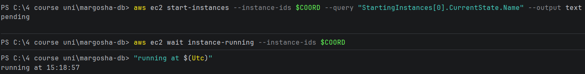

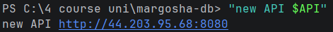

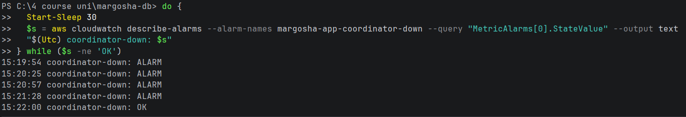

The instance was `running` at **15:18:57** with the new public IP `44.203.95.68`. The alarm was still `ALARM` at
15:21:28 and `OK` at 15:22:00.

**6. Show that the store works again.** The coordinator keeps its shard list only in memory, so it starts empty. The
replicas register again within 10 seconds ([M2, shard registration](../../M2.md#shard-registration-sharded-mode-when-a-shard-starts)). A write and a read through the
coordinator show that the store is back:

Windows (PowerShell):
```powershell
$ID = "coord-" + (Get-Date -Format HHmmss)
Invoke-RestMethod -Method Post -Uri "$API/tables/checks/records" -ContentType 'application/json' -Body ('{"id":"' + $ID + '","note":"check 7.3"}')
Invoke-RestMethod -Uri "$API/tables/checks/records/$ID"
```

macOS (Terminal):
```bash
ID="coord-$(date +%H%M%S)"
curl -s -X POST "$API/tables/checks/records" -H 'Content-Type: application/json' -d "{\"id\":\"$ID\",\"note\":\"check 7.3\"}"; echo
curl -s "$API/tables/checks/records/$ID"; echo
```

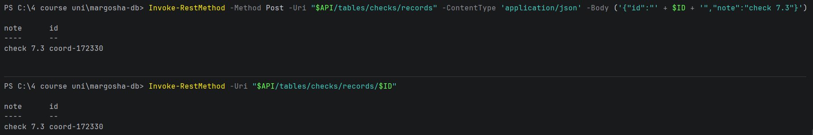

The write and the read of `coord-172330` both worked.

**7. Show the alarm's history:**

```bash
aws cloudwatch describe-alarm-history --alarm-name margosha-app-coordinator-down --history-item-type StateUpdate --max-records 4 --query "AlarmHistoryItems[].[Timestamp,HistorySummary]" --output table
```

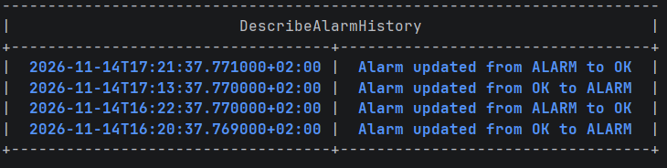

The CLI prints local time (UTC+2). In UTC: `OK → ALARM` at 15:13:37 and `ALARM → OK` at 15:21:37. The two older lines,
at 14:20:37 and 14:22:37, are from earlier the same day: the coordinator sent no metrics from about 14:13 to 14:21
(see the dashboard gap in [follower_down.md](follower_down.md)).

The same in the console. Each state change is followed by a successful SNS action, so each one sent an email:

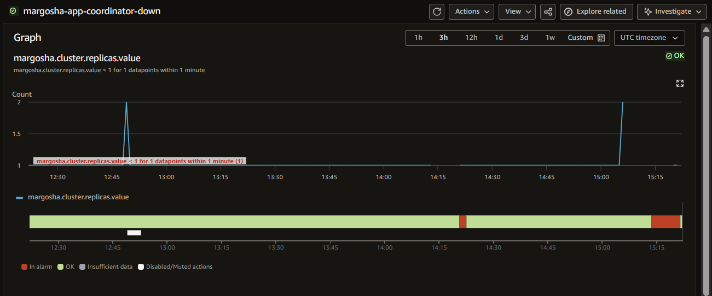

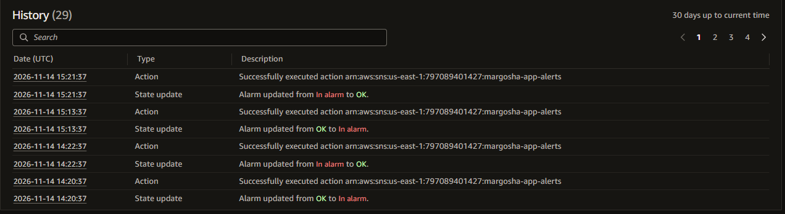

The `OK` email:

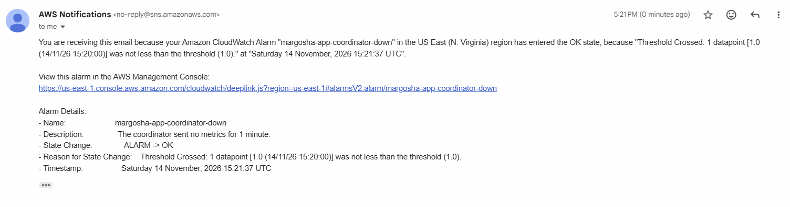

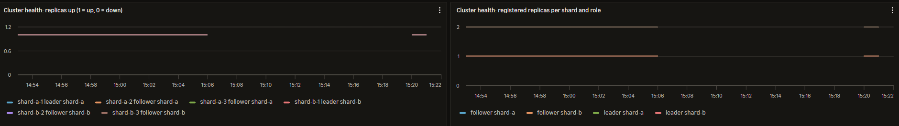

The health panels have a gap from 15:06 to 15:20. After it, all 6 replicas are up again, and every shard has 1 leader
and 2 followers registered.

## Timeline

| Time (UTC) | What happened |
|---|---|
| 15:06:06 | stop of the coordinator sent |
| 15:06:25 | coordinator stopped |
| 15:11:24 | still no alarm in `ALARM`, 5 minutes after the stop |
| 15:13:37 | coordinator alarm `ALARM`, email sent (7 min 31 s after the stop) |
| 15:18:57 | coordinator `running` again, new public IP |
| 15:20 | first metrics after the start, on the dashboard |
| 15:21:37 | coordinator alarm `OK`, email sent (2 min 40 s after the start) |
| 15:23:30 | a write and a read work |

## Why the alarm took 7.5 minutes

A replica alarm gets a real 0 from the coordinator, so it fires after about 1.5 minutes ([follower_down.md](follower_down.md)).
The coordinator alarm gets no data at all, and CloudWatch treats missing data more slowly.

When CloudWatch evaluates an alarm, it doesn't look only at the last period. It looks at a longer window, the
"evaluation range", which is several periods long. If the newest periods have no data, it uses the newest values it
still finds in that window. Missing data counts as breaching only when the whole window is empty. So the alarm sees
the coordinator's last values from 15:06 for several more minutes, and stays `OK`.

The earlier outage the same day shows the same delay: the metrics stopped at about 14:13, and the alarm fired at
14:20:37.

The graph also shows a value of 2 at about 15:06: at shutdown the coordinator sends its metrics once more, so that
minute got 2 values instead of 1.

## Result

- **The coordinator's node-down alarm fires without the coordinator:** CloudWatch noticed the missing data and sent an
  `ALARM` email, then an `OK` email after the coordinator came back.
- **Only one alarm fires:** the 6 replica alarms, and the lag and latency alarms, stayed `OK` the whole time, as
  [ADR 0013](../../adr/0013-monitoring-stack.md) decides.
- **The alarm resolves by itself:** 2 min 40 s after the instance was running, the alarm was `OK`. The replicas
  registered again, and a write and a read worked.
- **Slower than the SLO:** the alarm fired 7 min 31 s after the stop. [ADR 0014](../../adr/0014-slo-values.md) says a
  node counts as down after 1 minute, and expects an alert within about 1–2 minutes. For the coordinator this holds
  only when it sends a value, not when it is gone. This led to the fix below.

## After the fix

**What changed:** the coordinator alarm in `cfn/margosha-app.yaml` (`CoordinatorDownAlarm`) now uses CloudWatch's
`FILL(sent, 0)`, which turns a minute without a value into 0. The alarm fires after **2 such minutes in a row**, so a
minute whose values arrive late doesn't trigger it ([ADR 0013](../../adr/0013-monitoring-stack.md),
[ADR 0014](../../adr/0014-slo-values.md)). The alarm keeps its name, so the pipeline still mutes it during deploys.

**What should happen:** the alarm fires about 3 minutes after the coordinator stops, and only this alarm fires. While
the coordinator is running, the alarm stays `OK`.

**How it was run:** the change was deployed by the pipeline.
Then steps 2, 4, 5 and 7 above were run again with the same commands. The parts the fix
doesn't change (a client can't reach the store, the replica alarms stay `OK`, the store works after the start) are
shown in the first run and were not repeated.

### Results

**The new alarm after the deploy:** `OK`, 2 periods, 2 datapoints to alarm, missing data `breaching`, and the
expression `FILL(sent, 0)`.

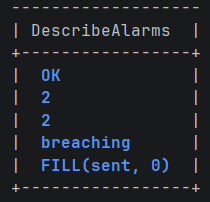
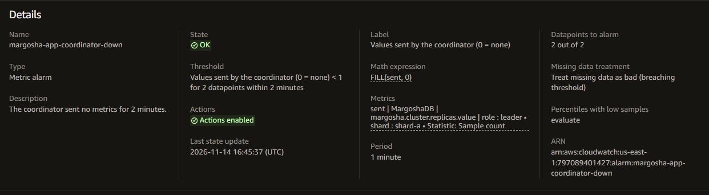

**Stop.** The stop was sent at **16:34:50** and the coordinator was stopped at **16:35:22**.

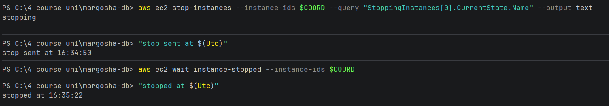

**Alarm.** The alarm went to `ALARM` at **16:37:37**, 2 min 47 s after the stop. Its reason: the minutes 16:35 and
16:36 both had the value 0, so 2 of 2 were below 1. The email came at the same minute. At 16:41:04, 3 minutes later,
it was still the only alarm in `ALARM`.

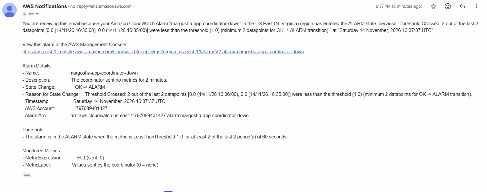

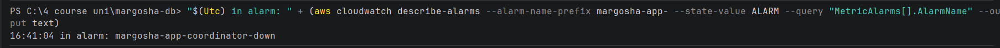

**Start.** The coordinator was `running` at **16:43:23**. The alarm went back to `OK` at **16:45:37**, 2 min 14 s
later, as soon as the minute 16:44 had a value again. The `OK` email came at the same minute.

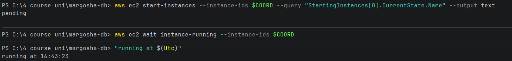

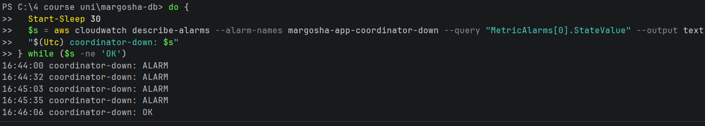

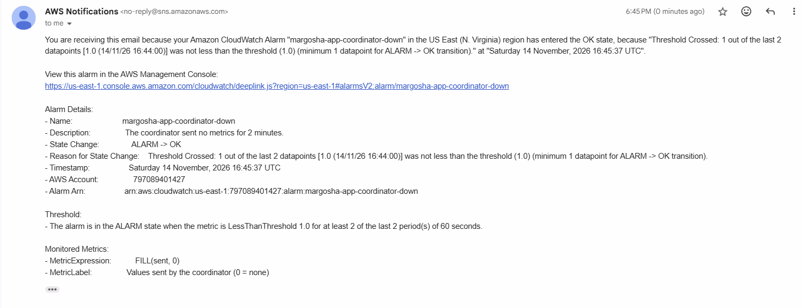

**History.** The CLI prints local time (UTC+2). The two newest lines are this run (16:37:37 and 16:45:37 UTC), the
others are the first run and the outage before it.

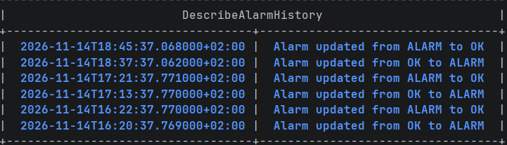

The console shows the same, plus the deploy. The alarm was updated at 16:28:53, and the pipeline muted and unmuted the
alarm emails until 16:33:12. The alarm stayed `OK` during the deploy. The coordinator's values never dropped to 0 for
2 minutes then.

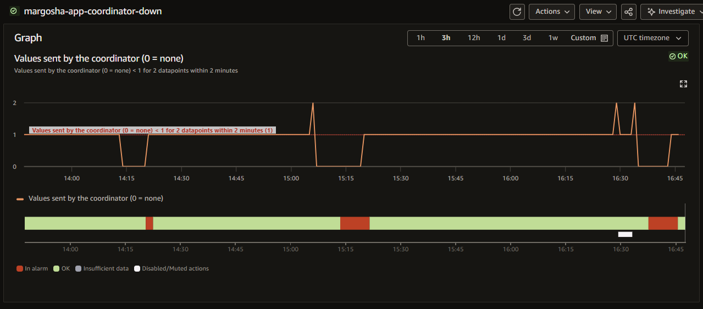

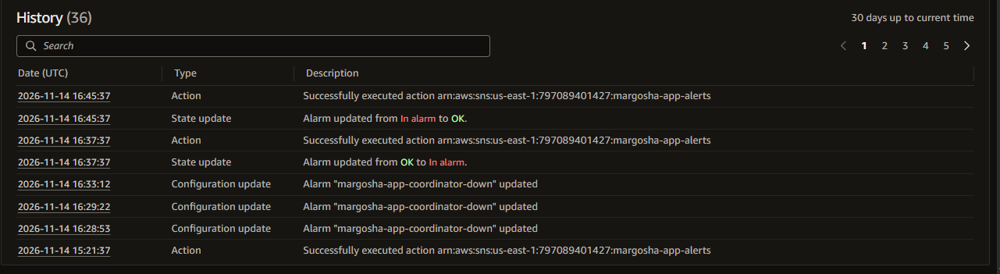

The graph now shows the new expression for the whole 3 hours: each outage is a run of zeros. The first run's outage
(15:06–15:20) shows zeros from 15:07, but the alarm, which then did not use `FILL`, fired only at 15:13:37.

### Timeline after the fix

| Time (UTC) | What happened |
|---|---|
| 16:28:53 | deploy updates the alarm |
| 16:33:12 | deploy ends, alarm emails on again, alarm still `OK` |
| 16:34:50 | stop of the coordinator sent |
| 16:35:22 | coordinator stopped |
| 16:37:37 | coordinator alarm `ALARM`, email sent (2 min 47 s after the stop) |
| 16:41:04 | still only the coordinator alarm in `ALARM` |
| 16:43:23 | coordinator `running` again |
| 16:45:37 | coordinator alarm `OK`, email sent (2 min 14 s after the start) |

### Result after the fix

- **The alarm is now on time:** it fired 2 min 47 s after the stop, instead of 7 min 31 s before the fix. This is
  the "about 3 minutes" [ADR 0014](../../adr/0014-slo-values.md) now gives for the coordinator.
- **Only one alarm fires:** the coordinator alarm was the only one in `ALARM`, also 6 minutes after the stop.
- **No false alarm:** the alarm stayed `OK` during the deploy and while the coordinator was running.
- **It resolves by itself:** 2 min 14 s after the coordinator was running, the alarm was `OK` again, with an email.
