# Checks after the M4 deploy (task 7.1)

**What was checked:** the pipeline deployed M4 with 7 instances, all 6 replicas registered with the coordinator,
CloudWatch gets metrics from all 7 nodes, the dashboard shows data, the 16 alarms exist, and a replica's metrics
endpoint can't be reached from outside the VPC.

Account `797089401427`, region `us-east-1`, 2026-11-14. All times are UTC.

Uses the setup from [first_m4_deploy.md](first_m4_deploy.md#0-setup) (`$PEM`, `$COORD`, `$COORD_PUB`, `$API`,
`$REPLICAS`). Plain `aws` commands are written on one line, so they run as they are on **Windows (PowerShell)** and
**macOS (Terminal)**. Commands that use variables or loops are given for both.

## Commands

**1. List the stack's instances:**

```bash
aws ec2 describe-instances --filters "Name=tag:Name,Values=margosha-*" "Name=instance-state-name,Values=pending,running,stopping,stopped" --query "Reservations[].Instances[].[Tags[?Key=='Name']|[0].Value,InstanceId,State.Name,PrivateIpAddress,PublicIpAddress]" --output table
```

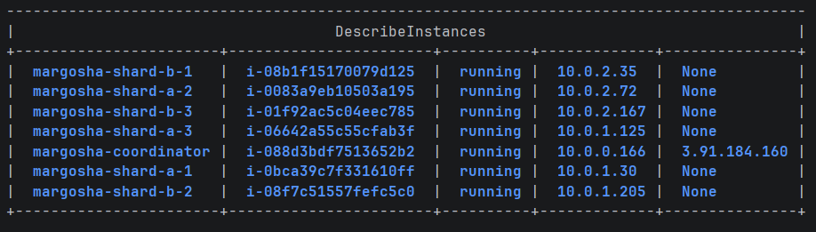

7 instances were `running`: the coordinator and the 6 replicas, with the same instance IDs as before the deploy (the
bench client is not created). Only the coordinator has a public IP (`3.91.184.160`). The replicas show `None`.

**2. Show the coordinator's log lines about replicas registering.** The coordinator's log goes to its serial console,
so no SSH is needed:

Windows (PowerShell):
```powershell
aws ec2 get-console-output --instance-id $COORD --latest --output text | Select-String "(Registered|Updated) replica" | Select-Object -Last 6
```

macOS (Terminal):
```bash
aws ec2 get-console-output --instance-id "$COORD" --latest --output text | grep -E "(Registered|Updated) replica" | tail -n 6
```

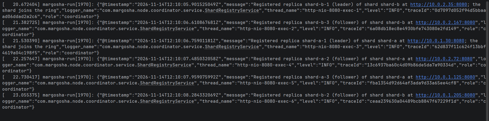

All 6 replicas registered within 3 seconds after the deploy:

| Time | Replica | Role | Address |
|---|---|---|---|
| 12:10:05 | shard-b-1 | leader | 10.0.2.35 (shard B joins the ring) |
| 12:10:06 | shard-b-3 | follower | 10.0.2.167 |
| 12:10:06 | shard-a-1 | leader | 10.0.1.30 (shard A joins the ring) |
| 12:10:07 | shard-a-2 | follower | 10.0.2.72 |
| 12:10:07 | shard-a-3 | follower | 10.0.1.125 |
| 12:10:08 | shard-b-2 | follower | 10.0.1.205 |

**3. Register a table `checks`, write and read 20 records, and read one missing record.** The missing record gives a
not-found error for the error panels. The record IDs start with the time, so the commands can be run again. When the
table already exists, its registration answers 409, which is fine.

Windows (PowerShell):
```powershell
try { Invoke-RestMethod -Method Post -Uri "$API/tables" -ContentType 'application/json' -Body '{"name":"checks","partitionKey":"id"}' } catch { $_.ErrorDetails.Message }
$RUN = Get-Date -Format HHmmss
1..20 | ForEach-Object {
  Invoke-RestMethod -Method Post -Uri "$API/tables/checks/records" -ContentType 'application/json' -Body ('{"id":"' + "$RUN-$_" + '","note":"check 7.1"}') | Out-Null
  Invoke-RestMethod -Uri "$API/tables/checks/records/$RUN-$_" | Out-Null
}
curl.exe -s "$API/tables/checks/records/missing"; ""
```

macOS (Terminal):
```bash
curl -s -X POST "$API/tables" -H 'Content-Type: application/json' -d '{"name":"checks","partitionKey":"id"}'; echo
RUN=$(date +%H%M%S)
for i in $(seq 1 20); do
  curl -s -o /dev/null -X POST "$API/tables/checks/records" -H 'Content-Type: application/json' -d "{\"id\":\"$RUN-$i\",\"note\":\"check 7.1\"}"
  curl -s -o /dev/null "$API/tables/checks/records/$RUN-$i"
done
curl -s "$API/tables/checks/records/missing"; echo
```

The 20 writes and reads worked, and the missing record answered
`{"code":"RECORD_NOT_FOUND","message":"Record missing not found in table checks"}`. Then wait about 2 minutes: the
coordinator sends metrics to CloudWatch once a minute.

**4. List the metrics in CloudWatch.** First the coordinator's own metrics, one name per line:

Windows (PowerShell):
```powershell
aws cloudwatch list-metrics --namespace MargoshaDB --dimensions Name=role,Value=coordinator --recently-active PT3H --query "Metrics[].MetricName" --output text | ForEach-Object { $_ -split "\s+" } | Sort-Object -Unique
```

macOS (Terminal):
```bash
aws cloudwatch list-metrics --namespace MargoshaDB --dimensions Name=role,Value=coordinator --recently-active PT3H --query "Metrics[].MetricName" --output text | tr '\t' '\n' | sort -u
```

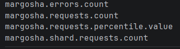

CloudWatch had the coordinator's `margosha.errors.count`, `margosha.requests.count`,
`margosha.requests.percentile.value` and `margosha.shard.requests.count`.

Then the replicas whose own metrics the coordinator sends on:

```bash
aws cloudwatch list-metrics --namespace MargoshaDB --metric-name margosha.replica.records.value --recently-active PT3H --query "Metrics[].Dimensions[?Name=='replica'].Value[]" --output text
```

It listed all 6 replicas, shard-a-1 … shard-b-3. So CloudWatch gets metrics from all 7 nodes.

**5. Look at the stack** in the CloudFormation console (stack `margosha-app`, tabs **Stack info**, **Outputs** and
**Resources**):

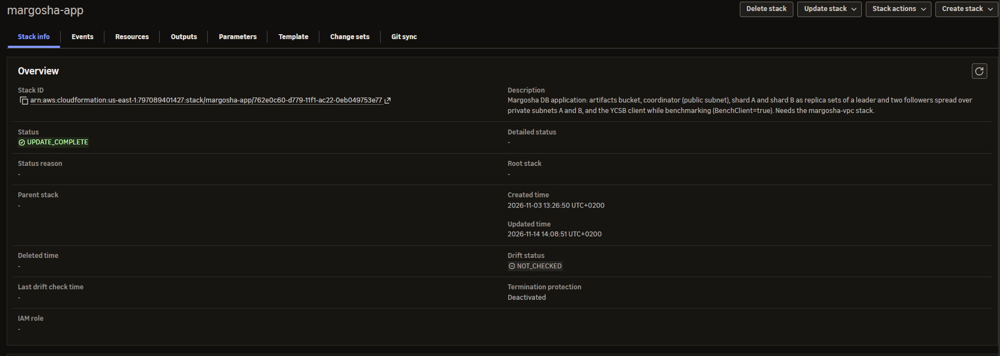

The stack is `UPDATE_COMPLETE`, updated by the pipeline at 12:08:51 (14:08:51 UTC+2 in the console).

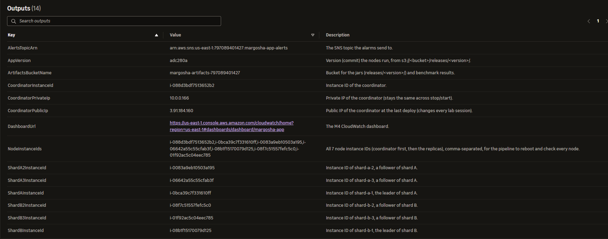

The outputs show `AppVersion` `adc280a`, the `DashboardUrl` and the `AlertsTopicArn`.

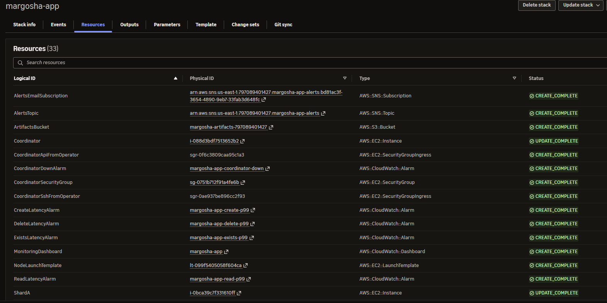

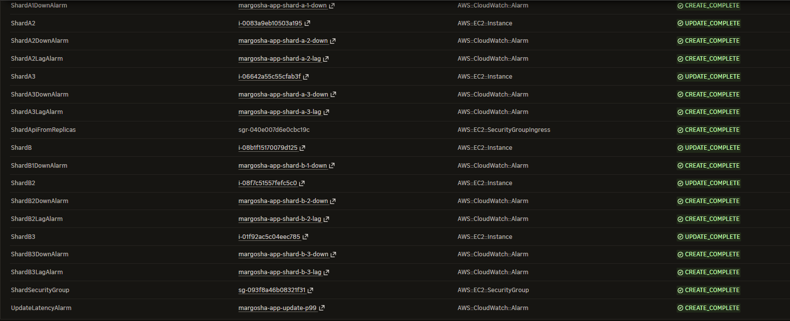

The stack has 33 resources. The 7 instances are `UPDATE_COMPLETE`: they were updated in place, not replaced. The
dashboard, the SNS topic, its e-mail subscription and the 16 alarms are `CREATE_COMPLETE`.

**6. Open the dashboard.** Its link is the stack output `DashboardUrl`:

```bash
aws cloudformation describe-stacks --stack-name margosha-app --query "Stacks[0].Outputs[?OutputKey=='DashboardUrl'].OutputValue" --output text
```

With the time range set to 3 hours (09:30–12:30), the panels show two bursts of traffic: one at about 10:17, sent
before the last deploy, and the one from step 3 at about 12:25. Between them, the lines have short gaps at about
10:45 and 12:09, while the deploys restarted the coordinator.

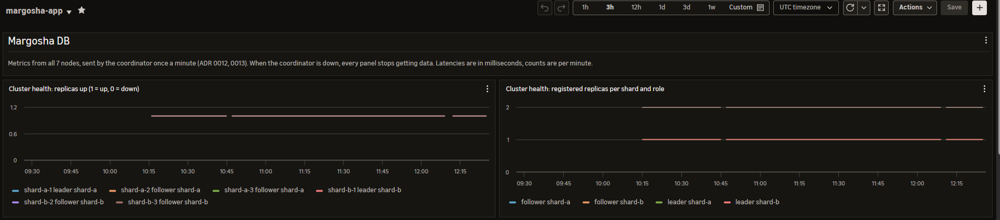

All 6 replicas are up (1), and every shard has 1 leader and 2 followers registered.

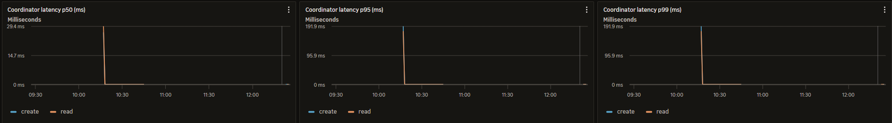

The coordinator has a line for create and for read. The first requests after a restart, at 10:17, took up to
192 ms at p95 and p99 (the JVM had just started). The requests at 12:25 took a few milliseconds.

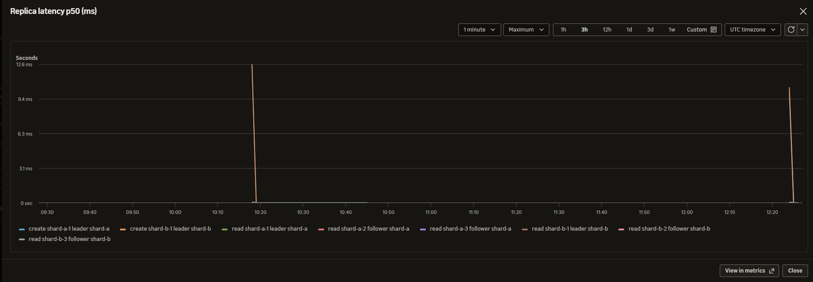

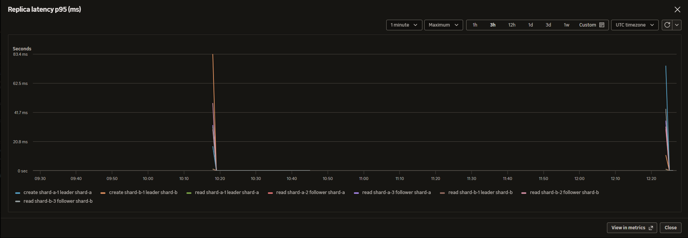

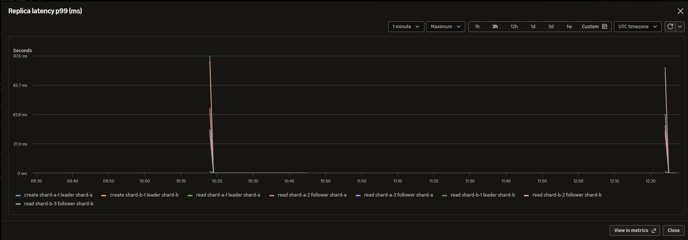

Every replica has a line for each of its operations: creates on the leaders, reads on all replicas. At 12:25 the
slowest was about 10.6 ms at p50, 75 ms at p95 and 80 ms at p99.

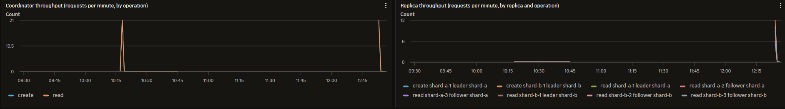

The coordinator handled 21 requests in the busiest minute. Each replica handled up to 12 requests a minute, split by
operation.

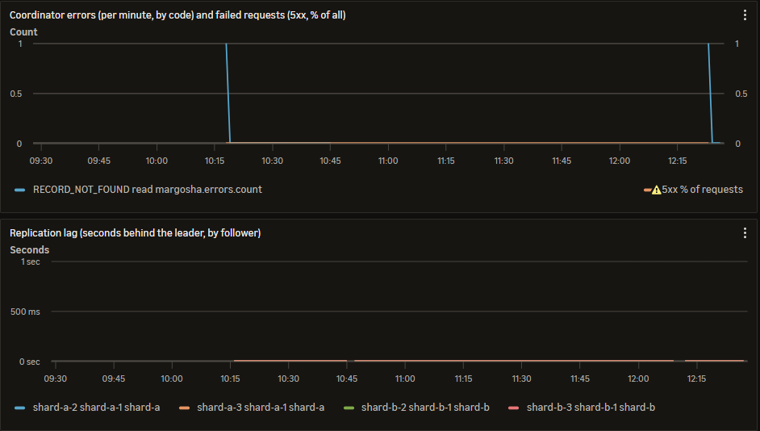

The coordinator's errors show one `RECORD_NOT_FOUND` for each burst, the missing record of step 3. The
"5xx % of requests" line is empty, because no request failed with a 5xx. The replication lag of all 4 followers is 0.

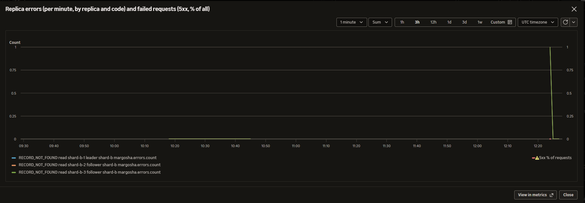

The replicas of shard B, which holds the key `missing`, show the same not-found: shard-b-3 answered it at 12:24.

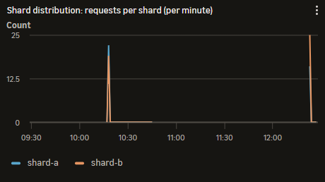

At 12:25 shard B got 25 requests and shard A about 16, as the ring spread the record IDs.

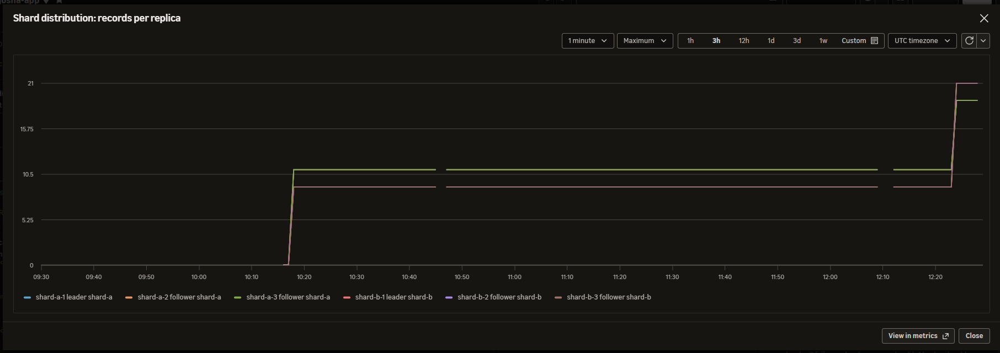

After both bursts, every replica of shard A holds 19 records and every replica of shard B holds 21 (40 in all). The
replicas of one shard hold the same number.

**7. Look at the alarms** in the CloudWatch console (**Alarms → All alarms**):

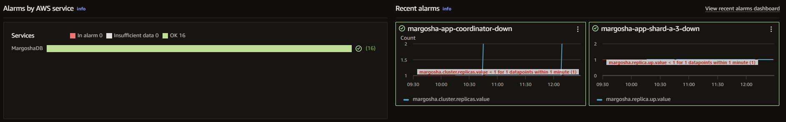

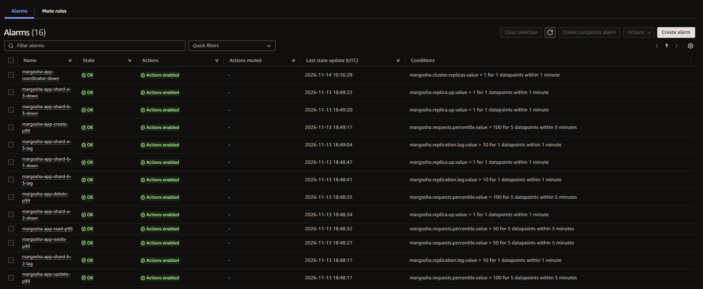

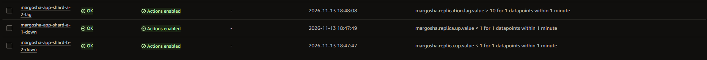

All 16 alarms are `OK`, with actions enabled. None changed state during the deploy at 12:08: the last change is
10:16 for the coordinator's alarm and the day before for the others.

**8. Show the rules of the replicas' security group:**

```bash
aws ec2 describe-security-groups --filters "Name=tag:Name,Values=margosha-shard-sg" --query "SecurityGroups[0].IpPermissions[].[FromPort,ToPort,join(',', IpRanges[].CidrIp),join(',', UserIdGroupPairs[].GroupId)]" --output table
```

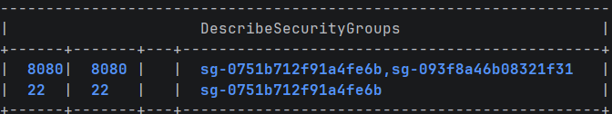

Port 8080 is open only to the coordinator's security group (`sg-0751b712f91a4fe6b`) and the replicas' own
(`sg-093f8a46b08321f31`). Port 22 is open only to the coordinator's. No IP range is allowed, so no `0.0.0.0/0`.

**9. Ask each replica's `/metrics` from the laptop:**

Windows (PowerShell):
```powershell
foreach ($ip in $REPLICAS) {
  try { Invoke-WebRequest -UseBasicParsing -TimeoutSec 5 "http://${ip}:8080/metrics" | Out-Null; "$ip ANSWERED" }
  catch { "$ip no answer" }
}
```

macOS (Terminal):
```bash
for ip in $REPLICAS; do
  if curl -s -m 5 -o /dev/null "http://$ip:8080/metrics"; then echo "$ip ANSWERED"; else echo "$ip no answer"; fi
done
```

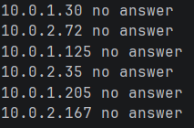

None of the 6 replicas answered.

**10. Ask a replica's `/metrics` from inside the VPC, through the coordinator:**

Windows (PowerShell):
```powershell
ssh -i $PEM -o StrictHostKeyChecking=accept-new "ec2-user@$COORD_PUB" "curl -s -m 5 http://$($REPLICAS[0]):8080/metrics | head -c 300; echo"
```

macOS (Terminal):
```bash
FIRST=${REPLICAS%% *}
ssh -i "$PEM" -o StrictHostKeyChecking=accept-new "ec2-user@$COORD_PUB" "curl -s -m 5 http://$FIRST:8080/metrics | head -c 300; echo"
```

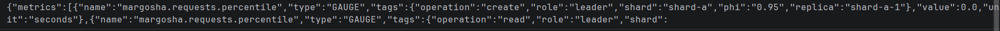

The replica answered with its JSON (`{"metrics":[{"name":"margosha.requests.percentile",…`). So the endpoint is there,
and only the outside can't reach it.
