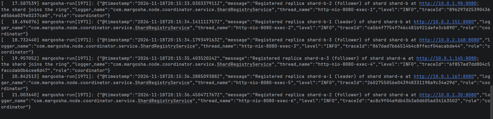
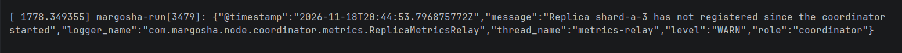
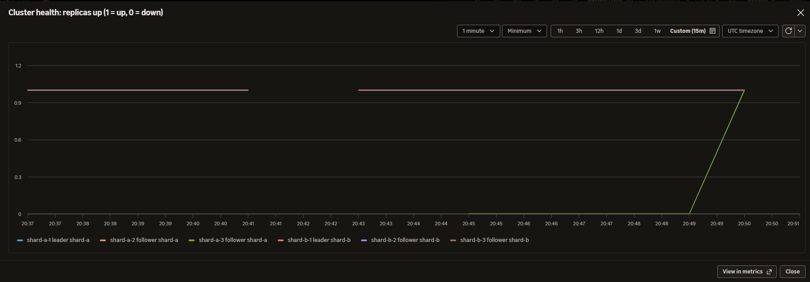
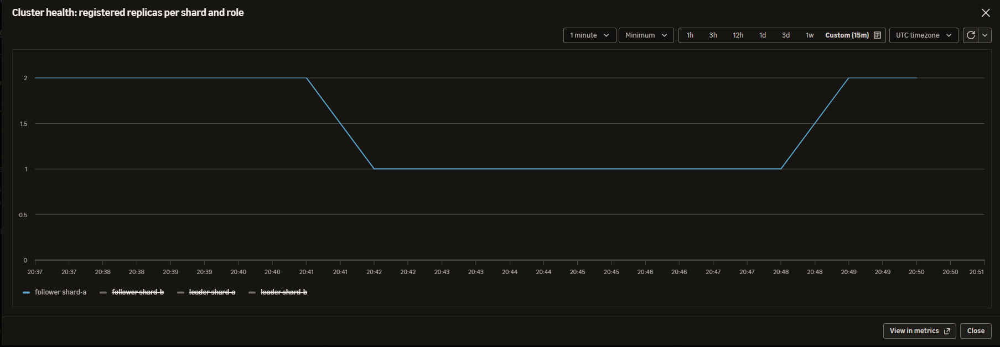
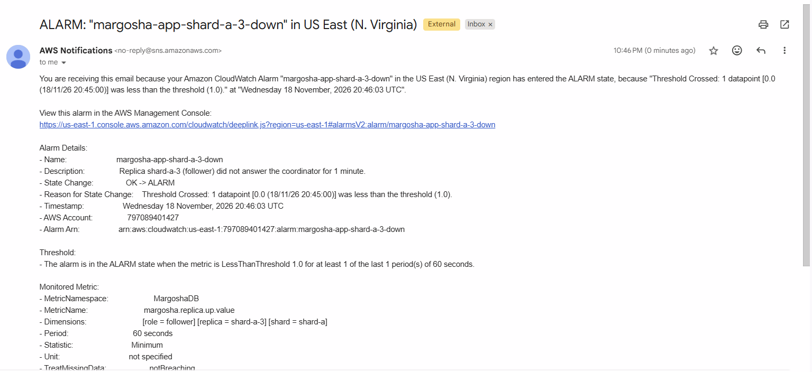
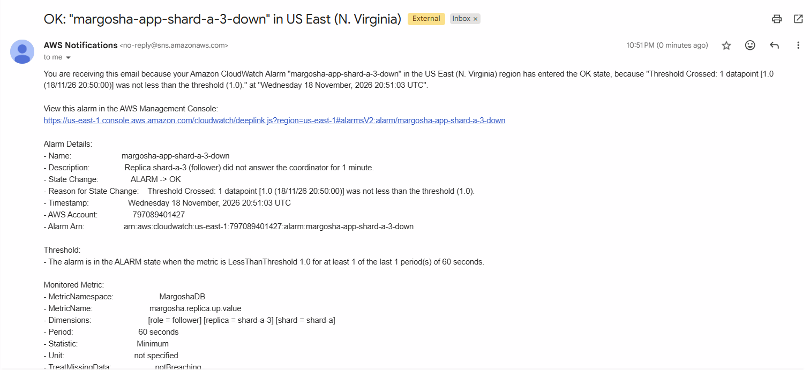
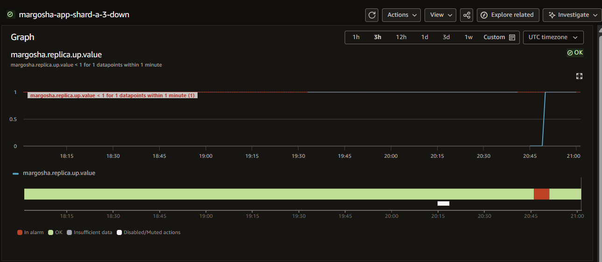
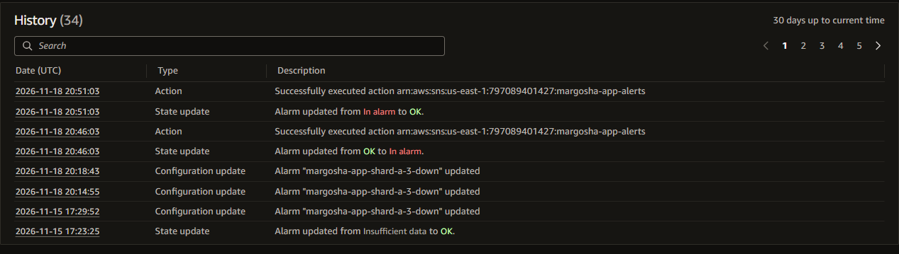

# A replica that never registers is reported as down

**What is checked:** the coordinator starts while a replica is already down, so that replica never registers. Before
the fix this replica had no `up` value at all, and its node-down alarm stayed `OK`
([ai_critique.md](../ai_critique.md), finding 1). Now the coordinator expects it
([ADR 0019](../../adr/0019-expected-replicas.md)): its `up` value has no data for 3 minutes after the coordinator
starts, then 0, so the alarm fires. When the replica comes back, the alarm goes back to `OK` by itself.

Checked on 2026-11-18, right after the deploy of the fix. All times are UTC.

Uses the setup from [first_m4_deploy.md](first_m4_deploy.md#0-setup), plus the IP of shard-a-3:

Windows (PowerShell):
```powershell
$A3 = $REPLICAS[2]
```

macOS (Terminal):
```bash
A3=$(echo $REPLICAS | cut -d' ' -f3)
```

## Before the check

After the deploy all 6 replicas registered (20:15:33–20:15:36), and all 17 alarms were `OK` with their actions on
([availability_alarm.md](availability_alarm.md) shows the alarm list).



## Commands

**1. Stop the coordinator, then shard-a-3, then start the coordinator.** The coordinator must be stopped first: it
keeps registrations only in memory, so after its restart it doesn't know shard-a-3. If shard-a-3 were stopped while
the coordinator runs, the old way (a known replica that stops answering) would fire the alarm, and the check would
show nothing new. The three commands are pasted together, so the coordinator is down for well under 2 minutes and
its own alarm doesn't fire:

```bash
ssh -i "$PEM" "ec2-user@$COORD_PUB" "sudo systemctl stop margosha"
ssh -i "$PEM" -o ProxyCommand="ssh -i $PEM -W %h:%p ec2-user@$COORD_PUB" "ec2-user@$A3" "sudo systemctl stop margosha"
ssh -i "$PEM" "ec2-user@$COORD_PUB" "sudo systemctl start margosha"
```

The coordinator was stopped at about 20:41 and started again at about 20:42.

**2. After about 3 minutes, the coordinator logs that shard-a-3 never registered:**

Windows (PowerShell):
```powershell
aws ec2 get-console-output --instance-id $COORD --latest --output text | Select-String "has not registered"
```

macOS (Terminal):
```bash
aws ec2 get-console-output --instance-id "$COORD" --latest --output text | grep "has not registered"
```



The line came at **20:44:53**, about 3 minutes after the coordinator started: the grace time of ADR 0019.

**3. The dashboard shows what happened.** In the panel "Cluster health: replicas up":



- Until 20:41 all 6 replicas are 1.
- 20:41–20:43: no values at all, because the coordinator, which sends them, was down.
- From 20:43 the other 5 replicas are 1 again. shard-a-3 has **no value** until 20:45 (the grace time), then **0**.
- At 20:50 shard-a-3 is 1 again, after it was started in step 5.

The panel "Cluster health: registered replicas per shard and role" shows the same from the registry: shard A had 2
followers, only 1 from 20:42 (shard-a-3 never registered with the new coordinator), and 2 again from 20:49.



**4. The alarm fires and sends an email.** `margosha-app-shard-a-3-down` went to `ALARM` at **20:46:03**, on the
datapoint 0 of 20:45, about 4 minutes after the coordinator started:



**5. Start shard-a-3 again.**:

```bash
ssh -i "$PEM" -o ProxyCommand="ssh -i $PEM -W %h:%p ec2-user@$COORD_PUB" "ec2-user@$A3" "sudo systemctl start margosha"
```

shard-a-3 registered again at 20:49, its `up` value was 1 at 20:50, and the alarm went back to `OK` at **20:51:03**,
with an email:



**6. The alarm's graph and history** show the whole cycle: 0 from 20:45, `In alarm` from 20:46 to 20:51, then 1 and
`OK`. The history has both state changes, each followed by a successful email action. The configuration updates at
20:14:55 and 20:18:43 are the deploy (the pipeline muting and unmuting the emails).





## Timeline

| Time (UTC) | What happened |
|---|---|
| 20:15:33–20:15:36 | after the deploy, all 6 replicas registered |
| about 20:41 | coordinator stopped, then shard-a-3 stopped |
| about 20:42 | coordinator started, 5 replicas registered, shard-a-3 didn't |
| 20:43–20:45 | shard-a-3's `up` has no value (grace time) |
| 20:44:53 | coordinator logs "Replica shard-a-3 has not registered since the coordinator started" |
| 20:45 | shard-a-3's `up` is 0 |
| 20:46:03 | `shard-a-3-down` `ALARM`, email sent |
| 20:49 | shard-a-3 started and registered again |
| 20:51:03 | `shard-a-3-down` `OK`, email sent |

## Result

- **A replica that never registers is reported as down:** the alarm fired about 4 minutes after the coordinator
  started (3 minutes of grace, plus the next read and the alarm's minute), as ADR 0019 expects. Before the fix it
  would have stayed `OK`.
- **No false alarm during the grace time:** for the first 3 minutes shard-a-3 had no value, not 0, so a normal
  restart doesn't page.
- **It clears by itself:** after shard-a-3 was started, the alarm was `OK` again within about 2 minutes.
