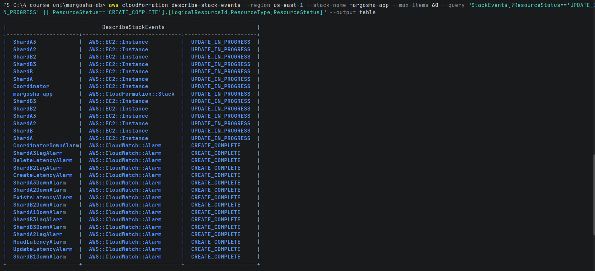
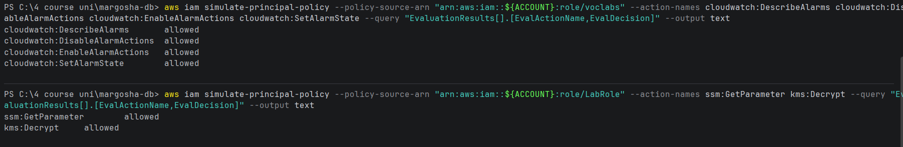

# The first M4 deploy

Checked on 2026-11-13.

## 0. Setup

I set the same variables as in M3's [How to verify it, step 1](../../M3.md#how-to-verify-it), which every section below uses: the SSH key, the
coordinator's instance ID and public IP, the API address, and the 6 replicas' private IPs. The SSH key is the lab's
`labsuser.pem` (**AWS Details → Download PEM**), in `~/.ssh/`. I ran everything from the repository root with the lab
credentials.

Windows (PowerShell):
```powershell
aws configure set region us-east-1
$env:PYTHONUTF8 = '1'; [Console]::OutputEncoding = [Text.Encoding]::UTF8
$PEM = "$HOME\.ssh\labsuser.pem"
function Ip($name, $field = 'PrivateIpAddress') {
  aws ec2 describe-instances --filters "Name=tag:Name,Values=margosha-$name" "Name=instance-state-name,Values=running" `
    --query "Reservations[0].Instances[0].$field" --output text
}
$COORD     = Ip coordinator InstanceId
$COORD_PUB = Ip coordinator PublicIpAddress
$API       = "http://${COORD_PUB}:8080"
$REPLICAS  = 'shard-a-1','shard-a-2','shard-a-3','shard-b-1','shard-b-2','shard-b-3' | ForEach-Object { Ip $_ }
"coordinator $COORD_PUB  replicas $REPLICAS"
```

macOS / Linux:
```bash
aws configure set region us-east-1
PEM=~/.ssh/labsuser.pem; chmod 400 "$PEM"
node_ip() {
  aws ec2 describe-instances --filters "Name=tag:Name,Values=margosha-$1" "Name=instance-state-name,Values=running" \
    --query "Reservations[0].Instances[0].${2:-PrivateIpAddress}" --output text
}
COORD=$(node_ip coordinator InstanceId)
COORD_PUB=$(node_ip coordinator PublicIpAddress)
API="http://$COORD_PUB:8080"
REPLICAS=$(for n in shard-a-1 shard-a-2 shard-a-3 shard-b-1 shard-b-2 shard-b-3; do node_ip $n; done | tr '\n' ' ')
echo "coordinator $COORD_PUB  replicas $REPLICAS"
```

It printed the coordinator's public IP and 6 private IPs, with no `None`. SSH to the coordinator works only from my
IP (the stack's `OperatorCidr`).

## 1. The first try failed: the replicas still had M3 logs

The pipeline updated the stack and rebooted the nodes. The coordinator started the new version, but `shard-a-1` did not:

```
The replication log /var/lib/margosha/replication.log is damaged at line 1, which is not the last line; the replica cannot start
```

The log was not damaged. Since M4 every log entry carries the record's version (vector clock and HLC,
[ADR 0016](../../adr/0016-record-versioning.md)), and the M3 entries don't have one, so the replica can't read them.
ADR 0016 decided that logs from before M4 are not kept: the replicas start with empty data folders on the first M4
deploy. Nothing had emptied them, so the replica stopped, and systemd kept restarting it.

## 2. The fix: empty the 6 replicas' data folders

I emptied them once, by hand, over SSH through the coordinator (the replicas accept SSH only from it), with the
variables of section 0. On each replica I stopped the service, deleted everything in `/var/lib/margosha` (the
replication log and its log ID file), and started it again.

Windows (PowerShell):
```powershell
$SSH = (Get-Command ssh).Source
foreach ($ip in $REPLICAS) {
  "== $ip"
  ssh -i $PEM -o StrictHostKeyChecking=accept-new -o "ProxyCommand=$SSH -i $PEM -o StrictHostKeyChecking=accept-new -W %h:%p ec2-user@$COORD_PUB" "ec2-user@$ip" 'sudo systemctl stop margosha; sudo find /var/lib/margosha -mindepth 1 -delete; echo files left: $(sudo ls -A /var/lib/margosha | wc -l); sudo systemctl start --no-block margosha'
}
```

macOS / Linux:
```bash
for ip in $REPLICAS; do
  echo "== $ip"
  ssh -i "$PEM" -o StrictHostKeyChecking=accept-new -o "ProxyCommand=ssh -i $PEM -o StrictHostKeyChecking=accept-new -W %h:%p ec2-user@$COORD_PUB" "ec2-user@$ip" 'sudo systemctl stop margosha; sudo find /var/lib/margosha -mindepth 1 -delete; echo files left: $(sudo ls -A /var/lib/margosha | wc -l); sudo systemctl start --no-block margosha'
done
```

Every replica printed `files left: 0`. The records stored before M4 are gone, as ADR 0016 accepts. The coordinator
keeps its table definitions, so the tables are still registered, but empty.

Then I re-ran the failed pipeline run (Actions → the run → Re-run failed jobs). It passed: all 7 nodes run version
`aca4f05` and all 6 replicas registered with the coordinator. The pipeline's wait step finds them by the
coordinator's `Registered replica` lines, so its log searches still match the M4 JSON log lines.

This is needed only once, on the first M4 deploy. Later deploys keep the M4 logs.

## 3. What the stack update did

I listed the stack events of the deploy. The 16 alarms were **created**, and the 7 instances were only **updated**
in place (their `AppVersion` tag). No instance was replaced, so their disks and data folders stayed.

```bash
aws cloudformation describe-stack-events --region us-east-1 --stack-name margosha-app --max-items 60 --query "StackEvents[?ResourceStatus=='UPDATE_IN_PROGRESS' || ResourceStatus=='CREATE_COMPLETE'].[LogicalResourceId,ResourceType,ResourceStatus]" --output table
```



The template changes of M4's monitoring are only additions (the `AlertEmail` parameter and its condition, the
dashboard, the SNS topic and e-mail subscription, the 16 alarms, two outputs). Nothing in the launch template, the
instances or the subnets changed, so nothing could be replaced.

## 4. The access the pipeline and the coordinator need

[permissions.md](permissions.md) checked creating alarms, dashboards and topics. M4's pipeline and coordinator also
use these calls, which I checked with the policy simulator:

- `voclabs` (the pipeline): `cloudwatch:DescribeAlarms`, `DisableAlarmActions`, `EnableAlarmActions` and
  `SetAlarmState`, to turn the alarm e-mails off and on around a deploy.
- `LabRole` (the coordinator): `ssm:GetParameter` and `kms:Decrypt`, to read the encrypted agent key.

Windows (PowerShell):
```powershell
$ACCOUNT = aws sts get-caller-identity --query Account --output text
```

macOS / Linux:
```bash
ACCOUNT=$(aws sts get-caller-identity --query Account --output text)
```

Then (same command on both):
```bash
aws iam simulate-principal-policy --policy-source-arn "arn:aws:iam::${ACCOUNT}:role/voclabs" --action-names cloudwatch:DescribeAlarms cloudwatch:DisableAlarmActions cloudwatch:EnableAlarmActions cloudwatch:SetAlarmState --query "EvaluationResults[].[EvalActionName,EvalDecision]" --output text
aws iam simulate-principal-policy --policy-source-arn "arn:aws:iam::${ACCOUNT}:role/LabRole" --action-names ssm:GetParameter kms:Decrypt --query "EvaluationResults[].[EvalActionName,EvalDecision]" --output text
```



All six are `allowed`.

Nothing new opens the replicas: they still accept traffic only from the coordinator and from each other. Their
metrics leave through the coordinator, and no VPC endpoint was added. The agent key and the alert address are a
GitHub secret and a GitHub variable, not in the repository.
