# Follower down and back

**What was checked:** one follower (shard-a-3) was stopped while a client kept writing. The dashboard showed it down
and its replication lag growing. The node-down alarm and the lag alarm fired and sent an email. After the follower was
started again and caught up, both alarms went back to `OK` by themselves and sent an email again.

Account `797089401427`, region `us-east-1`, 2026-11-14. All times are UTC.

Uses the setup from [first_m4_deploy.md](first_m4_deploy.md#0-setup) (`$PEM`, `$COORD`, `$COORD_PUB`, `$API`,
`$REPLICAS`). Plain `aws` commands are written on one line, so they run as they are on **Windows (PowerShell)** and
**macOS (Terminal)**. Commands that use variables or loops are given for both.

## What should happen

The limits come from [ADR 0014](../../adr/0014-slo-values.md) and the alarms in `cfn/margosha-app.yaml`:

- **Node down** (`margosha-app-shard-a-3-down`): the coordinator reads every replica's metrics once a minute and sends
  `margosha.replica.up` = 0 when the replica doesn't answer. The alarm fires when the value is below 1 in a 1-minute
  period.
- **Lag** (`margosha-app-shard-a-3-lag`): the leader shard-a-1 measures the time since the oldest write shard-a-3 hasn't
  confirmed. The alarm fires when it is above 10 s in a 1-minute period. The lag only starts once a write goes to
  shard A, so the client must keep writing after the stop.
- Both alarms have `OKActions`, so an email comes also when they are `OK` again.

The metrics reach CloudWatch about once a minute, so each alarm should change state 1–3 minutes after the event.

## Commands

**1. Save the IDs and addresses this check needs, and make sure the table exists.** A 409 answer means it already
exists, which is fine.

Windows (PowerShell):
```powershell
$A1    = Ip shard-a-1
$A3    = Ip shard-a-3
$A3_ID = Ip shard-a-3 InstanceId
function Utc { (Get-Date).ToUniversalTime().ToString('HH:mm:ss') }
function Status($ip) { ssh -i $PEM -o StrictHostKeyChecking=accept-new "ec2-user@$COORD_PUB" "curl -s -m 5 http://${ip}:8080/replication/status; echo" }
try { Invoke-RestMethod -Method Post -Uri "$API/tables" -ContentType 'application/json' -Body '{"name":"checks","partitionKey":"id"}' } catch { $_.ErrorDetails.Message }
"A1 $A1  A3 $A3  A3_ID $A3_ID"
```

macOS (Terminal):
```bash
A1=$(node_ip shard-a-1)
A3=$(node_ip shard-a-3)
A3_ID=$(node_ip shard-a-3 InstanceId)
utc() { date -u +%H:%M:%S; }
status() { ssh -i "$PEM" -o StrictHostKeyChecking=accept-new "ec2-user@$COORD_PUB" "curl -s -m 5 http://$1:8080/replication/status"; echo; }
curl -s -X POST "$API/tables" -H 'Content-Type: application/json' -d '{"name":"checks","partitionKey":"id"}'; echo
echo "A1 $A1  A3 $A3  A3_ID $A3_ID"
```

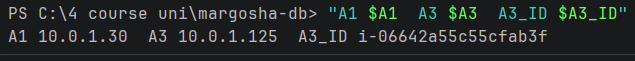

shard-a-1 is `10.0.1.30`, shard-a-3 is `10.0.1.125` with instance `i-06642a55c55cfab3f`.

**2. Check the starting point:** both alarms of shard-a-3 are `OK` with actions on, and the email subscription is
confirmed (not `PendingConfirmation`).

```bash
aws cloudwatch describe-alarms --alarm-names margosha-app-shard-a-3-down margosha-app-shard-a-3-lag --query "MetricAlarms[].[AlarmName,StateValue,ActionsEnabled,StateUpdatedTimestamp]" --output table
```

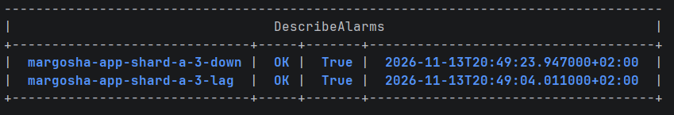

Windows (PowerShell):
```powershell
$TOPIC = aws cloudformation describe-stacks --stack-name margosha-app --query "Stacks[0].Outputs[?OutputKey=='AlertsTopicArn'].OutputValue" --output text
aws sns list-subscriptions-by-topic --topic-arn $TOPIC --query "Subscriptions[].[Protocol,SubscriptionArn]" --output table
```

macOS (Terminal):
```bash
TOPIC=$(aws cloudformation describe-stacks --stack-name margosha-app --query "Stacks[0].Outputs[?OutputKey=='AlertsTopicArn'].OutputValue" --output text)
aws sns list-subscriptions-by-topic --topic-arn "$TOPIC" --query "Subscriptions[].[Protocol,SubscriptionArn]" --output table
```

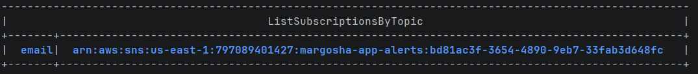

Both alarms were `OK` with actions enabled, unchanged since they were created on 2026-11-13. The email subscription
has a full ARN, so it is confirmed.

**3. Stop shard-a-3 and keep writing for 5 minutes.** The stop is sent without waiting, so the writes start at once.
One write a second goes to the `checks` table, and every 30 writes a line shows the time and how many failed. With
one follower down a write still has the leader and the other follower, so none should fail.

Windows (PowerShell):
```powershell
aws ec2 stop-instances --instance-ids $A3_ID --query "StoppingInstances[0].CurrentState.Name" --output text
"stop sent at $(Utc)"
$RUN = Get-Date -Format HHmmss
$end = (Get-Date).AddMinutes(5)
$i = 0
$failed = 0
while ((Get-Date) -lt $end) {
  $i++
  try { Invoke-RestMethod -Method Post -Uri "$API/tables/checks/records" -ContentType 'application/json' -Body ('{"id":"' + "$RUN-$i" + '","note":"check 7.2"}') | Out-Null } catch { $failed++ }
  if ($i % 30 -eq 0) { "$(Utc) $i writes, $failed failed" }
  Start-Sleep 1
}
"writes ended at $(Utc): $i writes, $failed failed"
```

macOS (Terminal):
```bash
aws ec2 stop-instances --instance-ids "$A3_ID" --query "StoppingInstances[0].CurrentState.Name" --output text
echo "stop sent at $(utc)"
RUN=$(date +%H%M%S)
END=$(( $(date +%s) + 300 ))
i=0
failed=0
while [ "$(date +%s)" -lt "$END" ]; do
  i=$((i+1))
  code=$(curl -s -o /dev/null -w '%{http_code}' -X POST "$API/tables/checks/records" -H 'Content-Type: application/json' -d "{\"id\":\"$RUN-$i\",\"note\":\"check 7.2\"}")
  [ "$code" = 201 ] || failed=$((failed+1))
  [ $((i % 30)) -eq 0 ] && echo "$(utc) $i writes, $failed failed"
  sleep 1
done
echo "writes ended at $(utc): $i writes, $failed failed"
```

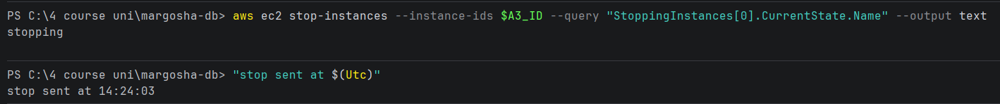

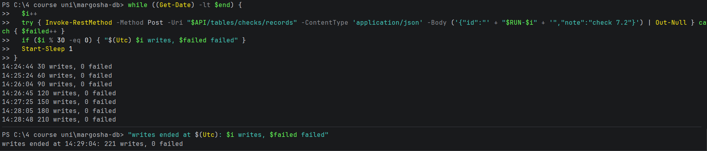

The stop was sent at **14:24:03**. The writes ran until **14:29:04**: **221 writes, 0 failed**.

**4. Look at the alarms while shard-a-3 is down** (CloudWatch console, **Alarms → All alarms**):

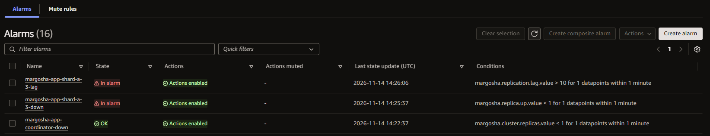

The node-down alarm went to `In alarm` at **14:25:37**, 1 min 34 s after the stop. Its reason: the value of the
14:24 minute was 0. The lag alarm went to `In alarm` at **14:26:06**, 2 min 3 s after the stop. Its reason: the lag of
the 14:25 minute was 67.5 s, above the 10 s limit. The coordinator's own alarm stayed `OK`.

Both `ALARM` emails arrived at the same minutes:

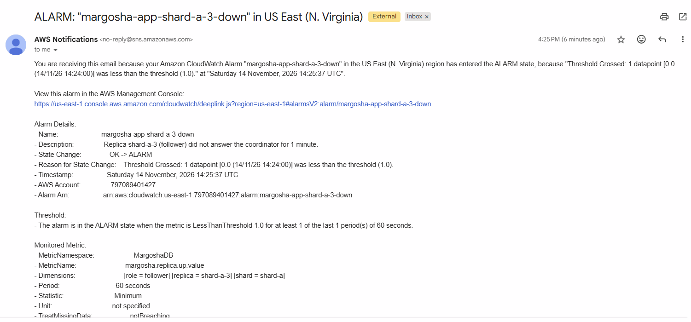

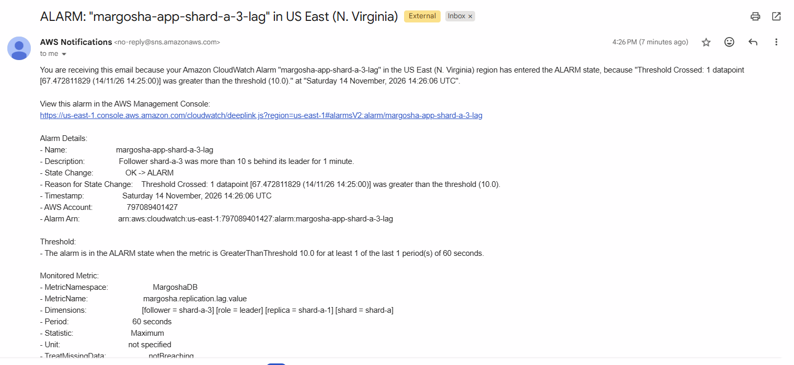

**5. Start shard-a-3 again** and wait until both alarms are `OK`. The loop asks every 30 seconds.

Windows (PowerShell):
```powershell
aws ec2 start-instances --instance-ids $A3_ID --query "StartingInstances[0].CurrentState.Name" --output text
aws ec2 wait instance-running --instance-ids $A3_ID
"running at $(Utc)"
do {
  Start-Sleep 30
  $s = aws cloudwatch describe-alarms --alarm-names margosha-app-shard-a-3-down margosha-app-shard-a-3-lag --query "MetricAlarms[].StateValue" --output text
  "$(Utc) down, lag: $s"
} while ($s -match 'ALARM')
```

macOS (Terminal):
```bash
aws ec2 start-instances --instance-ids "$A3_ID" --query "StartingInstances[0].CurrentState.Name" --output text
aws ec2 wait instance-running --instance-ids "$A3_ID"
echo "running at $(utc)"
while true; do
  sleep 30
  s=$(aws cloudwatch describe-alarms --alarm-names margosha-app-shard-a-3-down margosha-app-shard-a-3-lag --query "MetricAlarms[].StateValue" --output text)
  echo "$(utc) down, lag: $s"
  echo "$s" | grep -q ALARM || break
done
```

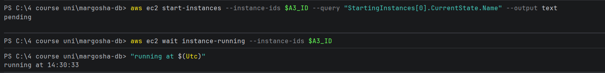

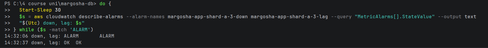

The instance was `running` at **14:30:33**. At 14:32:06 both alarms were still `ALARM`, and at 14:32:37 both were
`OK`. No one touched the alarms: they went back by themselves.

**6. Show that shard-a-3 caught up:** the follower's `lastVersion` equals the leader's, and the leader shows the same
position for both followers.

Windows (PowerShell):
```powershell
Status $A3
Status $A1
```

macOS (Terminal):
```bash
status "$A3"
status "$A1"
```

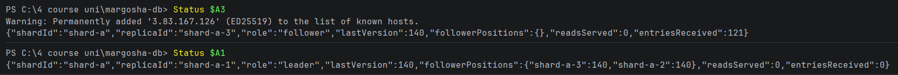

shard-a-3 is at version 140, the same as the leader. It received 121 entries after it came back: these are the 121 of
the 221 writes that the ring sent to shard A. The other 100 went to shard B.

**7. Show the alarms' history** with the exact times of each change:

```bash
aws cloudwatch describe-alarm-history --alarm-name margosha-app-shard-a-3-down --history-item-type StateUpdate --max-records 4 --query "AlarmHistoryItems[].[Timestamp,HistorySummary]" --output table
```

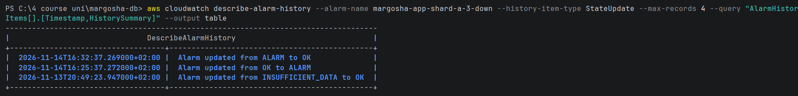

```bash
aws cloudwatch describe-alarm-history --alarm-name margosha-app-shard-a-3-lag --history-item-type StateUpdate --max-records 4 --query "AlarmHistoryItems[].[Timestamp,HistorySummary]" --output table
```

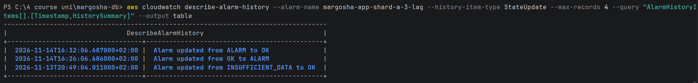

The CLI prints the times in local time (UTC+2). In UTC: node-down `OK → ALARM` at 14:25:37 and `ALARM → OK` at
14:32:37, lag `OK → ALARM` at 14:26:06 and `ALARM → OK` at 14:32:06.

The same in the console (each alarm's **Graph** and **History** tabs). The graphs show the whole drop and recovery.
In the history, each state change is followed by a successful SNS action, so each one sent an email:

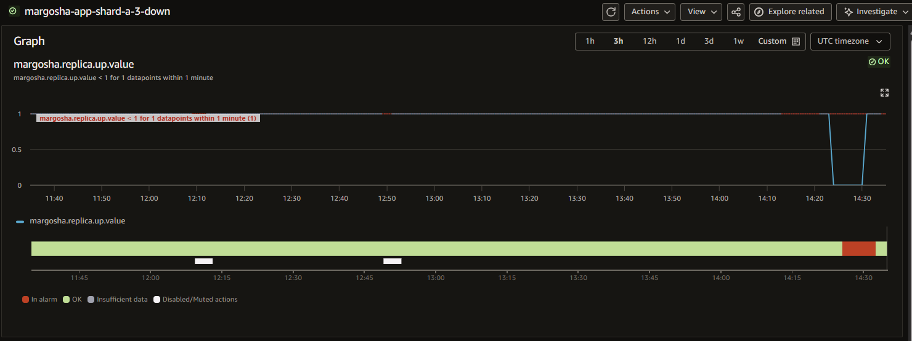

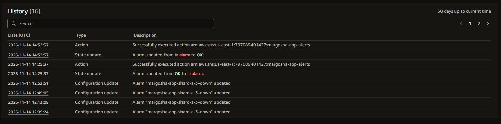

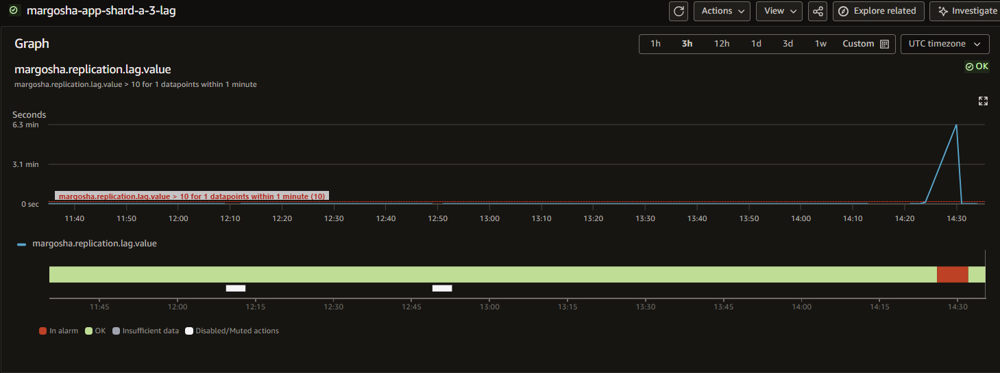

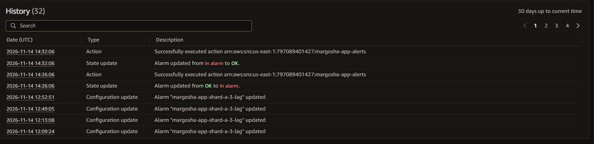

The `OK` emails arrived at the same minutes:

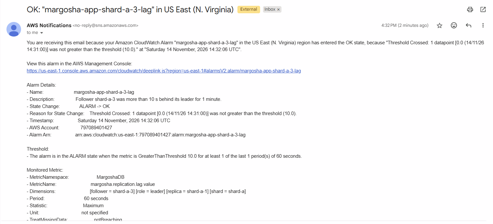

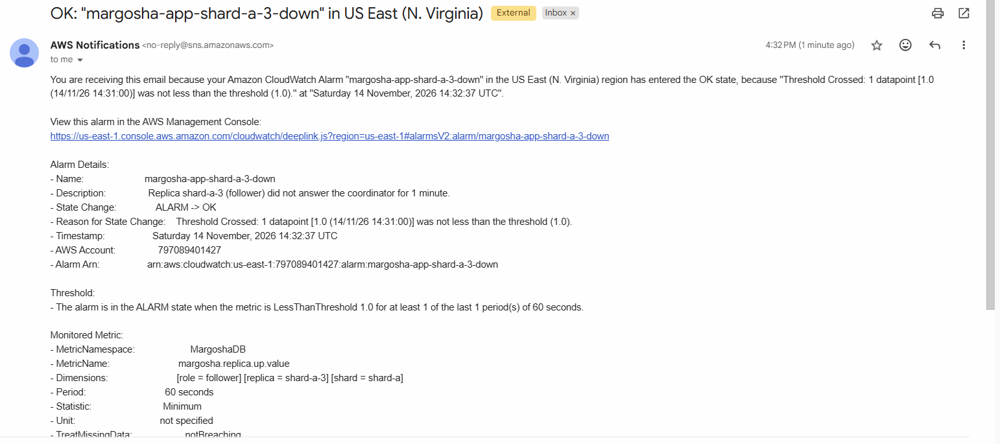

**8. The dashboard** (stack output `DashboardUrl`, time range 1 hour):

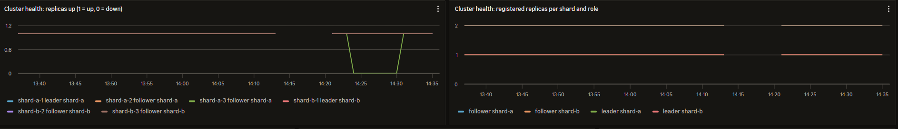

shard-a-3 (green) is 0 from 14:24 to 14:30, all other replicas stay 1. The registered replicas stay at 1 leader and 2
followers per shard, because a stopped replica stays registered with the coordinator. The gap from 14:13 to 14:21 is
before this check: the coordinator sent no metrics then (its alarm went back to `OK` at 14:22:37).

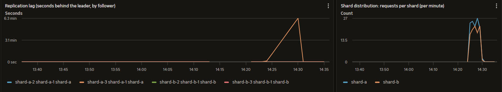

The lag of shard-a-3 grows in a straight line from 14:24 to about 6.3 minutes at 14:30, which is the time since the
first write it missed. Then it drops to 0 at 14:31, once it caught up. The other 3 followers stay at 0. Both shards
got requests the whole time.

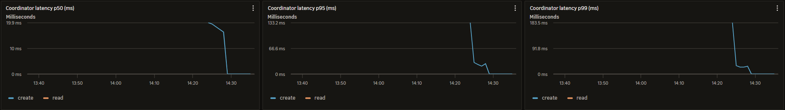

The coordinator's create p99 was 183 ms in the first minute (14:24) and about 20 ms after that. The first minute had
the first requests of the session and the stop of shard-a-3. One minute is not enough for the latency alarm, which
needs 5 minutes in a row, so it stayed `OK`.

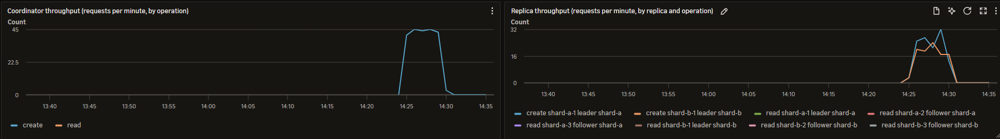

The coordinator handled about 44 creates a minute. The replicas' lines show creates on both leaders and no reads,
because the check only wrote.

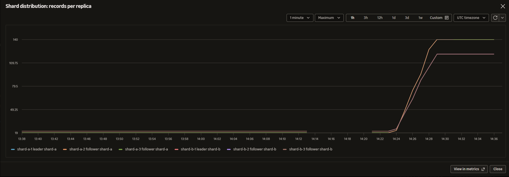

shard-a-2 grows from 19 to 140 records. shard-a-3 has no line while it is stopped and shows 140 again after it caught
up. The replicas of shard B grow from 21 to 121.

## Timeline

| Time (UTC) | What happened |
|---|---|
| 14:24:03 | stop of shard-a-3 sent, writes start |
| 14:25:37 | node-down alarm `ALARM`, email sent (1 min 34 s after the stop) |
| 14:26:06 | lag alarm `ALARM`, email sent (2 min 3 s after the stop), lag 67.5 s |
| 14:29:04 | writes end: 221 writes, 0 failed |
| 14:30:33 | shard-a-3 `running` again |
| 14:32:06 | lag alarm `OK`, email sent (1 min 33 s after the start) |
| 14:32:37 | node-down alarm `OK`, email sent (2 min 4 s after the start) |

## Result

- **The dashboard shows the follower down and its lag growing:** shard-a-3's `up` line drops to 0, and its lag grows
  to about 6.3 minutes while it is stopped.
- **Both alarms fire and notify:** node-down after 1 min 34 s, lag after 2 min 3 s, each with an `ALARM` email. This
  is within the 1–3 minutes expected from [ADR 0013](../../adr/0013-monitoring-stack.md) and
  [ADR 0014](../../adr/0014-slo-values.md).
- **Both alarms resolve by themselves:** about 2 minutes after the instance was running, both went back to `OK`, each
  with an `OK` email. Nothing was changed by hand.
- **The coordinator's alarm stayed `OK`.** The latency alarms need 5 slow minutes in a row, so the one slow minute
  at 14:24 could not fire them.
- **The store kept working:** all 221 writes succeeded, and shard-a-3 received the 121 entries it missed and reached
  the leader's version 140.
