# Fresh deploy from the pipeline

**What is checked:** the account has only the network stack `margosha-vpc`. The pipeline alone creates the whole M4
store: the bucket, the 7 nodes, the dashboard, the 16 alarms and their email topic, and the agent key in SSM. All 7
nodes start, every replica registers, metrics arrive from all 7 nodes, and the store works. The only manual steps are
the ones [ADR 0013](../../adr/0013-monitoring-stack.md) names: confirming the alarm email once from the inbox, and
opening the API to your IP.

Checked on 2026-11-15. All times are UTC.

The same check for M3 is in [fresh-deploy.md](../../m3/end_to_end/fresh-deploy.md). M4 adds the monitoring and the
agent key, which have to be created from nothing too.

## What should happen

- **The bucket doesn't exist at first,** so the pipeline uploads the jars right after it creates the stack. The 7 new
  nodes get the jar on their first boot and are not rebooted.
- **The stack creates the monitoring:** the dashboard `margosha-app`, 16 alarms and the email topic
  `margosha-app-alerts`. AWS sends a new confirmation email for the topic, because the old subscription was deleted with
  the old stack.
- **The pipeline saves the agent key** from the `MARGOSHA_AGENT_KEY` secret in SSM, and the coordinator reads it when
  it starts.
- **A new stack has the API closed** (`OperatorCidr` empty), so it has to be opened to your IP once.

## 1. Remove everything except `margosha-vpc`

**This deletes the 7 nodes and all their data, the alarms, the dashboard, and the jars of all earlier versions.** It
can't be undone.

**Set the region and get the bucket's name** (it is fixed: `margosha-artifacts-<account-id>`):

Windows (PowerShell):
```powershell
aws configure set region us-east-1
$env:PYTHONUTF8 = '1'; [Console]::OutputEncoding = [Text.Encoding]::UTF8
$BUCKET = "margosha-artifacts-$(aws sts get-caller-identity --query Account --output text)"
$BUCKET
```

macOS (Terminal):
```bash
aws configure set region us-east-1
BUCKET="margosha-artifacts-$(aws sts get-caller-identity --query Account --output text)"
echo "$BUCKET"
```

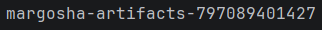

**Empty the bucket, delete the stack, and wait until it is gone.** CloudFormation can't delete a bucket that still
has files:

```bash
aws s3 rm "s3://$BUCKET" --recursive
```

```bash
aws cloudformation delete-stack --stack-name margosha-app
```

```bash
aws cloudformation wait stack-delete-complete --stack-name margosha-app
```

**Delete the agent key in SSM.** It isn't part of the stack, so it would stay. Deleting it shows that the pipeline
creates it again. The key itself stays in the GitHub secret:

```bash
aws ssm delete-parameter --name /margosha/agent-key
```

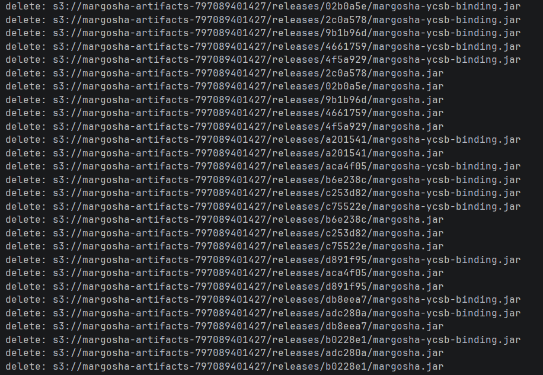

Emptying the bucket deleted the jars of every earlier version, from `a201541` (M3's fresh deploy) to `b0228e1`.

**Check that nothing is left** except `margosha-vpc`: no app stack, no node, no alarm, no dashboard, no agent key.

```bash
aws cloudformation describe-stacks --query "Stacks[?starts_with(StackName,'margosha')].[StackName,StackStatus]" --output table
```

```bash
aws ec2 describe-instances --filters "Name=tag:Name,Values=margosha-*" "Name=instance-state-name,Values=pending,running,stopping,stopped" --query "Reservations[].Instances[].Tags[?Key=='Name']|[].Value" --output text
```

```bash
aws cloudwatch describe-alarms --alarm-name-prefix margosha-app- --query "length(MetricAlarms)"
```

```bash
aws cloudwatch list-dashboards --dashboard-name-prefix margosha --query "DashboardEntries[].DashboardName" --output text
```

```bash
aws ssm describe-parameters --parameter-filters "Key=Name,Values=/margosha/agent-key" --query "length(Parameters)"
```

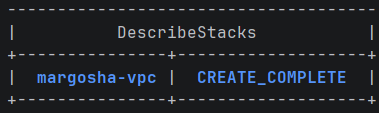

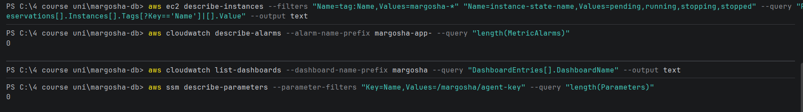

Only `margosha-vpc` was left. There was no node, the alarm count and the agent key count were `0`, and the dashboard
list was empty.

## 2. Deploy with the pipeline only

Start the pipeline on `main` with no code change (**Actions → pipeline → Run workflow**, version left empty), and
follow it:

```bash
gh workflow run pipeline.yml --ref main
```

```bash
gh run watch
```

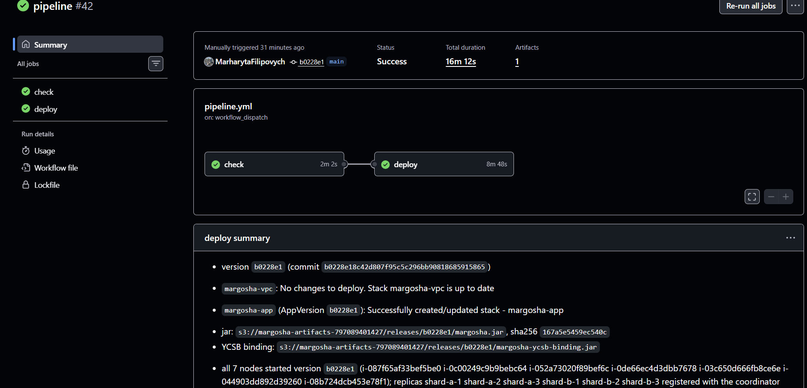

Pipeline run **#42** (started by hand, commit `b0228e1` on `main`) succeeded: `check` took 2 min 2 s and `deploy`
8 min 48 s. Its Summary shows:

- `margosha-vpc`: no changes.
- `margosha-app` (AppVersion `b0228e1`): "Successfully created/updated stack", this time a create.
- The jars were uploaded to the new bucket, under `releases/b0228e1/`.
- All 7 nodes started version `b0228e1`, and all 6 replicas registered with the coordinator.

## 3. Open the API and load the new nodes

All instance IDs and IPs are new. **Run the setup** from [first_m4_deploy.md](first_m4_deploy.md#0-setup) again.

**Open the API to your IP.** Run this from the repository root, on an up-to-date `main`. It changes only the
`OperatorCidr` parameter (two security group rules), and replaces nothing:

Windows (PowerShell):
```powershell
$MY_IP = (Invoke-RestMethod https://checkip.amazonaws.com).Trim()
aws cloudformation deploy --stack-name margosha-app --template-file cfn/margosha-app.yaml --parameter-overrides "OperatorCidr=$MY_IP/32" --no-fail-on-empty-changeset
```

macOS (Terminal):
```bash
MY_IP=$(curl -s https://checkip.amazonaws.com)
aws cloudformation deploy --stack-name margosha-app --template-file cfn/margosha-app.yaml --parameter-overrides "OperatorCidr=$MY_IP/32" --no-fail-on-empty-changeset
```

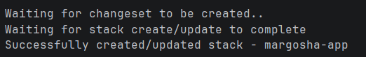

The stack was updated, and the API answered from the laptop afterwards (step 6).

## 4. All 6 replicas registered, and the coordinator has the agent key

Windows (PowerShell):
```powershell
aws ec2 get-console-output --instance-id $COORD --latest --output text | Select-String "(Registered|Updated) replica|Agent requests|agent key"
```

macOS (Terminal):
```bash
aws ec2 get-console-output --instance-id "$COORD" --latest --output text | grep -E "(Registered|Updated) replica|Agent requests|agent key"
```

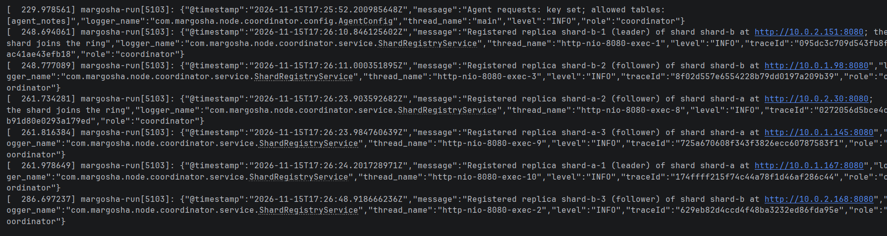

At **17:25:52** the coordinator logged `Agent requests: key set; allowed tables: [agent_notes]`, so it found the key
that the pipeline had just saved. The 6 replicas registered by themselves:

| Time | Replica | Role |
|---|---|---|
| 17:26:10 | shard-b-1 | leader (shard B joins the ring) |
| 17:26:11 | shard-b-2 | follower |
| 17:26:23 | shard-a-2 | follower (shard A joins the ring) |
| 17:26:23 | shard-a-3 | follower |
| 17:26:24 | shard-a-1 | leader |
| 17:26:48 | shard-b-3 | follower |

## 5. The monitoring exists

**The 16 alarms:**

```bash
aws cloudwatch describe-alarms --alarm-name-prefix margosha-app- --query "MetricAlarms[].[AlarmName,StateValue,ActionsEnabled]" --output table
```

**The dashboard:**

```bash
aws cloudwatch list-dashboards --dashboard-name-prefix margosha --query "DashboardEntries[].DashboardName" --output text
```

**The email subscription:**

Windows (PowerShell):
```powershell
$TOPIC = aws cloudformation describe-stacks --stack-name margosha-app --query "Stacks[0].Outputs[?OutputKey=='AlertsTopicArn'].OutputValue" --output text
aws sns list-subscriptions-by-topic --topic-arn $TOPIC --query "Subscriptions[].[Protocol,SubscriptionArn]" --output table
```

macOS (Terminal):
```bash
TOPIC=$(aws cloudformation describe-stacks --stack-name margosha-app --query "Stacks[0].Outputs[?OutputKey=='AlertsTopicArn'].OutputValue" --output text)
aws sns list-subscriptions-by-topic --topic-arn "$TOPIC" --query "Subscriptions[].[Protocol,SubscriptionArn]" --output table
```

Then open the email "AWS Notification - Subscription Confirmation", click **Confirm subscription**, and run the
command again. This is the manual step from [ADR 0013](../../adr/0013-monitoring-stack.md).

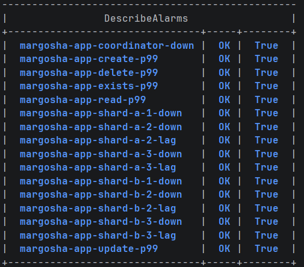

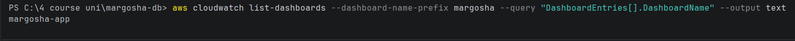

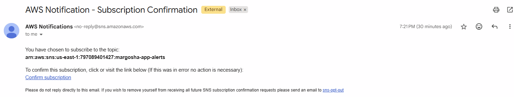

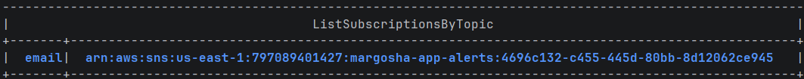

All 16 alarms exist, all `OK` with their actions on. The dashboard `margosha-app` exists. The confirmation email came
at 17:21, when the stack created the topic. After **Confirm subscription** was clicked, the subscription has a full
ARN.

## 6. The store works and replicates

Create a table, write 20 records and read them back, then read one missing record (it gives a `RECORD_NOT_FOUND`
error for the error panels):

Windows (PowerShell):
```powershell
try { Invoke-RestMethod -Method Post -Uri "$API/tables" -ContentType 'application/json' -Body '{"name":"checks","partitionKey":"id"}' } catch { $_.ErrorDetails.Message }
$ok = 0
1..20 | ForEach-Object {
  Invoke-RestMethod -Method Post -Uri "$API/tables/checks/records" -ContentType 'application/json' -Body ('{"id":"fresh-' + $_ + '","note":"fresh deploy"}') | Out-Null
  if ((Invoke-RestMethod -Uri "$API/tables/checks/records/fresh-$_").note -eq 'fresh deploy') { $ok++ }
}
"$ok of 20 records written and read back"
curl.exe -s "$API/tables/checks/records/missing"; ""
```

macOS (Terminal):
```bash
curl -s -X POST "$API/tables" -H 'Content-Type: application/json' -d '{"name":"checks","partitionKey":"id"}'; echo
ok=0
for i in $(seq 1 20); do
  curl -s -o /dev/null -X POST "$API/tables/checks/records" -H 'Content-Type: application/json' -d "{\"id\":\"fresh-$i\",\"note\":\"fresh deploy\"}"
  curl -s "$API/tables/checks/records/fresh-$i" | grep -q '"fresh deploy"' && ok=$((ok+1))
done
echo "$ok of 20 records written and read back"
curl -s "$API/tables/checks/records/missing"; echo
```

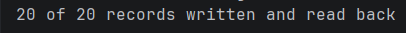

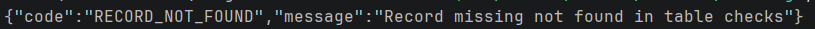

All 20 records were written and read back with the right text, and the missing record answered `RECORD_NOT_FOUND`.

## 7. Metrics from all 7 nodes, and the dashboard

Wait about 2 minutes: the coordinator sends metrics once a minute. Then list the coordinator's metrics, and the
replicas whose metrics it sends on:

Windows (PowerShell):
```powershell
aws cloudwatch list-metrics --namespace MargoshaDB --dimensions Name=role,Value=coordinator --recently-active PT3H --query "Metrics[].MetricName" --output text | ForEach-Object { $_ -split "\s+" } | Sort-Object -Unique
```

macOS (Terminal):
```bash
aws cloudwatch list-metrics --namespace MargoshaDB --dimensions Name=role,Value=coordinator --recently-active PT3H --query "Metrics[].MetricName" --output text | tr '\t' '\n' | sort -u
```

```bash
aws cloudwatch list-metrics --namespace MargoshaDB --metric-name margosha.replica.records.value --recently-active PT3H --query "Metrics[].Dimensions[?Name=='replica'].Value[]" --output text
```

The metrics of earlier stacks also count as "recently active" for 3 hours, so look at the dashboard too. Open it
from the stack output `DashboardUrl`:

```bash
aws cloudformation describe-stacks --stack-name margosha-app --query "Stacks[0].Outputs[?OutputKey=='DashboardUrl'].OutputValue" --output text
```

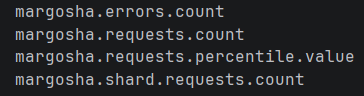

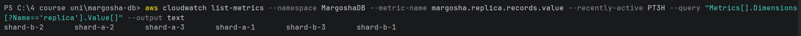

CloudWatch has the coordinator's 4 metrics and the records of all 6 replicas. The dashboard (time range 30 minutes)
shows that they come from the new nodes:

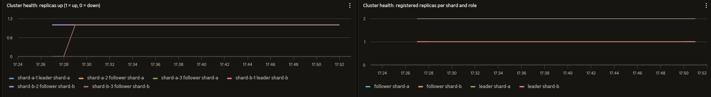

All 6 replicas are up from about 17:27. shard-b-3, which registered last (17:26:48), is 0 for the first minute and 1
after that. Every shard has 1 leader and 2 followers registered.

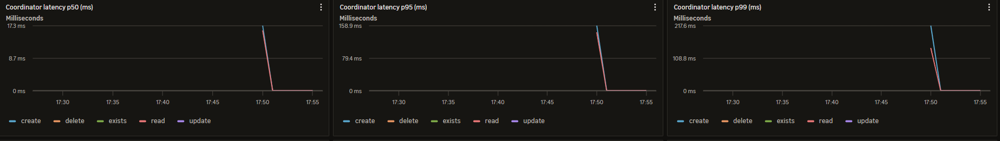

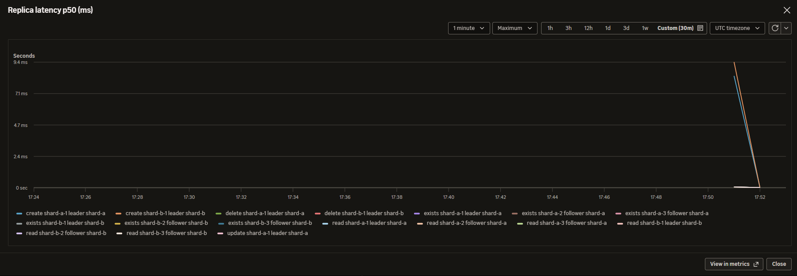

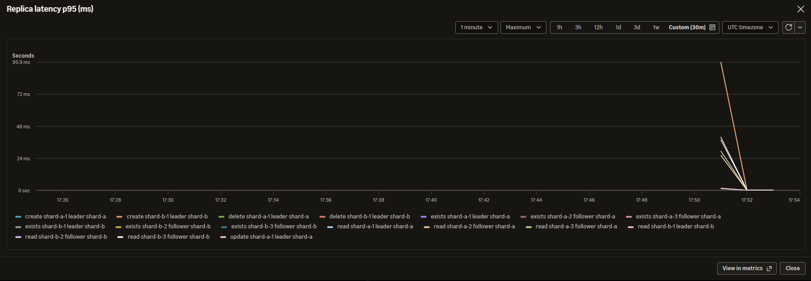

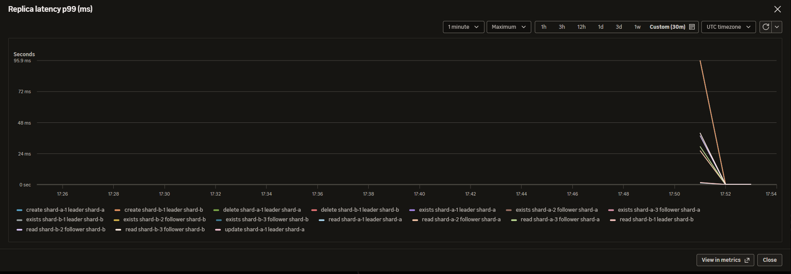

The latency panels show the requests of step 6, at 17:50–17:51, on the coordinator and on the replicas.

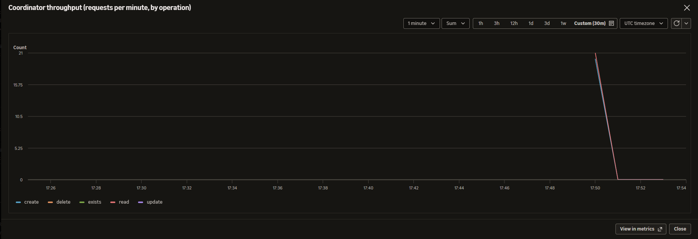

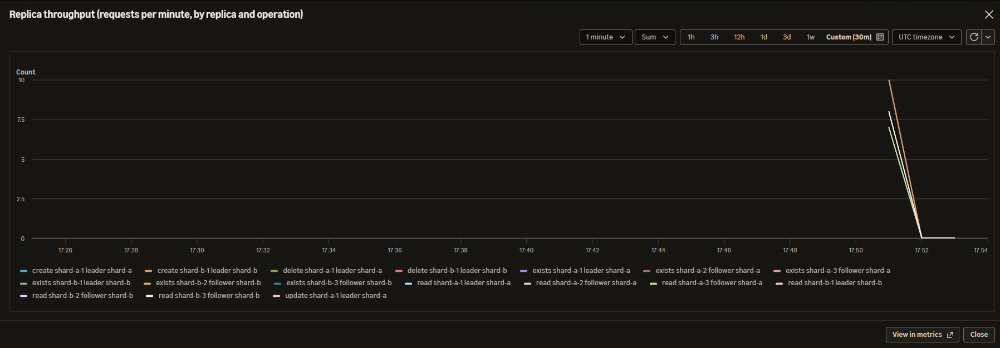

The coordinator handled about 20 creates and 21 reads in that minute.

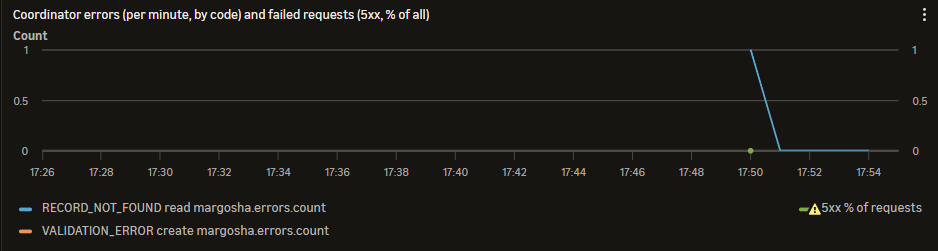

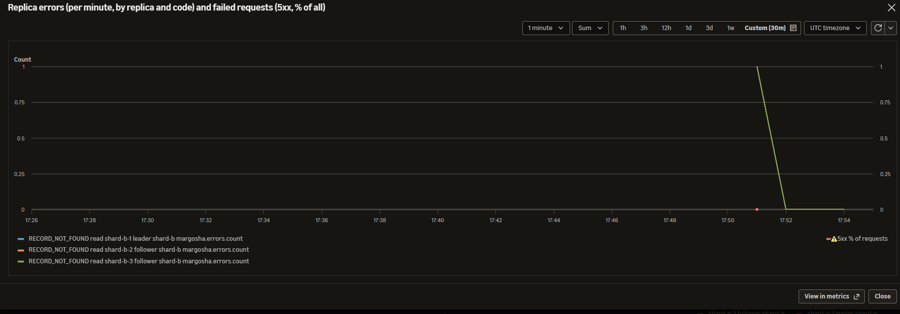

The one `RECORD_NOT_FOUND` is the missing record. On the replicas it shows on shard B, which holds the key `missing`.
No request failed with a 5xx.

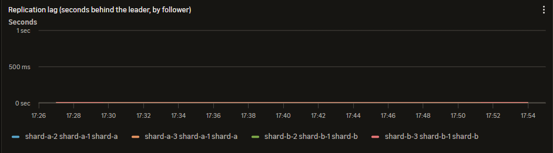

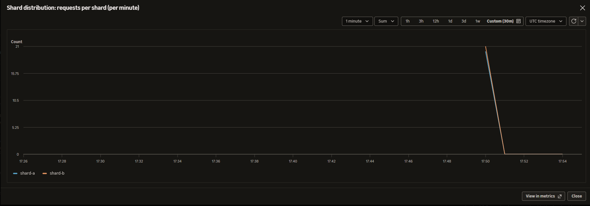

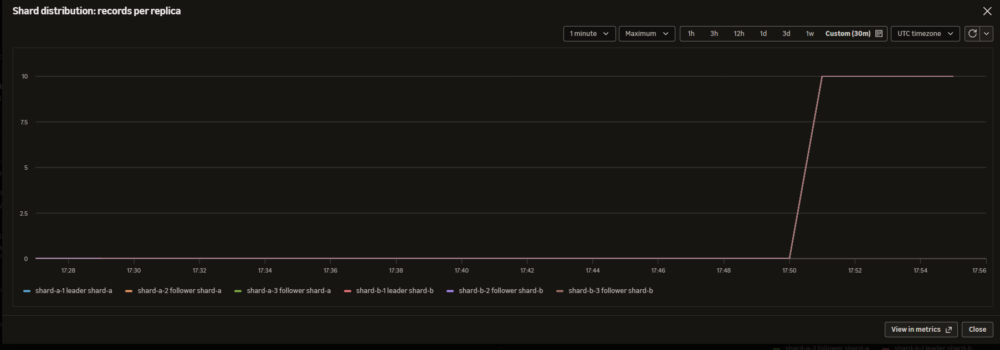

The lag of all 4 followers stays at 0. Both shards got about 20 requests. Every replica holds 10 records: the 20
records were split 10 and 10 between the shards, and every follower has all of its leader's records.

## Result

- **Only `margosha-vpc` existed before the deploy:** no app stack, no node, no alarm, no dashboard and no agent key.
- **The pipeline alone created the store:** run #42 created `margosha-app` and its bucket, uploaded the jars after the
  stack existed, and started all 7 nodes on version `b0228e1`.
- **Every replica registered by itself,** within 40 seconds (17:26:10–17:26:48).
- **The agent key was created again:** the pipeline saved it in SSM, and the coordinator found it when it started.
- **The monitoring was created from nothing:** 16 alarms (all `OK`), the dashboard, and the email topic. The
  dashboard shows data from all 7 nodes.
- **The store works and replicates:** 20 of 20 records written and read back, 10 on each shard, and every follower
  has all of its leader's records.
- **Two manual steps:** confirming the alarm email, which
  [ADR 0013](../../adr/0013-monitoring-stack.md) documents, and opening the API to the operator's IP, which a new
  stack keeps closed. Both are a click in the email and one CLI command, nothing in the AWS console.
