# High latency

**What is checked:** the coordinator's p99 for reads stays above the alarm's threshold for 5 minutes. The high-latency
alarm fires and sends an email. When the reads stop, it goes back to `OK` by itself and sends an email again.

Checked on 2026-11-14. All times are UTC.

Uses the setup from [first_m4_deploy.md](first_m4_deploy.md#0-setup).

## How the alarm is triggered

The alarm `margosha-app-read-p99` fires when the coordinator's p99 for reads is above **50 ms in each of 5 minutes in
a row** ([ADR 0014](../../adr/0014-slo-values.md)). In the M3 benchmark, reads had a p99 of about 15 ms at about 1,000
requests a second. Reaching 50 ms for 5 minutes on `t3.micro` would need much more load than that, and would use up
the nodes' CPU credits.

So, the check **lowers the threshold for the test**: from 50 ms to **1 ms**. A read through the
coordinator asks 2 replicas over the network, so its p99 is always above 1 ms. Everything else stays the same: the
metric, the 5 minutes, the email. Then a client reads one record without a pause, so every minute has a p99 value.
After the check, the alarm gets back exactly the definition from `cfn/margosha-app.yaml`, and CloudFormation's drift
check confirms it.

The coordinator works out p99 over the last minute ([metrics.md](../metrics.md)). When the reads stop, the next value
has no slow reads, so the alarm should go back to `OK` within 1–2 minutes.

## First try: the alarm could not fire

On the first try (18:54–19:10), the alarm stayed `OK` for over 10 minutes of reads, with the threshold at 1 ms. The
coordinator counted about 230–410 reads a minute, but its read p50 and p99 reached CloudWatch as **0**, and some
minutes had no value at all. So the alarm could not fire, at 1 ms or at the real 50 ms.

The coordinator's log (`sudo journalctl -u margosha` over SSH) showed why, at 18:55:28 and again at 19:08:28:

```
Failed to apply the value function for the gauge 'margosha.requests.percentile' ...
java.lang.ArrayIndexOutOfBoundsException: value outside of histogram covered range
	at org.HdrHistogram.DoubleRecorder.getIntervalHistogramInto(DoubleRecorder.java:176)
	at io.micrometer.core.instrument.distribution.TimeWindowPercentileHistogram.accumulate(...)
```

**Cause:** Micrometer works out the percentiles with the HdrHistogram library and needs version 2.2.2. But the jar
contained the old **2.1.4**: YCSB's `core`, a test dependency of the `node` module, asks for 2.1.4, and Maven took it
because it is closer in the dependency tree. The old version fails when it copies a minute's values that range from
microseconds to seconds. The failed copy left the percentiles at 0, or without a value.

**Fix:** `app/node/pom.xml` now sets HdrHistogram to 2.2.2, so the jar contains 2.2.2. The test
`RequestMetricsTest.readPercentilesAreKeptForDurationsFromMicrosecondsToSeconds` records read times from 1 µs to 2.5 s
and checks that p99 is still there. It fails with 2.1.4, with the same error as on AWS, and passes with 2.2.2.

The check below was run again after the pipeline deployed the fix.

## Commands

**1. Add the helpers, write one record to read, and show the alarm as it is now.** A 409 for the table means it
already exists, which is fine.

Windows (PowerShell):
```powershell
function Utc { (Get-Date).ToUniversalTime().ToString('HH:mm:ss') }
$TOPIC = aws cloudformation describe-stacks --stack-name margosha-app --query "Stacks[0].Outputs[?OutputKey=='AlertsTopicArn'].OutputValue" --output text
try { Invoke-RestMethod -Method Post -Uri "$API/tables" -ContentType 'application/json' -Body '{"name":"checks","partitionKey":"id"}' } catch { $_.ErrorDetails.Message }
$ID = "latency-" + (Get-Date -Format HHmmss)
Invoke-RestMethod -Method Post -Uri "$API/tables/checks/records" -ContentType 'application/json' -Body ('{"id":"' + $ID + '","note":"check high latency"}')
```

macOS (Terminal):
```bash
utc() { date -u +%H:%M:%S; }
TOPIC=$(aws cloudformation describe-stacks --stack-name margosha-app --query "Stacks[0].Outputs[?OutputKey=='AlertsTopicArn'].OutputValue" --output text)
curl -s -X POST "$API/tables" -H 'Content-Type: application/json' -d '{"name":"checks","partitionKey":"id"}'; echo
ID="latency-$(date +%H%M%S)"
curl -s -X POST "$API/tables/checks/records" -H 'Content-Type: application/json' -d "{\"id\":\"$ID\",\"note\":\"check high latency\"}"; echo
```

```bash
aws cloudwatch describe-alarms --alarm-names margosha-app-read-p99 --query "MetricAlarms[0].[StateValue,Threshold,EvaluationPeriods,DatapointsToAlarm,AlarmDescription]" --output table
```

**2. Lower the threshold to 1 ms.** Only the threshold and the description change. Same command on both systems:

```bash
aws cloudwatch put-metric-alarm --alarm-name margosha-app-read-p99 --alarm-description "TEST for high latency: threshold lowered to 1 ms" --namespace MargoshaDB --metric-name margosha.requests.percentile.value --dimensions Name=operation,Value=read Name=phi,Value=0.99 Name=role,Value=coordinator --statistic Maximum --period 60 --evaluation-periods 5 --datapoints-to-alarm 5 --threshold 1 --comparison-operator GreaterThanThreshold --treat-missing-data notBreaching --alarm-actions "$TOPIC" --ok-actions "$TOPIC"
```

```bash
aws cloudwatch describe-alarms --alarm-names margosha-app-read-p99 --query "MetricAlarms[0].[StateValue,Threshold,EvaluationPeriods,DatapointsToAlarm,AlarmDescription]" --output table
```

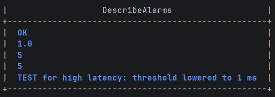

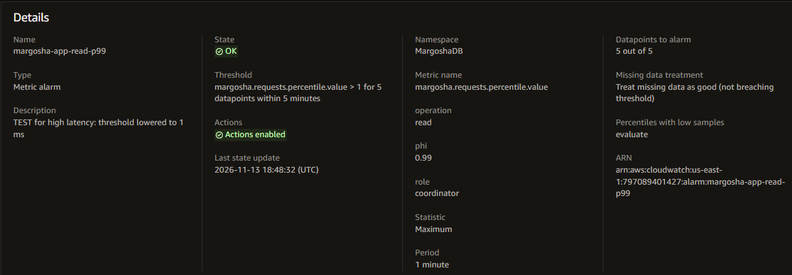

The alarm is `OK`, with `> 1 for 5 datapoints within 5 minutes` and the test description.

This step was run for the first try (18:53:37) and again before the run after the fix. Repeating it was not needed:
the deploy of the fix changed only the jar, and CloudFormation updates only the resources whose definition in the
template changed, so the alarm kept the 1 ms. The pipeline only muted and unmuted the alarm emails during the deploy.

**3. Read the record without a pause until the alarm fires.** Every 30 seconds a line shows the time, the number of
reads and the alarm's state. The loop stops at `ALARM`, or after 15 minutes at the latest.

Windows (PowerShell):
```powershell
$start = Get-Date
$last = Get-Date
$n = 0
$failed = 0
$s = ''
"reads start at $(Utc)"
while ($s -ne 'ALARM' -and ((Get-Date) - $start).TotalMinutes -lt 15) {
  try { Invoke-RestMethod -Uri "$API/tables/checks/records/$ID" | Out-Null } catch { $failed++ }
  $n++
  if (((Get-Date) - $last).TotalSeconds -ge 30) {
    $last = Get-Date
    $s = aws cloudwatch describe-alarms --alarm-names margosha-app-read-p99 --query "MetricAlarms[0].StateValue" --output text
    "$(Utc) $n reads, $failed failed, read-p99: $s"
  }
}
"reads stop at $(Utc): $n reads, $failed failed"
```

macOS (Terminal):
```bash
start=$(date +%s)
last=$start
n=0
failed=0
s=
echo "reads start at $(utc)"
while [ "$s" != ALARM ] && [ $(( $(date +%s) - start )) -lt 900 ]; do
  code=$(curl -s -o /dev/null -w '%{http_code}' "$API/tables/checks/records/$ID")
  [ "$code" = 200 ] || failed=$((failed+1))
  n=$((n+1))
  if [ $(( $(date +%s) - last )) -ge 30 ]; then
    last=$(date +%s)
    s=$(aws cloudwatch describe-alarms --alarm-names margosha-app-read-p99 --query "MetricAlarms[0].StateValue" --output text)
    echo "$(utc) $n reads, $failed failed, read-p99: $s"
  fi
done
echo "reads stop at $(utc): $n reads, $failed failed"
```

The alarm should be `ALARM` about 6–7 minutes after the reads start (5 minutes above the threshold, plus the time
the metrics need to reach CloudWatch). An `ALARM` email arrives at the same minute.

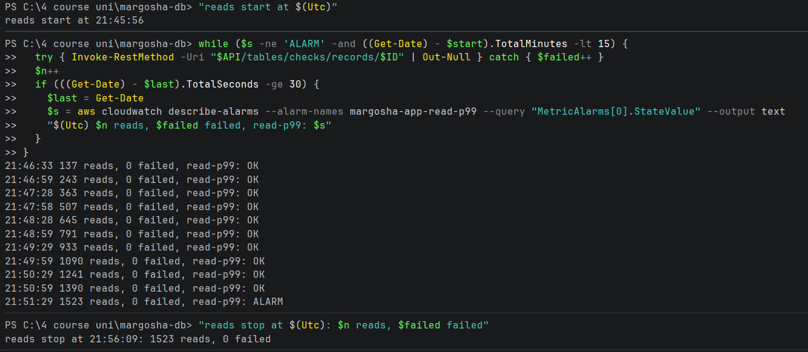

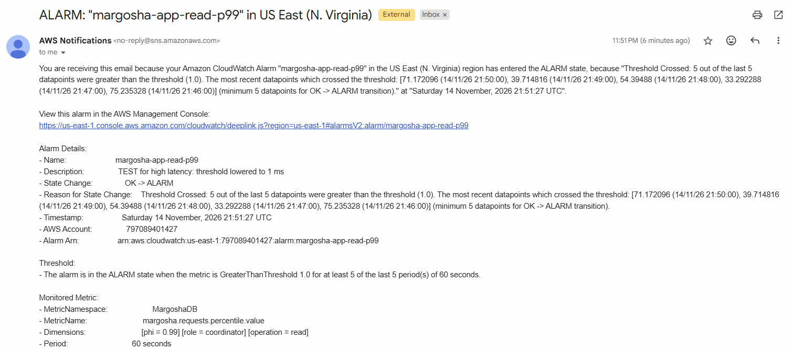

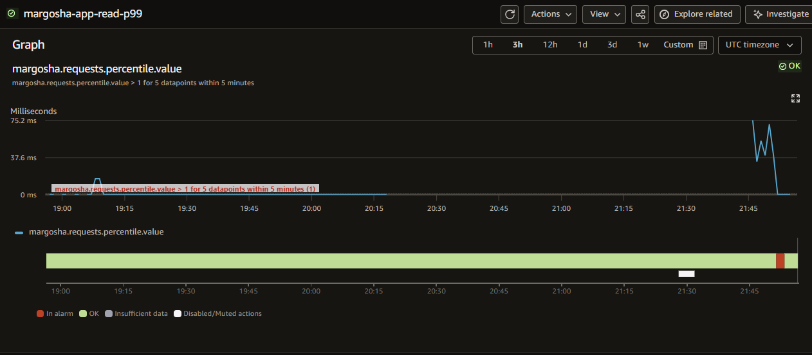

The reads started at **21:45:56**. The loop saw `ALARM` at 21:51:29 and stopped: 1,523 reads, none failed. (The line
"reads stop at 21:56:09" was printed later, when the next command was typed.) The alarm went to `ALARM` at
**21:51:27**, 5 min 31 s after the reads started. The email lists the 5 minutes it used, all above 1 ms:

| Minute (UTC) | Read p99 |
|---|---|
| 21:46 | 75.2 ms |
| 21:47 | 33.3 ms |
| 21:48 | 54.4 ms |
| 21:49 | 39.7 ms |
| 21:50 | 71.2 ms |

The graph shows these values, and before them the 0s of the first try (18:54–19:10). The short white bar at about
21:30 is the deploy of the fix, when the pipeline muted the alarm emails.

Three of these minutes were also above the real limit of 50 ms. The real alarm would not have fired, because it needs
all 5 minutes above 50 ms. But these reads came one at a time from a laptop, much less load than the M3 benchmark,
whose read p99 was about 15 ms. So the same minutes were looked at more closely (21:45–21:52):

- The coordinator's read p50 was 11–23 ms and its p95 21–31 ms. So a typical read took about 20 ms, not only a few
  slow ones. The p50 fell during the run, from 22.8 to 11.4 ms.
- The replicas of shard B, which hold the record, took 0.02–0.75 ms for their own part of a read (their latencies
  are sent in seconds: 0.000113664 s is 0.11 ms).
- Every instance had 189–192 CPU credits, so the nodes were not slowed down.

Almost all of a read's time is spent between the coordinator and the replicas: the calls over the network, or the
coordinator's handling around them.

**4. With the reads stopped, wait until the alarm is `OK`:**

Windows (PowerShell):
```powershell
do {
  Start-Sleep 30
  $s = aws cloudwatch describe-alarms --alarm-names margosha-app-read-p99 --query "MetricAlarms[0].StateValue" --output text
  "$(Utc) read-p99: $s"
} while ($s -ne 'OK')
```

macOS (Terminal):
```bash
while true; do
  sleep 30
  s=$(aws cloudwatch describe-alarms --alarm-names margosha-app-read-p99 --query "MetricAlarms[0].StateValue" --output text)
  echo "$(utc) read-p99: $s"
  [ "$s" = OK ] && break
done
```

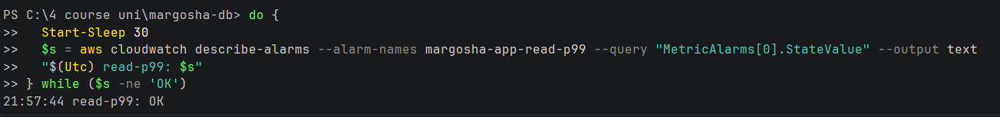

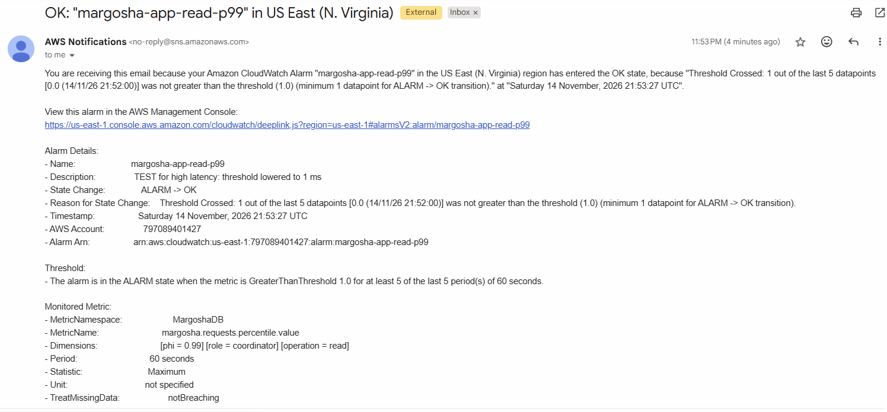

The alarm went back to `OK` at **21:53:27**, 2 minutes after the reads stopped, with an `OK` email. Its reason: the
minute 21:52 had no reads, so its p99 was 0, below the threshold. The wait loop, started later, saw `OK` at its first
try (21:57:44).

**5. Put the alarm back as the template defines it** (threshold 50 ms and the original description). Same command on
both systems:

```bash
aws cloudwatch put-metric-alarm --alarm-name margosha-app-read-p99 --alarm-description "The coordinator's p99 for READ stayed above 50 ms for 5 minutes." --namespace MargoshaDB --metric-name margosha.requests.percentile.value --dimensions Name=operation,Value=read Name=phi,Value=0.99 Name=role,Value=coordinator --statistic Maximum --period 60 --evaluation-periods 5 --datapoints-to-alarm 5 --threshold 50 --comparison-operator GreaterThanThreshold --treat-missing-data notBreaching --alarm-actions "$TOPIC" --ok-actions "$TOPIC"
```

```bash
aws cloudwatch describe-alarms --alarm-names margosha-app-read-p99 --query "MetricAlarms[0].[StateValue,Threshold,EvaluationPeriods,DatapointsToAlarm,AlarmDescription]" --output table
```

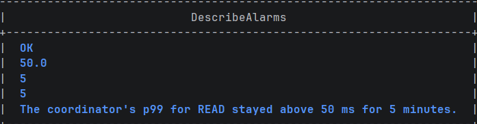

The alarm was put back at **21:59:02**: `OK`, 50 ms, 5 of 5, and the original description.

**6. Check that the alarm matches the template again** with CloudFormation's drift detection. 

Windows (PowerShell):
```powershell
$DRIFT = aws cloudformation detect-stack-drift --stack-name margosha-app --logical-resource-ids ReadLatencyAlarm --query StackDriftDetectionId --output text
Start-Sleep 15
aws cloudformation describe-stack-drift-detection-status --stack-drift-detection-id $DRIFT --query "[DetectionStatus,StackDriftStatus]" --output text
aws cloudformation describe-stack-resource-drifts --stack-name margosha-app --query "StackResourceDrifts[?LogicalResourceId=='ReadLatencyAlarm'].[LogicalResourceId,StackResourceDriftStatus]" --output table
```

macOS (Terminal):
```bash
DRIFT=$(aws cloudformation detect-stack-drift --stack-name margosha-app --logical-resource-ids ReadLatencyAlarm --query StackDriftDetectionId --output text)
sleep 15
aws cloudformation describe-stack-drift-detection-status --stack-drift-detection-id "$DRIFT" --query "[DetectionStatus,StackDriftStatus]" --output text
aws cloudformation describe-stack-resource-drifts --stack-name margosha-app --query "StackResourceDrifts[?LogicalResourceId=='ReadLatencyAlarm'].[LogicalResourceId,StackResourceDriftStatus]" --output table
```

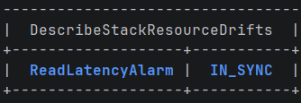

CloudFormation reports `ReadLatencyAlarm` as `IN_SYNC`: the alarm is again exactly as `cfn/margosha-app.yaml`
defines it.

**7. Show the alarm's history** with the exact times of each change:

```bash
aws cloudwatch describe-alarm-history --alarm-name margosha-app-read-p99 --max-records 10 --query "AlarmHistoryItems[].[Timestamp,HistoryItemType,HistorySummary]" --output table
```

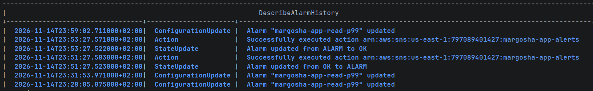

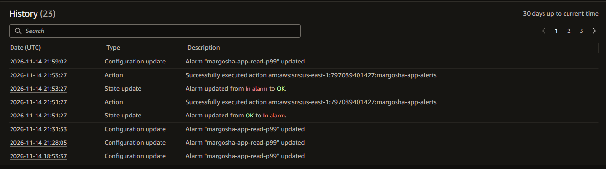

The CLI prints local time (UTC+2). In UTC, from the oldest: the threshold lowered at 18:53:37 (shown only in the
console), the pipeline muting and unmuting the alarm emails during the deploy of the fix at 21:28:05 and 21:31:53, `OK → ALARM` at 21:51:27 and
`ALARM → OK` at 21:53:27, each followed by a successful email, and the threshold back to 50 ms at 21:59:02.

## Timeline

| Time (UTC) | What happened |
|---|---|
| 18:53:37 | threshold lowered to 1 ms (first try) |
| 18:54–19:10 | first try: reads, but the read p99 reached CloudWatch as 0, so no alarm |
| 21:28–21:31 | deploy of the fix (HdrHistogram 2.2.2), alarm emails muted |
| 21:45:56 | reads start |
| 21:51:27 | read-p99 alarm `ALARM`, email sent (5 min 31 s after the reads started) |
| 21:51:29 | reads stop: 1,523 reads, 0 failed |
| 21:53:27 | read-p99 alarm `OK`, email sent (2 minutes after the reads stopped) |
| 21:59:02 | threshold back to 50 ms, then `IN_SYNC` with the template |

## Result

- **The high-latency alarm fires:** with the read p99 above the threshold in 5 minutes in a row, it went to `ALARM`
  after 5 min 31 s and sent an email. The threshold was lowered to 1 ms for the test, everything else was as in the
  template.
- **It clears by itself:** 2 minutes after the reads stopped, it was `OK` again and sent an email.
- **The alarm is back as the template defines it:** 50 ms, and CloudFormation reports no drift.
- **The check found a bug:** the jar contained HdrHistogram 2.1.4 instead of 2.2.2, so the read percentiles reached
  CloudWatch as 0 and no latency alarm could fire. It is fixed in `app/node/pom.xml`, with a test
  ([First try](#first-try-the-alarm-could-not-fire)).

**After this check, the read limit was raised from 50 ms to 100 ms**
([ADR 0018](../../adr/0018-read-latency-limit.md)). At low load, 3 of the 5 minutes were above 50 ms with no fault,
and the [trace](../tracing/traces.md) showed that a normal read costs about 28 ms on the coordinator. The check above was run
with the 50 ms that the template had then. The template now sets 100 ms, so to repeat the check, step 5 puts the alarm
back with `--threshold 100` and the description "The coordinator's p99 for READ stayed above 100 ms for 5 minutes.".
