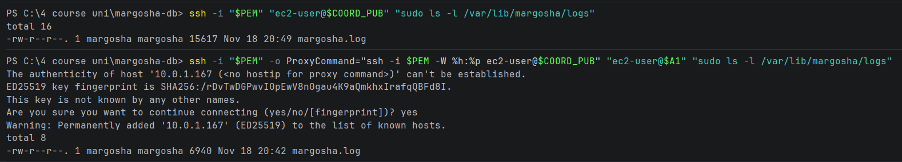
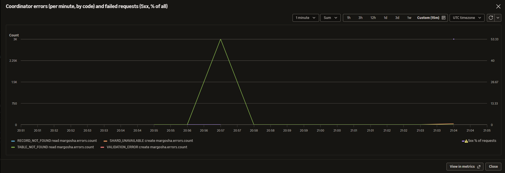
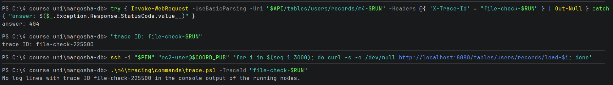
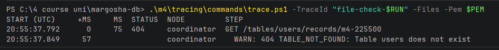

# Logs kept in a file: a trace the console has lost

**What is checked:** every node writes its JSON log lines also to `/var/lib/margosha/logs/margosha.log`
([ADR 0020](../../adr/0020-log-file.md)). A request is traced, then the coordinator writes thousands of lines. The
console output (about the last 64 KB) has lost the request, but the trace helper still finds it in the files
([ai_critique.md](../ai_critique.md), finding 3).

Checked on 2026-11-18, right after the deploy of the fix. All times are UTC.

Uses the setup from [first_m4_deploy.md](first_m4_deploy.md#0-setup), plus the IP of shard-a-1:

Windows (PowerShell):
```powershell
$A1 = $REPLICAS[0]
```

macOS (Terminal):
```bash
A1=$(echo $REPLICAS | cut -d' ' -f1)
```

## Commands

**1. The log file exists on the coordinator and on a replica.**:

```bash
ssh -i "$PEM" "ec2-user@$COORD_PUB" "sudo ls -l /var/lib/margosha/logs"
ssh -i "$PEM" -o ProxyCommand="ssh -i $PEM -W %h:%p ec2-user@$COORD_PUB" "ec2-user@$A1" "sudo ls -l /var/lib/margosha/logs"
```



Both have `margosha.log`, owned by the `margosha` user: 15,617 bytes on the coordinator, 6,940 bytes on shard-a-1.

**2. Make one request with its own trace ID.**

Windows (PowerShell):
```powershell
$RUN = Get-Date -Format HHmmss
try { Invoke-WebRequest -UseBasicParsing -Uri "$API/tables/users/records/m4-$RUN" -Headers @{ 'X-Trace-Id' = "file-check-$RUN" } | Out-Null } catch { "answer: $($_.Exception.Response.StatusCode.value__)" }
"trace ID: file-check-$RUN"
```

macOS (Terminal):
```bash
RUN=$(date +%H%M%S)
curl -s -o /dev/null -w 'answer: %{http_code}\n' -H "X-Trace-Id: file-check-$RUN" "$API/tables/users/records/m4-$RUN"
echo "trace ID: file-check-$RUN"
```

The trace ID was `file-check-225500`, and the answer was 404. The table `users` didn't exist in this stack, so the
coordinator answered `TABLE_NOT_FOUND` by itself and called no replica. For this check that is enough: the request
still has a log line with its trace ID.

**3. Make the coordinator write about 3 MB of log lines,** with 3,000 reads sent from the coordinator itself:

```bash
ssh -i "$PEM" "ec2-user@$COORD_PUB" 'for i in $(seq 1 3000); do curl -s -o /dev/null http://localhost:8080/tables/users/records/load-$i; done'
```

The dashboard's coordinator error panel shows them: about 3,000 `TABLE_NOT_FOUND` answers in the minute 20:57.



**4. Look for the request in the console output, then in the files.**

Windows (PowerShell):
```powershell
.\m4\tracing\commands\trace.ps1 -TraceId "file-check-$RUN"
.\m4\tracing\commands\trace.ps1 -TraceId "file-check-$RUN" -Files -Pem $PEM
```

macOS (Terminal):
```bash
./m4/tracing/commands/trace.sh "file-check-$RUN"
./m4/tracing/commands/trace.sh "file-check-$RUN" --files "$PEM"
```

The console output no longer has it:



The log files still have it: the coordinator's `GET` at 20:55:37.792 (404, 75 ms) and its warning line.



## Result

- **Every node writes the log file** in its data folder.
- **The file keeps what the console loses:** after about 3 MB of new lines, the console helper didn't find the
  request anymore, the file helper did.
- **The helper had a bug on AWS, and it is fixed:** the search must run in a root shell.