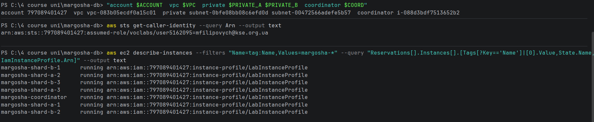
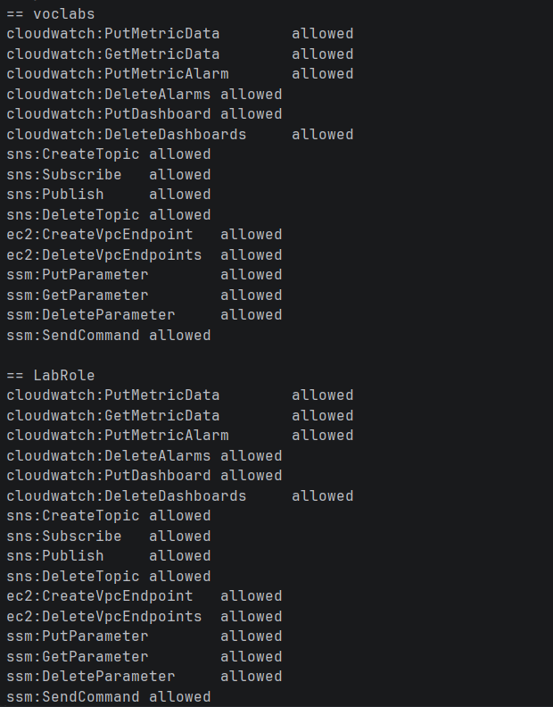
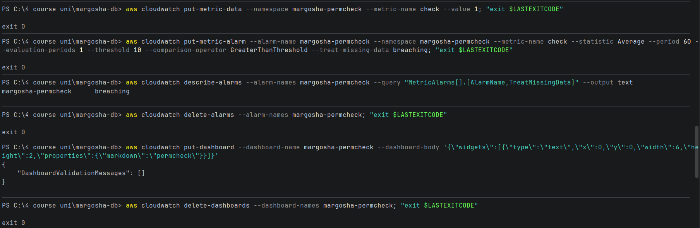
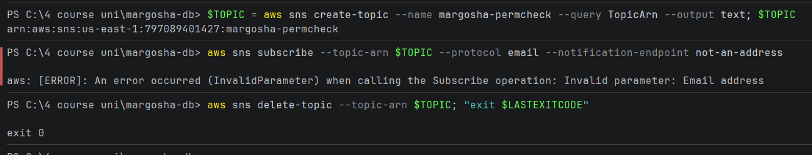
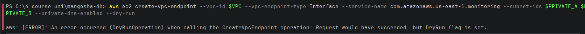
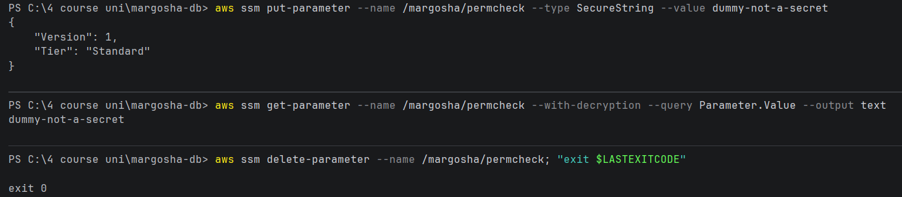
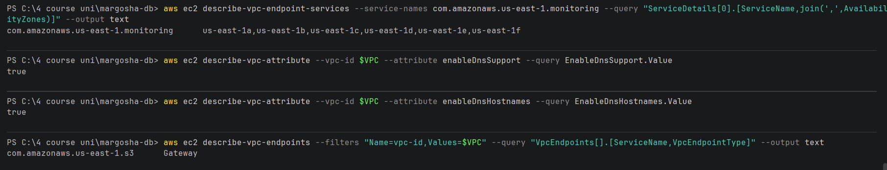
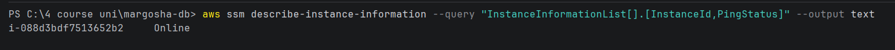
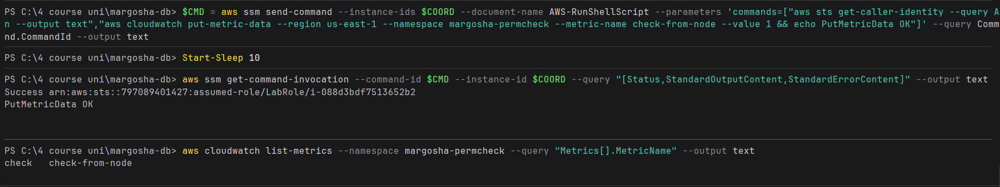

# What the monitoring options need from the lab roles

Checked on 2026-11-03. Used for ADR 0013 (monitoring stack).

Two roles:
- **`voclabs`**: my lab user. My CLI and the pipeline use it. It creates the dashboard, alarms and other resources.
- **`LabRole`**: the nodes' role. A node uses it to send metrics or read a secret.

**`exit 0`** means the command worked. A refused command shows an `AccessDenied` error and a number other than 0.

## 0. Setup

Windows (PowerShell):
```powershell
cd ~\margosha-db                      # wherever the repo is cloned
aws configure set region us-east-1
$ACCOUNT   = aws sts get-caller-identity --query Account --output text
$VPC       = aws cloudformation describe-stacks --stack-name margosha-vpc --query "Stacks[0].Outputs[?OutputKey=='VpcId'].OutputValue" --output text
$PRIVATE_A = aws cloudformation describe-stacks --stack-name margosha-vpc --query "Stacks[0].Outputs[?OutputKey=='PrivateSubnetAId'].OutputValue" --output text
$PRIVATE_B = aws cloudformation describe-stacks --stack-name margosha-vpc --query "Stacks[0].Outputs[?OutputKey=='PrivateSubnetBId'].OutputValue" --output text
$COORD     = aws ec2 describe-instances --filters "Name=tag:Name,Values=margosha-coordinator" "Name=instance-state-name,Values=running" --query "Reservations[0].Instances[0].InstanceId" --output text
"account $ACCOUNT  vpc $VPC  private $PRIVATE_A $PRIVATE_B  coordinator $COORD"
```

macOS (Terminal):
```bash
cd ~/margosha-db                      # wherever the repo is cloned
aws configure set region us-east-1
ACCOUNT=$(aws sts get-caller-identity --query Account --output text)
VPC=$(aws cloudformation describe-stacks --stack-name margosha-vpc --query "Stacks[0].Outputs[?OutputKey=='VpcId'].OutputValue" --output text)
PRIVATE_A=$(aws cloudformation describe-stacks --stack-name margosha-vpc --query "Stacks[0].Outputs[?OutputKey=='PrivateSubnetAId'].OutputValue" --output text)
PRIVATE_B=$(aws cloudformation describe-stacks --stack-name margosha-vpc --query "Stacks[0].Outputs[?OutputKey=='PrivateSubnetBId'].OutputValue" --output text)
COORD=$(aws ec2 describe-instances --filters "Name=tag:Name,Values=margosha-coordinator" "Name=instance-state-name,Values=running" --query "Reservations[0].Instances[0].InstanceId" --output text)
echo "account $ACCOUNT  vpc $VPC  private $PRIVATE_A $PRIVATE_B  coordinator $COORD"
```

## 1. Which role is used where

```bash
aws sts get-caller-identity --query Arn --output text
aws ec2 describe-instances --filters "Name=tag:Name,Values=margosha-*" --query "Reservations[].Instances[].[Tags[?Key=='Name']|[0].Value,State.Name,IamInstanceProfile.Arn]" --output text
```



My CLI is `voclabs`. All 7 nodes are `LabRole`.

## 2. Policy simulator, both roles

As in M1 ([role_dissection.md](../../m1/role_dissection.md)). Saves the full answer as JSON and prints a short
table. Run from the repo folder.

Windows (PowerShell):
```powershell
$ACTIONS = "cloudwatch:PutMetricData","cloudwatch:GetMetricData","cloudwatch:PutMetricAlarm","cloudwatch:DeleteAlarms",
  "cloudwatch:PutDashboard","cloudwatch:DeleteDashboards","sns:CreateTopic","sns:Subscribe","sns:Publish","sns:DeleteTopic",
  "ec2:CreateVpcEndpoint","ec2:DeleteVpcEndpoints","ssm:PutParameter","ssm:GetParameter","ssm:DeleteParameter","ssm:SendCommand"
foreach ($ROLE in "voclabs","LabRole") {
  aws iam simulate-principal-policy --policy-source-arn "arn:aws:iam::${ACCOUNT}:role/$ROLE" --action-names $ACTIONS --output json | Out-File -Encoding utf8 "m4\aws_checks\command_outputs\$ROLE-policy-simulator.json"
  "== $ROLE"
  aws iam simulate-principal-policy --policy-source-arn "arn:aws:iam::${ACCOUNT}:role/$ROLE" --action-names $ACTIONS --query "EvaluationResults[].[EvalActionName,EvalDecision]" --output text
}
```

macOS (Terminal):
```bash
ACTIONS="cloudwatch:PutMetricData cloudwatch:GetMetricData cloudwatch:PutMetricAlarm cloudwatch:DeleteAlarms
  cloudwatch:PutDashboard cloudwatch:DeleteDashboards sns:CreateTopic sns:Subscribe sns:Publish sns:DeleteTopic
  ec2:CreateVpcEndpoint ec2:DeleteVpcEndpoints ssm:PutParameter ssm:GetParameter ssm:DeleteParameter ssm:SendCommand"
for ROLE in voclabs LabRole; do
  aws iam simulate-principal-policy --policy-source-arn "arn:aws:iam::$ACCOUNT:role/$ROLE" --action-names $ACTIONS --output json > "m4/aws_checks/command_outputs/$ROLE-policy-simulator.json"
  echo "== $ROLE"
  aws iam simulate-principal-policy --policy-source-arn "arn:aws:iam::$ACCOUNT:role/$ROLE" --action-names $ACTIONS --query "EvaluationResults[].[EvalActionName,EvalDecision]" --output text
done
```



All 16 are `allowed` for both roles. Full answers:
[voclabs-policy-simulator.json](command_outputs/voclabs-policy-simulator.json),
[LabRole-policy-simulator.json](command_outputs/LabRole-policy-simulator.json).

The simulator can miss limits set for the whole lab, so I also tried each action for real.

## 3. Real calls as `voclabs`

Each test resource is called `margosha-permcheck` and deleted right away.

Two commands fail on purpose. The error shows the action is allowed:
- `sns subscribe` gets a fake e-mail address, so no e-mail is sent. `InvalidParameter` = only the address was wrong.
- `create-vpc-endpoint` is a dry run, so nothing is created. `DryRunOperation` = it would have worked.

If the action were not allowed, both would say "not authorized" instead.

Windows (PowerShell):
```powershell
# CloudWatch: metric, alarm, dashboard
aws cloudwatch put-metric-data --namespace margosha-permcheck --metric-name check --value 1; "exit $LASTEXITCODE"
aws cloudwatch put-metric-alarm --alarm-name margosha-permcheck --namespace margosha-permcheck --metric-name check --statistic Average --period 60 --evaluation-periods 1 --threshold 10 --comparison-operator GreaterThanThreshold --treat-missing-data breaching; "exit $LASTEXITCODE"
aws cloudwatch describe-alarms --alarm-names margosha-permcheck --query "MetricAlarms[].[AlarmName,TreatMissingData]" --output text
aws cloudwatch delete-alarms --alarm-names margosha-permcheck; "exit $LASTEXITCODE"
aws cloudwatch put-dashboard --dashboard-name margosha-permcheck --dashboard-body '{\"widgets\":[{\"type\":\"text\",\"x\":0,\"y\":0,\"width\":6,\"height\":2,\"properties\":{\"markdown\":\"permcheck\"}}]}'
aws cloudwatch delete-dashboards --dashboard-names margosha-permcheck; "exit $LASTEXITCODE"

# SNS: topic, subscription (invalid address on purpose), delete
$TOPIC = aws sns create-topic --name margosha-permcheck --query TopicArn --output text; $TOPIC
aws sns subscribe --topic-arn $TOPIC --protocol email --notification-endpoint not-an-address
aws sns delete-topic --topic-arn $TOPIC; "exit $LASTEXITCODE"

# CloudWatch endpoint in the private subnets (dry run)
aws ec2 create-vpc-endpoint --vpc-id $VPC --vpc-endpoint-type Interface --service-name com.amazonaws.us-east-1.monitoring --subnet-ids $PRIVATE_A $PRIVATE_B --private-dns-enabled --dry-run

# SSM: encrypted parameter, read back, delete
aws ssm put-parameter --name /margosha/permcheck --type SecureString --value dummy-not-a-secret
aws ssm get-parameter --name /margosha/permcheck --with-decryption --query Parameter.Value --output text
aws ssm delete-parameter --name /margosha/permcheck; "exit $LASTEXITCODE"
```

macOS (Terminal):
```bash
# CloudWatch: metric, alarm, dashboard
aws cloudwatch put-metric-data --namespace margosha-permcheck --metric-name check --value 1; echo "exit $?"
aws cloudwatch put-metric-alarm --alarm-name margosha-permcheck --namespace margosha-permcheck --metric-name check --statistic Average --period 60 --evaluation-periods 1 --threshold 10 --comparison-operator GreaterThanThreshold --treat-missing-data breaching; echo "exit $?"
aws cloudwatch describe-alarms --alarm-names margosha-permcheck --query "MetricAlarms[].[AlarmName,TreatMissingData]" --output text
aws cloudwatch delete-alarms --alarm-names margosha-permcheck; echo "exit $?"
aws cloudwatch put-dashboard --dashboard-name margosha-permcheck --dashboard-body '{"widgets":[{"type":"text","x":0,"y":0,"width":6,"height":2,"properties":{"markdown":"permcheck"}}]}'
aws cloudwatch delete-dashboards --dashboard-names margosha-permcheck; echo "exit $?"

# SNS: topic, subscription (invalid address on purpose), delete
TOPIC=$(aws sns create-topic --name margosha-permcheck --query TopicArn --output text); echo "$TOPIC"
aws sns subscribe --topic-arn "$TOPIC" --protocol email --notification-endpoint not-an-address
aws sns delete-topic --topic-arn "$TOPIC"; echo "exit $?"

# CloudWatch endpoint in the private subnets (dry run)
aws ec2 create-vpc-endpoint --vpc-id "$VPC" --vpc-endpoint-type Interface --service-name com.amazonaws.us-east-1.monitoring --subnet-ids "$PRIVATE_A" "$PRIVATE_B" --private-dns-enabled --dry-run

# SSM: encrypted parameter, read back, delete
aws ssm put-parameter --name /margosha/permcheck --type SecureString --value dummy-not-a-secret
aws ssm get-parameter --name /margosha/permcheck --with-decryption --query Parameter.Value --output text
aws ssm delete-parameter --name /margosha/permcheck; echo "exit $?"
```

**CloudWatch.** All `exit 0`. The alarm treats missing data as a problem, which a node-down alarm needs. The
dashboard has no errors:



**SNS.** Topic created, subscription fails only on the address, topic deleted:



**VPC endpoint.** It would have worked:



**SSM parameter.** An encrypted value is saved, read back and deleted:



The endpoint also needs CloudWatch in the VPC's zones and DNS turned on:

Windows (PowerShell):
```powershell
aws ec2 describe-vpc-endpoint-services --service-names com.amazonaws.us-east-1.monitoring --query "ServiceDetails[0].[ServiceName,join(',',AvailabilityZones)]" --output text
aws ec2 describe-vpc-attribute --vpc-id $VPC --attribute enableDnsSupport --query EnableDnsSupport.Value
aws ec2 describe-vpc-attribute --vpc-id $VPC --attribute enableDnsHostnames --query EnableDnsHostnames.Value
aws ec2 describe-vpc-endpoints --filters "Name=vpc-id,Values=$VPC" --query "VpcEndpoints[].[ServiceName,VpcEndpointType]" --output text
```

macOS (Terminal):
```bash
aws ec2 describe-vpc-endpoint-services --service-names com.amazonaws.us-east-1.monitoring --query "ServiceDetails[0].[ServiceName,join(',',AvailabilityZones)]" --output text
aws ec2 describe-vpc-attribute --vpc-id "$VPC" --attribute enableDnsSupport --query EnableDnsSupport.Value
aws ec2 describe-vpc-attribute --vpc-id "$VPC" --attribute enableDnsHostnames --query EnableDnsHostnames.Value
aws ec2 describe-vpc-endpoints --filters "Name=vpc-id,Values=$VPC" --query "VpcEndpoints[].[ServiceName,VpcEndpointType]" --output text
```



Both are fine. The only endpoint today is S3 (from M2).

## 4. Real call as `LabRole`, from a node

Which nodes SSM can reach (same on Windows and macOS):
```bash
aws ssm describe-instance-information --query "InstanceInformationList[].[InstanceId,PingStatus]" --output text
```



Only the coordinator. The replicas have no internet, so SSM can't reach them.

Run two commands on the coordinator (no SSH): show its role, then send a metric:

Windows (PowerShell):
```powershell
$CMD = aws ssm send-command --instance-ids $COORD --document-name AWS-RunShellScript --parameters 'commands=["aws sts get-caller-identity --query Arn --output text","aws cloudwatch put-metric-data --region us-east-1 --namespace margosha-permcheck --metric-name check-from-node --value 1 && echo PutMetricData OK"]' --query Command.CommandId --output text
Start-Sleep 10
aws ssm get-command-invocation --command-id $CMD --instance-id $COORD --query "[Status,StandardOutputContent,StandardErrorContent]" --output text
aws cloudwatch list-metrics --namespace margosha-permcheck --query "Metrics[].MetricName" --output text
```

macOS (Terminal):
```bash
CMD=$(aws ssm send-command --instance-ids "$COORD" --document-name AWS-RunShellScript \
  --parameters 'commands=["aws sts get-caller-identity --query Arn --output text","aws cloudwatch put-metric-data --region us-east-1 --namespace margosha-permcheck --metric-name check-from-node --value 1 && echo PutMetricData OK"]' \
  --query Command.CommandId --output text)
sleep 10
aws ssm get-command-invocation --command-id "$CMD" --instance-id "$COORD" --query "[Status,StandardOutputContent,StandardErrorContent]" --output text
aws cloudwatch list-metrics --namespace margosha-permcheck --query "Metrics[].MetricName" --output text
```

If it says `InProgress`, run `get-command-invocation` again.



`LabRole` can send metrics. Both test metrics arrived: `check` (from my laptop) and `check-from-node` (from the
coordinator). They can't be deleted; they vanish after two weeks and cost almost nothing.

The replicas were not tested: they can't reach CloudWatch without an endpoint. They have the same `LabRole`.

## 5. Result per option (design.md, "ADR 0013")

| Option | What it needs from AWS | Result |
|---|---|---|
| **CloudWatch** | Dashboard, alarms, SNS e-mail, VPC endpoint; nodes send metrics | **Allowed.** Replicas need the endpoint, or the coordinator sends their metrics. Confirm the e-mail once |
| **Prometheus + Grafana on the coordinator** | Install on the coordinator; it reaches replicas on port 8080 (already open) | **Allowed.** Limits: 1 GiB memory; changing the boot script replaces all nodes |
| **Prometheus → Grafana Cloud** | Install as above; API token in SSM; coordinator has internet | **Allowed** in AWS. Grafana account not checked |
| **Datadog on the coordinator** | Install as above; API key in SSM; coordinator has internet | **Allowed** in AWS. Datadog account not checked |

Nothing is refused for either role.

Not covered:
- I used the CLI, not CloudFormation. Both use `voclabs`; the first deploy will confirm.
- `LabRole` reading an SSM parameter was only simulated, not tried.
