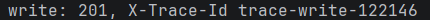
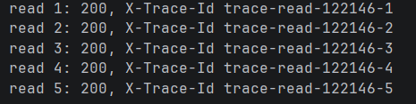
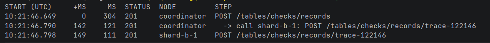
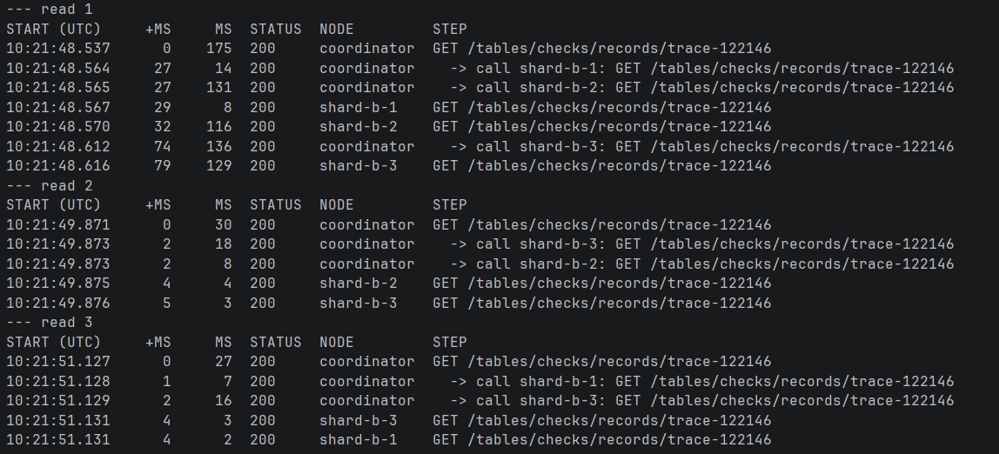
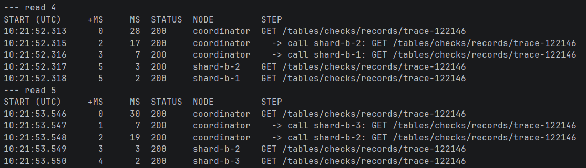

# Following a request by its trace ID

**What is checked:** one write and a few reads are sent, each with a trace ID that the client picks. Every answer
comes back with that ID. The [tracing helper](tracing.md#the-timeline-command) then finds the lines with this ID on
the coordinator and on the replicas it called, and prints them as one timeline with durations.

The 5 reads also help with a question left open by the [high-latency check](../checks/high_latency.md): a read took about 20 ms
on the coordinator, but only about 0.1 ms on the replicas. The timeline shows where the rest of the time goes.

Checked on 2026-11-15. All times are UTC.

Uses the setup from [first_m4_deploy.md](../checks/first_m4_deploy.md#0-setup).

## What should happen

From [tracing.md](tracing.md):

- **Write** (W = 2): the coordinator's request, its call to the shard's leader, and the leader's own work. The
  followers copy the write from the leader's log, so they don't show up in the trace.
- **Read** (R = 2): the coordinator's request, its calls to 2 replicas at the same time, and each replica's own work.
- **Durations fit inside each other:** a call takes at least as long as the replica's work, and the coordinator's
  request takes at least as long as its calls.

## Commands

**1. Make sure the table exists, then write one record and read it 5 times, one second apart.** Each request sends its
own trace ID. Each line prints the status and the trace ID that came back. If the table is already there, the answer
is 409, which is fine.

Windows (PowerShell):
```powershell
try { Invoke-RestMethod -Method Post -Uri "$API/tables" -ContentType 'application/json' -Body '{"name":"checks","partitionKey":"id"}' } catch { $_.ErrorDetails.Message }
$RUN = Get-Date -Format HHmmss
$r = Invoke-WebRequest -UseBasicParsing -Method Post -Uri "$API/tables/checks/records" -ContentType 'application/json' -Headers @{ 'X-Trace-Id' = "trace-write-$RUN" } -Body ('{"id":"trace-' + $RUN + '","note":"check traces"}')
"write: $($r.StatusCode), X-Trace-Id $($r.Headers['X-Trace-Id'])"
1..5 | ForEach-Object {
  $r = Invoke-WebRequest -UseBasicParsing -Uri "$API/tables/checks/records/trace-$RUN" -Headers @{ 'X-Trace-Id' = "trace-read-$RUN-$_" }
  "read ${_}: $($r.StatusCode), X-Trace-Id $($r.Headers['X-Trace-Id'])"
  Start-Sleep 1
}
```

macOS (Terminal):
```bash
curl -s -X POST "$API/tables" -H 'Content-Type: application/json' -d '{"name":"checks","partitionKey":"id"}'; echo
RUN=$(date +%H%M%S)
echo "write: $(curl -s -o /dev/null -D - -X POST "$API/tables/checks/records" -H 'Content-Type: application/json' -H "X-Trace-Id: trace-write-$RUN" -d "{\"id\":\"trace-$RUN\",\"note\":\"check traces\"}" | grep -i -e '^HTTP' -e '^x-trace-id' | tr -d '\r' | tr '\n' ' ')"
for i in 1 2 3 4 5; do
  echo "read $i: $(curl -s -o /dev/null -D - "$API/tables/checks/records/trace-$RUN" -H "X-Trace-Id: trace-read-$RUN-$i" | grep -i -e '^HTTP' -e '^x-trace-id' | tr -d '\r' | tr '\n' ' ')"
  sleep 1
done
```





The write got `201` and the 5 reads got `200`. Each answer came back with the trace ID that was sent.

`trace-122146` is the record's ID, which is part of the URL (`/tables/checks/records/trace-122146`). That is why it
shows up in every line of the timelines below. The trace IDs (`trace-write-122146`, `trace-read-122146-1` …) are only
in the `X-Trace-Id` header, and the helper uses them to pick the lines of one request.

**2. Print the write's timeline.** If a request you just sent is missing, wait a few seconds and run it again: a
node's console output can be a little behind its log.

Windows (PowerShell):
```powershell
.\m4\tracing\trace.ps1 -TraceId "trace-write-$RUN"
```

macOS (Terminal):
```bash
./m4/tracing/trace.sh "trace-write-$RUN"
```



The write took 304 ms on the coordinator. 142 ms of that passed before it called the leader shard-b-1, because this was
the first request after a quiet period (the coordinator had to look up the table and the shard). The call took 121 ms.
The leader's own work took 111 ms, which includes waiting for a follower to confirm the write (W = 2).

The write went to shard-b-1, shard B's leader, so the record `trace-122146` is on shard B.

**The helper was fixed during this check.** At first it printed "No log lines with trace ID …", even minutes later.
The reason: on the serial console, systemd puts a prefix in front of every log line
(`[ 8805.154271] margosha-run[1966]: {"@timestamp":…`). The helper only read lines that start with `{`, so it skipped
every line from AWS. It had only been tried on saved logs, which don't have this prefix. Now `trace.ps1` and
`trace.sh` cut each line at its first `{"`. The output in this section comes from the fixed `trace.ps1`.

**3. Print the timelines of the 5 reads:**

Windows (PowerShell):
```powershell
1..5 | ForEach-Object { "--- read $_"; .\m4\tracing\trace.ps1 -TraceId "trace-read-$RUN-$_" }
```

macOS (Terminal):
```bash
for i in 1 2 3 4 5; do echo "--- read $i"; ./m4/tracing/trace.sh "trace-read-$RUN-$i"; done
```





Every read asked 2 replicas of shard B at the same time, and every replica it asked logged the same trace ID. The
durations fit inside each other: each call took longer than the replica's own work, and each coordinator request took
longer than its calls. In read 1, shard-b-2 still hadn't answered after about 47 ms, so the coordinator also asked
shard-b-3. That is the 50 ms "hedge" of quorum reads ([replication.md](../../m3/replication.md)).

## Where a read's time goes

The table splits each read into parts, as seen on the coordinator. "Before" is the time from the start of the request
to the first call. For each call, the table shows how long it took and, in brackets, how long the replica's own work
took. "After" is the time from the second answer to the end of the request.

| Read | Coordinator | Before | Faster call | Slower call | After |
|---|---|---|---|---|---|
| 1 | 175 ms | 27 ms | 14 ms (8 ms) | 131 ms (116 ms) | 16 ms |
| 2 | 30 ms | 2 ms | 8 ms (4 ms) | 18 ms (3 ms) | 10 ms |
| 3 | 27 ms | 1 ms | 7 ms (2 ms) | 16 ms (3 ms) | 9 ms |
| 4 | 28 ms | 2 ms | 7 ms (2 ms) | 17 ms (3 ms) | 9 ms |
| 5 | 30 ms | 1 ms | 7 ms (2 ms) | 19 ms (3 ms) | 9 ms |

Reads 2–5 show a normal read. Each took 27–30 ms on the coordinator:

- **The replicas do very little:** 2–4 ms each, and that includes handling the HTTP request.
- **The calls take longer than the replicas' work.** The faster of the 2 calls took 7–8 ms and the slower one
  16–19 ms, even though both replicas needed the same 2–3 ms. So one call always waited about 10 ms longer than the
  other.
- **After the second answer came in, the coordinator needed another 9–10 ms** to finish the request.

Read 1 was the first read after a quiet period. shard-b-2 needed 116 ms for its own work and shard-b-3 129 ms, and the
coordinator spent 27 ms before it made the calls. A few reads like this in one minute are enough to push p99 above
50 ms.

This explains what the [high-latency check](../checks/high_latency.md) saw: when the store is quiet, a normal read takes about
28 ms on the coordinator, and the first read after a quiet period can take more than 100 ms. The trace doesn't show why
the second call and the end of the request each take about 10 ms. A call is timed until the replica's answer arrives,
so reading and comparing the answers may be part of the 9–10 ms after the calls. Finding the real cause would be
performance work, which is not part of this check.

## Result

- **The trace ID follows the request across nodes:** every answer came back with the ID that was sent. The write was
  found on the coordinator and on the leader, and each read on the coordinator and on every replica it asked.
- **The timeline shows the order of the steps and how long each took,** and the durations fit inside each other, as
  [tracing.md](tracing.md) says.
- **The helper had a bug on AWS, and it is fixed:** it now also reads console lines that have systemd's prefix.
- **Most of a read's time is spent outside the replicas:** about 28 ms on the coordinator, for only 2–4 ms of work on
  the replicas. Together with the high-latency check, this led to raising the read limit from 50 ms to 100 ms
  ([ADR 0018](../../adr/0018-read-latency-limit.md)).
